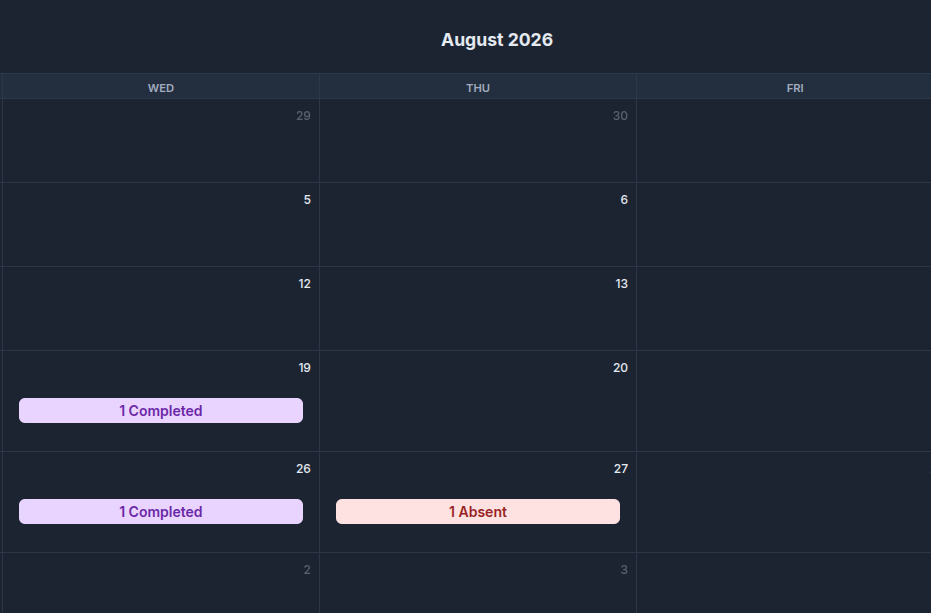
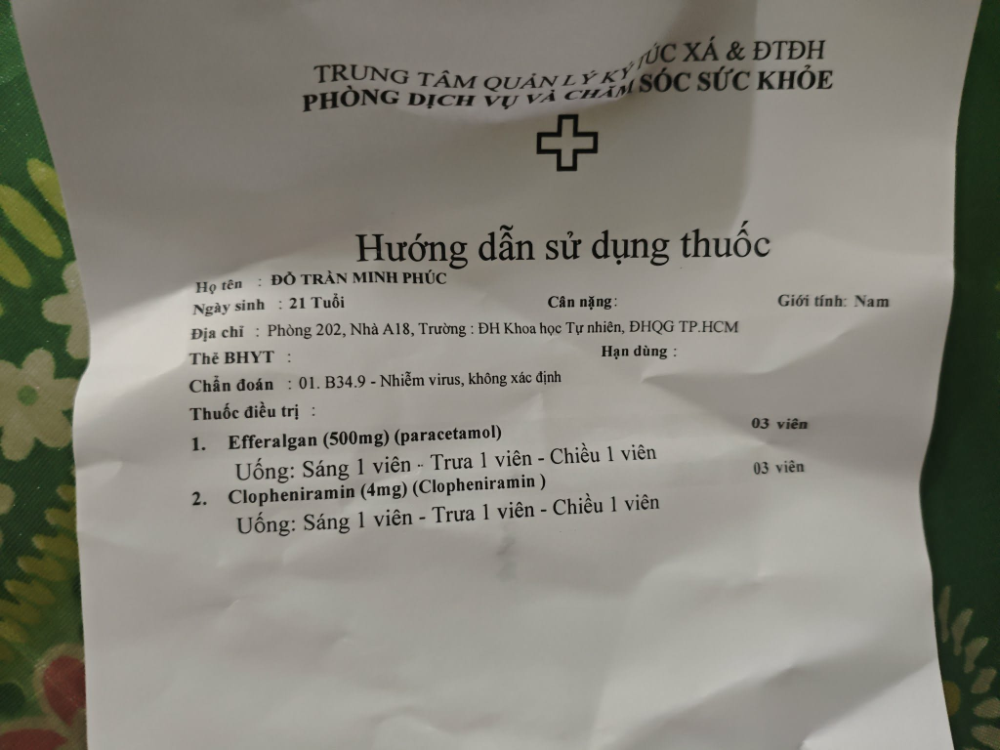

# Week 2: S3 Storage Design, IAM Least-Privilege & SAM Baseline
*Internship Period: 24/08/2026 – 28/08/2026*

### 1. Week 2 Objectives:
* Design object storage topology on Amazon S3 featuring Block Public Access and default SSE-S3 encryption.
* Architect a prefix-separation model to eliminate the risk of recursive invocation loops.
* Define IAM Execution Roles for Lambda functions following least-privilege principles.
* Initialize infrastructure template (infra/template.yaml) using AWS SAM and request foundation model access on Amazon Bedrock.

### 2. Daily Tasks & Schedule:
| Day | Detailed Tasks | Start Date | Completion Date | Reference Documentation |
|:---:|---|:---:|:---:|---|
| **Mon** | - Designed S3 bucket agentsys-mediabucket. - Enforced Block All Public Access and default Server-Side Encryption (SSE-S3 AES-256). | 24/08/2026 | 24/08/2026 | [Amazon S3 User Guide](https://docs.aws.amazon.com/AmazonS3/latest/userguide/) |
| **Tue** | - Defined S3 prefix partitions: uploads/ (incoming files) and transcripts/ (ASR outputs). - Configured S3 Event Notification prefix filters to prevent recursive trigger loops. | 25/08/2026 | 25/08/2026 | [S3 Event Notifications](https://docs.aws.amazon.com/AmazonS3/latest/userguide/EventNotifications.html) |
| **Wed** | - Authored IAM Execution Roles in SAM template. - Decoupled permissions between background ingestion worker (agentsys-ingest-role) and query API (agentsys-api-role). | 26/08/2026 | 26/08/2026 | [AWS IAM Best Practices](https://docs.aws.amazon.com/IAM/latest/UserGuide/best-practices.html) |
| **Thu** | - **Attendance Record:** Excused medical absence at dorm due to viral fever and acute abdominal pain (diagnosed as ICD-10 B34.9). - Self-studied AWS SAM technical documentation and drafted infra/template.yaml remotely from dorm room. | 27/08/2026 | 27/08/2026 | [AWS SAM Specification](https://docs.aws.amazon.com/serverless-application-model/latest/developerguide/sam-specification.html) |
| **Fri** | - Requested Foundation Model Access on AWS Bedrock Console for Titan Text Embeddings V2 and Nova Lite. - Reviewed technical guides in preparation for AI integration. | 28/08/2026 | 28/08/2026 | [Amazon Bedrock User Guide](https://docs.aws.amazon.com/bedrock/latest/userguide/) |

### 3. Week 2 Achievements:
* Established S3 bucket baseline with 100% Block Public Access and SSE-S3 AES-256 encryption.
* Enforced prefix-filtering on uploads/, guaranteeing zero risk of recursive invocation cascades when writing transcripts back to storage.
* Successfully segregated execution permissions between ingestion and query layers under least-privilege standards.
* SAM template validated cleanly with 0 syntax or linting errors via sam validate --lint.
* Foundation model access granted on Amazon Bedrock for both embedding generation and query planning models.

### 4. Attendance Record & Medical Excuse Documentation (27/08/2026):

* **Absence Context:** On the morning of 27/08/2026, the student developed a sudden high fever and persistent abdominal pain, preventing on-site work at the Bitexco office. The student visited the **Health Care & Medical Services Clinic — VNU-HCM Dormitory** (diagnosed with ICD-10 B34.9 viral infection) and was prescribed rest.
* **Portal Attendance:** Due to the sudden illness, the student was unable to cancel the office slot booking prior to the cutoff window, resulting in an automated **`1 Absent`** record on the FCAJ Portal. Supporting documentation is attached below:

*Figure: FCAJ Portal attendance record for 27/08/2026.*

*Figure: Medical prescription issued by VNU-HCM Dormitory Health Clinic.*

### 5. References:
* [Amazon S3 Security Best Practices](https://docs.aws.amazon.com/AmazonS3/latest/userguide/security-best-practices.html)
* [AWS Lambda Execution Role](https://docs.aws.amazon.com/lambda/latest/dg/lambda-intro-execution-role.html)
* [Amazon Bedrock Model Access Documentation](https://docs.aws.amazon.com/bedrock/latest/userguide/model-access.html)
