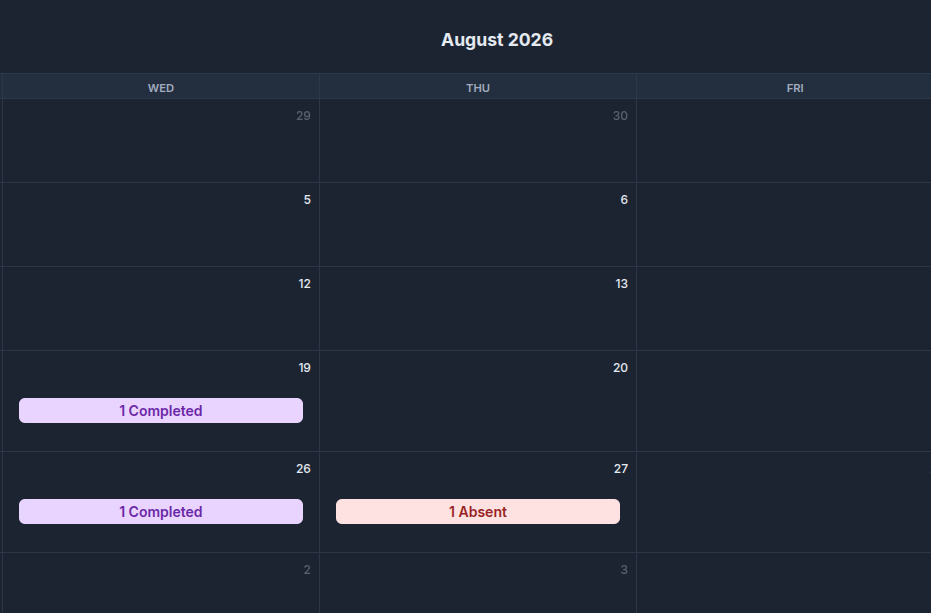
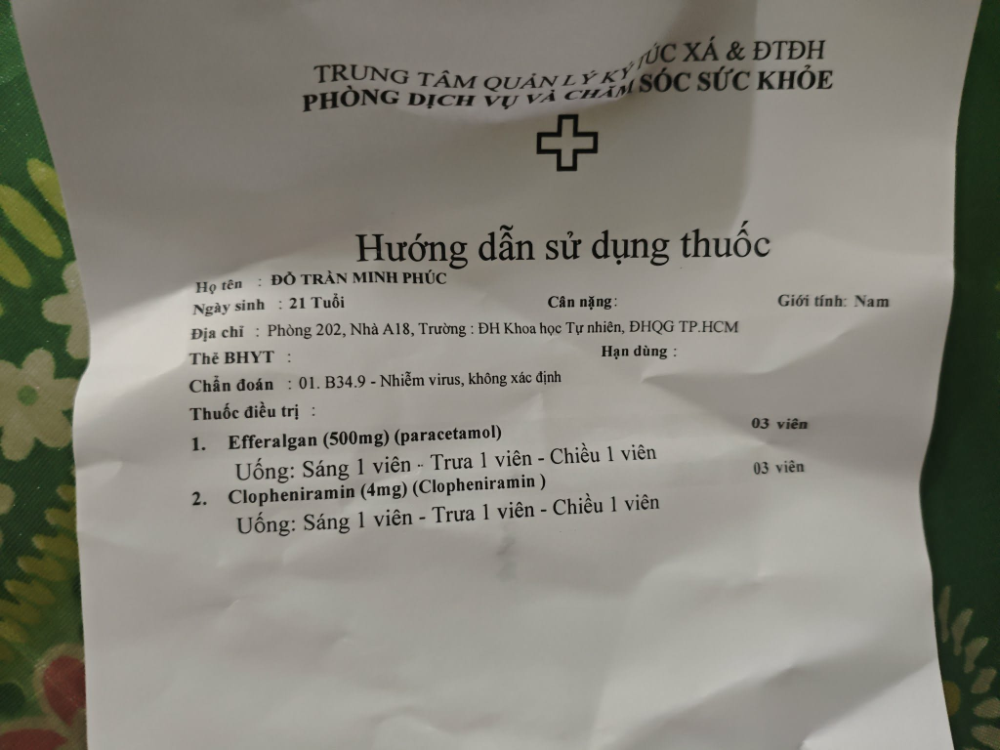

# Tuần 2: Thiết Kế S3 Storage, Phân Quyền IAM & Khởi Tạo SAM
*Thời gian thực hiện: 24/08/2026 – 28/08/2026*

### 1. Mục tiêu tuần 2:
* Thiết kế cấu trúc lưu trữ đối tượng trên Amazon S3 với chính sách Block Public Access và mã hóa SSE-S3.
* Xây dựng nguyên tắc phân tách tiền tố (prefix) lưu trữ để loại trừ nguy cơ vòng lặp kích hoạt đệ quy.
* Định nghĩa các IAM Execution Roles cho hàm Lambda theo nguyên tắc đặc quyền tối thiểu (Least Privilege).
* Khởi tạo file cấu hình hạ tầng infra/template.yaml bằng AWS SAM và kích hoạt quyền truy cập mô hình trên Amazon Bedrock Console.

### 2. Các công việc triển khai trong tuần:
| Thứ | Công việc cụ thể | Ngày bắt đầu | Ngày hoàn thành | Tài liệu tham khảo |
|:---:|---|:---:|:---:|---|
| **2** | - Thiết kế cấu trúc S3 bucket agentsys-mediabucket. - Bật tính năng Block All Public Access và thiết lập mã hóa mặc định Server-Side Encryption (SSE-S3 AES-256). | 24/08/2026 | 24/08/2026 | [Amazon S3 User Guide](https://docs.aws.amazon.com/AmazonS3/latest/userguide/) |
| **3** | - Phân tách cấu trúc tiền tố S3: uploads/ (nhận tệp) và transcripts/ (kết quả bóc băng). - Cấu hình S3 Event Notification với bộ lọc prefix để phòng chống trigger loop đệ quy. | 25/08/2026 | 25/08/2026 | [S3 Event Notifications](https://docs.aws.amazon.com/AmazonS3/latest/userguide/EventNotifications.html) |
| **4** | - Định nghĩa IAM Execution Roles trong SAM template. - Phân tách quyền hạn độc lập giữa worker xử lý nền (agentsys-ingest-role) và API truy vấn (agentsys-api-role). | 26/08/2026 | 26/08/2026 | [AWS IAM Best Practices](https://docs.aws.amazon.com/IAM/latest/UserGuide/best-practices.html) |
| **5** | - **Ghi nhận chuyên cần:** Nghỉ ốm bất khả kháng tại phòng KTX theo chỉ định của Trạm y tế (Nhiễm virus B34.9, phát sốt cao & đau bụng). - Tự nghiên cứu tài liệu kỹ thuật AWS SAM và soạn thảo file infra/template.yaml từ xa tại phòng KTX. | 27/08/2026 | 27/08/2026 | [AWS SAM Specification](https://docs.aws.amazon.com/serverless-application-model/latest/developerguide/sam-specification.html) |
| **6** | - Truy cập Amazon Bedrock Console xin cấp quyền Model Access cho Amazon Titan Text Embeddings V2 và Amazon Nova Lite. - Rà soát tài liệu kỹ thuật chuẩn bị cho giai đoạn tích hợp AI. | 28/08/2026 | 28/08/2026 | [Amazon Bedrock User Guide](https://docs.aws.amazon.com/bedrock/latest/userguide/) |

### 3. Kết quả đạt được tuần 2:
* Hoàn thiện thiết kế bucket S3 với chính sách bảo mật Block Public Access 100% và mã hóa dữ liệu tại chỗ với SSE-S3 AES-256.
* Cơ chế lọc prefix uploads/ hoạt động chuẩn xác, loại trừ hoàn toàn nguy cơ Lambda tự kích hoạt lại chính nó khi ghi file transcript vào bucket.
* Tách biệt thành công 2 IAM Role độc lập theo nguyên tắc Least Privilege: Ingest Role chỉ có quyền đọc uploads/ và gọi Rekognition/Transcribe; API Role chỉ có quyền đọc dữ liệu và gọi Bedrock.
* Template hạ tầng infra/template.yaml vượt qua kiểm tra sam validate --lint với 0 lỗi.
* Kích hoạt thành công Model Access trên Bedrock cho cả mô hình sinh vector và mô hình lập kế hoạch truy vấn.

### 4. Báo cáo Chuyên cần & Minh chứng Nghỉ ốm (Ngày 27/08/2026):

* **Tình huống phát sinh:** Vào chiều tối ngày 26/08/2026, sinh viên bắt đầu phát sốt nhẹ và đến rạng sáng ngày 27/08/2026 thì bị đau bụng dữ dội kèm sốt cao liên tục, không thể di chuyển lên văn phòng làm việc Bitexco. Sinh viên đã đến khám trực tiếp tại **Phòng Dịch vụ và Chăm sóc Sức khỏe — Trung tâm Quản lý Ký túc xá & ĐTĐH (ĐHQG TP.HCM)**.
* **Chẩn đoán y tế:** Bác sĩ chỉ định chẩn đoán mã bệnh **`01. B34.9 - Nhiễm virus, không xác định`**, kê đơn thuốc hạ sốt (Efferalgan 500mg) và chống dị ứng/kháng viêm (Clopheniramin 4mg), yêu cầu nghỉ ngơi theo dõi tại phòng KTX.
* **Tình trạng điểm danh Portal:** Do phát bệnh đột xuất lúc rạng sáng nên sinh viên không kịp thao tác hủy slot booking trước giờ quy định, hệ thống Portal FCAJ tự động ghi nhận trạng thái **`1 Absent`** cho ngày 27/08/2026. Sinh viên chủ động đính kèm đầy đủ hồ sơ bệnh án và lịch Portal bên dưới để chứng minh tính trung thực và lý do y tế bất khả kháng (không phải vắng trái quy định):

*Hình: Lịch điểm danh Portal tháng 8/2026 ghi nhận ngày 27/08/2026 ở trạng thái 1 Absent.*

*Hình: Toa thuốc và phiếu hướng dẫn sử dụng thuốc của Phòng Dịch vụ & Chăm sóc Sức khỏe KTX ĐHQG (Họ tên: Đỗ Trần Minh Phúc - 23120156, Chẩn đoán: B34.9 Nhiễm virus).*

### 5. Tài liệu tham khảo:
* [Amazon S3 Security Best Practices](https://docs.aws.amazon.com/AmazonS3/latest/userguide/security-best-practices.html)
* [AWS Lambda Execution Role](https://docs.aws.amazon.com/lambda/latest/dg/lambda-intro-execution-role.html)
* [Amazon Bedrock Model Access Documentation](https://docs.aws.amazon.com/bedrock/latest/userguide/model-access.html)
