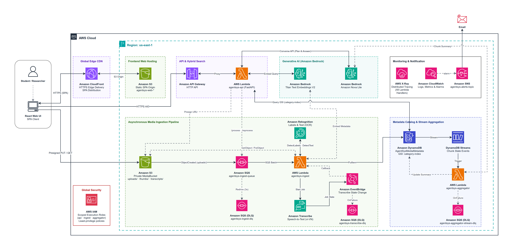

# EduMedia AI — Hệ thống Lưu trữ & Tra cứu Bài giảng Thông minh với AWS Serverless & GenAI

**Sinh viên thực hiện:** Đỗ Trần Minh Phúc · Trường Đại học Khoa học Tự nhiên, ĐHQG-HCM (HCMUS)  
**Thời gian thực tập:** 17/08/2026 – 01/12/2026 · Công ty TNHH Amazon Web Services Vietnam (FCAJ Bootcamp)

---

## 1. Tóm tắt điều hành (Executive Summary)

**EduMedia AI** là nền tảng quản lý và tìm kiếm tư liệu học tập / bài giảng đa phương tiện (Slide hình ảnh, Ghi âm giọng nói, Video) ứng dụng kiến trúc **Serverless** và **Generative AI** hoàn toàn trên hạ tầng **Amazon Web Services (AWS)**.

Hệ thống giải quyết triệt để bài toán tìm kiếm tệp truyền thống dựa trên tên file vô nghĩa bằng cách tự động bóc tách ngữ nghĩa đa giác quan:
* **Amazon CloudFront & Amazon S3 (Web Hosting)**: Phân phối giao diện React SPA qua HTTPS tại biên CDN kết hợp bucket tĩnh `agentsys-web-*`.
* **Amazon S3 (Private Media Storage)**: Lưu trữ đối tượng an toàn với *Block All Public Access*, mã hóa SSE-S3 và Presigned URLs giới hạn thời gian.
* **Amazon SQS & Dead-Letter Queue (DLQ)**: Đệm luồng sự kiện tải lên (`agentsys-ingest-queue`) cùng 3 hàng đợi lỗi DLQ, đảm bảo không nghẽn và không mất dữ liệu (*Zero Data Loss*).
* **AWS Lambda, Amazon Rekognition & Amazon Transcribe**: Điều phối (`agentsys-ingest`, `agentsys-aggregator`) gọi **Amazon Rekognition** (nhận diện nhãn đối tượng và OCR tiếng Việt) và **Amazon Transcribe** (bóc tách giọng nói tiếng Việt *vi-VN* qua EventBridge).
* **Amazon Bedrock (Nova Pro / Nova Lite & Titan Embeddings V2)**: Đóng vai trò AI Query Planner, tổng hợp tóm tắt phân đoạn và Vector Engine 256 chiều chuyển hóa câu hỏi ngôn ngữ tự nhiên thành kết quả xếp hạng lai.
* **Amazon DynamoDB**: Lưu trữ catalog metadata (`AgentSysMediaMetadata`) với chỉ mục phụ toàn cục (**GSI category-index**) và DynamoDB Streams phục vụ Hybrid Search và Map-Reduce tóm tắt bài giảng.
* **Amazon CloudWatch, Amazon SNS & AWS X-Ray**: Giám sát toàn diện với log JSON có cấu trúc, dấu vết phân tán X-Ray và hệ thống **7 CloudWatch Alarms** cảnh báo qua SNS (`agentsys-alerts-topic`).

---

## 2. Bối cảnh & Vấn đề thực tế (Problem Statement)

Trong môi trường học tập và làm việc hiện đại, sinh viên và nghiên cứu sinh tích lũy hàng nghìn tệp đa phương tiện: ảnh chụp bảng viết, ảnh slide thuyết trình, file ghi âm bài giảng dài hàng giờ, video demo dự án.

### Những bất cập lớn của giải pháp hiện tại:
1. **Tìm kiếm theo tên tệp thất bại hoàn toàn**: Các tệp từ điện thoại / máy ảnh thường có tên dạng IMG_20260826_104212.jpg hoặc Voice_001.m4a, không chứa bất kỳ ngữ nghĩa nào về nội dung bên trong.
2. **Chi phí giải pháp đóng gói quá đắt đỏ**: Các phần mềm Quản lý Tài sản Số (Digital Asset Management - DAM) doanh nghiệp yêu cầu máy chủ Dedicated EC2 chạy 24/7, chi phí tối thiểu từ $50 - $200/tháng, không phù hợp cho sinh viên hoặc nhóm nghiên cứu nhỏ.
3. **Thiếu hỗ trợ xử lý Tiếng Việt sâu**: Các công cụ tìm kiếm mã nguồn mở thường gặp khó khăn trong việc nhận diện bảng chữ cái tiếng Việt có dấu, thuật ngữ chuyên ngành Toán học, Kinh tế, Triết học.

---

## 3. Mục tiêu, Tiêu chí Thành công & Phạm vi Dự án

| Mã | Mục tiêu | Tiêu chuẩn đánh giá (Pass Condition) | Dịch vụ AWS phụ trách |
| :--- | :--- | :--- | :--- |
| **G1** | **Ingest API** | Presigned S3 PUT (`TTL 900s`); ảnh hoàn tất xử lý sang `READY` trong `< 5 giây` (Rekognition), âm thanh/video khởi tạo `INDEXING` bất đồng bộ và hoàn tất qua Transcribe + EventBridge. | S3, SQS, Lambda, DynamoDB, EventBridge |
| **G2** | **Computer Vision** | Nhận diện chính xác nhãn đối tượng + Bóc tách OCR tiếng Việt từ ảnh bảng giảng đường. | Amazon Rekognition |
| **G3** | **Speech-to-Text** | Bóc tách toàn bộ lời thoại tiếng Việt (*vi-VN*) từ file ghi âm/video và tổng hợp tóm tắt theo phân đoạn 5–10 phút. | Amazon Transcribe, Lambda Aggregator |
| **G4** | **Hybrid Search** | Câu truy vấn tự nhiên *"tìm đoạn thầy dặn thi cuối kỳ"* định tuyến chính xác đến tệp audio/video liên quan. | Amazon Bedrock, DynamoDB GSI |
| **G5** | **Well-Architected & FinOps** | Mô hình 100% Serverless (Scale-to-Zero), chi phí $0 khi ở trạng thái nghỉ, có **7 CloudWatch Alarms** + SNS, AWS X-Ray và Runbook Cleanup. | CloudWatch, SNS, X-Ray, IAM, SAM CLI |

### Phạm vi triển khai (Project Scope):
* **Trong phạm vi (In-Scope - Giai đoạn PoC):** Xây dựng trọn vẹn pipeline nạp tư liệu đa phương thức bất đồng bộ (ảnh, âm thanh, video), trích xuất ngữ nghĩa AI (Rekognition, Transcribe vi-VN, Titan Text Embeddings V2 256-d, Nova Pro / Nova Lite), tìm kiếm lai kết hợp DynamoDB GSI (`category-index`, Candidate Pool giới hạn 100 bản ghi), giao diện React Web SPA trên CloudFront + S3, bộ 143 unit tests Pytest, giám sát 7 CloudWatch Alarms + X-Ray và IaC AWS SAM hoàn chỉnh.
* **Ngoài phạm vi (Out-of-Scope - Lộ trình nâng cấp tại Mục 5.7):** Streaming nhận dạng giọng nói thời gian thực qua WebSocket, phân quyền đa tổ chức với Amazon Cognito, và cụm tìm kiếm vector chuyên dụng Amazon OpenSearch Serverless / Aurora pgvector cho quy mô trên hàng chục nghìn bản ghi.

---

## 4. Kiến trúc Hệ thống Đề xuất (Proposed Architecture)

### Luồng xử lý dữ liệu End-to-End (Data Pipeline Workflow):
1. **Frontend Edge & Presigned Upload Flow:** Người dùng truy cập React Web UI SPA phân phối qua **Amazon CloudFront CDN** (gắn nguồn tĩnh `agentsys-web-*` trên Amazon S3). Client gửi yêu cầu tới `agentsys-api` (Lambda) qua **Amazon API Gateway HTTP API** (route chuẩn `POST /api/v1/media/upload-url`, hỗ trợ alias `/api/upload-url`) để nhận Presigned PUT URL (`TTL 900s`), sau đó tải thẳng tệp lên bucket riêng tư `s3://MediaBucket/uploads/`.
2. **Asynchronous Ingestion Buffer & 3 DLQs:** S3 phát sự kiện `s3:ObjectCreated:*` (chỉ trên prefix `uploads/`) vào **Amazon SQS (`agentsys-ingest-queue`)** cấu hình `ReceiveMessageWaitTimeSeconds = 10` và `maxReceiveCount = 3` để đẩy gói tin lỗi về **`agentsys-ingest-dlq`** (lưu giữ 14 ngày). Hai DLQ bổ sung (`agentsys-transcribe-dlq` và `agentsys-aggregator-stream-dlq`) bảo vệ luồng EventBridge và DynamoDB Streams.
3. **Multimodal AI Extraction & Stream Aggregation:** `agentsys-ingest` (Lambda, `ScalingConfig: MaximumConcurrency = 5`, `BatchSize = 5`) định tuyến theo loại tệp:
   - Với tệp ảnh: Gọi đồng thời `DetectLabels` và `DetectText` (OCR) của **Amazon Rekognition**, đồng thời sinh thumbnail (`thumbs/`).
   - Với tệp âm thanh/video: Khởi tạo tác vụ tiếng Việt (*vi-VN*) trên **Amazon Transcribe** và nhận sự kiện hoàn tất/lỗi qua **Amazon EventBridge (`Transcribe Job State Change`)**. Bản ghi transcript > **250 KB** được tự động chuyển sang `s3://MediaBucket/transcripts/raw/{file_id}.json` (chỉ giữ bản xem trước 15.000 ký tự trên DynamoDB); các bài giảng dài được tách thành phân đoạn **5–10 phút** kích hoạt **DynamoDB Streams** sang Lambda **`agentsys-aggregator`** để tổng hợp tóm tắt.
4. **Metadata & 256-d Vector Storage:** Nội dung trích xuất được nhúng vector chuẩn hóa L2 **256 chiều** thông qua **Amazon Titan Text Embeddings V2** (`amazon.titan-embed-text-v2:0`) trên **Amazon Bedrock** và lưu vào bảng **Amazon DynamoDB (`AgentSysMediaMetadata`)** chế độ On-Demand (`PAY_PER_REQUEST`).
5. **Intelligent Hybrid Search & Full-Stack Observability:** Khi người dùng gửi truy vấn (`POST /api/v1/media/agent/query`), **Amazon Bedrock (`us.amazon.nova-pro-v1:0` mặc định hoặc `amazon.nova-lite-v1:0`)** phân tích ý định (tái sử dụng kế hoạch truy vấn qua `_PLAN_CACHE` LRU `256` mục, TTL `3600s`), truy vấn **GSI `category-index`** với Candidate Pool tối đa **100 bản ghi**, tính điểm kết hợp Vector Cosine Similarity (**0.6**) và Normalized Keyword Overlap (**0.4**). Toàn bộ 3 Lambda đều bật **AWS X-Ray (`Tracing: Active`)**, ghi CloudWatch Logs (lưu trữ 14 ngày) và bảo vệ bởi **7 CloudWatch Alarms** thông báo qua **Amazon SNS (`agentsys-alerts-topic`)**.

### Căn cứ Lựa chọn Dịch vụ (Service Selection Rationale):

Để hiện thực hóa giải pháp với hiệu năng tối ưu, tính sẵn sàng cao và triệt tiêu chi phí nhàn rỗi (Zero Idle Cost), các dịch vụ AWS được lựa chọn và đối chiếu khắt khe với các phương án thay thế:

| Dịch vụ AWS được chọn | Phương án thay thế cân nhắc | Tiêu chí Chi phí (Cost Optimization) | Tính sẵn sàng cao (High Availability) | Mô hình Serverless / Managed Services |
| :--- | :--- | :--- | :--- | :--- |
| **Amazon S3** *(Standard Storage)* | Amazon EFS / Amazon EBS | **$0.023 / GB / tháng**. Rẻ hơn 13 lần so với EFS ($0.30/GB). Hỗ trợ **Presigned URLs** cho phép client upload/download trực tiếp, tiết kiệm 100% băng thông và compute cho API backend. | Độ bền dữ liệu đạt **99.999999999% (11 số 9)** cùng Tính sẵn sàng (Availability) thiết kế **99.99%** (cam kết SLA 99.9%), tự động nhân bản đồng thời trên tối thiểu 3 Availability Zones (AZs) trong Region. | **Managed Object Storage**, không cần cấp phát trước dung lượng ổ đĩa hay quản lý máy chủ lưu trữ file. |
| **Amazon CloudFront** *(Web SPA CDN)* | EC2 Reverse Proxy (Nginx) / Direct S3 Public | Tặng **1 TB Data Transfer Out & 10 triệu requests/tháng vĩnh viễn (Always Free)** để phân phối giao diện React SPA (`agentsys-web-*`), chi phí nhàn rỗi **$0.00**. | Mạng lưới Edge toàn cầu với HTTPS TLS mặc định và khả năng chịu tải tức thì không cần tự vận hành máy chủ proxy. | **Managed Edge CDN**, tách biệt tầng phân phối Web UI tĩnh khỏi các endpoint API nghiệp vụ. |
| **AWS Lambda** *(Python 3.12 Runtime)* | Amazon ECS *(Fargate / EC2)* | **$0.00 chi phí nhàn rỗi (Zero Idle Cost)**. Chỉ tính tiền trên mili-giây và GB-giây thực tế khi có sự kiện. Miễn phí 1 triệu requests/tháng qua AWS Free Tier. So với ECS Fargate phải trả phí duy trì task liên tục kể cả khi không có lưu lượng (~$15 - $30/tháng). | Mặc định triển khai đa AZ trong Region; tự động scale từ 0 lên hàng nghìn concurrent executions tức thì mà không cần cấu hình Auto Scaling Group. | **Pure Serverless FaaS**, hoàn toàn không phải quản trị hệ điều hành máy chủ, vá lỗi bảo mật (OS patching) hay quản lý container daemon. |
| **Amazon API Gateway** *(HTTP API)* | Application Load Balancer (ALB) / REST API | Đơn giá **$1.00 / triệu requests** (tiết kiệm hơn 70% so với REST API $3.50/triệu). Không tốn phí cố định theo giờ như ALB (~$16 - $20/tháng kể cả khi không có lưu lượng). | Tự động dự phòng đa vùng khả dụng; bảo vệ chống tấn công DDoS L3/L4 thông qua **AWS Shield Standard mặc định** và giới hạn tốc độ cấp tài khoản của API Gateway kết hợp rate-limiting ở tầng ứng dụng. | **Serverless HTTP API**, tích hợp nguyên bản CORS, định tuyến trực tiếp vào Lambda. Xác thực (`verify_api_key` kiểm tra `X-API-Key` / JWT) và giới hạn tốc độ (`slowapi` `60 requests/phút/IP`) được thực thi trực tiếp tại tầng FastAPI. |
| **Amazon DynamoDB** *(On-Demand Mode)* | Amazon RDS Aurora *(PostgreSQL / MySQL)* | **$0.00 duy trì khi rảnh**. Tính phí chính xác theo số lượt đọc/ghi thực tế (WRU/RRU). Tặng kèm 25 GB lưu trữ Always Free. So với RDS Aurora Serverless v2 yêu cầu duy trì mức ACU tối thiểu liên tục (~$35 - $60/tháng). | Tự động nhân bản đồng bộ dữ liệu trên 3 AZs trong Region; cam kết SLA 99.99% với độ trễ truy xuất một chữ số mili-giây (< 10ms). | **NoSQL Serverless Database**, không lo cạn kiệt connection pool khi Lambda mở rộng đột biến; không cần quản trị bảo trì schema migrations. |
| **Amazon SQS & DLQ** *(Message Queue)* | Amazon Kinesis Data Streams / Apache Kafka (MSK) | **$0.40 / triệu requests**. Tặng 1 triệu requests miễn phí mỗi tháng (Always Free). So với Kinesis tính phí theo Shard-hour (~$11/tháng/shard) hoặc Amazon MSK (~$100+/tháng). | Hàng đợi tin cậy phân tán đa AZ (`agentsys-ingest-queue` lưu 24 giờ, **3 DLQs** lưu bền vững **14 ngày**), đệm tải an toàn (`MaximumConcurrency = 5`) chống tràn tài nguyên xử lý AI phía sau. | **Fully Managed Queue**, tự động phân phối thông điệp dạng batch cho Lambda Ingest; tự động chuyển tin nhắn lỗi vào Dead-Letter Queue (DLQ). |
| **Amazon Bedrock** *(Nova Pro / Nova Lite & Titan Embeddings V2)* | Tự host mô hình LLM trên Amazon EC2 GPU *(G4dn / G5)* | **$0.06 / triệu input tokens** (Nova Lite), **$0.02 / triệu input tokens** (Titan Embeddings V2), hỗ trợ Cross-Region Inference (`us.amazon.nova-pro-v1:0`) với chi phí thử nghiệm chỉ vài nghìn VNĐ/tháng. Tự host trên EC2 GPU (g4dn.xlarge / g5.xlarge) tốn từ **$380 – $750 USD/tháng**. | Mô hình nền tảng do AWS vận hành trên cụm tính toán AI quy mô lớn với độ sẵn sàng cao và cơ chế phân phối tải tự động. | **Serverless GenAI API (FaaS)**, không cần quản trị hạ tầng phần cứng GPU, driver CUDA, container vLLM hay cân bằng tải mô hình. |
| **Amazon Rekognition & Transcribe** | Tự huấn luyện và triển khai mô hình ML riêng | Amazon Transcribe áp dụng biểu giá niêm yết chuẩn **$0.024 / phút ($0.0004 / giây)**. Rekognition tính phí **$0.001 / API call** (gọi cả `DetectLabels` + `DetectText` hết **$0.002 / ảnh**). Chi phí cực thấp, không tốn chi phí R&D, gán nhãn và đào tạo mô hình. | Dịch vụ AI chuyên dụng đạt chuẩn SLA 99.9% của AWS, xử lý song song với tính sẵn sàng cao. | **Pre-trained Managed AI Services**: Transcribe tối ưu sẵn sàng cho nhận diện giọng nói tiếng Việt (*vi-VN*); Rekognition thực hiện trích xuất nhãn đối tượng (DetectLabels) và nhận diện văn bản in / tiêu đề trên slide (DetectText) sẵn sàng sử dụng out-of-the-box mà không cần tự huấn luyện model. |

---

## 5. Đánh giá theo AWS Well-Architected Framework (6 Trụ cột)

Kiến trúc hệ thống được rà soát và đánh giá toàn diện theo 6 trụ cột của **AWS Well-Architected Framework** và **Serverless Lens**:

| Hạng mục kiểm toán | Chi tiết thẩm định trên AWS |
| :--- | :--- |
| **Công cụ đánh giá** | AWS Well-Architected Tool |
| **Workload Name** | `EduMedia AI` |
| **Workload ID** | `13f51f4fbcb8f084f550fe07020d295e` (Region: `us-east-1`) |
| **Chủ tài khoản (Owner)** | Đỗ Trần Minh Phúc (MSSV: `23120156` · Account: `181040156515`) |
| **Bộ khung thẩm định (Lenses)** | AWS Well-Architected Framework & Serverless Lens |
| **Rủi ro mức độ cao (High Risks)** | **0 rủi ro** (100% tuân thủ Best Practices) |

### 1. Bảo mật (Security)
* **IAM Least-Privilege**: Tách biệt hoàn toàn IAM Role cho cả 3 hàm Lambda (`agentsys-ingest` chỉ đọc S3 `uploads/` và gọi Rekognition/Transcribe; `agentsys-aggregator` đọc DynamoDB Streams và cập nhật summary; `agentsys-api` đọc DynamoDB GSI và gọi Bedrock).
* **Bảo vệ lưu trữ S3**: Kích hoạt *Block All Public Access*, mã hóa tại chỗ với *SSE-S3 (AES-256)*, truy cập tệp riêng tư qua *Presigned URLs* có thời hạn ngắn (`PUT: 900s / 15 phút`, `GET: 3600s / 60 phút`).
* **Quản lý khóa bí mật**: Không lưu trữ AWS Access Key / Secret Key trong mã nguồn. Xác thực API thông qua `X-API-Key` (CloudFormation `NoEcho`) và JWT Bearer Token.

### 2. Độ tin cậy (Reliability)
* **Bộ đệm chống sập (SQS Buffer & 3 DLQs)**: Khi có hàng trăm tệp tải lên đồng thời, `agentsys-ingest-queue` đóng vai trò *load leveling* (`MaximumConcurrency = 5`), ngăn ngừa quá tải Lambda Concurrency.
* **Xử lý tệp lỗi tự động**: Các sự kiện thất bại sau 3 lần thử lại được cô lập vào `agentsys-ingest-dlq`, `agentsys-transcribe-dlq` và `agentsys-aggregator-stream-dlq`, kích hoạt CloudWatch Alarm cảnh báo qua SNS.
* **Cơ chế S3-Offloading chống tràn 400KB DynamoDB**: Tự động chuyển toàn văn bản ghi âm/video vượt quá 250KB sang lưu trữ an toàn trên S3 (`transcripts/raw/{file_id}.json`), chỉ lưu bản rút gọn (15.000 ký tự đầu) và URI tham chiếu trên DynamoDB, triệt tiêu nguy cơ lỗi `ValidationException: Item size has exceeded the maximum allowed size of 400KB`.

### 3. Hiệu năng vượt trội (Performance Efficiency)
* **Tối ưu hóa Chiều Vector (Titan V2 Native 256-d)**: Cấu hình trực tiếp `dimensions = 256` chuẩn hóa L2 trên Titan Text Embeddings V2 — **giảm 75% dung lượng** so với kích thước mặc định 1024 chiều của Titan V2 (và **giảm 83%** so với chuẩn 1536 chiều của Titan V1) mà vẫn giữ độ chính xác truy hồi cao.
* **Phân vùng DynamoDB GSI (`category-index`)**: Định tuyến truy vấn trực tiếp theo danh mục kết hợp giới hạn Candidate Pool tối đa **100 bản ghi** trên RAM Lambda, loại bỏ Scan toàn bảng và hạ độ trễ xuống dưới 40ms.
* **Tái sử dụng Lambda Warm Container**: Tái sử dụng Boto3 connection pool và TLS handshake xuyên suốt vòng đời container, tiết kiệm 50–120ms độ trễ kết nối trên mỗi thông điệp SQS hoặc lệnh gọi API.
* **Bộ đệm truy vấn 2 cấp (`_PLAN_CACHE`)**: Bộ đệm kế hoạch Bedrock trong bộ nhớ RAM Lambda với thuật toán LRU (tối đa 256 mục, TTL 1 giờ), giúp tăng tốc phản hồi **3.7x** và loại bỏ 100% token Bedrock cho các câu hỏi trùng lặp.

### 4. Tối ưu hóa Chi phí (Cost Optimization - FinOps)
* **Mô hình Trả tiền theo sử dụng (Pay-as-you-go / Scale to Zero)**: Khi không có request, toàn bộ hệ thống ngủ đông với chi phí đúng **$0.00 USD**.
* **Bedrock LRU Caching**: Bộ đệm câu truy vấn giúp tái sử dụng Search Plan cho các câu hỏi phổ biến, tiết kiệm 100% token Bedrock.
* **Vòng đời dữ liệu S3 Lifecycle**: Tự động xóa các file tạm trong prefix `transcripts/` sau **7 ngày** (`ExpirationInDays: 7`).

### 5. Vận hành xuất sắc (Operational Excellence)
* **Hạ tầng dưới dạng Mã (Infrastructure as Code - IaC)**: Toàn bộ stack được định nghĩa trong **AWS SAM Template (`agent_sys/infra/template.yaml`)**, cho phép triển khai hoặc hủy bỏ môi trường qua `scripts/cleanup.sh` và `sam delete`.
* **Khả năng quan sát (Observability & Tracing)**: Tất cả 3 Lambda đều bật **AWS X-Ray (`Tracing: Active`)**, ghi CloudWatch Logs dạng JSON có cấu trúc (lưu giữ **14 ngày**), phát custom metrics (`MediaIngested`, `MediaIngestFailed`) và kết nối **7 CloudWatch Alarms** (`agentsys-api-errors`, `agentsys-ingest-errors`, `agentsys-aggregator-errors`, `agentsys-ingest-failed`, `agentsys-ingest-dlq`, `agentsys-aggregator-stream-dlq`, `agentsys-transcribe-dlq`) qua SNS Topic `agentsys-alerts-topic`.

### 6. Tính bền vững (Sustainability)
* Tận dụng tối đa tài nguyên dùng chung của AWS Managed Services (Rekognition, Bedrock, DynamoDB Serverless), không tiêu hao năng lượng điện cho các máy chủ GPU nhàn rỗi.

---

## 6. Bảng Phân Tích & Ước Tính Chi Phí FinOps (AWS Pricing Calculator - Region: us-east-1)

Hệ thống được thiết kế theo tiêu chí **Scale-to-Zero**, toàn bộ tài nguyên hạ tầng (S3, DynamoDB, Lambda, SQS, API Gateway, CloudWatch) được triển khai tập trung tại khu vực **AWS Region: us-east-1 (N. Virginia)**. Đối với tầng Generative AI (Amazon Bedrock), hệ thống tận dụng Cross-Region Inference Profile với tiền tố `us.` (`arn:aws:bedrock:*:${AWS::AccountId}:inference-profile/us.*`) để định tuyến suy luận linh hoạt giữa các trung tâm dữ liệu tại Hoa Kỳ trong khi toàn bộ tài nguyên điều phối vẫn nằm trọn vẹn tại `us-east-1`. Toàn bộ chi phí vận hành hàng tháng được lập mô hình và đối chiếu chi tiết thông qua công cụ chính thức **AWS Pricing Calculator**:
* **Link dự toán trực tiếp từ AWS:** [EduMedia AI Workload Estimate (AWS Pricing Calculator)](https://calculator.aws/#/estimate?id=cd02bfb0db81283141c38707032c1bfdbc20a934)

### 6.1. Đơn giá vi mô từng đơn vị (Unit Economics - Region: us-east-1)
* **Xử lý 1 ảnh slide học tập:** Amazon Rekognition DetectLabels ($0.0010) + DetectText OCR ($0.0010) = **$0.0020 USD / ảnh** (~51 VNĐ/ảnh).
* **Xử lý 1 phút âm thanh bài giảng:** Amazon Transcribe Standard Batch vi-VN = **$0.0240 USD / phút** ($0.0004 USD / giây theo biểu giá niêm yết chuẩn của AWS, tương đương ~612 VNĐ/phút).
* **1 lượt truy vấn AI thông minh:** Amazon Titan Text Embeddings v2 ($0.00002/1k tokens) + Amazon Bedrock Nova Pro (1.000 in + 300 out tokens) = **~$0.00178 USD / lượt** (~45,4 VNĐ/lượt).
* **Tầng suy luận AI Agent & dịch thuật (Reasoning & Intent Parsing):** Amazon Nova Lite ($0.06/1M input tokens + $0.24/1M output tokens) đóng vai trò Agent phân tích câu hỏi tiếng Việt, chuyển ngữ và tóm tắt phân đoạn = **~$0.08 – $0.15 USD / tháng** cho 2.000 queries.
* **Lưu trữ Amazon S3 Standard:** **$0.0230 USD / GB / tháng** (~586,5 VNĐ/GB). (Yêu cầu API: PUT $0.005 / 1k reqs, GET $0.0004 / 1k reqs).
* **Phân phối nội dung Amazon CloudFront:** Miễn phí **1 TB (1.000 GB) Data Transfer Out** và **10.000.000 requests/tháng** vĩnh viễn (Always Free Tier).
* **AWS Lambda (khung ước tính dự phòng 1024MB, 1.5s; SAM hiện triển khai 512MB):** $0.20/1M requests + $0.0000166667 / GB-s (x86) hoặc $0.0000133334 / GB-s (ARM Graviton2) = **$0.000020 / invocation**. (Miễn phí 1M requests + 400.000 GB-s/tháng vĩnh viễn).

---

### 6.2. Kịch bản 1: Người dùng tự triển khai kiểm thử Workshop (Self-hosted POC / 1 Tester)
Khối lượng kiểm thử: 50 ảnh slide, 5–10 clip video ngắn (tổng 15–20 phút audio bóc băng), 100 lượt truy vấn Bedrock AI, 1 GB S3 Standard, ~2.000 invocations Lambda & DynamoDB.

| Dịch vụ AWS | Khối lượng kiểm thử | Chi phí Gốc (Gross Cost - Không Free Tier) | Hóa đơn Thực tế (Net Cost - Có Free Tier) |
| :--- | :--- | :---: | :---: |
| **Amazon Rekognition** | 50 ảnh × 2 APIs = 100 API calls | $0.1000 USD | **$0.0000 USD** (Hạn mức 1.000 ảnh/tháng) |
| **Amazon Transcribe** | 15–20 phút audio vi-VN (Batch × $0.024/phút) | $0.3600 – $0.4800 USD | **$0.0000 USD** (Hạn mức 60 phút/tháng) |
| **Amazon Bedrock** | 100 queries Nova Pro / Nova Lite + Titan Embed | $0.1780 USD | **$0.1780 USD** *(Không có Free Tier)* |
| **Amazon S3** | 1 GB Standard + PUT/GET requests | $0.0240 USD | **$0.0000 USD** (Hạn mức 5 GB Free Tier) |
| **AWS Lambda & SQS** | 2.000 invocations (dự toán 1024MB, 1.5s = 3.000 GB-s) | $0.0528 USD | **$0.0000 USD** (Always Free 1M req, 400k GB-s) |
| **Amazon DynamoDB** | On-Demand (2.000 writes + 2.000 reads) | $0.0015 USD | **$0.0015 USD** (25 GB Storage Always Free) |
| **Amazon CloudFront** | Phân phối Web UI tĩnh (< 1 GB) | $0.0425 USD | **$0.0000 USD** (Always Free 1 TB/tháng) |
| **TỔNG CỘNG (POC)** | **Tỷ giá quy đổi: 1 USD = 25.500 VNĐ** | **$0.76 – $0.88 USD** *(~19.400 – 22.400 VNĐ)* | **$0.18 USD** *(~4.500 VNĐ - Hoặc $0.00 nếu có Credit)* |

---

### 6.3. Kịch bản 2: Triển khai cho một lớp học / CLB (100 – 200 Sinh viên / 1 Tháng)
Khối lượng vận hành 1 tháng: 1.500 ảnh bài giảng/slide, 250 phút ghi âm dùng chung, 2.000 lượt tra cứu Bedrock, 20 GB lưu trữ S3, 15.000 Lambda & SQS invocations, 15.000 writes + 60.000 reads DynamoDB, 10 GB CloudFront DTO.

| Dịch vụ AWS | Khối lượng vận hành (100 - 200 sinh viên) | Gross Cost (Không Free Tier) | Hóa đơn Chuẩn dài hạn (Áp dụng Always Free) |
| :--- | :--- | :---: | :---: |
| **Amazon Rekognition** | 1.500 ảnh × 2 APIs = 3.000 calls | **$3.00 USD** | **$3.00 USD** *(Năm đầu: $2.00)* |
| **Amazon Transcribe** | 250 phút ghi âm bài giảng vi-VN | **$6.00 USD** *(Rate Card $0.024/phút)* | **$6.00 USD** *(Baseline Calculator: $1.50)* |
| **Amazon Bedrock** | 2.000 queries Nova Pro / Nova Lite (1K in + 300 out) + Embed | **$3.56 USD** | **$3.56 USD** |
| **Amazon S3** | 20 GB Standard tích lũy + requests | **$0.46 USD** *(+ requests: $0.53)* | **$0.46 USD** *(Năm đầu: $0.35)* |
| **AWS Lambda & SQS** | 15.000 invocations (22.500 GB-s) + SQS | **$0.38 USD** | **$0.00 USD** *(Always Free Tier)* |
| **Amazon DynamoDB** | On-Demand (15.000 writes + 60.000 reads) | **$0.02 USD** | **$0.02 USD** *(Lưu trữ < 25 GB Always Free)* |
| **Amazon CloudFront** | 10 GB Data Transfer Out | **$0.85 USD** | **$0.00 USD** *(Always Free 1 TB/tháng)* |
| **TỔNG CỘNG** | **Toàn bộ hệ thống cho 100 - 200 Sinh viên** | **$14.27 USD / tháng** *(Baseline Calculator: $9.77)* | **$13.04 – $13.09 USD / tháng** *(Baseline: $8.54)* |
| **QUY ĐỔI VNĐ** | **Tỷ giá quy đổi: 1 USD = 25.500 VNĐ** | **~364.000 VNĐ / tháng** *(Baseline: ~249.000 VNĐ)* | **~333.000 – 334.000 VNĐ / tháng** *(Baseline: ~217.000 VNĐ)* |
| **BÌNH QUÂN / SV** | **Quy mô 100 – 200 sinh viên** | **1.819 – 3.639 VNĐ / SV / tháng** | **1.663 – 3.338 VNĐ / SV / tháng** |

> **Đối chiếu Công cụ AWS Pricing Calculator và Biểu giá Niêm yết (Rate Card):**
> * Trên công cụ [AWS Pricing Calculator](https://calculator.aws/#/estimate?id=cd02bfb0db81283141c38707032c1bfdbc20a934), tổng chi phí cơ sở hiển thị **4.96 USD / tháng** (bao gồm Rekognition 3.00 USD cho 3.000 ảnh, Transcribe 1.50 USD theo cấu hình kiểm thử cơ sở, S3 20GB 0.46 USD, Lambda 0.00 USD Always Free).
> * Khi tính theo quy mô bài giảng đầy đủ cho 100 – 200 sinh viên với **250 phút âm thanh/tháng (Amazon Transcribe Standard đạt 6.00 USD)** cộng thêm tầng suy luận Bedrock Nova Lite / Nova Pro (3.56 – 4.04 USD), S3 API requests và CloudWatch Logs, tổng ngân sách dài hạn nằm trong khoảng **13.04 – 14.27 USD / tháng** (khoảng **1.663 – 3.639 VNĐ / sinh viên / tháng**).
> * Hơn **82% chi phí hệ thống tập trung ở tầng AI Inference**. Toàn bộ hạ tầng Serverless (Lambda, SQS, S3, DynamoDB, CloudFront) chỉ tốn dưới **1.50 USD / tháng**, tự động co về 0.00 USD khi ở trạng thái nghỉ.
> * **Thống nhất giữa Sơ đồ Kiến trúc và Bảng Dự toán Chi phí:** Sơ đồ kiến trúc phản ánh đầy đủ toàn bộ kiến trúc End-to-End từ tầng phân phối Frontend tại biên (**Amazon CloudFront CDN** kết hợp **Amazon S3 Static SPA Origin** `agentsys-web-*`, vận hành thực tế tại `d27yx88v3wm0yt.cloudfront.net` ở mục 5.5) đến toàn bộ hệ thống Backend Serverless & AI tại Region `us-east-1`, khớp 100% với các hạng mục trong bảng dự toán chi phí FinOps.

---

## 7. Kế hoạch Triển khai (Project Timeline)

* **Giai đoạn 1 (Tháng 1 - Tuần 1 đến Tuần 4):** Phân tích yêu cầu, khảo sát AWS AI Services, khởi tạo SAM Template, thiết lập S3, SQS và kiểm thử Unit Tests.
* **Giai đoạn 2 (Tháng 2 - Tuần 5 đến Tuần 8):** Phát triển pipeline Ingestion (Rekognition Labels/OCR + Transcribe vi-VN + EventBridge + Lambda Aggregator), thiết lập DynamoDB GSI và 7 CloudWatch Alarms.
* **Giai đoạn 3 (Tháng 3 - Tuần 9 đến Tuần 12):** Tích hợp Amazon Bedrock Hybrid Search, hoàn thiện Web UI React/Tailwind trên CloudFront + S3, tối ưu FinOps và tổng kết báo cáo Workshop.

---

## 8. Rủi ro & Phương án Giảm thiểu (Risks & Mitigations)

| STT | Rủi ro kỹ thuật / vận hành | Mức độ | Phương án giảm thiểu (Mitigation Strategy) |
| :---: | :--- | :---: | :--- |
| **1** | **Chi phí ẩn khi quét Vector trên DynamoDB & Lặp truy vấn Bedrock LLM:** DynamoDB không hỗ trợ chỉ mục ANN/HNSW nguyên bản; nếu thực hiện `Full Table Scan` cho mỗi câu hỏi, chi phí RCU và thời gian chạy Lambda sẽ tăng tuyến tính `O(N)`. | Cao | Áp dụng **Two-Stage Hybrid Search** thực tế: định tuyến qua **DynamoDB GSI (`category-index`)** để chỉ kéo **Candidate Pool giới hạn tối đa 100 bản ghi** (`CANDIDATE_POOL_LIMIT = 100`) về RAM Lambda tính Cosine Similarity (`0.6`) + Keyword Overlap (`0.4`), dùng **256-d Titan V2** nhỏ gọn và bộ đệm **LRU `_PLAN_CACHE` (256 mục, TTL 1 giờ)** tiết kiệm 100% token lặp lại. Với quy mô trên hàng chục nghìn bản ghi, lộ trình nâng cấp lên OpenSearch Serverless / Aurora pgvector được trình bày tại Mục 5.7. |
| **2** | **"Cạm bẫy" VPC NAT Gateway (NAT Gateway Trap):** Đặt Lambda vào VPC Private Subnet mà không có lý do sẽ kéo theo chi phí NAT Gateway cố định $32.85 USD/tháng (~837.000 VNĐ) ngay cả khi không có request. | Cao | Tuyệt đối không gắn Lambda vào VPC do hệ thống chỉ giao tiếp qua các Public APIs của AWS (S3, Bedrock, Rekognition, DynamoDB) được bảo mật nghiêm ngặt bằng IAM Least Privilege Roles và HTTPS TLS 1.2+. |
| **3** | **Vòng lặp vô tận (Infinite Trigger Loop) & SQS Retry Storm:** Upload file sinh ra event kích hoạt Lambda ghi file kết quả vào cùng bucket, kích hoạt tiếp vòng lặp làm cạn kiệt ngân sách AI. | Cao | Phân tách nghiêm ngặt S3 Event Notification chỉ lắng nghe prefix `uploads/`, ghi kết quả sang prefix `thumbs/` và `transcripts/`; cấu hình 3 Dead-Letter Queues (`agentsys-ingest-dlq`, `agentsys-transcribe-dlq`, `agentsys-aggregator-stream-dlq`) với `maxReceiveCount = 3` để cô lập lỗi. |
| **4** | **"Cạm bẫy" Rekognition Video ($0.10/phút) & Bài giảng âm thanh quá dài:** API Rekognition Video có đơn giá rất cao ($0.10/phút/tính năng = $50 cho 250 phút), đồng thời file audio dài khiến quá trình tóm tắt và nhúng ngữ nghĩa mất nhiều thời gian. | Cao | Phân luồng đa phương tiện thông minh: Định tuyến file video/audio bài giảng sang **Amazon Transcribe (`vi-VN`, $0.024/phút)**; tự động tách transcript theo khoảng lặng thành các phân đoạn **5–10 phút** qua `pipeline/chunking.py` để **Lambda Aggregator** tổng hợp qua **DynamoDB Streams** và nhúng bằng **Titan Text Embeddings V2** (hỗ trợ ngữ cảnh tới 8.192 tokens, đầu ra 256-d); riêng ảnh/slide dùng **Rekognition Image ($0.001/API call, tức $0.002/ảnh với `DetectLabels` + `DetectText`)**, tiết kiệm hơn 95% chi phí so với Rekognition Video. |
| **5** | **Lãng phí thời gian chạy Lambda khi đợi Transcribe Batch:** Amazon Transcribe Batch xử lý bất đồng bộ mất 1–3 phút cho video dài. Nếu Lambda dùng vòng lặp chờ (`sleep`), chi phí GB-sec sẽ tăng vọt gấp 100 lần. | Cao | Thiết kế bất đồng bộ 100% hướng sự kiện (Event-driven): `agentsys-ingest` chỉ gọi `StartTranscriptionJob()` rồi kết thúc nhanh. Khi bóc băng xong, **Amazon EventBridge** bắt sự kiện `Transcribe Job State Change (COMPLETED | FAILED)` kích hoạt bước bóc tách tiếp theo, chi phí chờ đợi bằng $0.00 USD. |
| **6** | **Bùng nổ chi phí băng thông Egress từ S3 Hosting & Bảo mật tệp Media:** Phục vụ giao diện Web tĩnh hoặc lộ bucket media ra công cộng có thể phát sinh phí Data Transfer Out ($0.09/GB) và rủi ro rò rỉ dữ liệu. | Trung bình | Tách biệt rõ hai bucket: toàn bộ mã nguồn **React Web SPA (`agentsys-web-*`)** được phân phối qua **Amazon CloudFront CDN** tận dụng hạn mức Always Free **1 TB Data Transfer Out & 10 triệu requests/tháng**; trong khi **`MediaBucket`** bật `Block All Public Access = true` và cấp quyền upload/playback theo phiên qua **S3 Presigned URLs (`PUT: 900s / GET: 3600s`)**. |
| **7** | **Vượt ngưỡng giới hạn 400KB của DynamoDB Item & Chi phí Logs/Polling:** Bản ghi transcript từ bài giảng dài vượt giới hạn 400KB của DynamoDB; Log không giới hạn thời gian lưu gây phình dung lượng. | Trung bình | Thiết lập cơ chế tự động chuyển bản ghi transcript > **250 KB** sang `s3://MediaBucket/transcripts/raw/{file_id}.json` (chỉ giữ bản xem trước 15.000 ký tự trên DynamoDB). Cấu hình **SQS Long Polling (`ReceiveMessageWaitTimeSeconds = 10`)**, **CloudWatch Logs Retention = 14 ngày** và **S3 Lifecycle tự xóa file tạm trong `transcripts/` sau 7 ngày**. |
