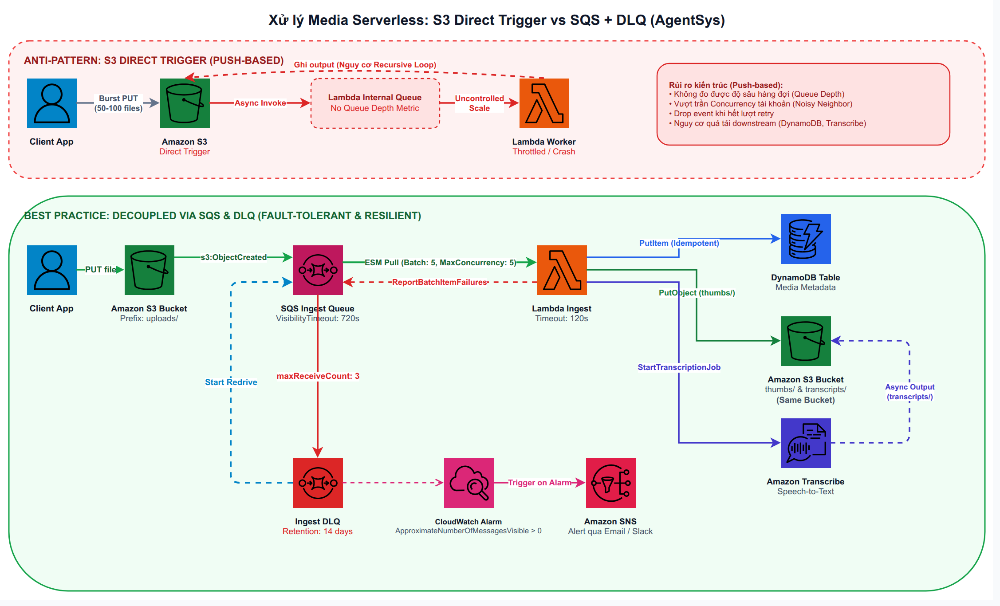

{}
* **Author:** Do Tran Minh Phuc (Student ID: 23120156 — VNUHCM University of Science)
* **Program:** First Cloud AI Journey (FCAJ) 2026 — AWS Vietnam
* **Associated Project:** EduMedia AI — Multi-modal Media Retrieval System on Serverless AWS
* **Publication Channel:** [AWS Study Group Community (Facebook)](https://www.facebook.com/groups/awsstudygroupfcj)
{}

# Serverless Media Processing in EduMedia AI: Why I Avoid Direct S3 Lambda Triggers

When designing media ingestion for EduMedia AI, my initial instinct was: whenever an object lands on S3, directly invoke the Lambda ingest worker. Files trigger code instantaneously without an extra queue, matching conventional serverless tutorials.

However, during high-volume load testing simulating peak classroom submissions (50–100 slide decks and audio recordings uploaded simultaneously), this push-based direct trigger architecture exposed three critical pitfalls:

---

### 1. Three Critical Pitfalls of Push-Based S3 Direct Triggers

1. **Lambda Internal Queue is a Black Box:**  
   S3 invokes Lambda asynchronously. Events land inside an AWS-managed internal queue that lacks real-time queue depth metrics. Engineers cannot monitor pending message count, pause ingestion, or purge obsolete events during emergencies.

2. **Concurrency Exhaustion & "Noisy Neighbor" Impact:**  
   Under rapid bursts, Lambda scales containers aggressively. This not only consumes regional account concurrency (throttling critical search APIs), but also overwhelms downstream services like Amazon DynamoDB write thresholds and Amazon Transcribe concurrent job limits. Applying Reserved Concurrency simply causes events to back up and age out in the internal queue.

3. **Silent Event Loss (Silent Failure):**  
   Lambda async invocations default to 2 retries (3 total attempts). If attempts exhaust or exceed the internal retention window (default 6 hours) without an On-Failure Destination, the event drops silently. Even if CloudWatch logs `AsyncEventsDropped`, event metadata evaporates forever while raw S3 objects remain stranded and unprocessed.

---

### 2. Architecture Comparison: Push-Based vs. Decoupled SQS + DLQ


*Figure: Comparison between the Push-based Anti-pattern and the Pull-based SQS + DLQ Claim Check Best Practice implemented in EduMedia AI.*

---

### 3. Solution: Pull-Based Flow via SQS + DLQ

```text
S3 (ObjectCreated) ──> SQS Ingest Queue ──> Lambda Ingest ──> DynamoDB & S3 Output
```

This architecture addresses each failure mode through four architectural pillars:

#### 3.1. Load Regulation with MaximumConcurrency
Batching (`BatchSize = 5`) alone does not prevent over-scaling because AWS Event Source Mapping (ESM) pollers scale aggressively when queues build up.  
By configuring `ScalingConfig: MaximumConcurrency = 5` on the ESM, the system enforces a strict ceiling of ~25 in-flight items at any moment (5 workers × batch 5), safeguarding downstream throughput regardless of burst size.

#### 3.2. Partial Failure Handling (ReportBatchItemFailures)
By default, if 1 out of 5 batch items fails, SQS retries the entire batch. Enabling `ReportBatchItemFailures` and returning failed item IDs ensures that ESM deletes the 4 successful items and retains only the failed item for targeted redelivery.

#### 3.3. DLQ Safety Net via Claim Check Pattern
Configuring `maxReceiveCount = 3` on SQS routes repeatedly failing messages into the Dead-Letter Queue (DLQ):
* **Claim Check:** Messages carry lightweight pointer metadata (~1 KB) while raw media files reside safely in S3 (`uploads/`).
* **Self-Healing Redrive:** The DLQ retains messages for 14 days with CloudWatch alarms notifying SNS. Once a bug fix deploys, clicking "Start redrive" transfers messages back to the primary queue for automated re-processing without user intervention.

#### 3.4. Idempotency & Recursive Loop Defense
* **Idempotency:** SQS Standard guarantees at-least-once delivery. The Lambda worker uses `object_key` as Partition Key with DynamoDB conditional expressions (`attribute_not_exists`) to prevent duplicate Transcribe jobs and race conditions.
* **Loop Prevention:** S3 event notifications listen strictly on the `uploads/` prefix, while generated thumbnails and transcripts write to `thumbs/` and `transcripts/`, eliminating self-triggering loops.

---

### 4. Summary Takeaway

In serverless architectures, engineering rigor is not about wiring managed services together; it is about controlling state transitions under load bursts and designing self-healing failure recovery into the data path.

```
#AWS #Serverless #AmazonSQS #AWSLambda #AmazonS3 #CloudComputing #WellArchitected
```