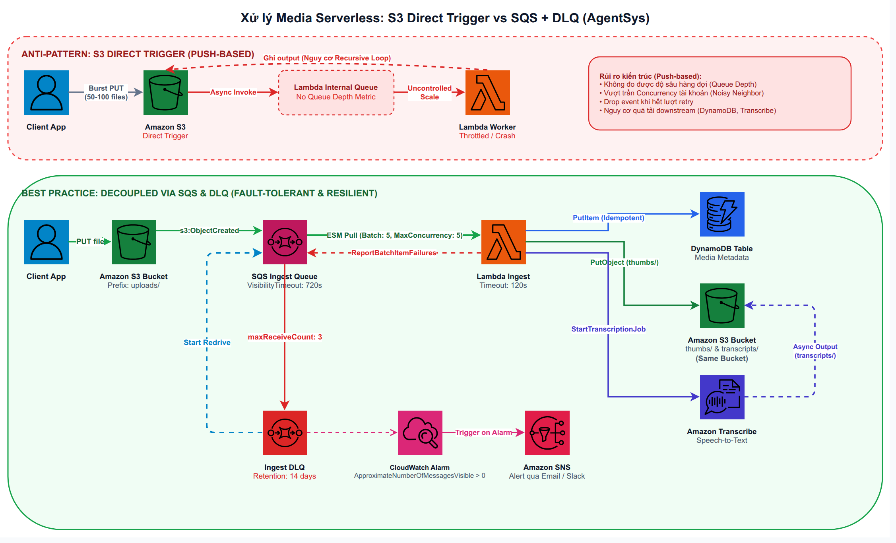

{}
* **Tác giả:** Đỗ Trần Minh Phúc (MSSV: 23120156 — Trường ĐH Khoa học Tự nhiên, ĐHQG-HCM)
* **Chương trình:** First Cloud AI Journey (FCAJ) 2026 — AWS Vietnam
* **Dự án liên quan:** EduMedia AI — Hệ thống Lưu trữ & Tra cứu Bài giảng Thông minh với AWS Serverless & GenAI
* **Kênh công bố:** [Cộng đồng AWS Study Group (Facebook)](https://www.facebook.com/groups/awsstudygroupfcj)
{}

# Xử lý Media Serverless trong dự án EduMedia AI: Tại sao mình không để Amazon S3 trigger trực tiếp Lambda?

Lúc làm tính năng xử lý media cho dự án thực tập EduMedia AI, phản xạ đầu tiên của mình là: cứ có file đẩy lên S3 thì trigger thẳng Lambda Ingest luôn. Vừa upload xong là code chạy ngay, không cần dựng thêm queue trung gian cho đỡ cồng kềnh, đúng kiểu "chuẩn Serverless" mà các bài tutorial hay hướng dẫn.

Nhưng khi chạy script thử nghiệm dồn tải (load test) giả lập kịch bản cao điểm — khoảng 50–100 file slide và ghi âm đổ vào cùng lúc — mô hình S3 gọi trực tiếp Lambda (Push-based) bắt đầu lộ ra 3 cái bẫy chí mạng:

---

### 1. Ba "cạm bẫy chí mạng" của mô hình S3 Direct Trigger (Push-based)

1. **Hàng đợi ngầm của Lambda là một "hộp đen":**  
   S3 gọi Lambda theo cơ chế Bất đồng bộ (Async Invocation). Event sẽ rơi vào một hàng đợi nội bộ do hạ tầng Lambda quản lý ngầm. Hàng đợi này không có metric đo độ sâu (Queue Depth) theo thời gian thực để biết có bao nhiêu event đang chờ, cũng không thể can thiệp tạm dừng hay xóa bớt khi cần.

2. **Khủng hoảng Concurrency & hiệu ứng "Noisy Neighbor":**  
   Thấy event dồn ứ, Lambda sẽ scale-up container rất nhanh. Nó không chỉ "ăn lẹm" vào hạn mức concurrency chung của toàn bộ tài khoản AWS trong Region (làm nghẽn lây sang các API tìm kiếm của ứng dụng), mà còn xả lũ đánh sập downstream như vượt ngưỡng thích ứng của DynamoDB hay chạm trần concurrent jobs của Amazon Transcribe. Kể cả ép Reserved Concurrency trên Lambda Ingest thì cũng chỉ là "chặn ngọn", khiến event bị nghẽn và già đi trong hàng đợi ngầm.

3. **Drop event thầm lặng (Silent Failure):**  
   Lambda Async chỉ retry mặc định 2 lần nữa (tổng 3 attempts). Nếu retry kiệt hoặc nằm quá hạn ngầm (mặc định 6h) mà không có On-Failure Destination đón đầu, event sẽ bị drop thầm lặng. Dù CloudWatch có nhảy metric `AsyncEventsDropped`, payload event metadata đã bốc hơi vĩnh viễn khỏi hàng đợi. Dù file gốc vẫn còn trên S3, hệ thống hoàn toàn "quên mất" sự tồn tại của các file này.

---

### 2. Sơ đồ kiến trúc đối chiếu: Push-based vs Decoupled SQS + DLQ


*Hình: So sánh kiến trúc Anti-pattern (S3 Push-based Direct Trigger) và Best Practice (Pull-based qua SQS + DLQ Claim Check) áp dụng trong AgentSys.*

---

### 3. Giải pháp: Chuyển sang mô hình Kéo (Pull-based) qua SQS + DLQ

Trong AgentSys, mình đưa SQS vào giữa để làm bộ đệm điều tiết dòng chảy:
$$\text{S3 (ObjectCreated)} \longrightarrow \text{SQS Ingest Queue} \longrightarrow \text{Lambda Ingest} \longrightarrow \text{DynamoDB \& S3 Output}$$

Mô hình này giải quyết triệt để vấn đề nhờ 4 điểm mấu chốt:

#### 3.1. Đệm tải thực sự với MaximumConcurrency
Nhiều bạn nghĩ chỉ cần gom batch (`BatchSize = 5`) là Lambda sẽ chạy từ tốn. Nhưng thực tế, bộ Event Source Mapping (ESM) poller của AWS khi thấy queue đầy sẽ tự scale worker rất hăng!  
Để "cắt đỉnh tải", trên Event Source Mapping mình set thêm `ScalingConfig: MaximumConcurrency = 5`. Cấu hình này khóa cứng trần tối đa khoảng 25 message in-flight tại mọi thời điểm (5 concurrent workers × batch 5). Dù có dồn dập vài trăm file thì queue vẫn tiêu thụ nhịp nhàng, downstream hoàn toàn an toàn.

#### 3.2. Xử lý lỗi từng phần (ReportBatchItemFailures)
Mặc định nếu 1 trong 5 file trong batch bị lỗi ném exception, SQS sẽ coi như cả batch fail và retry toàn bộ. Bằng cách bật `ReportBatchItemFailures` và trả về đúng ID của item lỗi trong danh sách `batchItemFailures`, ESM sẽ xóa ngay 4 item thành công và chỉ giữ lại đúng file lỗi để thử lại.  
*(Lưu ý: cơ chế này áp dụng khi code bắt được lỗi logic và return bình thường; nếu Lambda bị crash OOM hay dính hard timeout, SQS vẫn sẽ retry cả batch nguyên khối).*

#### 3.3. Lưới an toàn DLQ theo mô hình Claim Check
Mình cấu hình `maxReceiveCount = 3` trên SQS: sau 3 lần nhận xử lý thất bại (1 lần đầu + 2 lần retry), message sẽ tự tách sang Ingest DLQ:
* **Claim Check:** SQS và DLQ chỉ giữ "vé giữ xe" (metadata con trỏ ~1 KB), file media nặng hàng chục MB vẫn an toàn trên S3 nguồn (`uploads/`).
* **Khả năng tự phục hồi (Self-Healing Redrive):** DLQ giữ message 14 ngày (kèm CloudWatch Alarm báo qua SNS). Sau khi fix bug code xong, mình chỉ cần bấm "Start redrive" trên console để đẩy message ngược lại queue chính cho Lambda xử lý bù — người dùng không cần upload lại file.

#### 3.4. Thiết kế Idempotent & Phòng thủ đệ quy
* **Idempotency:** SQS Standard là At-least-once, nên Lambda Worker dùng `object_key` làm Partition Key trên DynamoDB kèm một `ConditionExpression` nguyên tử (atomic claim) để chống race condition và tránh sinh job Transcribe trùng lặp gây tốn chi phí.
* **Chống Loop:** S3 Event chỉ lắng nghe prefix `uploads/`, còn thumbnail và transcript sinh ra được ghi vào `thumbs/` và `transcripts/` để triệt tiêu nguy cơ Lambda tự kích hoạt lại chính nó.

---

### 4. Bài học đúc kết

Từ ca xử lý này mình thấy, làm Serverless cái "ăn tiền" không phải là nối vài dịch vụ cho nó chạy được, mà là kiểm soát được dòng chảy dữ liệu khi có đột biến và thiết kế sao cho hệ thống tự phục hồi được khi có sự cố.

```
#AWS #Serverless #AmazonSQS #AWSLambda #AmazonS3 #CloudComputing #WellArchitected
```