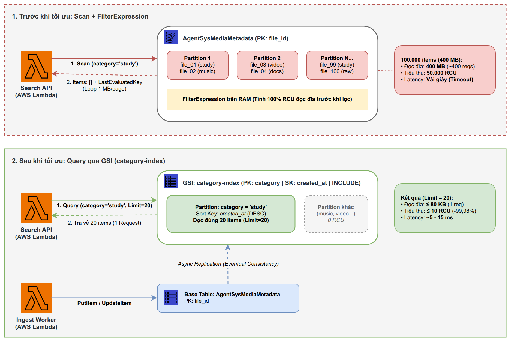

{}
* **Author:** Do Tran Minh Phuc (Student ID: 23120156 — VNUHCM-University of Science)
* **Program:** First Cloud AI Journey (FCAJ) 2026 — AWS Vietnam
* **Related Project:** EduMedia AI — Smart Lecture Storage & Retrieval Platform on AWS
* **Published Community:** [AWS Study Group Community (Facebook)](https://www.facebook.com/groups/awsstudygroupfcj)
{}

# Optimizing DynamoDB Queries in EduMedia AI: Why I Ditched Scan + FilterExpression for GSI

While building **EduMedia AI** (a serverless multimodal media catalog and semantic retrieval platform on AWS), one of the most fundamental requirements was filtering media records by category (category values like study, music, video, docs, raw...).

Coming from a relational SQL background to NoSQL with DynamoDB, I initially made a textbook mistake: using Scan with a FilterExpression, assuming it behaves like a WHERE clause in MySQL or PostgreSQL.

When the database holds only a few hundred items, the API feels snappy and everything seems fine. But looking under the hood at DynamoDB's physical read and billing mechanics reveals that relying on Scan + FilterExpression for real-time queries is an awful solution for both cloud bill and tail latency.

---

### 1. FilterExpression Does Not Save RCU as Most People Expect

In the DynamoDB SDK (boto3), passing FilterExpression into Scan makes it tempting to think the engine only reads and charges for items matching the condition. Under the hood, DynamoDB's storage nodes actually execute in three distinct phases:

* 1. Disk Read: DynamoDB scans physical partitions sequentially, pulling raw data blocks from disk into memory up to a hard ceiling of **1 MB** per page.
* 2. RCU Billing: The system calculates and deducts Read Capacity Units (RCU) on 100% of the raw data read from disk, regardless of whether each item matches your filter or not (AWS pricing rule: each 4 KB block costs 1 RCU for Strongly Consistent Reads, or 0.5 RCU for Eventually Consistent Reads).
* 3. RAM Filtering: Only after the full RCU fee has already been charged does DynamoDB apply your FilterExpression in memory to discard non-matching records before sending the payload back to the client.

In short: FilterExpression only saves network bandwidth back to your client. The disk read complexity remains O(N) across the entire table. If your table holds 1 million items and only 20 match category = 'study', you still pay RCU for reading all 1 million items.

---

### 2. The "Empty Page" Trap (Empty Page Pagination) Freezing Lambda

Beyond high RCU consumption, Scan with FilterExpression creates a nasty tail latency problem due to the 1 MB page boundary:

* The 1 MB ceiling applies to raw data read from disk before filtering, not to the size of the final response array.
* Suppose our AgentSysMediaMetadata table grows to **400 MB**. If the first 1 MB block read from disk contains no items with category = 'study', DynamoDB still returns an empty array (Items: []) along with a LastEvaluatedKey cursor.
* The search Lambda function is then forced into an iterative while loop, making repeated network round-trips to DynamoDB to scan consecutive 1 MB blocks until it collects 20 items for the UI.

As a result, a simple catalog list API can see latency explode from 20ms to several seconds. This bloats Lambda execution duration (GB-seconds) and risks hitting API Gateway's 29-second hard timeout on large datasets.

---

### 3. Architecture Comparison: Scan vs. GSI Targeted Query

Here is the architectural comparison between the two approaches:


*Figure 3.2: Physical storage mechanics contrasting the Anti-pattern (Scan + FilterExpression) against Best Practice (Query via GSI category-index).*

---

### 4. The AgentSys Solution: Switching to Query on Global Secondary Index (GSI)

To eliminate full table scans without modifying the primary key file\_id on the base table AgentSysMediaMetadata, I configured a Global Secondary Index (GSI) named category-index:

* **Partition Key:** category - Groups all records sharing the same category into a single logical partition.
* **Sort Key:** created\_at - Pre-sorts records chronologically on disk (ISO-8601 UTC). When fetching latest media, code doesn't need application-tier sorting.
* **Projection:** INCLUDE - Base items in AgentSys carry heavy payloads (such as long lecture transcripts used for AI search). Setting Projection: ALL would duplicate all heavy attributes to the GSI, doubling storage and WCU footprint. We only INCLUDE the lightweight fields needed for UI grid rendering: filename, thumbnail\_url, status, duration (the base table's partition key file\_id is automatically projected to the GSI by DynamoDB).

With the GSI created, Lambda code switches from Scan to a direct Query:

```python
import os
import boto3
from boto3.dynamodb.conditions import Key

TABLE_NAME = os.environ.get('MEDIA_METADATA_TABLE', 'AgentSysMediaMetadata')
dynamodb = boto3.resource('dynamodb', region_name='ap-southeast-1')
table = dynamodb.Table(TABLE_NAME)

def get_media_by_category(category_name: str, limit: int = 20, cursor: dict = None):
    # Direct Query against GSI partition instead of full-table scan
    params = {
        'IndexName': 'category-index',
        'KeyConditionExpression': Key('category').eq(category_name),
        'ScanIndexForward': False,  # Fetch newest items first based on created_at
        'Limit': limit
    }
    
    if cursor:
        params['ExclusiveStartKey'] = cursor

    response = table.query(**params)
    
    return {
        'items': response.get('Items', []),
        'next_cursor': response.get('LastEvaluatedKey')
    }
```

#### Under-the-Hood Difference with GSI Query:

1. **Direct Partition Routing:** DynamoDB hashes the category = 'study' value to immediately jump to the exact storage partition holding study data, skipping all other categories entirely (0 RCU).
2. **Reading Only What Is Needed (Limit=20):** Because there is no FilterExpression, Limit=20 tells DynamoDB to stop reading disk right after retrieving the first 20 records chronologically.
3. **Single Network Round-Trip:** No more empty pages or Lambda while loops. API response latency stays consistently around 10ms.

---

### 5. Practical Benchmark: Scan vs. GSI Query

Looking at concrete production metrics from AgentSys, assume AgentSysMediaMetadata holds **100,000 items** averaging 4 KB per item (total table size: **400 MB**). When a user browses the **20 newest items** in category study (using Eventually Consistent Read, where each 4 KB consumes 0.5 RCU):

| Evaluation Criteria | Scan + FilterExpression | Query on GSI (category-index) |
| :--- | :--- | :--- |
| **Disk Retrieval Method** | Sequential full table scan | Direct partition routing via Hash Key |
| **Data Read from Disk** | **400 MB** (reads all 100,000 items) | **At most 80 KB** (only first 20 items) |
| **Network Calls from Lambda** | At least **400 requests** (1 MB/page limit) | **1 request** |
| **RCU Cost per API Call** | **50,000 RCU** (100,000 × 0.5 RCU) | **≤ 10 RCU** (even lower with INCLUDE) |
| **Response Latency** | Several seconds to Timeout (grows with table size) | **~5 ms – 15 ms** (constant regardless of table size) |

Switching to a GSI query slashed **99.98% of RCU consumption** per category query while locking latency to predictable milliseconds.

---

### 6. Architectural Trade-offs with GSI

In cloud architecture, there is no free lunch. Implementing GSI requires weighing three trade-offs:

1. **Write Amplification:** Whenever the Ingest Worker Lambda inserts a new file or updates metadata on the base table, DynamoDB triggers an asynchronous background write to the GSI partition, consuming additional WCU. Limiting attributes via Projection: INCLUDE significantly reduces this overhead.
2. **Eventual Consistency:** When Ingest Worker writes data into the base table, DynamoDB replicates attributes to the GSI asynchronously. GSIs only support Eventually Consistent Reads. This replication lag is typically within 10–50ms, which easily satisfies media browsing requirements.
3. **Hot Partition Risk:** A single physical DynamoDB partition maxes out at **3,000 RCU** and **1,000 WCU**. For AgentSys, category handles normal traffic comfortably. For ultra-high traffic apps with tens of thousands of requests per second hitting one category, Write Sharding (appending random suffixes like study#1, study#2...) is needed to distribute load across physical partitions.

---

### 7. Key Takeaways

The biggest practical lesson from building **AgentSys** with DynamoDB:

* Never bring relational SELECT \* ... WHERE thinking into Scan + FilterExpression for end-user APIs.
* FilterExpression filters data only after you have been charged full RCU.
* In NoSQL, always determine your Access Patterns upfront to design the right Partition Key, Sort Key, and GSI from day one.

{}
**Publication Evidence:**  
* This technical article is published and discussed on the **AWS Study Group** community: [View Community Discussion on Facebook](https://www.facebook.com/groups/awsstudygroupfcj)
{}
