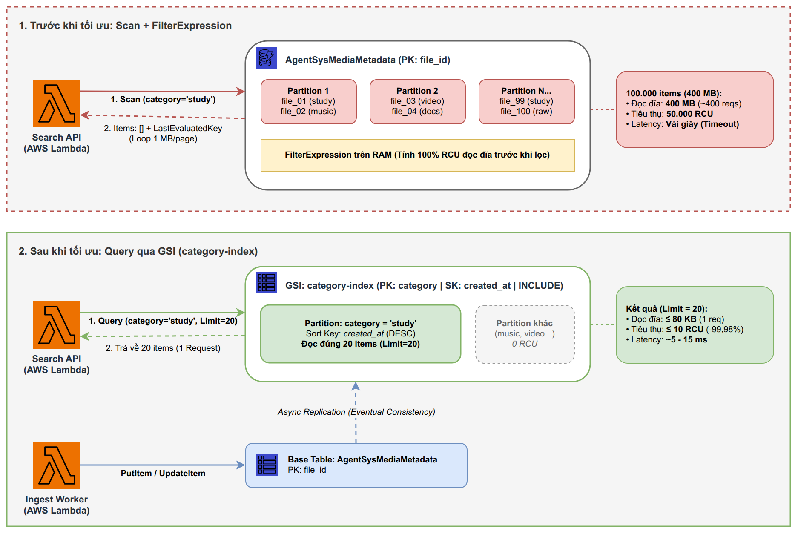

{}
* **Tác giả:** Đỗ Trần Minh Phúc (MSSV: 23120156 — Trường ĐH Khoa học Tự nhiên, ĐHQG-HCM)
* **Chương trình:** First Cloud AI Journey (FCAJ) 2026 — AWS Vietnam
* **Dự án liên quan:** AgentSys — Hệ thống Catalog & Truy vấn Media Đa phương tiện Serverless
* **Kênh công bố:** [Cộng đồng AWS Study Group (Facebook)](https://www.facebook.com/groups/awsstudygroupfcj)
{}

# Tối ưu truy vấn DynamoDB trong dự án AgentSys: Tại sao mình bỏ Scan + FilterExpression để chuyển sang GSI?

Trong quá trình xây dựng AgentSys (hệ thống quản lý và truy vấn media đa phương tiện Serverless trên AWS), một trong những tính năng cơ bản nhất mình cần xử lý là lọc danh sách file theo danh mục (category như study, music, video, docs, raw...).

Lúc mới bắt đầu chuyển từ SQL sang NoSQL như DynamoDB, mình (và khá nhiều bạn làm đồ án cùng đợt) từng mắc một sai lầm kinh điển: dùng hàm Scan kèm theo FilterExpression vì nghĩ rằng nó hoạt động giống mệnh đề WHERE trong MySQL hay PostgreSQL. 

Khi bảng dữ liệu còn ít (vài trăm dòng), API chạy rất mượt nên khó phát hiện vấn đề. Nhưng khi tìm hiểu sâu vào cơ chế đọc vật lý và tính phí của DynamoDB, việc dùng Scan + FilterExpression cho các API tìm kiếm thời gian thực thực sự là một giải pháp rất tệ về cả chi phí lẫn thời gian phản hồi.

---

### 1. FilterExpression không hề giúp tiết kiệm RCU như chúng ta tưởng

Trong DynamoDB SDK (boto3), việc truyền FilterExpression vào hàm Scan rất dễ làm người mới lầm tưởng rằng hệ thống chỉ đọc và tính tiền những bản ghi khớp điều kiện. Thực tế bên dưới tầng lưu trữ của DynamoDB lại diễn ra theo đúng 3 bước:

* 1. Đọc đĩa: DynamoDB quét tuần tự qua các partition vật lý, đọc dữ liệu thô từ ổ đĩa lên bộ nhớ với giới hạn tối đa **1 MB** cho mỗi lần quét (1 page).
* 2. Tính phí RCU: Hệ thống tính toán và trừ Read Capacity Units (RCU) dựa trên 100% dung lượng dữ liệu vừa đọc từ đĩa, bất kể bản ghi đó có khớp điều kiện lọc hay không (theo cách tính của AWS: cứ 4 KB dữ liệu tiêu tốn 1 RCU cho Strongly Consistent Read, hoặc 0.5 RCU cho Eventually Consistent Read).
* 3. Lọc trên RAM: Sau khi đã tính phí RCU xong xuôi, DynamoDB mới áp dụng FilterExpression để loại bỏ các bản ghi không khớp trước khi trả response về cho client.

Tóm lại: FilterExpression chỉ giúp giảm băng thông mạng trả về, chứ độ phức tạp đọc đĩa vẫn là O(N) trên toàn bảng. Nếu bảng có 1 triệu bản ghi mà chỉ có 20 bản ghi thuộc danh mục study, bạn vẫn phải trả tiền RCU cho việc đọc cả 1 triệu bản ghi đó.

---

### 2. Hiện tượng "Trang rỗng" (Empty Page Pagination) làm treo Lambda

Ngoài chuyện tốn RCU, Scan kèm FilterExpression còn gây ra một vấn đề rất khó chịu về độ trễ (latency) do giới hạn 1 MB mỗi lần đọc:

* Giới hạn 1 MB được áp dụng cho dữ liệu thô đọc từ đĩa trước khi lọc, không phải kích thước mảng kết quả trả về.
* Giả sử bảng AgentSysMediaMetadata của mình nặng **400 MB**. Nếu trong 1 MB dữ liệu đầu tiên quét được không có bản ghi nào mang category = 'study', DynamoDB vẫn trả về một mảng rỗng (Items: []) kèm theo con trỏ LastEvaluatedKey.
* Lúc này, hàm Lambda xử lý tìm kiếm buộc phải chạy một vòng lặp while gọi mạng liên tục sang DynamoDB để quét tiếp các trang 1 MB kế tiếp cho đến khi gom đủ 20 kết quả cho giao diện.

Hậu quả là chỉ một API lấy danh sách media đơn giản nhưng thời gian phản hồi có thể vọt từ vài chục mili-giây lên tới vài giây, làm tăng thời gian chạy (Duration) của Lambda và thậm chí chạm ngưỡng timeout 29 giây của API Gateway nếu bảng quá lớn.

---

### 3. Sơ đồ đối chiếu kiến trúc: Scan vs. GSI Query

Dưới đây là sơ đồ chi tiết minh họa sự khác biệt giữa hai cơ chế truy xuất:


*Hình 3.2: Sơ đồ đối chiếu cơ chế vật lý giữa Anti-pattern (Scan + FilterExpression) và Best Practice (Query qua GSI category-index).*

---

### 4. Giải pháp trong AgentSys: Chuyển sang Query trên Global Secondary Index (GSI)

Để xử lý dứt điểm vụ này mà không phải sửa lại khóa chính file\_id của bảng gốc AgentSysMediaMetadata, mình tạo thêm một GSI tên là category-index với cấu hình:

* **Partition Key:** category - Gom toàn bộ các bản ghi có cùng danh mục về chung một phân vùng logic.
* **Sort Key:** created\_at - Sắp xếp sẵn các bản ghi theo thời gian tạo (chuẩn ISO-8601) ngay trên đĩa. Khi lấy danh sách media mới nhất, code không cần tốn công sort lại trên RAM.
* **Projection:** INCLUDE - Bảng chính của AgentSys lưu nhiều trường nặng (như transcript bóc băng phục vụ AI search). Nếu chọn Projection: ALL, DynamoDB sẽ nhân bản toàn bộ sang GSI gây tốn dung lượng và WCU. Do đó mình chỉ INCLUDE thêm các trường nhẹ phục vụ hiển thị ngoài giao diện: filename, thumbnail\_url, status, duration (còn khóa chính file\_id của bảng gốc đã được DynamoDB tự động chiếu sẵn sang GSI).

Khi đã có GSI, code trên AWS Lambda được chuyển hẳn từ Scan sang Query:

```python
import os
import boto3
from boto3.dynamodb.conditions import Key

TABLE_NAME = os.environ.get('MEDIA_METADATA_TABLE', 'AgentSysMediaMetadata')
dynamodb = boto3.resource('dynamodb', region_name='ap-southeast-1')
table = dynamodb.Table(TABLE_NAME)

def get_media_by_category(category_name: str, limit: int = 20, cursor: dict = None):
    # Query truc tiep tren GSI thay vi Scan toan bang
    params = {
        'IndexName': 'category-index',
        'KeyConditionExpression': Key('category').eq(category_name),
        'ScanIndexForward': False,  # Lay file moi nhat xep truoc theo created_at
        'Limit': limit
    }
    
    if cursor:
        params['ExclusiveStartKey'] = cursor

    response = table.query(**params)
    
    return {
        'items': response.get('Items', []),
        'next_cursor': response.get('LastEvaluatedKey')
    }
```

#### Sự khác biệt khi chạy Query trên GSI:

1. **Nhảy thẳng vào đúng Partition:** DynamoDB băm (hash) giá trị category = 'study' trong KeyConditionExpression để định vị ngay lập tức phân vùng chứa dữ liệu study, bỏ qua hoàn toàn các danh mục khác (0 RCU).
2. **Đọc đúng số lượng cần lấy (Limit=20):** Vì không dùng FilterExpression, tham số Limit=20 giúp DynamoDB dừng đọc ngay khi lấy đủ 20 item đầu tiên từ trên xuống theo created\_at.
3. **Chỉ mất 1 request duy nhất:** Không còn cảnh trả về trang rỗng hay phải chạy vòng lặp while trên Lambda, độ trễ phản hồi giữ ổn định quanh mức 10ms.

---

### 5. Phép tính so sánh thực tế: Scan vs. GSI Query

Lấy ví dụ cụ thể trên dữ liệu thực tế của AgentSys, giả sử bảng có **100.000 bản ghi**, trung bình 4 KB/bản ghi (tổng dung lượng bảng **400 MB**). Khi người dùng bấm xem **20 tài liệu mới nhất** của mục study (với chế độ Eventually Consistent Read, mỗi 4 KB tốn 0.5 RCU):

| Tiêu chí | Dùng Scan + FilterExpression | Dùng Query trên GSI (category-index) |
| :--- | :--- | :--- |
| **Cách thức đọc đĩa** | Quét tuần tự toàn bộ bảng (Full Table Scan) | Định vị trực tiếp partition qua Hash Key |
| **Lượng dữ liệu đọc từ đĩa** | **400 MB** (đọc hết 100.000 bản ghi) | **Tối đa 80 KB** (chỉ đọc đúng 20 bản ghi) |
| **Số lần gọi mạng từ Lambda** | Tối thiểu **400 requests** (do giới hạn 1 MB/page) | **1 request** duy nhất |
| **Chi phí RCU cho 1 lần gọi API** | **50.000 RCU** (100.000 × 0.5 RCU) | **≤ 10 RCU** (nhỏ hơn nữa nếu dùng INCLUDE) |
| **Thời gian phản hồi (Latency)** | Vài giây đến Timeout (tăng dần theo độ lớn bảng) | **~5 ms – 15 ms** (không đổi dù bảng phình to) |

Tính ra chỉ cần chuyển qua GSI là đã cắt giảm được tới **99,98% lượng RCU** cho mỗi lần lọc danh mục.

---

### 6. Một vài điểm đánh đổi (Trade-offs) cần lưu ý khi dùng GSI

Dùng GSI giải quyết êm được bài toán đọc, nhưng lúc đưa vào chạy thực tế thì phải chấp nhận 3 điểm đánh đổi sau:

1. **Chi phí ghi tăng thêm (Write Amplification):** Mỗi khi hàm Lambda Ingest Worker thêm file mới hoặc cập nhật metadata trên bảng chính, DynamoDB sẽ tự động kích hoạt thêm một thao tác ghi bất đồng bộ sang GSI và tính thêm WCU. Việc giới hạn các trường bằng Projection: INCLUDE giúp giảm đáng kể lượng dữ liệu phải ghi sang GSI.
2. **Độ trễ đồng bộ dữ liệu (Eventual Consistency):** Khi Ingest Worker đẩy dữ liệu vào bảng chính, DynamoDB cần vài chục mili-giây để nhân bản sang GSI theo cơ chế bất đồng bộ (asynchronous replication). Do đó GSI chỉ hỗ trợ Eventually Consistent Read, nhưng độ trễ tích tắc này hoàn toàn đáp ứng tốt trải nghiệm duyệt media trên web.
3. **Nguy cơ lệch tải phân vùng (Hot Partition):** Một partition vật lý của DynamoDB chịu tải tối đa **3.000 RCU** và **1.000 WCU**. Với quy mô của AgentSys hiện tại thì khóa phân vùng category chạy rất thoải mái. Tuy nhiên với các hệ thống lớn có hàng chục ngàn lượt truy cập mỗi giây dồn vào đúng một danh mục, chúng ta sẽ cần áp dụng thêm kỹ thuật Write Sharding (gắn thêm hậu tố ngẫu nhiên kiểu study#1, study#2...) để chia tải ra nhiều partition vật lý.

---

### 7. Tổng kết

Từ trải nghiệm tối ưu này trong dự án **AgentSys**, bài học thực tế lớn nhất mình rút ra khi làm việc với DynamoDB là:

* Tuyệt đối không bê tư duy SELECT \* ... WHERE của SQL sang dùng cho Scan + FilterExpression ở các API phục vụ người dùng cuối.
* FilterExpression chỉ lọc dữ liệu sau khi bạn đã bị trừ tiền RCU.
* Với NoSQL, phải xác định rõ Access Pattern (cách giao diện truy vấn dữ liệu) ngay từ đầu để thiết kế Partition Key, Sort Key và GSI cho khớp.

{}
**Bằng chứng đăng bài trên AWS Study Group:**  
* Bài viết đã được chia sẻ và thảo luận tại cộng đồng **AWS Study Group**: [Xem liên kết bài đăng trên Facebook](https://www.facebook.com/groups/awsstudygroupfcj)
{}
