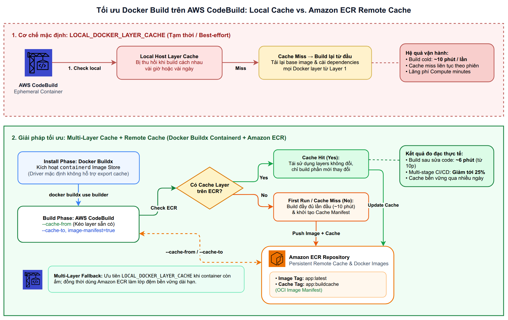
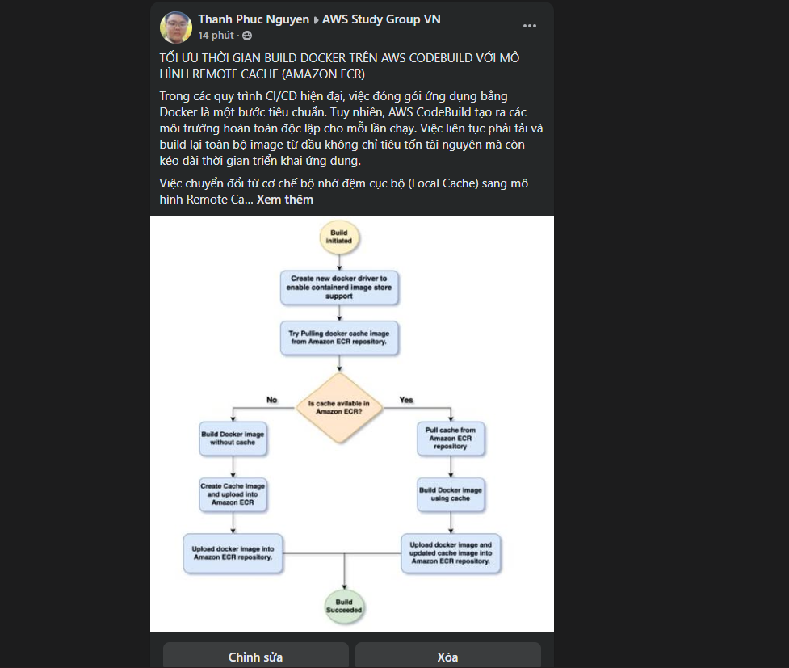

{}
* **Author:** Nguyen Thanh Phuc
* **Program:** First Cloud AI Journey (FCAJ) 2026 — AWS Vietnam
* **Topic Domain:** AWS CI/CD & Cost Optimization — Docker Layer Caching on AWS CodeBuild & Amazon ECR
* **Publication Channel:** [AWS Study Group Community (Facebook)](https://www.facebook.com/groups/awsstudygroupfcj) *(Submitted — Pending Admin Approval)*
{}

# Optimizing Docker Build Time on AWS CodeBuild with Amazon ECR Remote Cache

In modern CI/CD workflows, packaging applications with Docker is a standard step. However, **AWS CodeBuild** provisions completely ephemeral, isolated build environments for each execution. Repeatedly downloading base images and rebuilding every layer from scratch wastes compute minutes and slows down deployment pipelines.

Transitioning from AWS CodeBuild's default local cache mechanism to a **Remote Cache** architecture backed by **Amazon Elastic Container Registry (Amazon ECR)** provides persistent layer reuse across spaced-out builds and cuts infrastructure overhead.

---

### 1. Limitations of Default CodeBuild Local Cache

Many CI/CD pipelines initially rely solely on CodeBuild's built-in `LOCAL_DOCKER_LAYER_CACHE` option. In production usage, this mechanism exhibits two fundamental drawbacks:

1. **Ephemeral, Best-Effort Storage:**  
   CodeBuild local storage is provisioned on temporary host instances. Local layer caching is only effective when consecutive builds run closely back-to-back on the same cached fleet.
2. **Lack of Persistence Across Time Gaps:**  
   When builds occur hours or days apart, the underlying local cache volume is reclaimed. Even with `LOCAL_DOCKER_LAYER_CACHE` enabled, CodeBuild encounters cache misses and must re-download base images and reinstall every dependency layer from Layer 1, driving up build duration and billable compute minutes.

---

### 2. Architecture: Multi-Layer Caching with Amazon ECR Remote Cache

To achieve durable cross-build layer caching, the cache backend must live outside the ephemeral CodeBuild container. The workflow uses Docker Buildx backed by a `containerd` image store and Amazon ECR:

```text
CodeBuild (Install phase) ──> Enable containerd via docker buildx ──> CodeBuild (Build phase) ──> Pull/Push Cache (--cache-from / --cache-to) <──> Amazon ECR
```


*Figure: Architectural comparison between ephemeral Local Cache and durable Multi-Layer + Amazon ECR Remote Cache on AWS CodeBuild.*

#### Core Components:
* **Amazon ECR:** Acts as a long-term persistent remote backend storing cached Docker layer manifests alongside final application images.
* **AWS CodeBuild:** Configured in `buildspec.yml` to proactively pull cached layers prior to building and export updated cache layers upon completion.
* **Containerd Image Store (`docker buildx`):** The legacy default Docker driver does not support exporting build cache directly to a remote registry. An isolated builder instance backed by `containerd` must be initialized during the `install` phase.

---

### 3. Build Mechanics & Reference Configuration

#### 3.1. Enforcing Remote Cache Pull and Push (`--cache-from` / `--cache-to`)
During the `build` phase, passing `--cache-from` instructs Buildx to query the ECR cache manifest before rebuilding layers, while `--cache-to` (with `image-manifest=true`) packages and pushes updated layer metadata back to ECR.

```yaml
version: 0.2
phases:
  install:
    commands:
      # Initialize buildx builder supporting registry cache export
      - docker buildx create --name ecr-builder --driver docker-container --use
  pre_build:
    commands:
      - aws ecr get-login-password --region $AWS_DEFAULT_REGION | docker login --username AWS --password-stdin $AWS_ACCOUNT_ID.dkr.ecr.$AWS_DEFAULT_REGION.amazonaws.com
  build:
    commands:
      - |
        docker buildx build \
          --cache-from type=registry,ref=$ECR_REPO:buildcache \
          --cache-to type=registry,ref=$ECR_REPO:buildcache,mode=max,image-manifest=true \
          -t $ECR_REPO:latest \
          --push .
```

#### 3.2. Incremental Change Handling & Performance Impact
* **Cold Run (Initial Cache Miss):** On the first run before cache manifests exist, the pipeline builds all layers end-to-end (~**10 minutes**) and uploads both the application image and the `buildcache` manifest to Amazon ECR.
* **Subsequent Runs (Code or Dockerfile Changes):** Whenever source code or downstream `Dockerfile` instructions change, Docker automatically reuses every unchanged upstream layer from ECR and only rebuilds invalidated stages, bringing observed build time down to **~6 minutes** (and delivering up to a **25% build time reduction** in complex multi-stage builds).

#### 3.3. Multi-Layer Cache Strategy (Local + Remote Fallback)
Adopting ECR Remote Cache does not require disabling CodeBuild's `LOCAL_DOCKER_LAYER_CACHE`. Keeping both enabled establishes a resilient two-tier cache hierarchy:
* **Tier 1 (Warm Container):** CodeBuild serves unchanged layers instantaneously from local disk cache whenever a warm host instance is available.
* **Tier 2 (Persistent Fallback):** Whenever the local host cache has expired or rotated out, CodeBuild falls back seamlessly to Amazon ECR remote cache layers instead of rebuilding from scratch.

---

### 4. Practical Comparison: Local Cache Only vs. Multi-Layer ECR Remote Cache

| Evaluation Criteria | Default `LOCAL_DOCKER_LAYER_CACHE` | `docker buildx` (`containerd`) + ECR Remote Cache |
| :--- | :--- | :--- |
| **Cache Persistence** | Ephemeral (evicted after hours/days) | **Persistent** in Amazon ECR repository |
| **Registry Cache Export** | Local host only | Supported via **`containerd` + `image-manifest=true`** |
| **Observed Build Time** | ~**10 minutes** on spaced-out cold runs | ~**6 minutes** incremental (**up to 25% faster** multi-stage) |
| **Compute Cost Control** | Repeated cold rebuilds waste build minutes | **Predictable savings** across spaced CI/CD triggers |

---

### 5. Key Takeaways

1. **CI/CD Optimization Goes Beyond Build Success:** Controlling per-run compute duration directly reduces pipeline wait times and AWS CodeBuild billing.
2. **Containerd Driver Is Mandatory:** Default Docker drivers cannot export registry cache; configuring `docker buildx` in the `install` phase unlocks remote layer manifests cleanly.
3. **Combine Tiers for Speed & Durability:** Pairing `LOCAL_DOCKER_LAYER_CACHE` for rapid back-to-back commits with **Amazon ECR Remote Cache** as persistent backup delivers smooth continuous integration at minimal operational complexity.

```
#AWS #CodeBuild #AmazonECR #Docker #DevOps #CI_CD #CostOptimization #FCAJ
```

{}
**Publication Evidence (Pending Admin Approval):**  
* This article was submitted to the [AWS Study Group VN (Facebook)](https://www.facebook.com/groups/awsstudygroupfcj) community and is currently awaiting administrator approval (`Chỉnh sửa | Xóa` moderation bar displayed while pending public publication).


*Figure: Submission proof of Blog 3 awaiting administrator approval in the AWS Study Group VN Facebook group.*
{}
