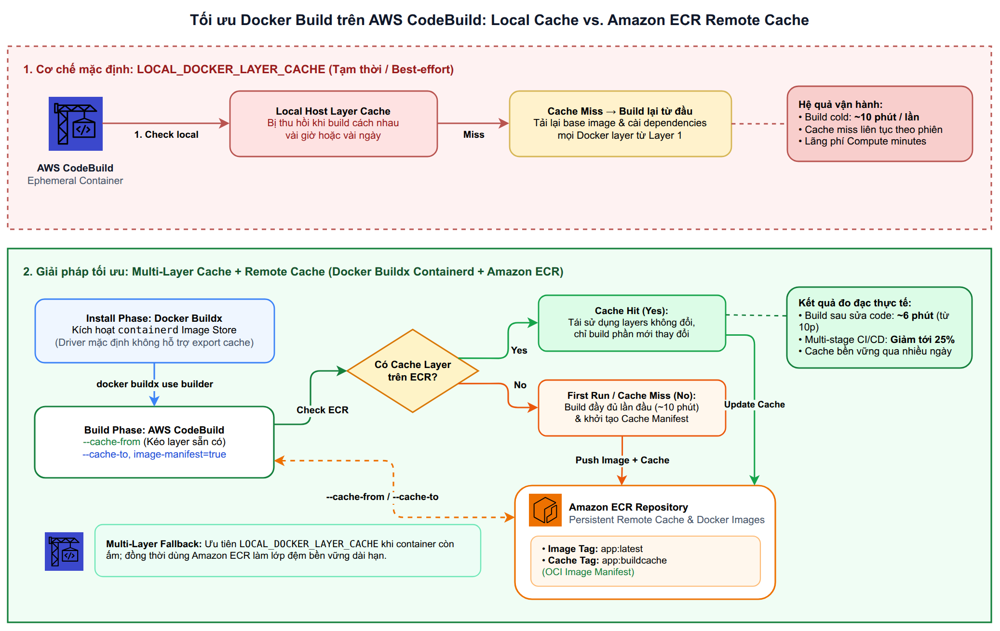
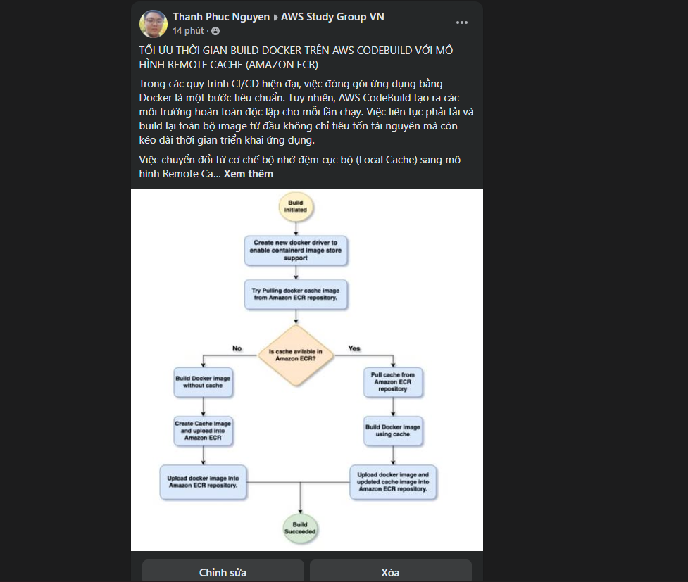

{}
* **Tác giả:** Đỗ Trần Minh Phúc (MSSV: 23120156 — Trường ĐH Khoa học Tự nhiên, ĐHQG-HCM)
* **Chương trình:** First Cloud AI Journey (FCAJ) 2026 — AWS Vietnam
* **Chủ đề:** AWS CI/CD & Cost Optimization — Tối ưu Docker Layer Caching với AWS CodeBuild & Amazon ECR
* **Kênh công bố:** [Cộng đồng AWS Study Group (Facebook)](https://www.facebook.com/groups/awsstudygroupfcj) *(Đã gửi bài — Đang chờ quản trị viên phê duyệt)*
{}

# Tối ưu thời gian build Docker trên AWS CodeBuild với mô hình Remote Cache (Amazon ECR)

Trong các quy trình CI/CD hiện đại, việc đóng gói ứng dụng bằng Docker là một bước tiêu chuẩn. Tuy nhiên, **AWS CodeBuild** khởi tạo các môi trường hoàn toàn độc lập (ephemeral) cho mỗi lần chạy. Việc liên tục phải tải base image và build lại toàn bộ layer từ đầu không chỉ tiêu tốn tài nguyên tính toán mà còn kéo dài thời gian triển khai ứng dụng.

Việc chuyển đổi từ cơ chế bộ nhớ đệm cục bộ (**Local Cache**) sang mô hình **Remote Cache** kết hợp với **Amazon Elastic Container Registry (Amazon ECR)** là giải pháp hiệu quả giúp tái sử dụng Docker layers bền vững, tối ưu hóa thời gian build và cắt giảm chi phí hạ tầng.

---

### 1. Cơ chế Local Cache mặc định gặp vấn đề gì?

Nhiều dự án hiện nay vẫn chỉ cấu hình bật tính năng `LOCAL_DOCKER_LAYER_CACHE` mặc định của CodeBuild. Khi vận hành thực tế, cơ chế này bộc lộ hai hạn chế cốt lõi:

1. **Tính tạm thời (Best-effort):**  
   CodeBuild cung cấp không gian lưu trữ cục bộ rất tạm thời trên host instance. Cơ chế này chỉ thực sự phát huy tác dụng khi các bản build diễn ra liên tiếp, sát nhau về mặt thời gian.
2. **Thiếu tính bền vững theo thời gian:**  
   Khi các đợt chạy cách xa nhau (vài giờ hoặc vài ngày), môi trường lưu trữ cục bộ bị thu hồi. Lúc này, dù có bật tùy chọn cache, hệ thống vẫn bị cache miss và phải tải lại base image, cài đặt lại mọi layer phụ thuộc từ đầu — làm tăng trực tiếp thời gian build và tiêu tốn chi phí compute không cần thiết.

---

### 2. Kiến trúc triển khai với Amazon ECR làm Remote Cache

Để khắc phục điểm yếu mất cache giữa các phiên chạy, kiến trúc cần một kho lưu trữ cache độc lập và bền vững bên ngoài container của CodeBuild:

```text
CodeBuild (Install phase) ──> Kích hoạt containerd (buildx) ──> CodeBuild (Build phase) ──> Kéo/Đẩy Cache (--cache-from / --cache-to) <──> Amazon ECR
```


*Hình: Đối chiếu kiến trúc Local Cache tạm thời và mô hình Multi-Layer + Amazon ECR Remote Cache trên AWS CodeBuild.*

#### Vai trò từng thành phần:
* **Amazon ECR:** Đóng vai trò làm kho lưu trữ dài hạn (backend) cho các Docker layer cache bên cạnh container image thành phẩm, giữ cho các layer luôn sẵn sàng tái sử dụng qua nhiều ngày hoặc nhiều tuần.
* **AWS CodeBuild:** Cấu hình lại quy trình trong `buildspec.yml` để chủ động kéo (`pull`) cache sẵn có trước khi build và đẩy (`push`) cache mới lên ECR sau khi build.
* **Containerd Image Store (`docker buildx`):** Mặc định Docker driver truyền thống không hỗ trợ xuất registry cache ra ngoài. Do đó, cần khởi tạo một builder mới thông qua `docker buildx` có kích hoạt `containerd` ngay từ pha `install`.

---

### 3. Cơ chế hoạt động và cấu hình tối ưu hiệu suất

#### 3.1. Ép sử dụng và cập nhật Remote Cache (`--cache-from` / `--cache-to`)
Trong tệp `buildspec.yml`, lệnh build sử dụng tham số `--cache-from` để Docker đối chiếu và kéo các layer đã cache trên ECR, đồng thời dùng `--cache-to` (kèm cờ `image-manifest=true`) để đóng gói và lưu cache ngược lên ECR:

```yaml
version: 0.2
phases:
  install:
    commands:
      # Khởi tạo driver buildx sử dụng containerd để hỗ trợ export registry cache
      - docker buildx create --name ecr-builder --driver docker-container --use
  pre_build:
    commands:
      - aws ecr get-login-password --region $AWS_DEFAULT_REGION | docker login --username AWS --password-stdin $AWS_ACCOUNT_ID.dkr.ecr.$AWS_DEFAULT_REGION.amazonaws.com
  build:
    commands:
      - |
        docker buildx build \
          --cache-from type=registry,ref=$ECR_REPO:buildcache \
          --cache-to type=registry,ref=$ECR_REPO:buildcache,mode=max,image-manifest=true \
          -t $ECR_REPO:latest \
          --push .
```

#### 3.2. Xử lý thông minh khi mã nguồn hoặc Dockerfile thay đổi
* **Lần chạy đầu tiên (Cold Build / Cache Miss):** Khi chưa có cache trên ECR, hệ thống thực hiện build toàn bộ các layer (mất khoảng **10 phút**) và lưu cả image ứng dụng lẫn cache manifest lên ECR.
* **Các lần chạy kế tiếp:** Dù mã nguồn hay phần sau của `Dockerfile` có chỉnh sửa, Docker sẽ tự động tái sử dụng các layer không đổi trước điểm thay đổi và chỉ build lại phần mới. Thời gian thực tế ghi nhận giảm xuống chỉ còn **~6 phút** (và giúp **giảm tới 25% thời gian build** đối với các dự án phức tạp dạng multi-stage build).

#### 3.3. Kết hợp lớp đệm đa tầng (Multi-Layer Cache)
Giải pháp Remote Cache không yêu cầu loại bỏ Local Cache. Bằng cách giữ nguyên `LOCAL_DOCKER_LAYER_CACHE` song song với Amazon ECR:
* **Lớp 1 (Ưu tiên tốc độ):** Nếu container build vừa chạy gần đó và vẫn giữ cache cục bộ, CodeBuild đọc trực tiếp từ đĩa local.
* **Lớp 2 (Dự phòng bền vững):** Nếu môi trường local đã bị thu hồi, Amazon ECR Remote Cache lập tức đóng vai trò dự phòng an toàn giúp tránh việc phải build lại từ đầu.

---

### 4. Bảng so sánh thực tế: Local Cache vs. Multi-Layer ECR Remote Cache

| Tiêu chí đánh giá | Chỉ dùng `LOCAL_DOCKER_LAYER_CACHE` | `docker buildx` (`containerd`) + Amazon ECR Remote Cache |
| :--- | :--- | :--- |
| **Độ bền vững của Cache** | Tạm thời (dễ mất sau vài giờ / vài ngày) | **Bền vững lâu dài** trên Amazon ECR |
| **Khả năng Export Registry Cache** | Không hỗ trợ trên Docker driver mặc định | Hỗ trợ qua **`containerd` + `image-manifest=true`** |
| **Thời gian build thực tế** | ~**10 phút** khi bị cold build | ~**6 phút** khi chỉnh sửa code (**giảm tới 25%** ở multi-stage) |
| **Tối ưu chi phí Compute** | Tốn compute minutes cho các lần miss lặp lại | **Cắt giảm trực tiếp chi phí** trên từng phiên build CI/CD |

---

### 5. Bài học đúc kết

1. **Tối ưu CI/CD không chỉ là build thành công:** Kiểm soát tốt thời gian chạy và lượng tài nguyên tiêu thụ cho từng bản build mới là yếu tố quyết định độ mượt và chi phí vận hành pipeline.
2. **Chú ý chuẩn `containerd` với `docker buildx`:** Cấu hình đúng driver ở pha `install` là điều kiện bắt buộc để kích hoạt tính năng registry cache export.
3. **Kết hợp hai lớp cache:** Giữ Local Cache cho tốc độ tức thì và Amazon ECR Remote Cache cho tính bền vững giúp quy trình CI/CD liền mạch dù tần suất deploy thưa hay dày.

```
#AWS #CodeBuild #AmazonECR #Docker #DevOps #CI_CD #CostOptimization #FCAJ
```

{}
**Bằng chứng gửi bài trên AWS Study Group (Trạng thái Pending Approval):**  
* Bài viết đã được gửi lên cộng đồng [AWS Study Group VN (Facebook)](https://www.facebook.com/groups/awsstudygroupfcj) và hiện đang ở trạng thái **chờ quản trị viên phê duyệt** (hiển thị thanh công cụ `Chỉnh sửa | Xóa` trước khi bài viết được công khai để lấy permalink).


*Hình: Ảnh chụp bài viết Blog 3 đang ở trạng thái chờ quản trị viên phê duyệt trên nhóm AWS Study Group VN.*
{}
