# Event 1: AWS First Cloud AI Journey - Community Day

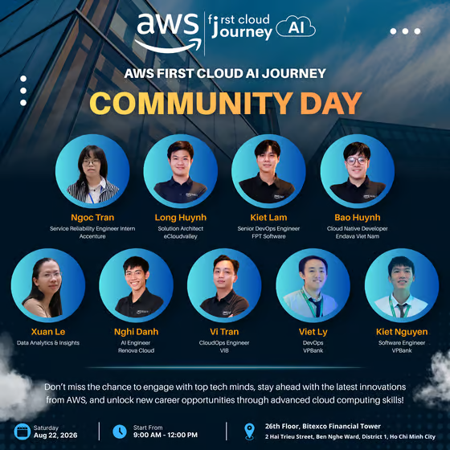

- **Date:** Saturday, August 22, 2026 (09:00 AM - 12:00 PM)
- **Location:** AWS Vietnam Office, 26th Floor, Bitexco Financial Tower, 2 Hai Trieu Street, Ben Nghe Ward, District 1, Ho Chi Minh City
- **Role:** Intern attendee
- **Organized by:** AWS First Cloud Journey (FCJ) & AWS Community

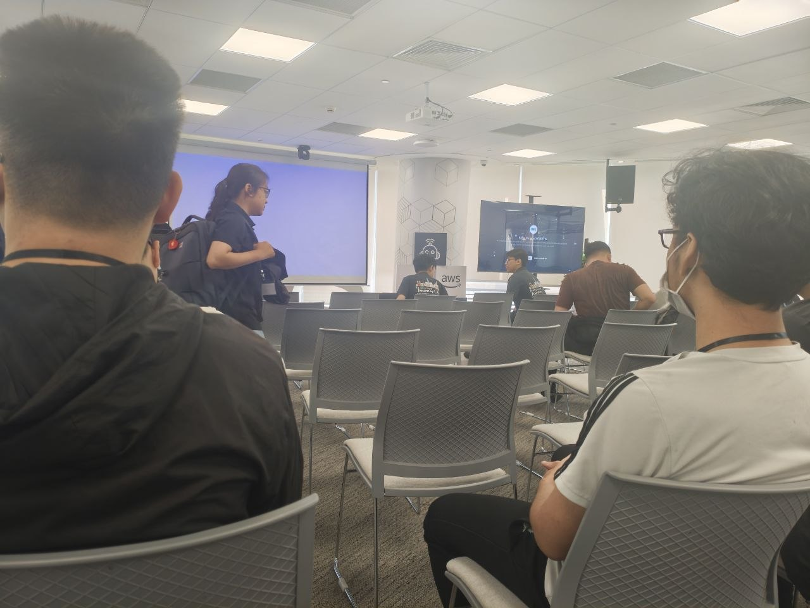

---

## 1. Event Overview

**AWS First Cloud AI Journey - Community Day (August 2026)** was an in-depth technical knowledge-sharing conference organized by the **First Cloud Journey (FCJ)** community at the AWS Vietnam Office (26th Floor, Bitexco Financial Tower).

The event featured 7 intensive sharing sessions spanning across: **Serverless Architecture, Database Optimization & Archiving Strategy, AI/DevOps, Cloud Native, and Generative AI**, bringing together 9 seasoned engineers and technology leaders from leading enterprises.

### Featured Speakers:
1. **Lâm Tuấn Kiệt (Kiet Lam)** — Senior DevOps Engineer, *FPT Software*
2. **Lý Hoàng Việt (Viet Ly)** — DevOps Engineer, *VPBank* (AWS Community Builder)
3. **Nguyễn Tuấn Kiệt (Kiet Nguyen)** — Software Engineer / Data Engineer, *VPBank*
4. **Huỳnh Hoàng Long (Long Huynh)** — Solution Architect, *eCloudvalley*
5. **Ngọc Trần (Ngoc Tran)** — Service Reliability Engineer Intern, *Accenture*
6. **Bảo Huỳnh (Bao Huynh)** — Cloud Native Developer, *Endava Viet Nam*
7. **Xuân Lê (Xuan Le)** — Data Analytics & Insights
8. **Nghị Danh (Nghi Danh)** — AI Engineer, *Renova Cloud*
9. **Vĩ Trần (Vi Tran)** — CloudOps Engineer, *VIB*

---

## 2. Session 1: DevOps AI Development Application with AWS Serverless

- **Speaker:** **Lam Tuan Kiet (Kiet Lam)** — Senior DevOps Engineer at FPT Software

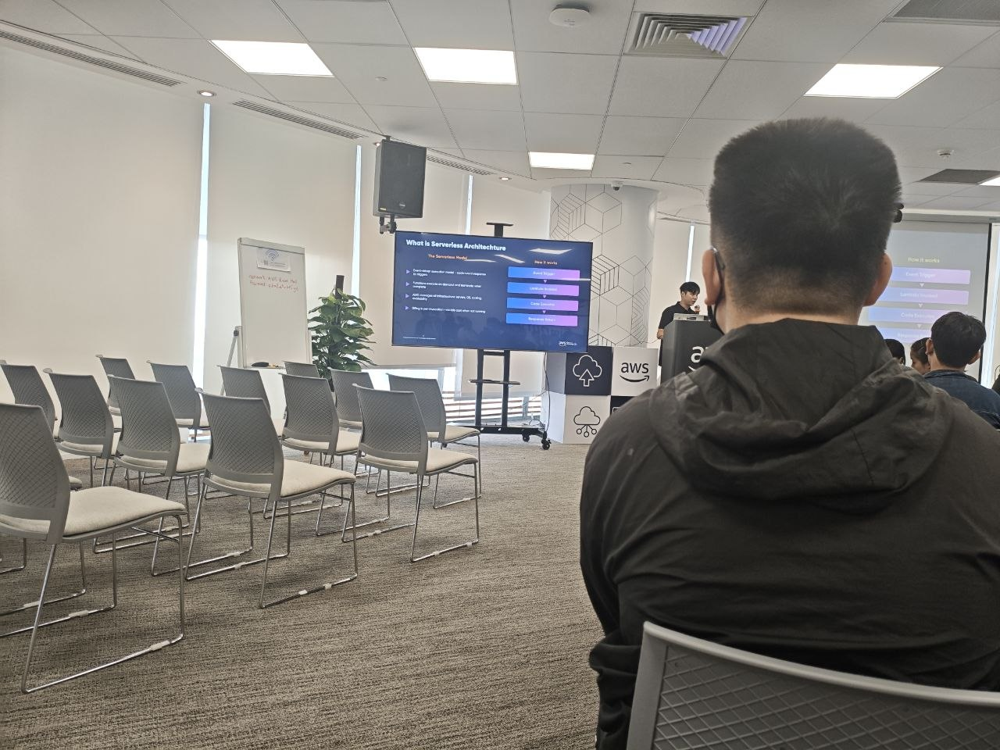

### 2.1. Essence of Serverless Computing

Mr. Kiet opened the session by explaining the core philosophy of Serverless — offloading underlying infrastructure management completely to AWS:
- **Focus on Code:** Development teams focus 100% on feature delivery and business logic without managing server provisioning, Load Balancer configuration, or operating system patching.
- **Automatic Scaling & Scale-to-Zero:** Infrastructure dynamically scales with real-time incoming traffic and automatically scales down to zero when idle.
- **Cost-effective (Pay-as-you-go):** Billed strictly based on exact invocation count and precise execution runtime (in milliseconds). Zero idle cost incurred.

### 2.2. Event-driven Architecture & Core Serverless Services

The architecture follows the **Event Trigger ➔ AWS Lambda Execution ➔ Response** execution flow:

| AWS Service | Technical Role |
|---|---|
| **AWS Lambda** | Multi-language serverless compute engine executed on-demand, deeply integrated with AWS services |
| **Amazon API Gateway** | Managed traffic ingestion gateway providing routing, throttling, and direct integrations with Lambda/SQS |
| **Amazon DynamoDB** | Fully managed, single-digit millisecond latency NoSQL database with auto-scaling throughput |
| **Amazon S3** | Durable object storage for media assets, unstructured data, and static Single Page Application (SPA) hosting |

### 2.3. Traditional vs. Serverless Application Comparison

| Criteria | Traditional Application (VM / Monolith / Container) | Serverless Application (Lambda / API Gateway) |
|---|---|---|
| **Infrastructure** | Self-managed Server, OS, Auto Scaling Groups, manual patching | 100% managed by AWS |
| **Deployment Unit** | Monolith service, Docker container image, Virtual Machine | Function (Lambda), API Route, Event Handler |
| **Scaling** | Complex configuration (Nginx, ALB, Kubernetes HPA...), minute-scale scaling | Instant, automated scaling per request invocation |
| **Cost Model** | Billed 24/7 continuously regardless of actual workload | Only billed during active execution + data transfer |
| **High Availability (HA)** | Requires explicit Multi-AZ configuration & Failover design | Built-in Multi-AZ High Availability at the service layer |

### 2.4. 6 Real-World Trade-offs and Engineering Solutions

Mr. Kiet highlighted that Serverless is not a silver bullet and discussed 6 practical production trade-offs:

1. **Cold Start Latency:** New Lambda instances require ~2-3 seconds to initialize the execution container and libraries.  
   ➜ *Solution:* Enable **Provisioned Concurrency** (keeping 2-3 warm instances ready) for latency-critical endpoints.
2. **Local Debugging & Tracing Complexity:** Difficult to replicate distributed cloud triggers and IAM permissions locally.  
   ➜ *Solution:* Establish dedicated cloud Development environments on AWS, automated via CI/CD pipelines for direct testing.
3. **Vendor Lock-in:** Code and trigger bindings are tied to AWS-native APIs and managed services.
4. **Cost Predictability under Continuous High Traffic:** For applications with sustained high concurrency 24/7, Serverless can exceed container hosting costs.  
   ➜ *Rule:* Start with Serverless for unpredictable or variable workloads; consider migrating to container-based architectures (ECS/EKS) once steady baseline traffic is established.
5. **Package Size Limit (250 MB):** Heavy AI/ML dependencies can exceed unzipped package limits.  
   ➜ *Solution:* Modularize shared dependencies into **Lambda Layers**.
6. **Database Connection Exhaustion:** Hundreds of concurrently spawned Lambda instances can overwhelm relational databases (PostgreSQL/MySQL).  
   ➜ *Solution:* Deploy **Amazon RDS Proxy** in front of the database to handle centralized Connection Pooling.

### 2.5. 4 Serverless Application Patterns

- **Pattern 1 - Synchronous API:** Client ➔ API Gateway ➔ Lambda Handler ➔ DynamoDB / RDS.
- **Pattern 2 - Authentication & Authorization:** Client ➔ Amazon Cognito User Pool / API Gateway Custom Authorizer ➔ Lambda.
- **Pattern 3 - Scheduled CronJobs:** Amazon EventBridge Scheduler periodically triggering Lambda (e.g. nightly data aggregation).
- **Pattern 4 - Asynchronous Event Processing:** Producer ➔ Amazon SQS Queue ➔ Lambda (e.g. batch email notifications, asynchronous video processing).

### 2.6. Monorepo Project Structure for Serverless Applications

Mr. Kiet shared the production project layout used at FPT Software:
- apps/: Each subfolder represents an isolated Lambda function handler.
- packages/shared-library/: Shared utility code (standard error responses, TypeScript types, loggers).
- packages/infra/: Infrastructure as Code (IaC) defining Lambda configurations, API Gateway paths, and IAM roles.

### 2.7. Q&A Highlights



  

    <i class="fas fa-comments text-blue-500"></i> Live Workshop Discussion
  

  

    <strong>🙋 Question (Trung Kien - Software Engineer):</strong> 
    Why evaluate Serverless for cost optimization instead of traditional architectures?
  

  

    <strong>👨‍🏫 Speaker (Lam Tuan Kiet):</strong> 
    Consider internal banking portals: Staff only use them during business hours (8 hours/day, Mon-Fri). Running traditional servers 24/7 wastes money during the remaining 16 hours and weekends. Serverless scales to zero during idle periods, saving 100% of off-hour compute costs. Only when traffic becomes steady around the clock should container migration be considered.
  



---

## 3. Session 2: Optimize Database Cost & Performance with Data Archiving Strategy

- **Speakers:**
  - **Ly Hoang Viet (Viet Ly)** — AWS Community Builder, DevOps Engineer at VPBank
  - **Nguyen Tuan Kiet (Kiet Nguyen)** — Software Engineer / Data Engineer at VPBank

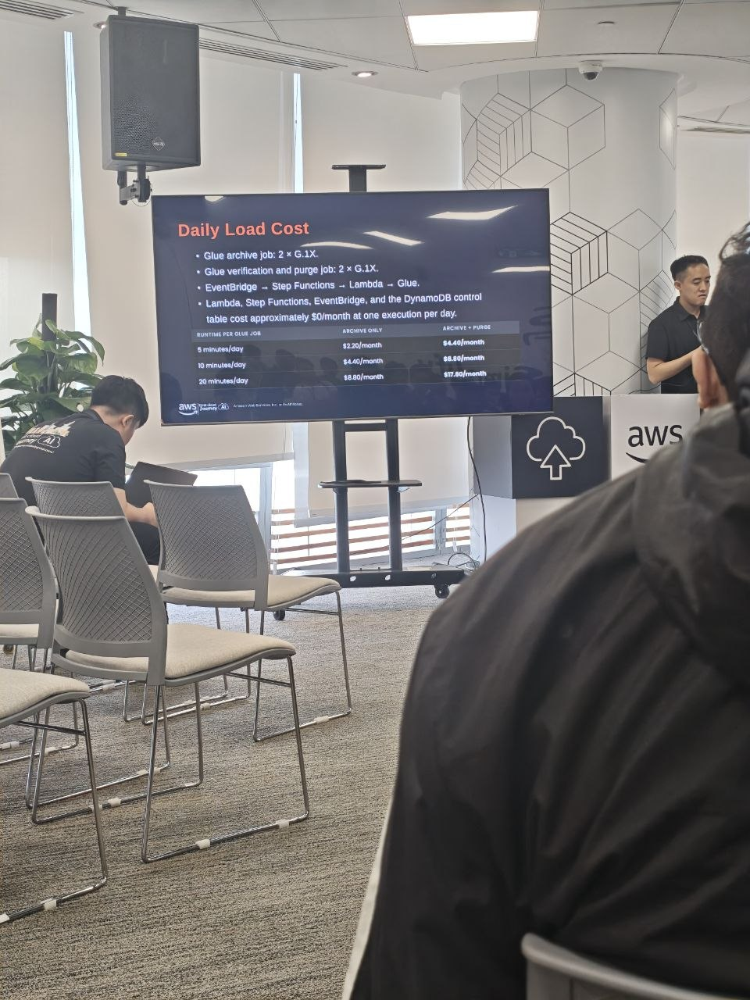

### 3.1. Enterprise Challenge: Operational Database Growth
Over years of continuous operation, banking databases grow to hundreds of gigabytes or terabytes:
- **Skyrocketing Storage Costs:** Provisioning high-performance SSD storage on Amazon RDS or DynamoDB is expensive.
- **Degraded Query Performance:** Multi-million-row tables cause query latency degradation even with indexing.
- **Impacting User Experience:** Banking customers experience delays during financial operations.

### 3.2. Data Tiering Strategy: Hot Data vs. Cold Data

| Criteria | Hot Data | Cold Data (Historical) |
|---|---|---|
| **Characteristics** | Recent transactional records (< 1 year / < 90 days) | Historical records (> 1 year / > 90 days) |
| **Access Frequency** | Queried continuously daily for live operations | Rarely accessed (audit, historical inquiries) |
| **Optimal Storage** | **Amazon RDS PostgreSQL / MySQL** | **Amazon S3 Data Lake + Amazon Athena** |

### 3.3. Archiving Pipeline Architecture

The VPBank engineering team presented an automated pipeline with two main flows:

#### Flow 1: Initial Full Load (Migrating Baseline Historical Data)
1. **AWS DMS (Database Migration Service):** Extracts historical data beyond the cutoff (e.g. > 90 days) from RDS to **Amazon S3** as Raw Parquet files.
2. **AWS Glue Job:** Ingests Raw Parquet, performs **Deep Partitioning** (/year=YYYY/month=MM/day=DD/), and writes to the S3 Curated bucket.
3. **Purge Script:** Safely removes archived records from the source RDS database.

#### Flow 2: Daily Incremental Load
1. **Amazon EventBridge:** Automatically triggers the ETL workflow during off-peak night hours to avoid production I/O contention.
2. **Step Functions + AWS Lambda + AWS Glue:** Ingests the oldest day's cold records, converts to Parquet, partitions, and stores in S3 Curated.
3. **Purge Task:** Deletes corresponding rows from RDS to keep database footprint at an optimal steady state (e.g. capping at 50 GB instead of growing past 100 GB+).
4. **Amazon Athena:** Acts as a Serverless SQL query engine allowing staff or reporting tools to query S3 cold data using standard ANSI SQL without reloading into databases.

### 3.4. Live Demo on RDS PostgreSQL

Mr. Nguyen Tuan Kiet demonstrated the workflow live:
- Configured a 90-day cutoff timestamp on PostgreSQL.
- Executed AWS DMS extraction of cold data to S3 Raw bucket.
- Ran AWS Glue job to partition data into S3 Curated (Year/Month/Day).
- Successfully executed the purge script, deleting **629 records** from the source table.
- Queried archived data in Amazon Athena with rapid execution via Partition Pruning.

### 3.5. Cost Breakdown Analysis

#### Initial Load (DMS C3 Medium, 50 GB Storage, Single-AZ + 2 Glue DPUs):
- **100 GB Data Volume:** DMS runtime 4h ($0.48) + Glue runtime 1h ($1.00) ≈ **$1.48**
- **1 TB Data Volume:** DMS runtime 24h ($2.88) + Glue runtime 6h ($6.00) ≈ **$8.88**

#### Daily Incremental Load (2 Glue workers per job):
- **5 minutes/day runtime:** Archive Only = **$2.20/month** | Archive + Purge = **$4.40/month**
- **10 minutes/day runtime:** Archive Only = **$4.40/month** | Archive + Purge = **$8.80/month**
- **20 minutes/day runtime:** Archive Only = **$8.80/month** | Archive + Purge = **$17.60/month**
- *Associated costs for Lambda, Step Functions, EventBridge, and DynamoDB control table are negligible (~$0/month).*

### 3.6. 5 Key Takeaways
1. **Archive cold data:** Proactively separate historical data from primary OLTP databases.
2. **Use incremental processing:** Process daily batches to keep runtime and resource costs minimal.
3. **Optimize data format:** Always leverage columnar Parquet with Deep Partitioning.
4. **Right-size compute:** Match Glue DPU and DMS instance sizing to actual workload volume.
5. **Keep data accessible:** Ensure cold data remains instantly queryable via Amazon Athena.

### 3.7. In-Depth Q&A



  

    <i class="fas fa-question-circle text-blue-500"></i> Q1: Multi-AZ / Multi-Region Replication
  

  

    <strong>❓ Question:</strong> How to ensure consistency and prevent downtime when migrating large datasets across regions?
  

  

    <strong>💡 Answer:</strong> AWS DMS supports Multi-AZ deployment. Migrations filter historical records by timestamp cutoff, preventing write locks or conflicts with live transactions.
  

  

    <i class="fas fa-question-circle text-blue-500"></i> Q2: Accelerating Cold Data Queries
  

  

    <strong>❓ Question:</strong> How to maximize query speed on cold S3 data?
  

  

    <strong>💡 Answer:</strong> Define fine-grained partition keys (Year/Month/Day/Client ID) for Athena partition pruning. For enterprise environments requiring ACID guarantees and time-travel queries, implement Open Table Formats like <strong>Apache Iceberg</strong> or <strong>Apache Hudi</strong> on S3 Data Lake.
  

  

    <i class="fas fa-question-circle text-blue-500"></i> Q3: Amazon Redshift at VPBank
  

  

    <strong>❓ Question:</strong> What is the primary use case for Amazon Redshift at VPBank?
  

  

    <strong>💡 Answer:</strong> Redshift is utilized as an SQL Data Transformation Engine. The team loads data from Data Lake to Redshift and uses standard SQL for complex analytical transformations without having to manage Apache Spark clusters.
  



---

## 4. Session 3: Diffusion & OCR — Generative AI on AWS Serverless Infrastructure

- **Speaker:** **Huynh Hoang Long (Long Huynh)** — Solution Architect at eCloudvalley

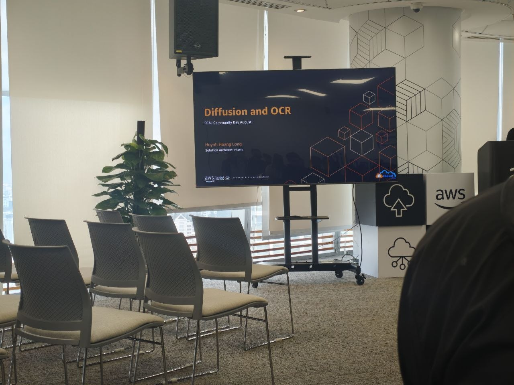

### 4.1. Serverless Text-to-Image Generation Architecture

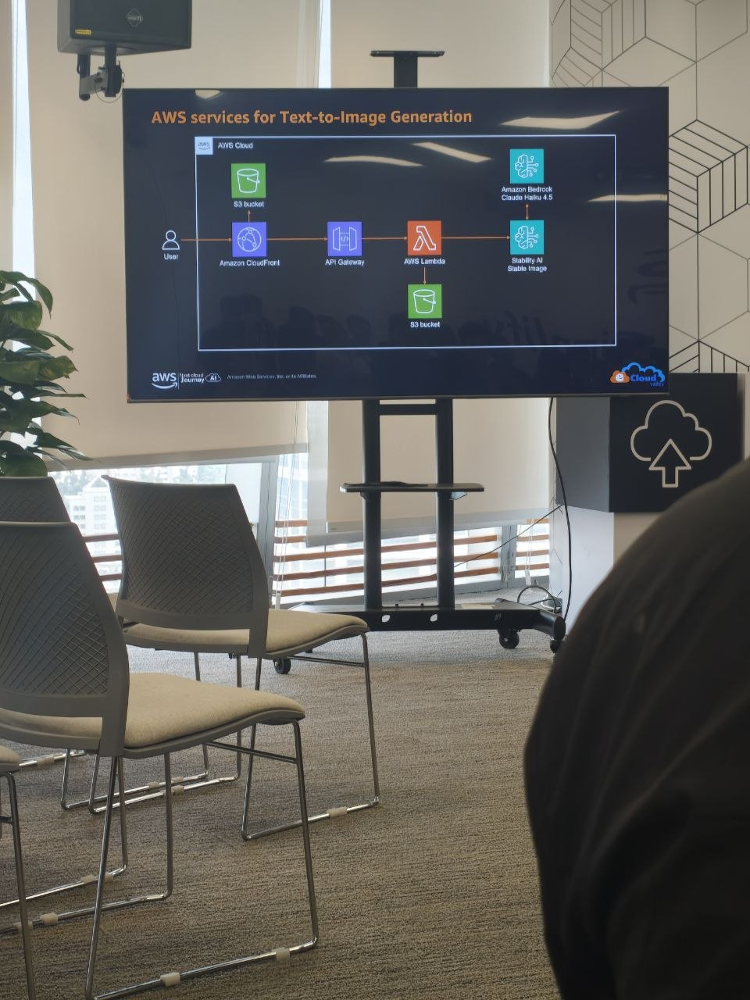

Fully Serverless architectural workflow:
1. **Frontend Hosting:** Single Page Application (SPA) hosted on **Amazon S3** and distributed globally via **Amazon CloudFront** CDN.
2. **API & Routing:** **Amazon API Gateway** receives client requests and triggers **AWS Lambda**.
3. **Prompt Enrichment:** Lambda invokes **Claude Haiku 4.5** on **Amazon Bedrock** to expand short Vietnamese prompts into detailed, photorealistic descriptive English prompts.
4. **Image Synthesis:** Lambda forwards the enriched prompt to **Stability AI (Stable Image)** on Bedrock to render high-resolution visuals.
5. **Storage & Delivery:** Rendered images are stored in **Amazon S3** and secure CDN URLs are returned to the client.

### 4.2. Live Demo: "DemoAI — Image ⇌ Text"

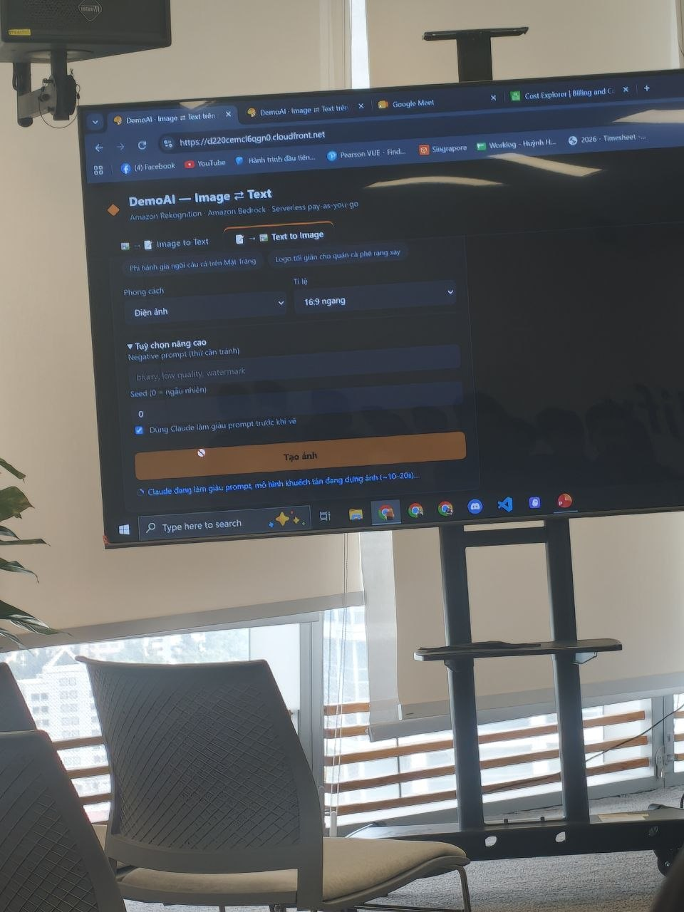

Features demonstrated live:
- **Image to Text (OCR):** Text extraction and scene understanding using Amazon Rekognition combined with Bedrock.
- **Text to Image:** Customization options including Cinematic styles, aspect ratios (16:9, 1:1), negative prompts (removing watermarks, low quality), and seed control.
- Pay-as-you-go cost model with zero idle baseline expense.

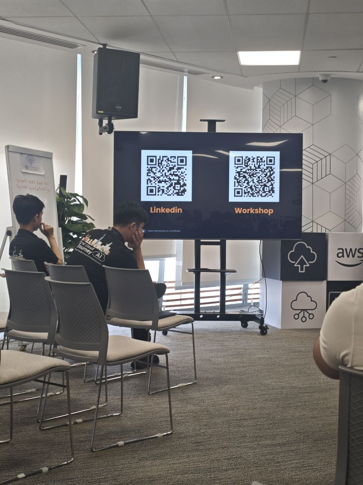

---

## 5. Key Learnings and Practical Value

Attending the **AWS First Cloud AI Journey - Community Day** provided high-value engineering insights:

1. **Modern Cloud-Native Architectural Thinking:** Clear criteria for balancing Serverless agility and Containerized throughput in production environments.
2. **Enterprise Database Lifecycle Mastery:** The Hot/Cold Data Archiving pattern (DMS + S3 + Glue + Athena) drastically reduces storage costs while retaining historical data accessibility.
3. **Applied GenAI Integration:** Practical patterns for chaining foundational LLMs (Claude Haiku via Amazon Bedrock) for prompt engineering before routing into generative diffusion models.

---

## 6. Event Photos

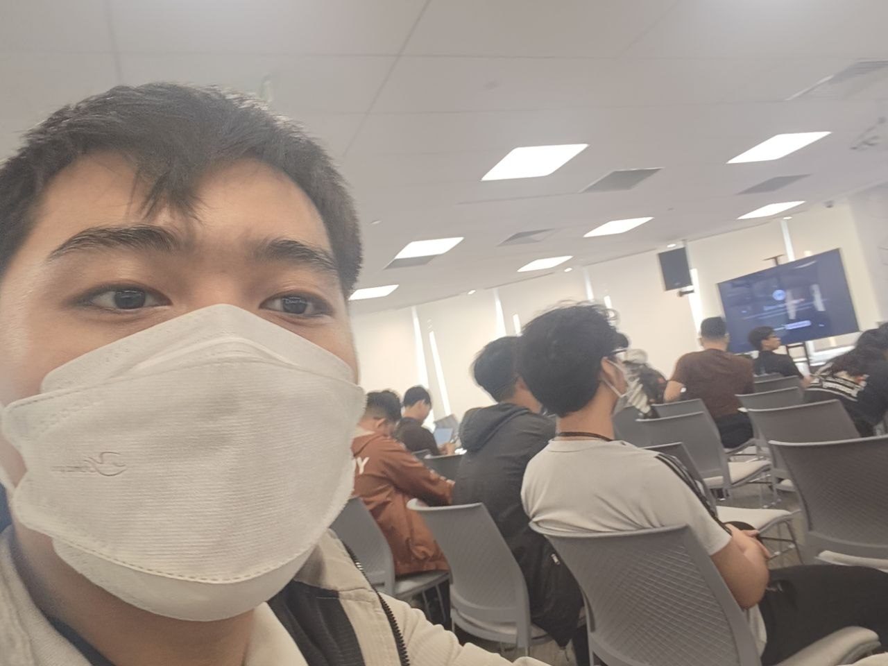

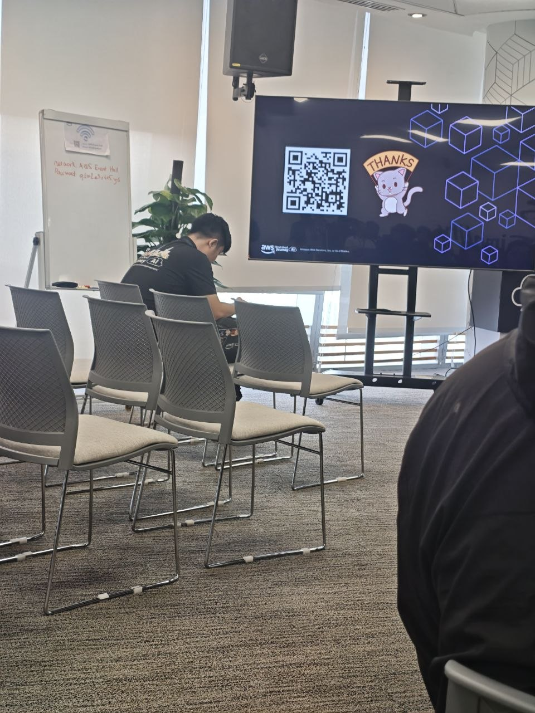

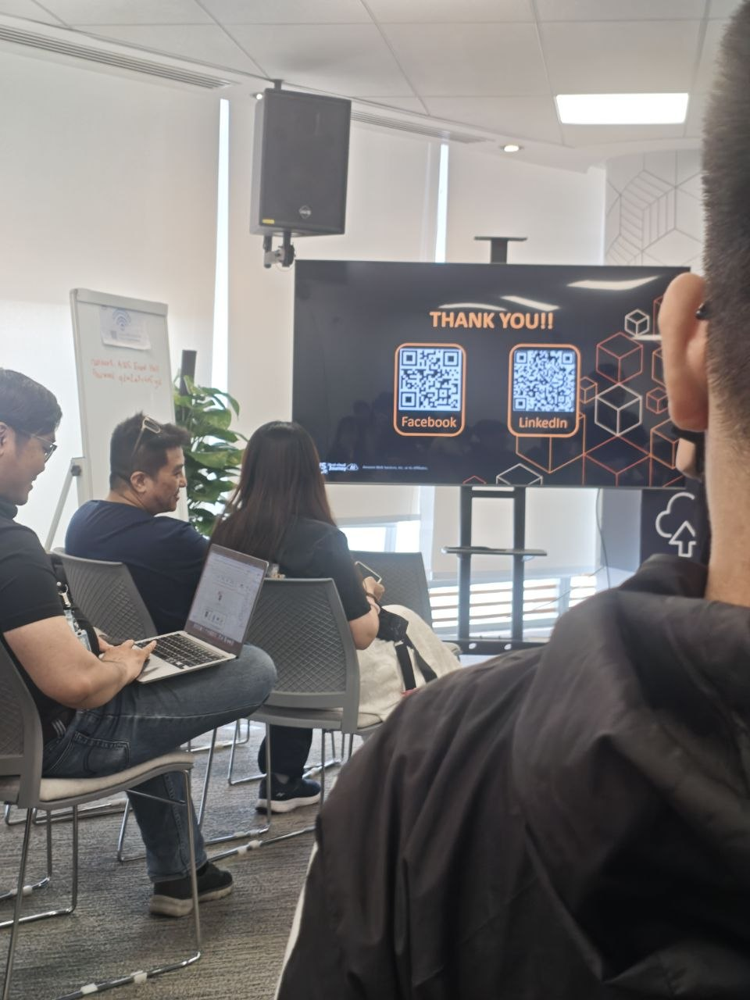
