# Event 1: AWS First Cloud AI Journey - Community Day

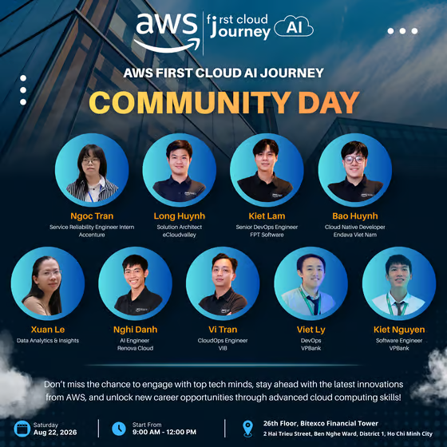

- **Thời gian:** Thứ Bảy, 22/08/2026 (09:00 - 12:00)
- **Địa điểm:** Văn phòng AWS Việt Nam, Tầng 26 Bitexco Financial Tower, Số 2 Hải Triều, Phường Bến Nghé, Quận 1, TP.HCM
- **Vai trò:** Thực tập sinh tham dự
- **Đơn vị tổ chức:** AWS First Cloud Journey (FCJ) & AWS Community

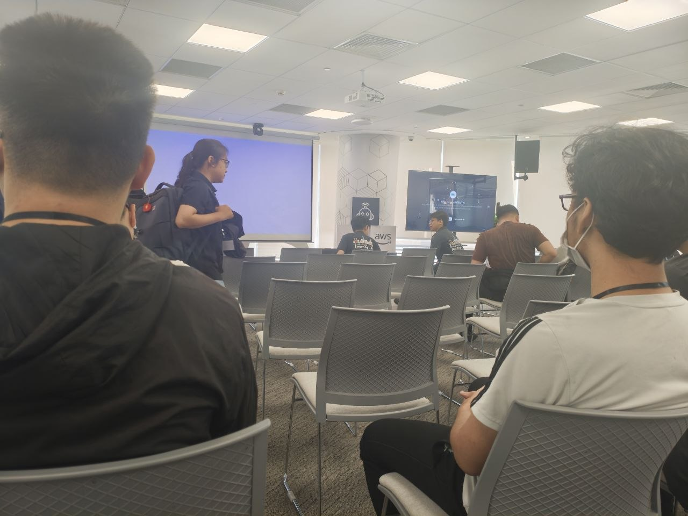

---

## 1. Tổng quan sự kiện

**AWS First Cloud AI Journey - Community Day (Tháng 8/2026)** là hội thảo công nghệ chuyên sâu do cộng đồng **First Cloud Journey (FCJ)** phối hợp cùng AWS Community tổ chức tại Văn phòng AWS Việt Nam (Tầng 26 Bitexco Financial Tower).

Sự kiện diễn ra trong buổi sáng với 7 phiên chia sẻ kỹ thuật thực chiến xoay quanh các chủ đề: **Serverless Architecture, Database Optimization & Archiving Strategy, AI/DevOps, Cloud Native và Generative AI**, quy tụ 9 diễn giả là các chuyên gia, kỹ sư hàng đầu đến từ các doanh nghiệp lớn.

### Danh sách 9 diễn giả tại sự kiện:
1. **Lâm Tuấn Kiệt (Kiet Lam)** — Senior DevOps Engineer, *FPT Software*
2. **Lý Hoàng Việt (Viet Ly)** — DevOps Engineer, *VPBank* (AWS Community Builder)
3. **Nguyễn Tuấn Kiệt (Kiet Nguyen)** — Software Engineer / Data Engineer, *VPBank*
4. **Huỳnh Hoàng Long (Long Huynh)** — Solution Architect, *eCloudvalley*
5. **Ngọc Trần (Ngoc Tran)** — Service Reliability Engineer Intern, *Accenture*
6. **Bảo Huỳnh (Bao Huynh)** — Cloud Native Developer, *Endava Viet Nam*
7. **Xuân Lê (Xuan Le)** — Data Analytics & Insights
8. **Nghị Danh (Nghi Danh)** — AI Engineer, *Renova Cloud*
9. **Vĩ Trần (Vi Tran)** — CloudOps Engineer, *VIB*

---

## 2. Phiên 1: DevOps AI Development Application with AWS Serverless

- **Diễn giả:** Anh **Lâm Tuấn Kiệt** — Senior DevOps Engineer tại FPT Software

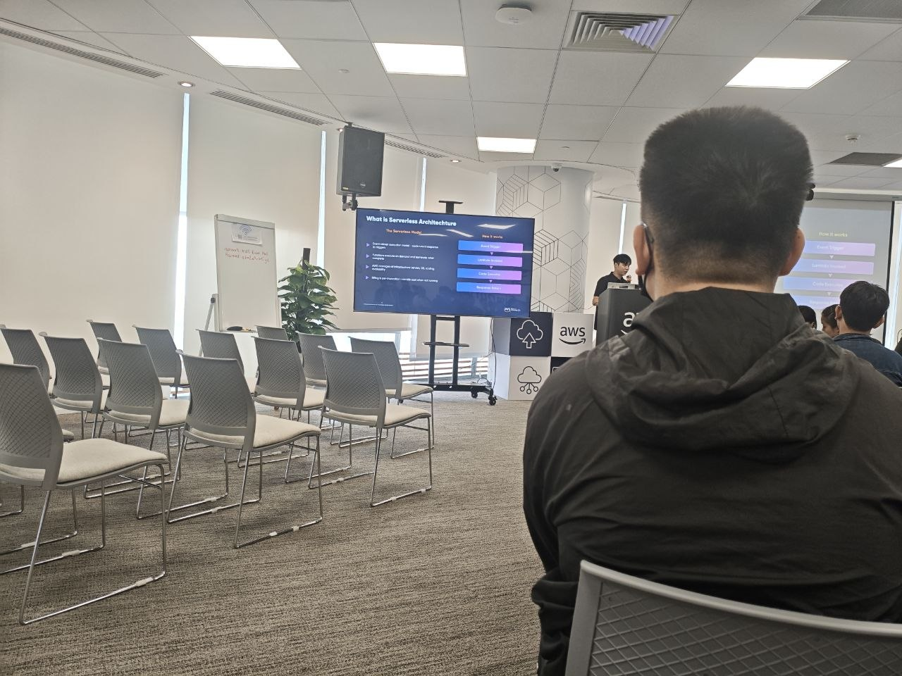

### 2.1. Bản chất Serverless Computing

Anh Kiệt mở đầu phiên bằng việc phân tích mô hình Serverless — nơi nhà phát triển được giải phóng hoàn toàn khỏi việc quản trị máy chủ:
- **Focus on Code (Tập trung phát triển mã nguồn):** Toàn bộ việc cấp phát phần cứng, cấu hình Load Balancer, cài đặt bản vá hệ điều hành (OS patching) và bảo mật tầng dưới do AWS chịu trách nhiệm. Lập trình viên chỉ tập trung vào logic nghiệp vụ và bàn giao sản phẩm.
- **Automatic Scaling & Scale-to-Zero:** Hệ thống tự động co giãn theo lưu lượng truy cập thực tế. Khi không có request, tài nguyên tự động co về 0 (Scale to zero).
- **Cost-effective (Tối ưu chi phí thực tế):** Tính phí theo mô hình Pay-as-you-go — chỉ trả tiền cho số lần kích hoạt (invocation) và thời gian xử lý chính xác (tính bằng mili-giây). Không phát sinh chi phí trong thời gian hệ thống rảnh rỗi.

### 2.2. Kiến trúc Event-driven và các dịch vụ Serverless cốt lõi

Hệ thống hoạt động theo luồng: **Event Trigger ➔ AWS Lambda Execution ➔ Response**:

| Dịch vụ AWS | Vai trò kỹ thuật |
|-------------|-------------------|
| **AWS Lambda** | Compute service thực thi code on-demand, hỗ trợ đa ngôn ngữ, tích hợp sâu trong hệ sinh thái AWS |
| **Amazon API Gateway** | Cổng tiếp nhận HTTP/REST traffic từ internet, xác thực và định tuyến thông minh tới Lambda hoặc AWS SQS |
| **Amazon DynamoDB** | Cơ sở dữ liệu NoSQL Serverless độ trễ mili-giây, quản lý hoàn toàn, tự động scale theo throughput |
| **Amazon S3** | Object storage lưu trữ media assets, tài liệu và hosting Single Page Application (SPA) |

### 2.3. So sánh Traditional Application vs. Serverless

| Tiêu chí | Traditional Application (VM / Monolith / Container) | Serverless Application (Lambda / API Gateway) |
|---|---|---|
| **Hạ tầng (Infrastructure)** | Tự quản lý Server, OS, cấu hình Auto Scaling Groups, vá lỗi định kỳ | AWS quản lý toàn bộ, chỉ cấu hình rule mức cao |
| **Đơn vị triển khai (Deployment Unit)** | Monolith service, Docker container, Virtual Machine | Function (Lambda), API Route, Event Handler |
| **Khả năng mở rộng (Scaling)** | Cấu hình phức tạp (Nginx, ALB, K8s HPA...), thời gian scale tính bằng phút | Tự động scale tức thì theo từng invocation |
| **Mô hình chi phí (Cost Model)** | Tính tiền 24/7 liên tục ngay cả khi không có traffic | Chỉ tính tiền khi có request xử lý + data transfer |
| **Độ sẵn sàng (High Availability)** | Phải tự thiết kế Multi-AZ, Load Balancer failover | Built-in High Availability sẵn ở cấp độ dịch vụ AWS |

### 2.4. 6 Trade-offs thực tế và Giải pháp kỹ thuật

Anh Kiệt nhấn mạnh Serverless không phải giải pháp toàn năng thay thế 100% kiến trúc cũ, mà tồn tại các đánh đổi cần xử lý:

1. **Cold Start (Độ trễ khởi động lạnh):** Khi khởi tạo một Lambda instance mới, hệ thống mất khoảng 2-3 giây để init môi trường runtime và thư viện.  
   ➜ *Giải pháp:* Kích hoạt **Provisioned Concurrency** (luôn giữ sẵn 2-3 container ấm) cho các endpoint nhạy cảm với độ trễ.
2. **Khó khăn trong Debug & Distributed Tracing ở môi trường Local:** Khó mô phỏng trọn vẹn luồng tương tác đa dịch vụ Serverless ở máy cá nhân.  
   ➜ *Giải pháp:* Xây dựng môi trường Development độc lập trên AWS, tự động hóa deploy qua CI/CD Pipeline để test trực tiếp trên cloud.
3. **Vendor Lock-in:** Code và cơ chế trigger gắn chặt với API và dịch vụ của AWS, khó chuyển đổi sang đám mây khác hoặc on-premise.
4. **Chi phí không kiểm soát khi tải cao liên tục:** Với ứng dụng có lượng truy cập lớn và đều đặn 24/7, Serverless có thể đắt hơn so với việc thuê cụm EC2 / EKS cố định.  
   ➜ *Nguyên tắc:* Áp dụng Serverless cho các workload có biến động lớn, không dự đoán trước được tải (unpredictable). Khi ứng dụng đạt ngưỡng traffic ổn định lâu dài thì cân nhắc chuyển sang Container-based.
5. **Giới hạn dung lượng gói (Package Size Limit 250 MB):** Các bài toán AI/ML kéo theo các bộ thư viện lớn dễ vượt ngưỡng 250 MB giải nén của Lambda.  
   ➜ *Giải pháp:* Tách các thư viện dùng chung ra thành các **Lambda Layers**.
6. **Quản lý Database Connection (Connection Exhaustion):** Mỗi Lambda instance mở một connection riêng đến RDBMS. Khi có 1.000 requests đồng thời, 1.000 kết nối đồng loạt mở sẽ làm sập PostgreSQL/MySQL.  
   ➜ *Giải pháp:* Bổ sung tầng **Amazon RDS Proxy** đứng trước database để quản lý tập trung Connection Pooling.

### 2.5. 4 Serverless Application Patterns phổ biến

- **Pattern 1 - Synchronous API:** Client ➔ API Gateway ➔ Lambda Handler ➔ DynamoDB / RDS.
- **Pattern 2 - Authentication & Authorization:** Client ➔ Amazon Cognito User Pool / API Gateway Custom Authorizer ➔ Lambda.
- **Pattern 3 - Scheduled CronJobs:** Amazon EventBridge Scheduler định kỳ trigger Lambda (ví dụ 12h đêm hàng ngày) để tổng hợp dữ liệu, báo cáo.
- **Pattern 4 - Asynchronous Event Processing:** Producer ➔ Amazon SQS Queue ➔ Lambda (xử lý nền gửi email hàng loạt, xử lý video).

### 2.6. Cấu trúc Monorepo thực tế cho dự án Serverless

Anh Kiệt chia sẻ cấu trúc project chuẩn đang vận hành tại doanh nghiệp:
- apps/: Mỗi thư mục con đại diện cho một Lambda function độc lập.
- packages/shared-library/: Chứa mã nguồn dùng chung (Error responses, Type definitions, Logger) cho mọi Lambda.
- packages/infra/: Chứa mã Infrastructure as Code (IaC) cấu hình Lambda, API Gateway routes và permission.

### 2.7. Phần hỏi đáp (Q&A)

> **Người hỏi (Bạn Trung Kiên - Software Engineer):** *Tại sao lại dùng Serverless để đánh giá/tối ưu chi phí thay vì kiến trúc truyền thống?*  
> **Anh Lâm Tuấn Kiệt:** *Hãy lấy ví dụ hệ thống nội bộ (internal portal) của ngân hàng: Ứng dụng chỉ có nhân viên truy cập trong 8 tiếng giờ hành chính từ thứ 2 đến thứ 6. Nếu chạy server truyền thống 24/7 thì 16 tiếng ban đêm và 2 ngày cuối tuần bị lãng phí hoàn toàn tiền hạ tầng. Sử dụng Serverless với tính năng scale-to-zero giúp tiết kiệm 100% chi phí ngoài giờ. Khi nào lượng người dùng tăng đột biến và trải đều cả ngày lẫn đêm thì mới cân nhắc chuyển về Container.*

---

## 3. Phiên 2: Optimize Database Cost & Performance with Data Archiving Strategy

- **Diễn giả:**
  - Anh **Lý Hoàng Việt (Viet Ly)** — AWS Community Builder, DevOps Engineer tại VPBank
  - Anh **Nguyễn Tuấn Kiệt (Kiet Nguyen)** — Software Engineer / Data Engineer tại VPBank

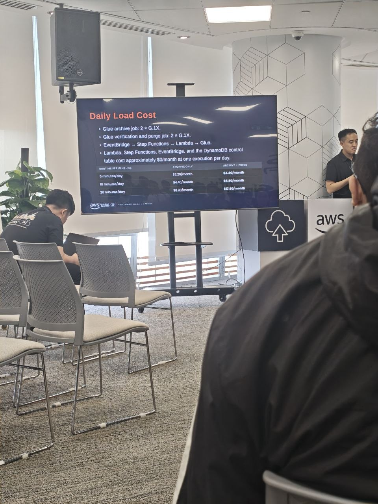

### 3.1. Bài toán thực tế: Sự phình to của Cơ sở dữ liệu tại Ngân hàng

Sau nhiều năm vận hành, khối lượng dữ liệu giao dịch trong ngân hàng phình to đến hàng trăm GB hoặc hàng TB:
- **Chi phí lưu trữ tăng cao:** Lưu trữ SSD hiệu năng cao trên Amazon RDS hoặc DynamoDB rất đắt đỏ.
- **Tốc độ truy vấn suy giảm (Latency tăng):** Bảng có hàng triệu dòng khiến việc query, quét dữ liệu bị chậm lại dù đã đánh Index.
- **Ảnh hưởng trải nghiệm người dùng:** Khách hàng ngân hàng phải chờ đợi lâu khi thực hiện giao dịch.

### 3.2. Chiến lược phân tầng dữ liệu: Hot Data vs. Cold Data

| Tiêu chí | Hot Data (Dữ liệu nóng) | Cold Data (Dữ liệu lạnh / lịch sử) |
|---|---|---|
| **Đặc điểm** | Dữ liệu phát sinh gần nhất (< 1 năm hoặc < 90 ngày) | Dữ liệu lịch sử cũ (> 1 năm hoặc > 90 ngày) |
| **Tần suất truy cập** | Truy vấn liên tục hàng ngày cho các giao dịch trực tiếp | Rất hiếm khi truy vấn (chủ yếu phục vụ audit, tra soát) |
| **Nơi lưu trữ tối ưu** | **Amazon RDS PostgreSQL / MySQL** | **Amazon S3 Data Lake + Amazon Athena** |

### 3.3. Kiến trúc Pipeline Lưu trữ & Xử lý (Data Archiving Pipeline)

Nhóm chuyên gia VPBank xây dựng pipeline tự động hóa với 2 luồng chính:

#### Luồng 1: Initial Full Load (Nạp dữ liệu lịch sử lần đầu)
1. **AWS DMS (Database Migration Service):** Trích xuất toàn bộ dữ liệu lịch sử (cũ hơn 365 ngày hoặc 90 ngày) từ RDS và ghi sang **Amazon S3** dưới dạng file Raw Parquet.
2. **AWS Glue Job:** Đọc file Raw Parquet, thực hiện phân vùng sâu (**Deep Partitioning**) theo cấu trúc thư mục /year=YYYY/month=MM/day=DD/ và ghi vào S3 Curated bucket.
3. **Purge Script:** Xóa an toàn các bản ghi đã được sao lưu ra khỏi database RDS gốc.

#### Luồng 2: Daily Incremental Load (Lưu trữ tăng dần hàng ngày)
1. **Amazon EventBridge:** Kích hoạt ETL pipeline tự động vào khung giờ ban đêm (off-peak hours) để tránh chiếm dụng I/O của database production.
2. **Step Functions + AWS Lambda + AWS Glue:** Trích xuất dữ liệu của ngày cũ nhất đạt mốc cut-off, chuyển đổi định dạng Parquet, phân vùng và lưu vào S3 Curated.
3. **Purge Task:** Xóa các dòng tương ứng trên RDS để giữ dung lượng DB luôn ở mức tối ưu cố định (ví dụ luôn duy trì 50 GB thay vì tăng lên 100 GB+).
4. **Amazon Athena:** Đóng vai trò Query Engine Serverless giúp nhân viên hoặc ứng dụng truy vấn dữ liệu lạnh trên S3 thông qua cú pháp SQL chuẩn mà không cần nạp ngược lại vào database.

### 3.4. Video Demo thực tế trên RDS PostgreSQL

Anh Nguyễn Tuấn Kiệt trình diễn trực tiếp kịch bản thực tế:
- Cấu hình mốc cut-off 90 ngày trên database PostgreSQL.
- Khởi chạy AWS DMS migrate dữ liệu cũ hơn 90 ngày sang S3 Raw bucket.
- AWS Glue Job xử lý phân vùng thành công sang S3 Curated bucket theo Year/Month/Day.
- Thực thi tác vụ xóa và giải phóng thành công **629 records** khỏi bảng PostgreSQL gốc.
- Mở Amazon Athena thực hiện câu lệnh SQL quét dữ liệu trên S3 thành công với tốc độ cao nhờ tính năng Partition Pruning.

### 3.5. Bảng tính toán chi phí chi tiết (Cost Estimation)

#### Chi phí Initial Load (DMS C3 Medium, 50 GB Storage, Single-AZ + 2 DPU AWS Glue):
- **Khối lượng 100 GB:** DMS chạy 4h ($0.48) + Glue chạy 1h ($1.00) ≈ **$1.48**
- **Khối lượng 1 TB:** DMS chạy 24h ($2.88) + Glue chạy 6h ($6.00) ≈ **$8.88**

#### Chi phí Daily Incremental Load (2 workers Glue mỗi job):
- **Thời gian chạy 5 phút/ngày:** Archive Only = **$2.20/tháng** | Archive + Purge = **$4.40/tháng**
- **Thời gian chạy 10 phút/ngày:** Archive Only = **$4.40/tháng** | Archive + Purge = **$8.80/tháng**
- **Thời gian chạy 20 phút/ngày:** Archive Only = **$8.80/tháng** | Archive + Purge = **$17.60/tháng**
- *Chi phí cho Lambda, Step Functions, EventBridge và DynamoDB control table xấp xỉ **$0/tháng** do nằm trong định mức miễn phí hoặc cực nhỏ.*

### 3.6. 5 Key Takeaways từ phiên chia sẻ
1. **Archive cold data:** Chủ động tách dữ liệu lạnh ra khỏi database chính.
2. **Use incremental processing:** Xử lý tăng dần theo ngày để kiểm soát tải và chi phí.
3. **Optimize data format:** Luôn sử dụng định dạng cột Parquet kết hợp Deep Partitioning.
4. **Right-size compute:** Chọn đúng cấu hình DPU/Worker cho DMS và Glue để tránh lãng phí.
5. **Keep data accessible:** Đảm bảo dữ liệu lạnh luôn sẵn sàng để truy vấn bằng Amazon Athena.

### 3.7. Phần hỏi đáp chuyên sâu (Q&A)

> **Câu hỏi 1 (Đồng bộ Multi-Region / Multi-AZ):** *Làm sao để đảm bảo tính nhất quán dữ liệu và tránh downtime khi migrate dữ liệu lớn trên hệ thống phân tán?*  
> **Trả lời:** AWS DMS hỗ trợ cấu hình Multi-AZ sẵn sàng cao. Việc trích xuất dữ liệu lịch sử được thực hiện dựa trên trường mốc thời gian (timestamp cutoff) nên không gây xung đột ghi (write conflict) với các giao dịch nóng hiện tại.
>
> **Câu hỏi 2 (Tối ưu tốc độ query dữ liệu Cold Data):** *Khi cần tra cứu Cold Data gấp thì làm sao để tốc độ đạt nhanh nhất?*  
> **Trả lời:** Phân vùng (Partitioning) sâu theo các trường thường xuyên lọc (Year/Month/Day/Customer ID) giúp Athena chỉ quét đúng thư mục cần thiết. Đối với các hệ thống lớn đòi hỏi chuẩn ACID và Time-travel query, có thể triển khai các định dạng bảng mở như **Apache Iceberg** hoặc **Apache Hudi** trên S3 Data Lake.
>
> **Câu hỏi 3 (Ứng dụng Amazon Redshift tại VPBank):** *VPBank có use-case nào sử dụng Amazon Redshift không?*  
> **Trả lời:** Redshift được sử dụng như Data Transformation Engine. Nhóm nạp dữ liệu từ Data Lake lên Redshift và dùng câu lệnh SQL quen thuộc để xử lý, biến đổi dữ liệu phân tích mà không cần phải xây dựng và vận hành cụm Apache Spark phức tạp.

---

## 4. Phiên 3: Diffusion & OCR — Ứng dụng Generative AI trên hạ tầng Serverless AWS

- **Diễn giả:** Anh **Huỳnh Hoàng Long (Long Huynh)** — Solution Architect tại eCloudvalley

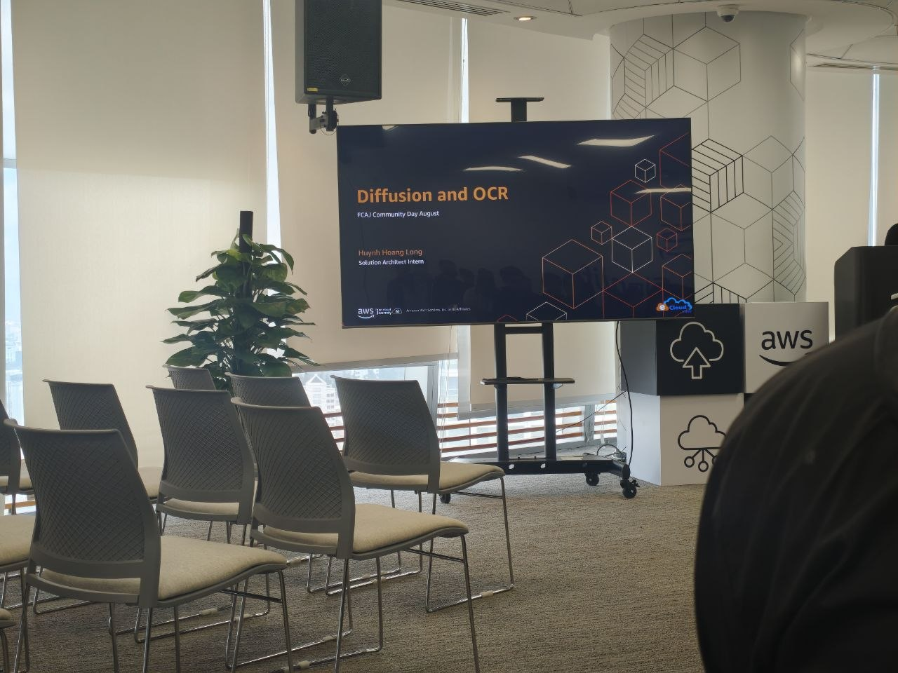

### 4.1. Kiến trúc Serverless Text-to-Image Generation

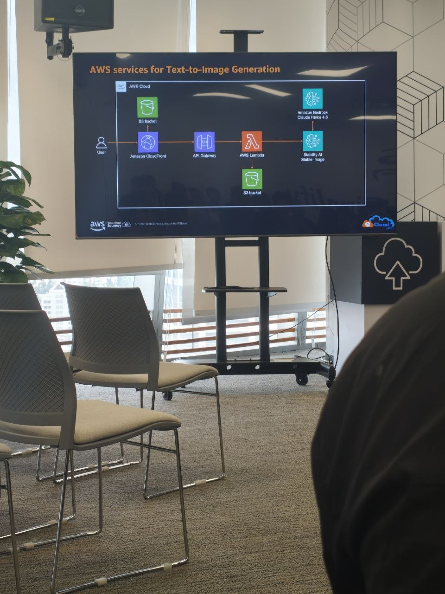

Giải pháp xây dựng hoàn toàn trên nền tảng Serverless:
1. **Frontend Hosting:** Ứng dụng Single Page App lưu trữ trên **Amazon S3** và phân phối toàn cầu qua CDN **Amazon CloudFront**.
2. **API & Orchestration:** **Amazon API Gateway** tiếp nhận yêu cầu từ người dùng và ủy quyền xử lý cho **AWS Lambda**.
3. **Prompt Enrichment (Làm giàu câu lệnh):** Lambda gọi mô hình nền tảng **Claude Haiku 4.5** qua **Amazon Bedrock** để mở rộng câu lệnh tiếng Việt ngắn gọn thành mô tả prompt tiếng Anh giàu chi tiết hình ảnh và ánh sáng.
4. **Diffusion Image Synthesis:** Lambda chuyển tiếp prompt hoàn chỉnh sang **Stability AI (Stable Image)** trên Bedrock để tạo hình ảnh có độ phân giải cao.
5. **Storage & Delivery:** Hình ảnh kết quả được lưu trữ vào **Amazon S3 Bucket** và trả URL an toàn về cho người dùng.

### 4.2. Trình diễn ứng dụng thực tế "DemoAI — Image ⇌ Text"

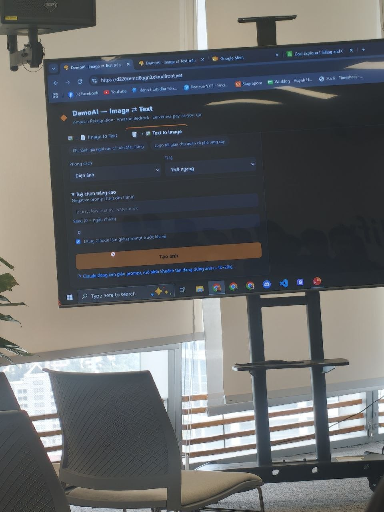

Ứng dụng demo trực tiếp các tính năng:
- **Image to Text (OCR):** Nhận diện ký tự và phân tích ngữ cảnh hình ảnh qua Amazon Rekognition kết hợp Bedrock.
- **Text to Image:** Hỗ trợ chọn phong cách (Điện ảnh / Cinematic), tỷ lệ khung hình (16:9, 1:1), Negative prompt (loại bỏ watermark, low quality) và seed tùy biến.
- Toàn bộ kiến trúc hoạt động theo cơ chế Pay-as-you-go, không tốn chi phí duy trì khi không có người dùng.

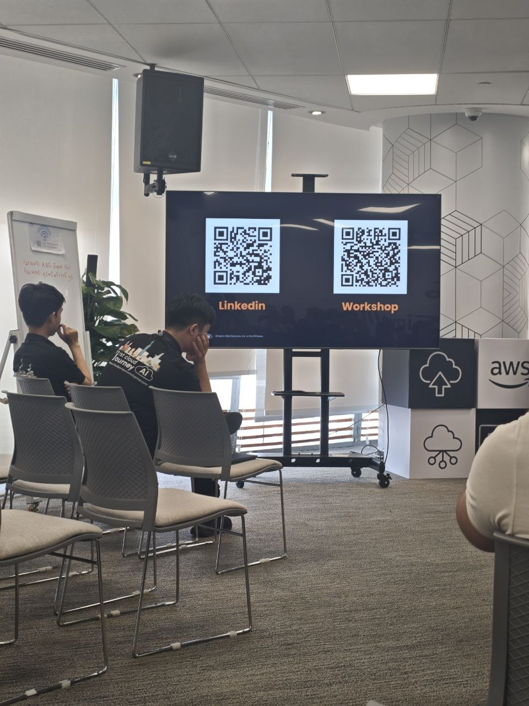

---

## 5. Tổng kết bài học và Giá trị thu hoạch

Tham dự sự kiện **AWS First Cloud AI Journey - Community Day** đã mang lại những bài học công nghệ giá trị:

1. **Tư duy thiết kế hệ thống Cloud-Native hiện đại:** Nắm rõ sự cân bằng giữa tính linh hoạt của Serverless và sức mạnh xử lý của Containerization để áp dụng đúng bài toán thực tế.
2. **Làm chủ quy trình tối ưu hóa Database quy mô lớn:** Mô hình Hot/Cold Data Tiering với bộ công cụ DMS + S3 + Glue + Athena giúp cắt giảm 80%+ chi phí lưu trữ DB mà vẫn bảo đảm khả năng truy xuất lịch sử.
3. **Kỹ thuật tích hợp AI/GenAI thực chiến:** Học hỏi mô hình kết hợp LLM (Claude Haiku trên Amazon Bedrock) để làm giàu ngữ cảnh trước khi đưa vào các mô hình chuyên biệt (Stability AI).

---

## 6. Hình ảnh lưu niệm tại sự kiện

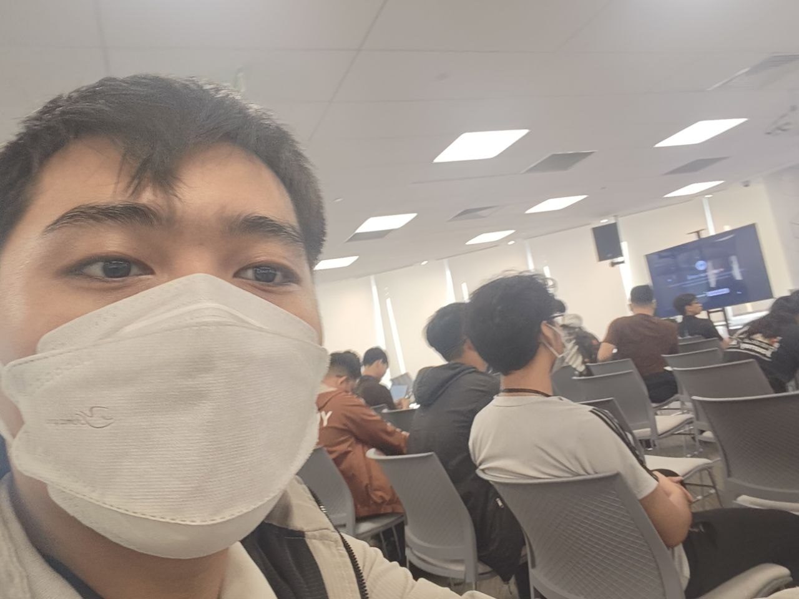

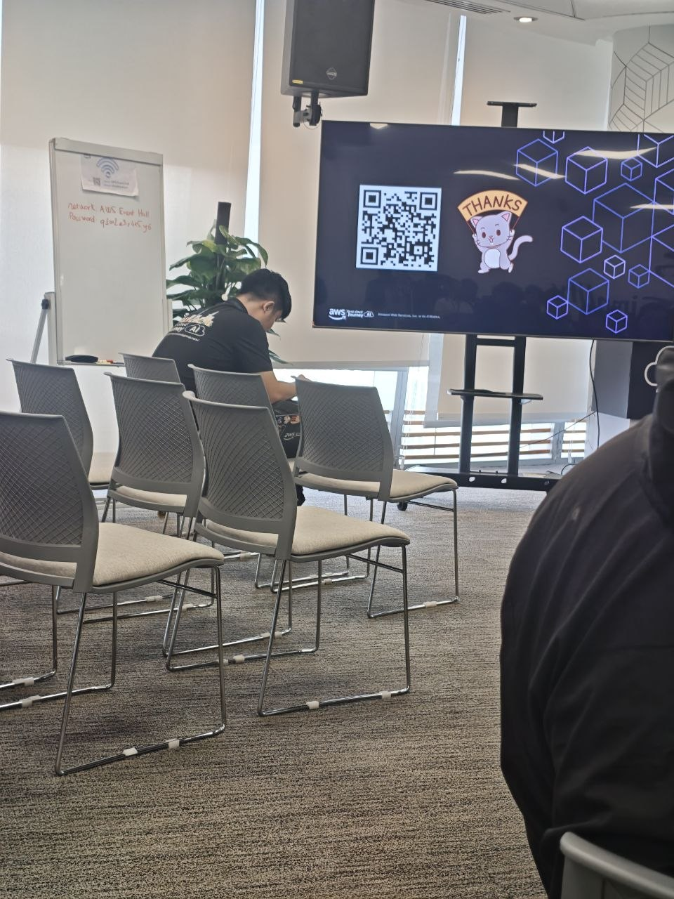

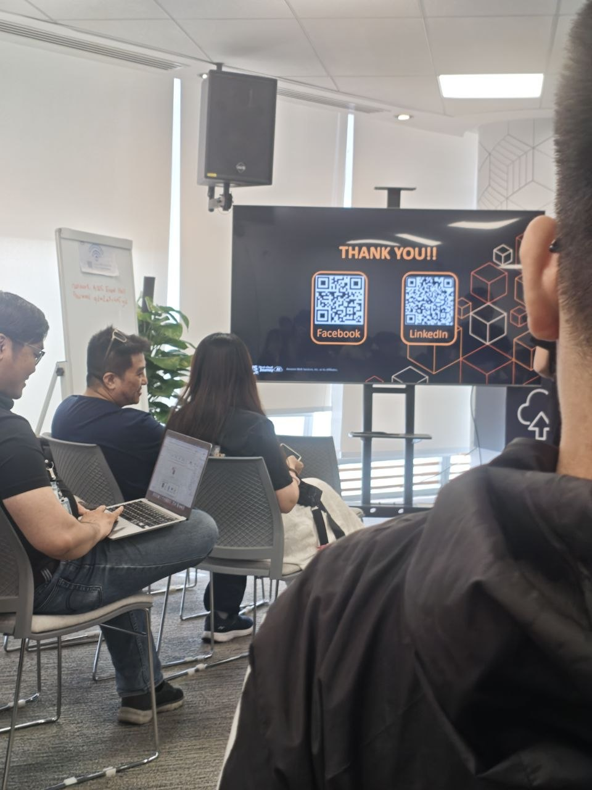
