# Event 2: FCJ Build-a-thon Kick-off 2026 — Code the Future with CMC Global

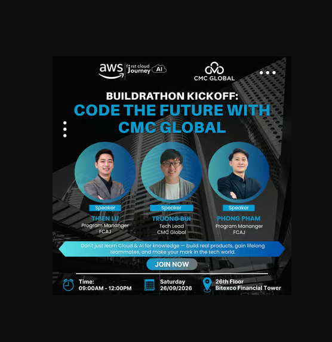

- **Date & Time:** Saturday, September 26, 2026 (09:00 AM – 12:00 PM)
- **Location:** AWS Vietnam Office, 26th Floor, Bitexco Financial Tower, No. 2 Hai Trieu, Ben Nghe Ward, District 1, Ho Chi Minh City
- **Role:** Intern / Participating Builder
- **Organizers:** AWS First Cloud AI Journey (FCAJ), AWS Cloud Academy in collaboration with CMC Global

### Key Guests & Keynote Speakers:
1. **Mr. Nguyen Gia Hung** — Head of Solutions Architecture at AWS Vietnam & Cambodia, Founder First Cloud Journey (FCJ/FCAJ) & AWS Study Group
2. **Mr. Bui Nhat Truong** — Technical Leader at CMC Global (Australia Market), Head of Digital Transformation at Son Kim Group
3. **Ms. Thai Thanh Nhan** — Communications & Talent Acquisition Representative, CMC Global (Event MC)
4. **Mr. Thien Lu & Mr. Phong Pham** — Program Managers, First Cloud AI Journey (FCAJ)

---

## Event Check-in & Attendance

| Check-in at the Event | Attending Keynote at the Hall |
| :---: | :---: |
| 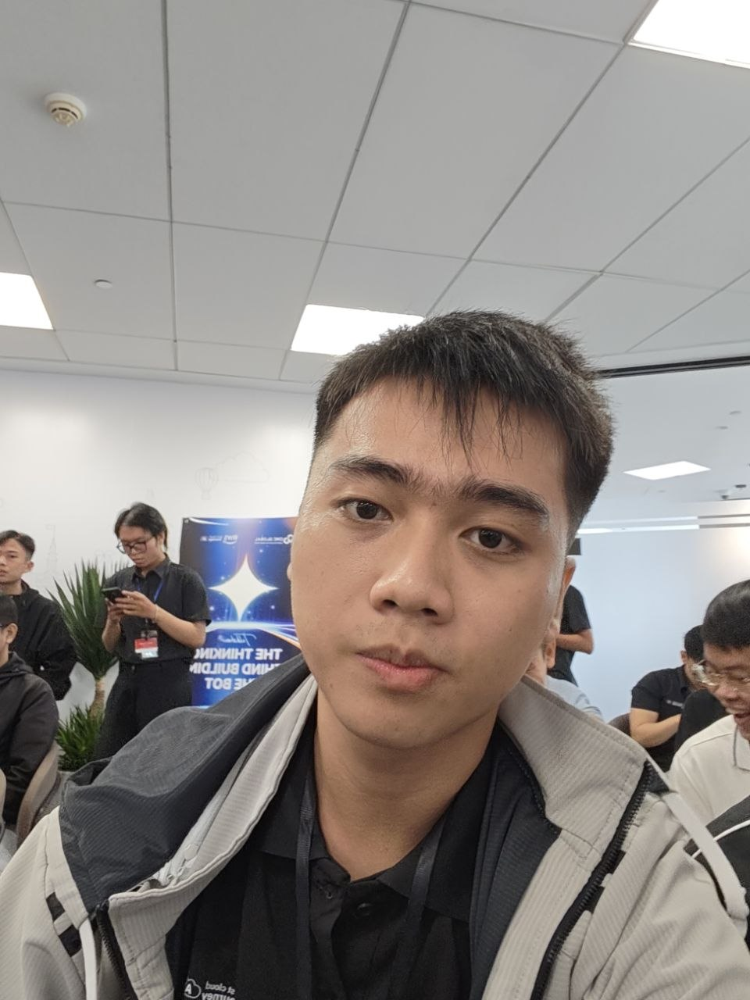 | 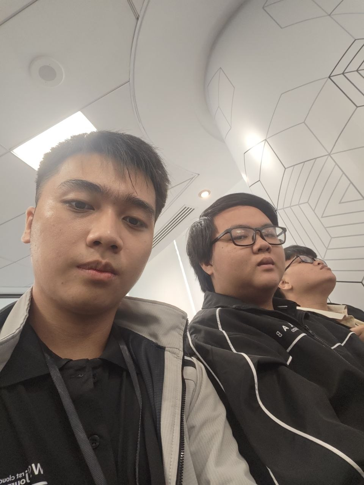 |

---

## 1. Event Overview & FCJ Build-a-thon 2026 Kick-off

The **FCJ Build-a-thon Kick-off 2026** represents an essential milestone in the evolution of the First Cloud Journey community: transitioning from traditional lecture-based training to a **"Hands-on Product Building"** paradigm.

Organized in partnership with **CMC Global** — a premier strategic partner of AWS in Vietnam and global markets, the event provided participants with direct insights into contemporary hiring expectations, industry opportunities, and practical enterprise AI Agent implementations.

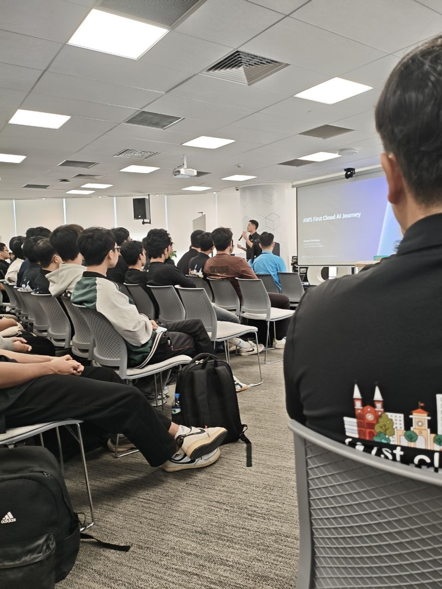

---

## 2. Session 1: Community Spirit, AI-Era Hiring Realities & FCJ Build-a-thon Core Values

- **Speaker:** Mr. **Nguyen Gia Hung** — Head of Solutions Architecture at AWS Vietnam & Cambodia; Founder First Cloud Journey (FCJ/FCAJ) & AWS Study Group.

> **About the Speaker:** Mr. Nguyen Gia Hung is the Head of Solutions Architecture for AWS across Vietnam and Cambodia, with over 17 years of enterprise cloud architecture leadership. He is the founder and guiding spirit of the First Cloud Journey (FCAJ) initiative and the AWS Study Group community, directly securing sponsorship from global/ASEAN AWS executives and enterprise partners to build high-impact cloud internship and career pathways for university students.

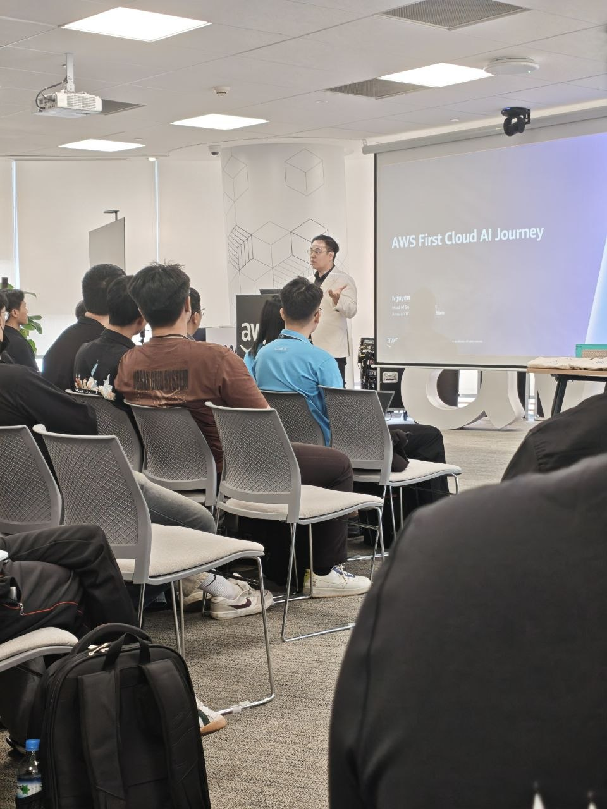

### 2.1. Cloud Stature, AWS Ecosystem & Long-Term Investment in Vietnam
Mr. Hung reflected on AWS's strategic journey in Vietnam since 2015:
- Unlike typical short-term software subscription models, AWS focuses on deep, sustainable investments in **people, local talent, and foundational infrastructure**: establishing official entities in HCMC (2017) and Hanoi (2019), launching Edge Locations, Local Zones, and progressing toward future AWS Region development in Vietnam.
- AWS serves as the principal profit engine of Amazon, powering major commercial banks, fintechs, and tech enterprises in Vietnam (VPBank, Techcombank, VIB, VNG, MoMo, Masan, Grab...).

| AWS Investment History in Vietnam (2015 – 2026) | Diverse Customer Base in Vietnam |
| :---: | :---: |
| 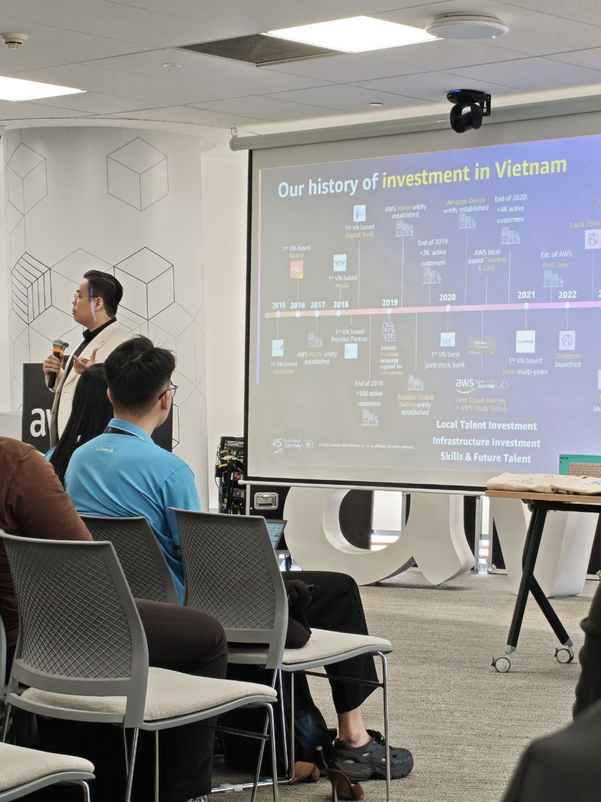 | 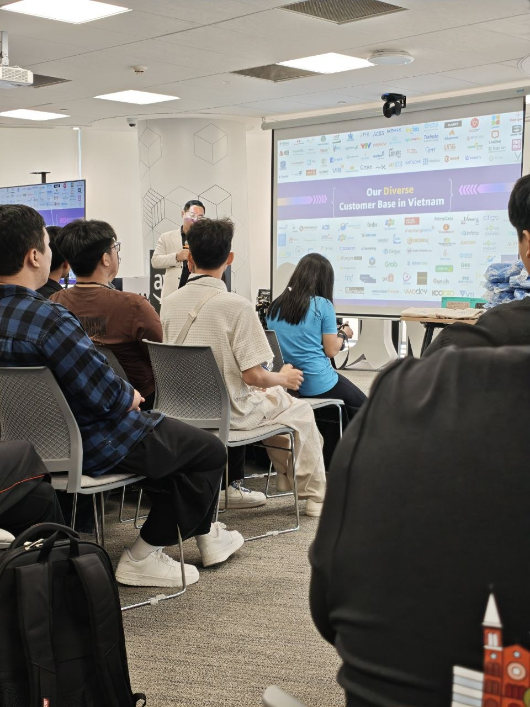 |

### 2.2. "AWS is your competitive edge, not a job title"
Mr. Hung emphasized that **Cloud and AWS are no longer isolated job titles, but mandatory baseline competencies for all software engineers**:
- Regardless of role — whether AI Engineer, Backend Developer, Data Engineer, or DevOps — proficiency in Cloud infrastructure serves as a vital competitive edge.
- In the generative AI era, hiring managers expect candidates to possess both **solid Computer Science fundamentals** and the ability to leverage modern AI tools effectively.

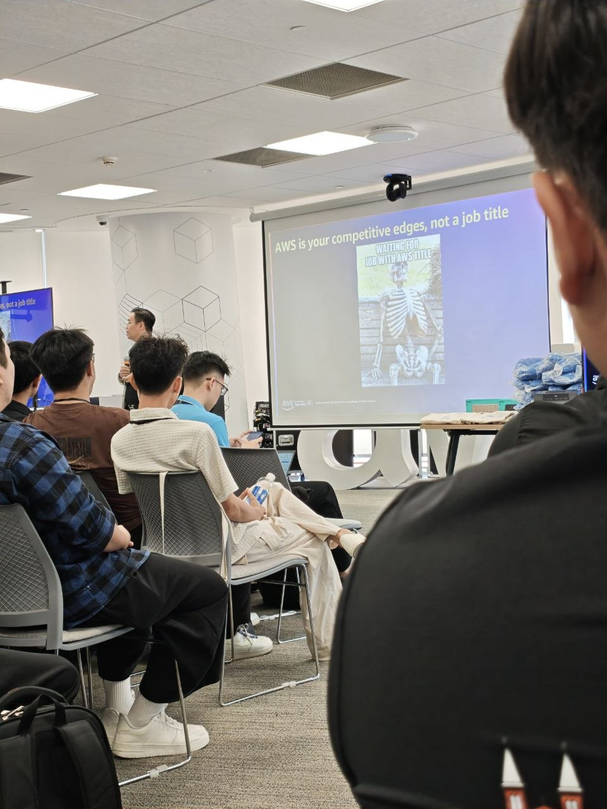

### 2.3. Core Mental Models for Young Engineers
Drawing from over 20 years of technical leadership, Mr. Hung shared essential mental models:
1. **The Power of Brotherhood:** *"Sharks swim in schools; only goldfish drift aimlessly."* Industry challenges are increasingly complex; engineers must cultivate reliable, collaborative networks to sustain long-term career growth.
2. **Jevons Paradox in Software Engineering:** As AI reduces software development costs, the total volume of software will explode exponentially. More software inherently demands **greater human accountability (human-in-the-loop) and advanced troubleshooting capabilities under production pressure**.
3. **Two Fundamental Engineering Inquiries:** Every technical assessment boils down to two core proofs:
   - *Have you personally built and deployed a production-grade system?*
   - *When critical incidents arise, can you debug and resolve them down to root causes?*
4. **"Pay it forward" Culture:** Prioritize contributing to the community and team before seeking personal perks or voicing complaints.
5. **Resilience & Self-Investment:** *"If you hesitate to invest in your own skills, employers will hesitate to invest in your compensation."* Technology demands continuous, lifelong learning.

### 2.4. Distinction of FCJ Build-a-thon
- **Not a 24–48 Hour Hackathon:** Short hackathons frequently result in superficial MVP prototypes and pitch decks.
- **A 3- to 6-Month Real-World Building Program:** Requires builders to engineer genuine, fully functional architectures on live AWS accounts, mentored by senior architects, and evaluated by external industry judges (enterprise CIOs and IT Directors).

---

## 3. Session 2: Career Opportunities at CMC Global & Mentimeter Pulse Survey

- **Host:** Ms. **Thai Thanh Nhan** — Communications & Talent Acquisition Representative, CMC Global.

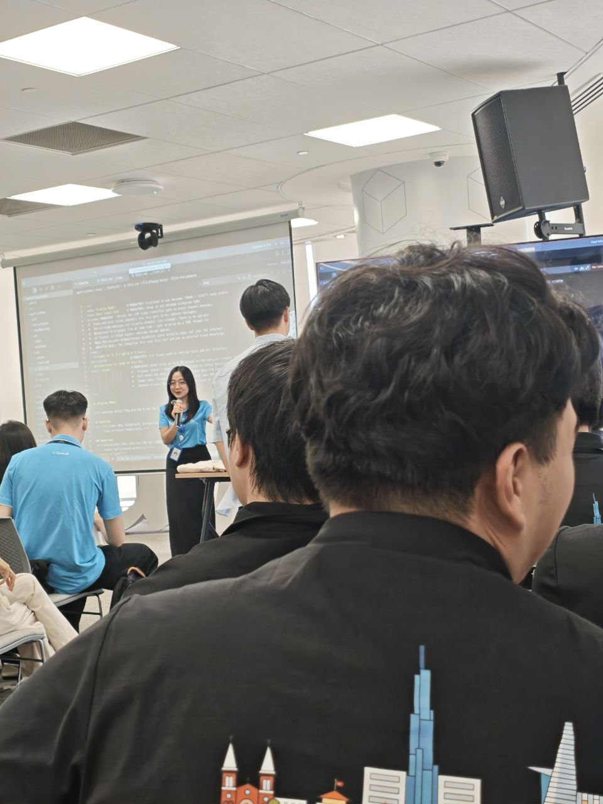

### 3.1. About CMC Global
- The global business division of CMC Corporation, operating across 10+ offices in 30 countries worldwide, with major technical hubs in Hanoi, Da Nang, and Ho Chi Minh City.
- Introduced the **Fresher Tech Camp** — a structured talent development initiative in its 4th consecutive year, providing paid internships and full-time promotion pathways.

### 3.2. Mentimeter AI Demand Survey
Attendees participated in an interactive poll regarding their primary daily AI needs:
- Top keyword selections included: **Coding, Research, Task Automation, Debugging, GenAI, Continuous Learning**.
- This transitioned into the technical discussion: how to architect customized, production-ready AI agents tailored for real enterprise workflows.

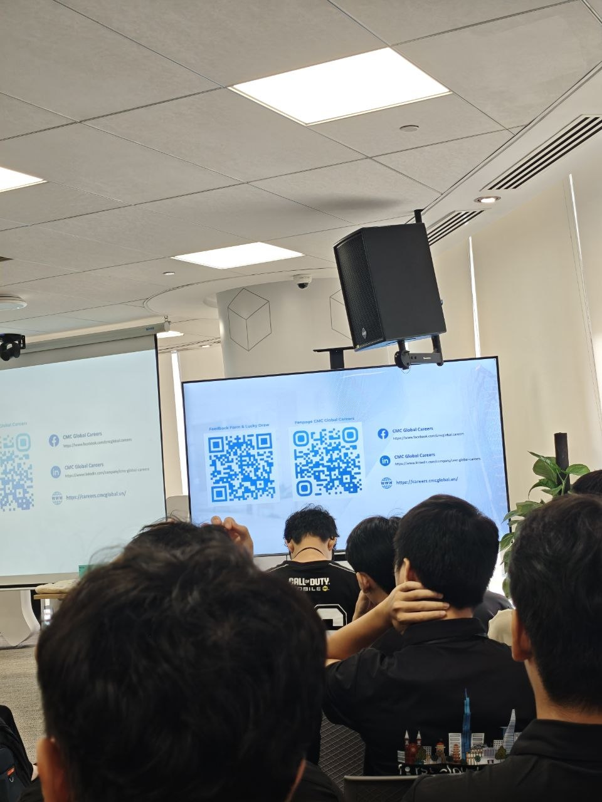

---

## 4. Session 3: Technical Deep-Dive — Building a Production Triage Bot & Coding Agent on Slack

- **Speaker:** Mr. **Bui Nhat Truong** — Technical Leader at CMC Global (Australia Market), Head of Digital Transformation at Son Kim Group.

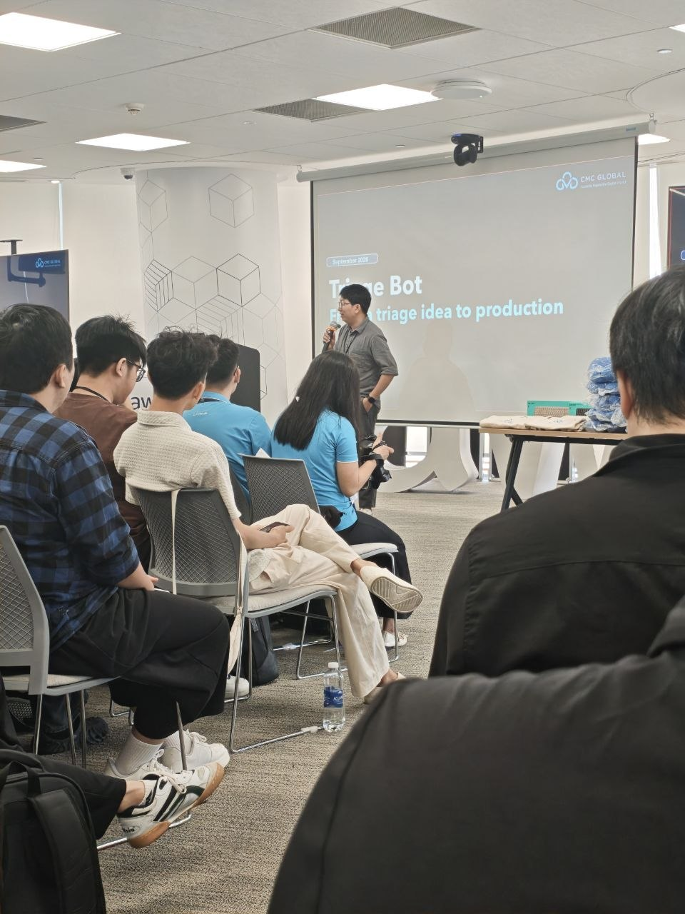

### 4.1. Business Problem & Operational Context
- CMC Global's engineering teams are based in Vietnam, while client and business teams operate in Australia across a **3–4 hour timezone difference**.
- When Australian stakeholders report urgent bugs early in their morning, Vietnamese engineers are not yet online.
- **Objective:** Construct an autonomous **Triage Bot** on Slack capable of gathering detailed incident context from stakeholders, cross-referencing monitoring signals (AWS CloudWatch, Datadog, Sumo Logic), and generating structured triage summaries ready for engineers by 8:30 AM.

### 4.2. "The Full Picture" Architectural Breakdown

Mr. Truong delivered a comprehensive walk-through of the **Market Slack Bot** architecture, powered by the **Claude Code / Clawbot Harness Tool**:

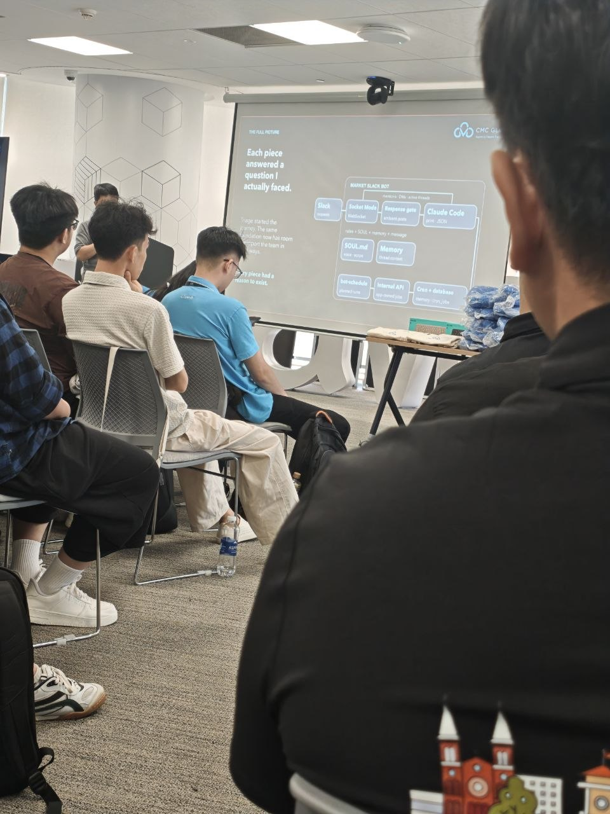

#### Core Architectural Components Breakdown:
1. **The Soul Layer (SOUL.md — inspired by OpenClaw):**
   - Decoupled from core agent logic to define: *Persona (friendly, professional), Scope (permitted vs. restricted actions), and Communication Tone*.
   - Enables orchestrating distinct specialized sub-agents (Developer, Tester, Reviewer, Jira Updater) within a single request cycle without role collision.
2. **Slack Socket Mode:**
   - Establishes persistent outbound WebSocket communication, **eliminating the need for public IP addresses or inbound firewall openings**, significantly reducing attack surfaces.
3. **Response Gate (Message Filter & Cost-Aware Routing):**
   - Evaluates whether incoming channel messages require action or silence (preventing unwanted banter replies).
   - **FinOps Optimization:** Routes straightforward queries to lightweight models such as **Claude Haiku** (~\$0.25–\$1.00/1M tokens) instead of costlier models like **Sonnet/Opus** (\$3.00–\$15.00/1M tokens).
4. **Thread-Level Memory Management:**
   - Persists conversation context per Slack thread in a database. At each invocation turn, the bot fetches and refines state rather than appending raw unbounded text strings, preventing context window saturation.
5. **Resilient Scheduling Engine ("A schedule had to survive a restart"):**
   - The bot handles recurring automated tasks, such as reminding engineers about pending Pull Requests across 8 repositories.
   - Because ephemeral containers frequently redeploy and purge OS cron states, schedule configurations are stored in a database and reloaded via an Internal API upon each boot.
6. **Guardrails & Protective Hooks:**
   - Pre- and post-execution hooks (bash scripts) validate all agent outputs, mitigating hallucinations, data loss, or secret key exposure.

| Response Gate: Knowing when to stay quiet | Scheduler surviving container restarts |
| :---: | :---: |
| 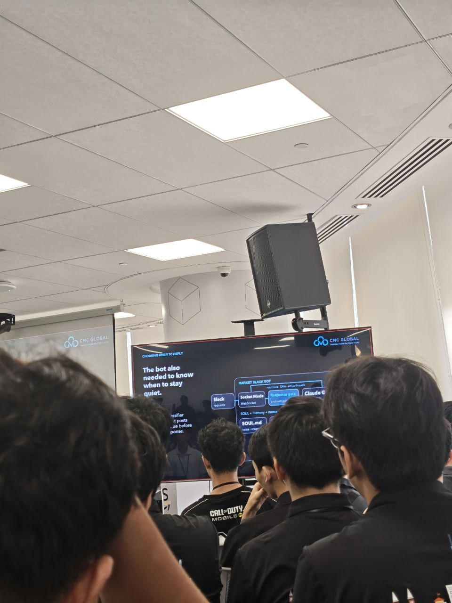 | 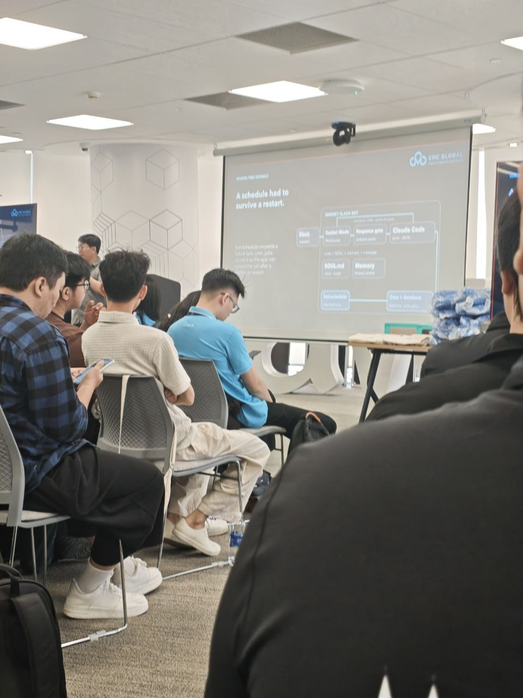 |


### 4.3. Live Slack Production Demo
Mr. Truong demonstrated the bot's workflow through real-time multi-account testing:
- **Scenario 1 (Autonomous Follow-up):** A stakeholder requests a 1-minute pause → Exactly 60 seconds later, the bot pings to resume information gathering.
- **Scenario 2 (Cloudflare 500 Incident Triage):** A user reports a service outage → The bot systematically clarifies error codes, categorizes incident severity, and posts an incident summary to #market-triage.
- **Scenario 3 (Automated Jira Dispatch):** A stakeholder provides a CSV file of UUIDs requiring investigation → The bot confirms with an engineer and automatically invokes Jira APIs to generate a fully formatted ticket with the CSV attached.

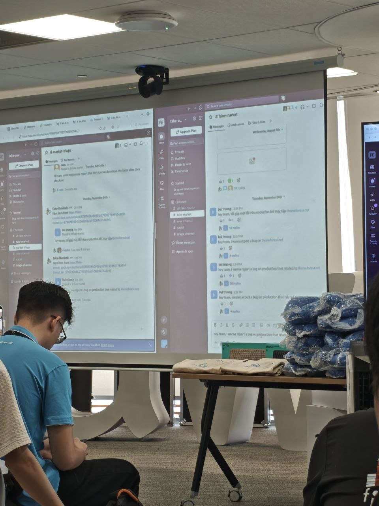

---

## 5. Session 4: Q&A Panel & Hands-on Minigame

### 5.1. Highlighted Technical Inquiries:
1. **How does the bot acquire enterprise project context?**
   - *Answer:* Via **Model Context Protocol (MCP)** integrated with internal Confluence documentation, ensuring triage decisions align with standard corporate operating procedures.
2. **How to prevent AI hallucinations from misrouting channel messages?**
   - *Answer:* Maintain a dual design: **deterministic rules (channel mappings, credentials) are strictly hard-coded in configuration files**, while natural language reasoning is delegated to the LLM.
3. **Managing permissions for command-line execution:**
   - *Answer:* Enforce the Principle of Least Privilege, execute agents within isolated sandbox containers, and employ strict hook validators on all inputs and outputs.

### 5.2. Hands-on Minigame: Structuring SOUL.md
Participants drafted specifications for agent behavior. Mr. Truong presented the standard template for enterprise AI agents:
```yaml
name: TriageBot
role: Senior Incident Triage & Support Specialist
default_model: claude-3-haiku
tone_and_style:
  internal_engineers: concise, technical, direct, structured
  external_stakeholders: empathetic, polite, non-technical, clarifying
skills:
  - confluence_search
  - jira_ticket_creator
  - log_query_cloudwatch
anti_patterns:
  - Do not expose stack traces or raw database queries to stakeholders.
  - Never execute destructive commands without human confirmation.
out_of_scope:
  - Financial questions, salary inquiries, contract terms.
```

---

## 6. Personal Takeaways & Practical Applications to AgentSys

Attending this kick-off provided concrete technical enhancements directly applicable to my **AgentSys** project:

1. **Adopting the Soul & Scope Paradigm in Multi-Modal Pipelines:**
   - In agent\_sys, I will reinforce role boundaries: the Ingest Lambda (agentsys-ingest) focuses solely on feature extraction; the API Lambda (agentsys-api) handles user routing; and Amazon Bedrock operates with well-scoped system prompts.
2. **FinOps Awareness & Model Routing:**
   - The Response Gate architecture reinforces my strategy of pairing **Amazon Titan Embeddings V2 (256-dimension)** with **Nova Lite** for general catalog search, achieving near-zero idle and inference costs.
3. **Cultivating Engineering Resilience:**
   - Embracing Mr. Hung's guidance on hands-on rigor, persistent debugging on live AWS environments, and the long-term value of teamwork.

---

**Related Content:** [4.1. Event 1: AWS Community Day (August 2026)](../4.1-Event1/) · [2. Proposal](../2-Proposal/) · [5. Workshop](../5-Workshop/)
