# Event 2: FCJ Build-a-thon Kick-off 2026 — Code the Future with CMC Global

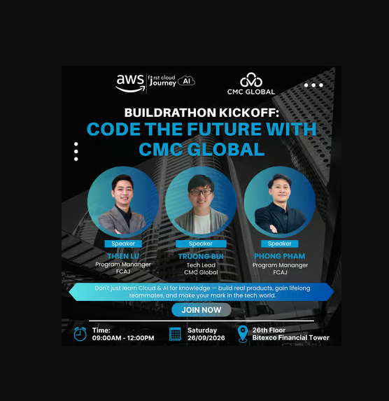

- **Thời gian:** Thứ Bảy, 26/09/2026 (09:00 – 12:00)
- **Địa điểm:** Văn phòng AWS Việt Nam, Tầng 26 Bitexco Financial Tower, Số 2 Hải Triều, Phường Bến Nghé, Quận 1, TP.HCM
- **Vai trò:** Thực tập sinh / Builder tham dự
- **Đơn vị tổ chức:** AWS First Cloud AI Journey (FCAJ), AWS Cloud Academy phối hợp cùng CMC Global

### Khách mời & Diễn giả chính:
1. **Anh Nguyễn Gia Hưng** — Head of Solutions Architecture tại AWS Vietnam & Campuchia, Founder First Cloud Journey (FCJ/FCAJ) & AWS Study Group
2. **Anh Bùi Nhật Trường** — Technical Leader tại CMC Global (Thị trường Úc), Trưởng phòng Chuyển đổi số Sơn Kim
3. **Chị Thái Thanh Nhàn** — Đại diện Ban Truyền thông & Tuyển dụng, CMC Global (MC điều phối)
4. **Anh Thiện Lữ & Anh Phong Phạm** — Program Managers, First Cloud AI Journey (FCAJ)

---

## Hình ảnh Check-in Tham Gia Sự Kiện

| Check-in tại sự kiện | Tham dự cùng mọi người tại hội trường |
| :---: | :---: |
| 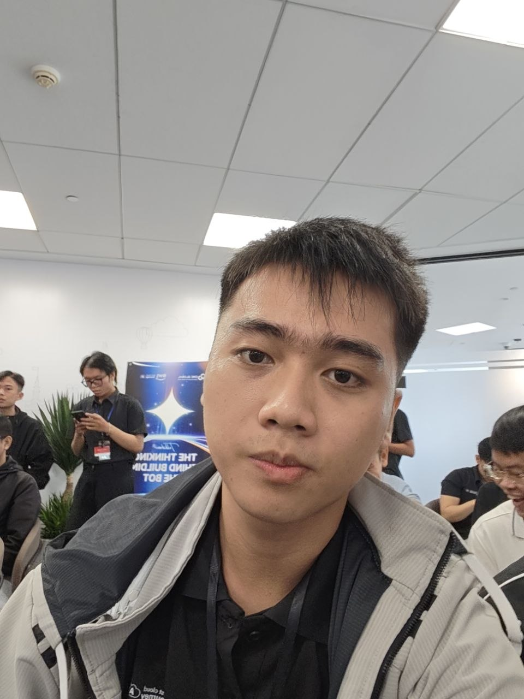 | 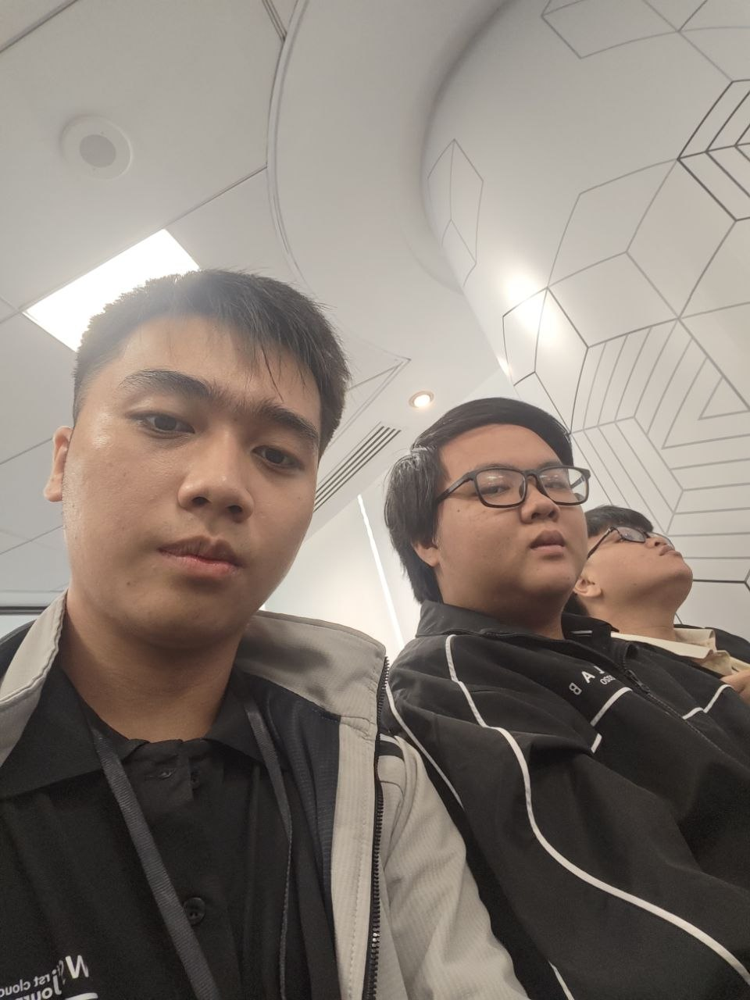 |

---

## 1. Tổng quan sự kiện & Khởi động FCJ Build-a-thon 2026

**FCJ Build-a-thon Kick-off 2026** là sự kiện đánh dấu cột mốc chuyển mình quan trọng của cộng đồng First Cloud Journey: từ mô hình đào tạo lý thuyết truyền thống sang mô hình **"Build thật — Sản phẩm thật"**.

Chương trình được tổ chức với sự đồng hành của **CMC Global** — một trong những đối tác chiến lược hàng đầu của AWS tại Việt Nam và thị trường quốc tế, mang đến cho các builder cái nhìn thực tế về tiêu chuẩn tuyển dụng, cơ hội việc làm và các bài toán kỹ thuật AI Agent thực chiến trong doanh nghiệp.

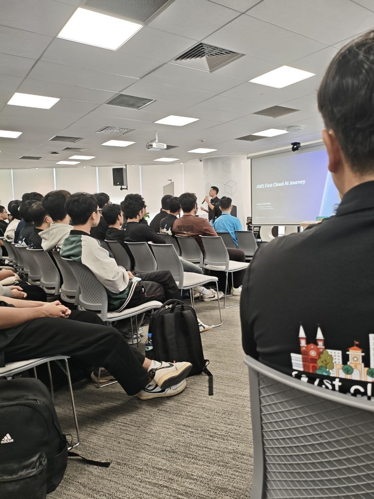

---

## 2. Phiên 1: Tinh thần Cộng đồng, Thực tế Tuyển dụng thời AI & Giá trị FCJ Build-a-thon

- **Diễn giả:** Anh **Nguyễn Gia Hưng** — Head of Solutions Architecture tại AWS Vietnam & Campuchia; Founder First Cloud Journey (FCJ/FCAJ) & AWS Study Group.

> **Về diễn giả Nguyễn Gia Hưng:** Anh Hưng hiện là Trưởng bộ phận Kiến trúc sư Giải pháp của AWS tại Việt Nam và Campuchia, với hơn 17 năm kinh nghiệm kiến trúc Cloud/Enterprise. Anh là người sáng lập và "linh hồn" dẫn dắt toàn bộ chương trình First Cloud Journey (FCAJ) cũng như cộng đồng AWS Study Group lớn nhất khu vực, trực tiếp kết nối nguồn tài trợ từ các lãnh đạo cấp cao AWS toàn cầu/ASEAN và hệ thống đối tác để mở ra cơ hội thực tập, việc làm cho hàng ngàn sinh viên.

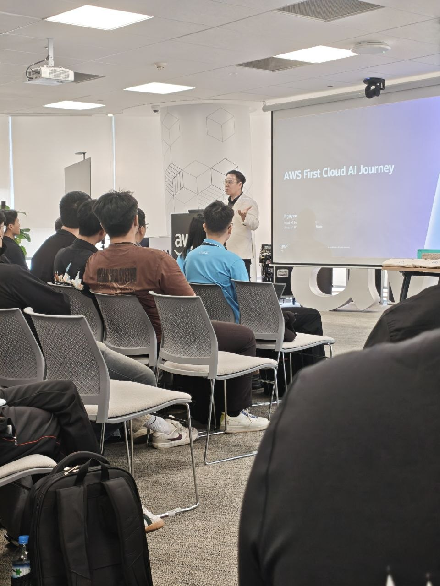

### 2.1. Vị thế của Cloud, AWS và Lịch sử Đầu tư tại Việt Nam
Anh Hưng điểm lại chặng đường đầu tư bài bản và bền bỉ của AWS tại Việt Nam từ năm 2015 đến nay:
- Không đơn thuần là "bán license ngắn hạn" như nhiều hãng công nghệ khác, AWS cam kết đầu tư chiều sâu vào **con người, hạ tầng và hệ sinh thái bản địa**: từ mở văn phòng tại TP.HCM (2017), Hà Nội (2019), xây dựng trạm Edge Location, Local Zones, đến kế hoạch xây dựng AWS Region tại Việt Nam trong tương lai.
- AWS hiện là động cơ tăng trưởng lợi nhuận cốt lõi của tập đoàn Amazon, là nền tảng phục vụ hầu hết các định chế tài chính, ngân hàng số và kỳ lân công nghệ lớn tại Việt Nam (VPBank, Techcombank, VIB, VNG, MoMo, Masan, Grab...).

| Lịch sử đầu tư của AWS tại Việt Nam (2015 – 2026) | Hệ sinh thái khách hàng đa dạng của AWS tại Việt Nam |
| :---: | :---: |
| 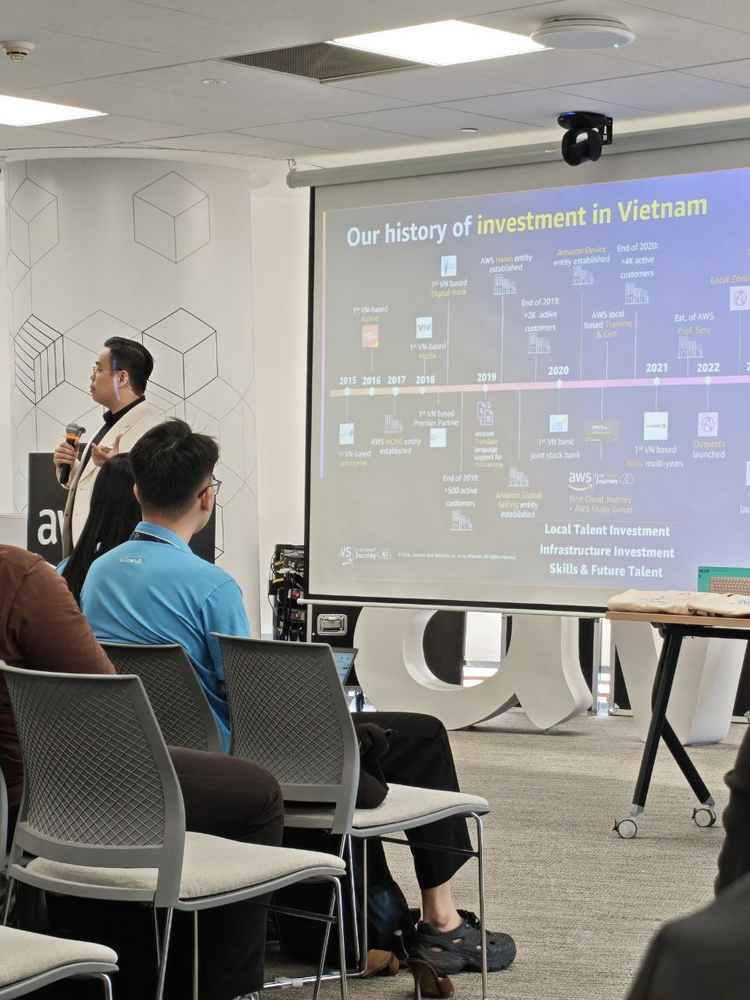 | 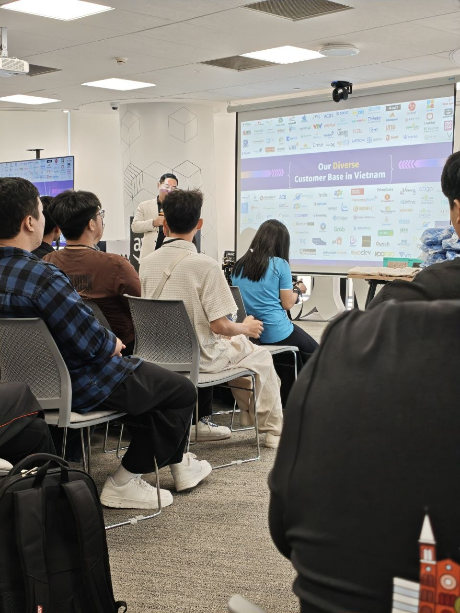 |

### 2.2. "AWS is your competitive edge, not a job title"
Anh Hưng nhấn mạnh một quan điểm định hướng nghề nghiệp rất thực tế: **Cloud hay AWS không còn là một chức danh công việc riêng biệt (job title), mà đã trở thành kiến thức nền tảng bắt buộc (baseline requirement) của mọi kỹ sư phần mềm**:
- Dù bạn làm ở vị trí nào: AI Engineer, Backend Developer, Data Engineer, hay DevOps, việc nắm vững hạ tầng Cloud chính là lợi thế cạnh tranh sống còn (*competitive edge*).
- Trong thời đại AI bùng nổ, thị trường không còn chỗ cho những bản CV "biết dùng công cụ chay". Khách hàng và nhà tuyển dụng yêu cầu ứng viên vừa phải có **nền tảng kỹ thuật vững chắc (Computer Science foundation)**, vừa phải có khả năng làm chủ các công cụ AI thế hệ mới.

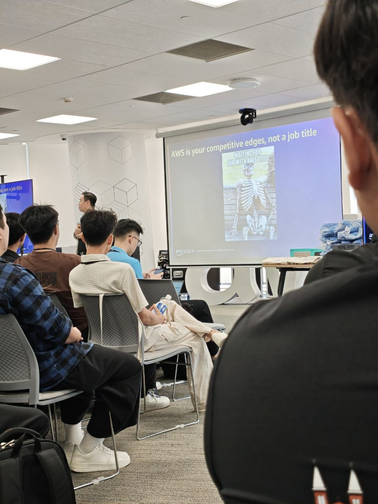

### 2.3. Các Mental Model cốt lõi cho kỹ sư trẻ
Anh Hưng chia sẻ những mô hình tư duy (mental models) đúc kết qua hơn 20 năm làm việc và tuyển dụng hàng trăm kỹ sư:
1. **Sức mạnh của Brotherhood (Đồng đội):** *"Cá mập bơi theo đàn, chỉ có cá vàng mới bơi lung tung."* Thách thức của ngành công nghệ hiện nay quá lớn, không ai có thể đơn độc đi đường dài. Cần xây dựng cho mình một đội ngũ đồng hành đáng tin cậy.
2. **Nghịch lý Jevons (Jevons Paradox) trong kỷ nguyên AI:** Khi AI giúp việc tạo phần mềm trở nên rẻ hơn và nhanh hơn, số lượng ứng dụng sinh ra sẽ bùng nổ theo cấp số nhân. Càng nhiều phần mềm được tạo ra thì **càng cần con người chịu trách nhiệm (human-in-the-loop) và có năng lực xử lý sự cố (troubleshooting under pressure)**.
3. **Hai kỹ năng sống còn trong IT:** Dù role nào, mọi thứ đều quy về hai câu hỏi lớn của nhà tuyển dụng:
   - *Bạn đã tự tay build được sản phẩm gì chạy thực tế trên production chưa?*
   - *Khi hệ thống gặp sự cố, bạn có kinh nghiệm troubleshoot đến tận cùng không?*
4. **Văn hóa "Pay it forward":** Trước khi đòi hỏi quyền lợi hay phàn nàn, hãy tự hỏi bản thân đã đóng góp được gì cho cộng đồng và tổ chức.
5. **Tinh thần "Lì đòn" & Đầu tư cho bản thân:** *"Nếu bạn tiếc tiền đầu tư cho năng lực của chính mình, sếp sẽ tiếc tiền trả lương cho bạn."* Nghề công nghệ là nghề phải học cả đời, cần sự kiên trì bền bỉ vượt qua nghịch cảnh.


### 2.4. Bản chất của FCJ Build-a-thon
- **Không phải Hackathon ngắn hạn 24h–48h:** Các cuộc thi hackathon thường chỉ tạo ra sản phẩm MVP chắp vá mang tính trình diễn ý tưởng (pitching).
- **Build-a-thon kéo dài 3 – 6 tháng:** Đòi hỏi sinh viên xây dựng sản phẩm thật, chạy trên AWS account thật, có sự đồng hành của các Mentor cấp cao, và bảo vệ dự án trước Ban giám khảo bên ngoài (các CIO, Giám đốc CNTT Ngân hàng và Doanh nghiệp lớn).

---

## 3. Phiên 2: Cơ hội Nghề nghiệp tại CMC Global & Khảo sát Mentimeter

- **Điều phối:** Chị **Thái Thanh Nhàn** — Đại diện Ban Truyền thông & Tuyển dụng, CMC Global.

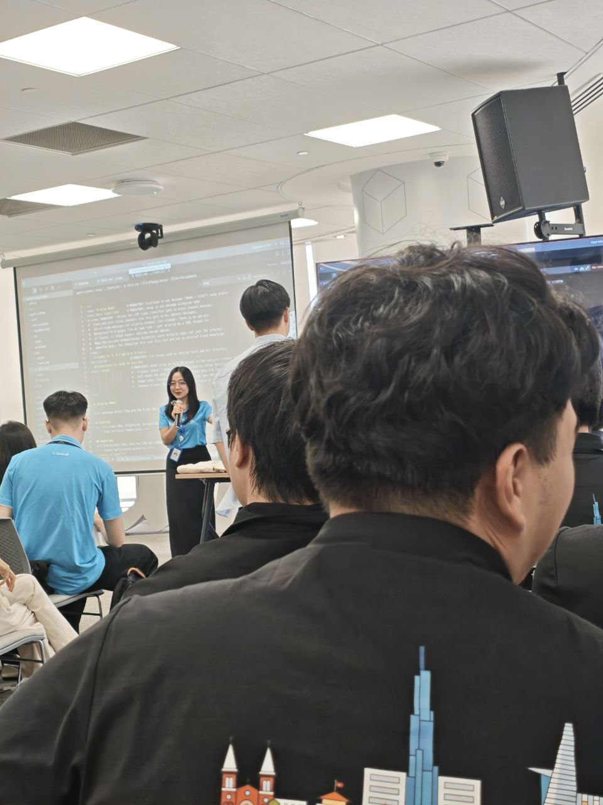

### 3.1. Giới thiệu về CMC Global
- Là khối kinh doanh quốc tế mũi nhọn của Tập đoàn Công nghệ CMC (CMC Corp), sở hữu hơn 10 văn phòng tại 30 quốc gia trên thế giới, với các trung tâm công nghệ lớn tại Hà Nội, Đà Nẵng và TP.HCM.
- Giới thiệu chương trình **Fresher Tech Camp** — chương trình ươm mầm tài năng công nghệ đã vận hành đến năm thứ 4, hỗ trợ đào tạo chuyên sâu và thực tập có phụ cấp cho sinh viên tiềm năng.

### 3.2. Khảo sát nhu cầu sử dụng AI qua Mentimeter
Ban tổ chức tổ chức khảo sát trực tiếp thông qua mã QR Mentimeter với câu hỏi: *"Nếu có một trợ lý AI xử lý tác vụ lớn nhất trong ngày, nhu cầu lớn nhất của bạn là gì?"*:
- Các từ khóa nổi bật được hội trường bình chọn nhiều nhất: **Coding, Research, Task Automation, Debugging, GenAI, Continuous Learning**.
- Khảo sát mở ra cầu nối dẫn dắt vào bài toán thực tế: Làm thế nào để xây dựng một con AI Agent tùy biến chuyên sâu theo đúng nhu cầu đặc thù của doanh nghiệp?

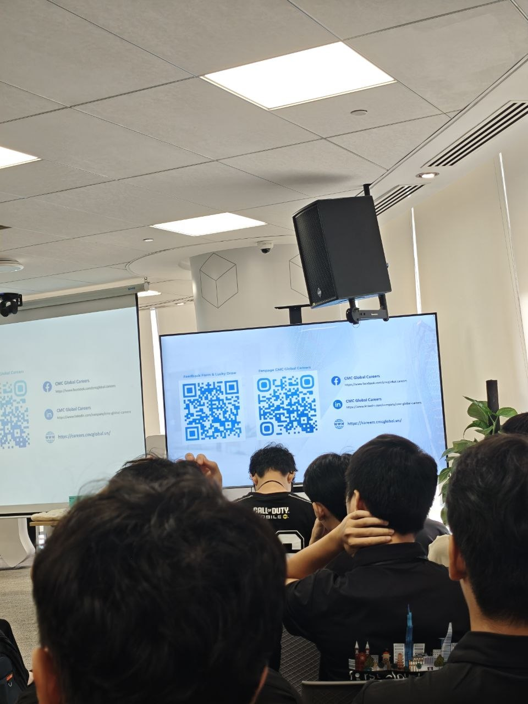

---

## 4. Phiên 3: Deep-dive Kỹ thuật — Xây dựng Production Triage Bot & Coding Agent trên Slack

- **Diễn giả:** Anh **Bùi Nhật Trường** — Technical Leader tại CMC Global (phụ trách thị trường Úc), Trưởng phòng Chuyển đổi số Sơn Kim.

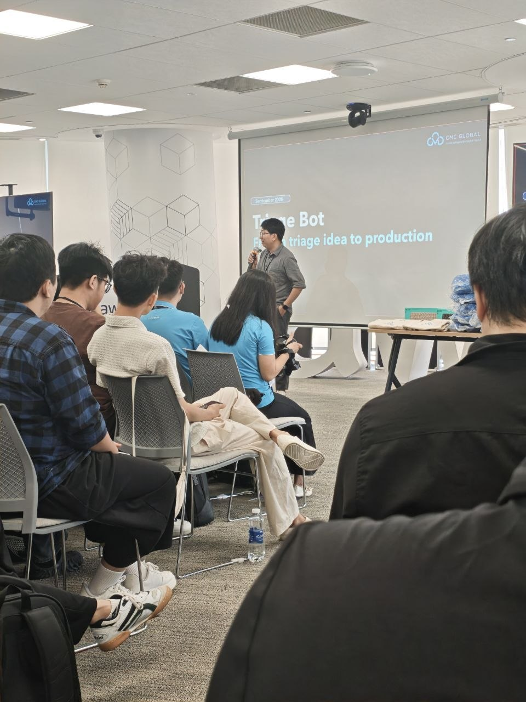

### 4.1. Bối cảnh bài toán thực tế (Problem Context)
- Team kỹ sư của CMC Global làm việc tại Việt Nam, trong khi khách hàng và business team ở Úc với khoảng chênh lệch múi giờ **3 – 4 tiếng**.
- Khi đối tác Úc báo lỗi hay yêu cầu hỗ trợ vào sáng sớm, đội ngũ kỹ sư tại Việt Nam vẫn chưa bắt đầu ca làm việc.
- **Mục tiêu:** Xây dựng một **Triage Bot** tự động tương tác trên Slack để thu thập toàn bộ ngữ cảnh sự cố (*stakeholder context*) kết hợp tín hiệu giám sát hệ thống (*monitoring signals* từ AWS CloudWatch, Datadog, Sumo Logic). Khi kỹ sư Việt Nam thức dậy lúc 8:30 sáng, toàn bộ báo cáo phân loại lỗi đã sẵn sàng.

### 4.2. Kiến trúc Hệ thống Toàn cảnh (The Full Picture)

Anh Trường phân tích chi tiết sơ đồ kiến trúc của **Market Slack Bot** được xây dựng trên nền tảng **Claude Code / Clawbot Harness Tool**:

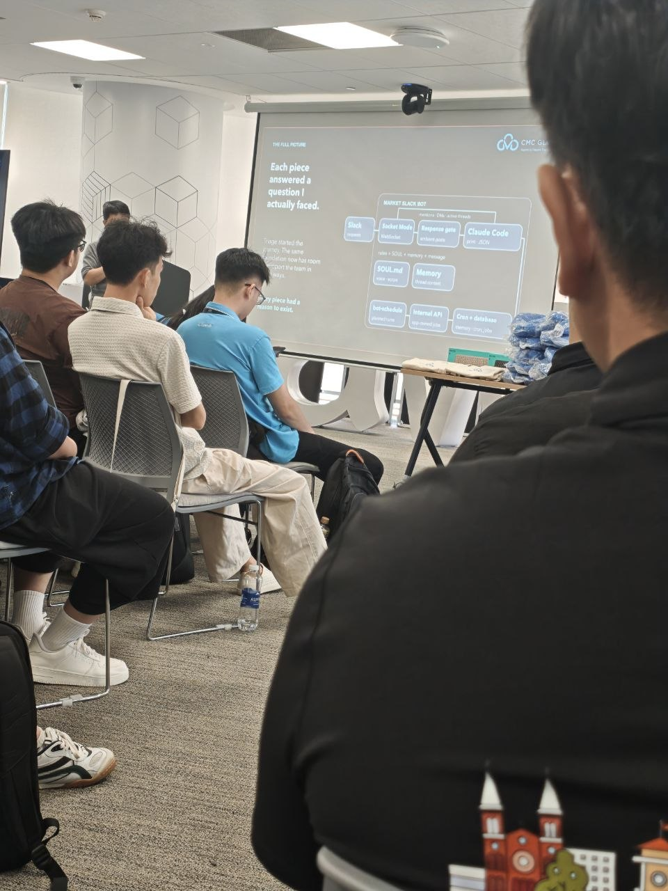

#### Chi tiết các khối thành phần kỹ thuật cốt lõi:
1. **Lớp Soul (SOUL.md Layer — lấy cảm hứng từ OpenClaw):**
   - Thay vì sửa vào core logic của Agent, nhóm tách riêng file SOUL.md để định nghĩa: *Persona (tính cách thân thiện, chuyên nghiệp), Scope làm việc (những việc ĐƯỢC LÀM và KHÔNG ĐƯỢC LÀM), Tone & Style giao tiếp*.
   - Cho phép một request có thể phối hợp nhiều sub-agent chuyên biệt (Developer, Tester, Reviewer, Jira Updater) mà không gây xung đột vai trò.
2. **Slack Socket Mode:**
   - Kết nối hai chiều qua WebSocket an toàn, **không cần mở public IP hay mở inbound port** ra ngoài Internet, giảm thiểu tối đa bề mặt tấn công.
3. **Response Gate (Bộ lọc phản hồi & Định tuyến mô hình):**
   - Xác định xem bot có nên trả lời tin nhắn hay giữ im lặng (tránh spam trong channel khi mọi người chào hỏi thông thường).
   - **Tối ưu chi phí token (FinOps):** Phân luồng câu hỏi đơn giản tới model rẻ như **Claude Haiku** (~\$0.25–\$1.00/1M tokens) thay vì lạm dụng các model đắt đỏ như **Sonnet/Opus** (\$3.00–\$15.00/1M tokens).
4. **Quản lý Bộ nhớ (Memory Management):**
   - Lưu trữ toàn bộ tương tác theo thread vào Database. Mỗi lượt tương tác, bot chủ động trích xuất và tinh chỉnh lại ngữ cảnh (*refine memory*) thay vì nối chuỗi vô hạn làm tràn context window.
5. **Cơ chế Scheduler chống sập qua restart ("A schedule had to survive a restart"):**
   - Để bot tự động nhắc nhở review PR trên 8 repository, bot cần quản lý Cron jobs.
   - Do container có thể bị deploy lại định kỳ làm mất process cron cục bộ, bot lưu trạng thái scheduler vào Database và gọi qua một Internal API để nạp lại đầy đủ các lịch trình mỗi khi container khởi động lại.
6. **Bảo mật Guardrails & Hooks:**
   - Cài đặt các pre-hook / post-hook (bash scripts) kiểm soát câu trả lời, ngăn chặn tình trạng AI tự ý xóa dữ liệu hoặc làm lộ secret key / file .env.

| Khối Response Gate: Biết khi nào nên im lặng | Cơ chế Scheduler sống sót qua container restart |
| :---: | :---: |
| 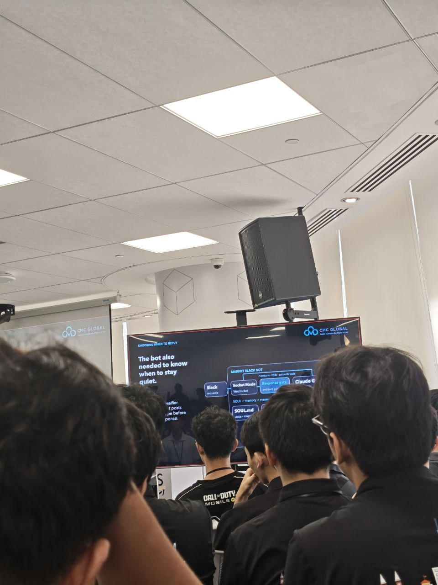 | 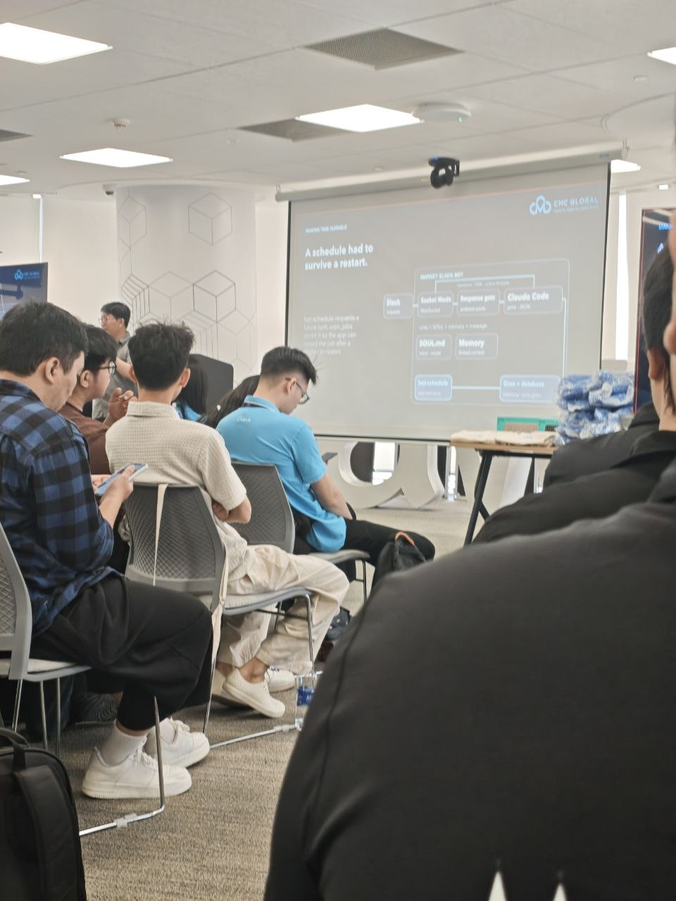 |


### 4.3. Demo Thực tế trên Slack (Live Production Demo)
Anh Trường trình diễn kịch bản chạy thực tế giữa hai màn hình song song:
- **Tình huống 1 (Follow-up tự động):** Stakeholder báo bận 1 phút sau quay lại → Đúng 60 giây sau, bot tự động ping nhắc nhở tiếp tục xử lý.
- **Tình huống 2 (Triage lỗi Cloudflare 500):** Khách hàng báo sự cố web down → Bot hỏi mã lỗi, khoanh vùng phạm vi → Tự động phân loại Severity → Gửi báo cáo tóm tắt vào #market-triage cho kỹ sư.
- **Tình huống 3 (Tự động hóa Jira Ticket):** Khách hàng gửi file CSV danh sách UUID cần check → Bot đề xuất tạo ticket → Khi kỹ sư xác nhận, bot tự động gọi API tạo Jira issue hoàn chỉnh có đính kèm file CSV.

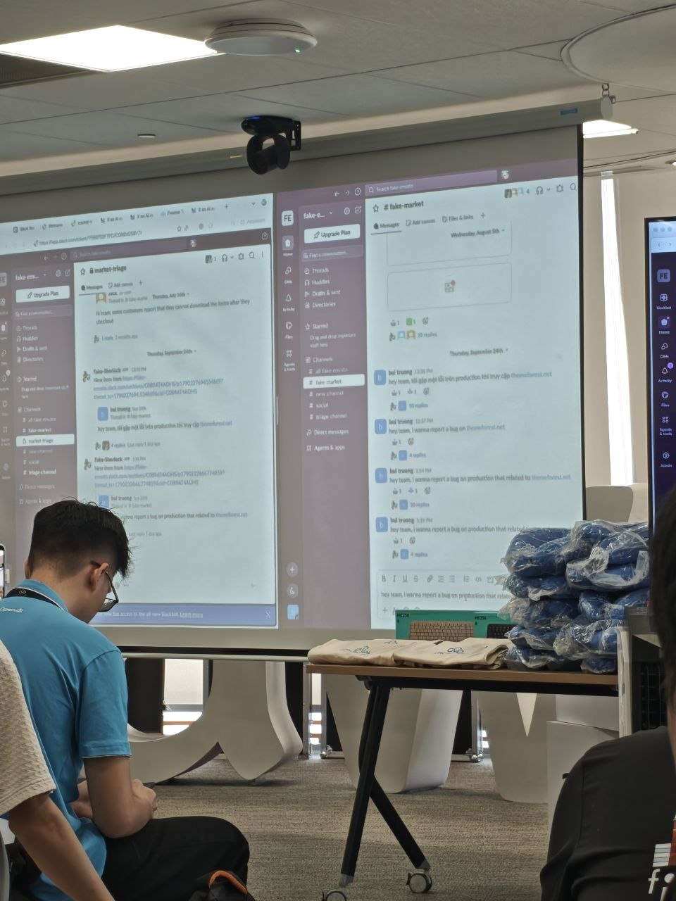

---

## 5. Phiên 4: Hỏi Đáp (Q&A) & Hands-on Minigame

### 5.1. Các câu hỏi kỹ thuật nổi bật trong phần Q&A


<div class="qa-card">
  <div class="qa-header">
    <i class="fas fa-question-circle text-blue-500"></i> Câu hỏi 1: Ngữ cảnh dự án nội bộ
  </div>
  <div class="qa-question">
    <strong>❓ Người hỏi:</strong> Làm sao để bot hiểu ngữ cảnh dự án và quy trình nội bộ của công ty?
  </div>
  <div class="qa-answer">
    <strong>💡 Diễn giả (Anh Trường):</strong> Sử dụng <strong>Model Context Protocol (MCP)</strong> để kết nối bot với kho tài liệu Confluence nội bộ. Bot tra cứu chuẩn phân loại bug và quy trình vận hành trực tiếp từ wiki của công ty một cách tự động.
  </div>
</div>

<div class="qa-card">
  <div class="qa-header">
    <i class="fas fa-question-circle text-blue-500"></i> Câu hỏi 2: Kiểm soát hiện tượng AI ảo giác (Hallucination)
  </div>
  <div class="qa-question">
    <strong>❓ Người hỏi:</strong> Làm sao tránh AI bị ảo giác (hallucination) chọn nhầm channel Slack khi bắn thông báo khẩn?
  </div>
  <div class="qa-answer">
    <strong>💡 Diễn giả (Anh Trường):</strong> Áp dụng nguyên tắc cốt lõi: <strong>Cái gì cần độ chính xác 100% thì cấu hình cứng (hard-code/config file)</strong>; phần nào cần linh hoạt xử lý ngôn ngữ tự nhiên mới giao cho LLM phân tích.
  </div>
</div>

<div class="qa-card">
  <div class="qa-header">
    <i class="fas fa-question-circle text-blue-500"></i> Câu hỏi 3: Phân quyền và an toàn thực thi lệnh
  </div>
  <div class="qa-question">
    <strong>❓ Người hỏi:</strong> Phân quyền và bảo mật như thế nào khi bot có quyền chạy các câu lệnh trên hệ thống?
  </div>
  <div class="qa-answer">
    <strong>💡 Diễn giả (Anh Trường):</strong> Cấp quyền tối thiểu (Least Privilege), chạy bot trong môi trường sandbox cô lập hoàn toàn, và dùng các Hook script để kiểm tra chặt chẽ input/output trước khi thực thi.
  </div>
</div>


### 5.2. Hands-on Mini Game: Thiết kế Cấu trúc file SOUL.md
Các bạn sinh viên xung phong lên bảng chia sẻ tư duy định hình "linh hồn" cho một con bot. Anh Trường tổng kết template chuẩn của một file SOUL.md phục vụ doanh nghiệp:
```yaml
name: TriageBot
role: Senior Incident Triage & Support Specialist
default_model: claude-3-haiku
tone_and_style:
  internal_engineers: concise, technical, direct, structured
  external_stakeholders: empathetic, polite, non-technical, clarifying
skills:
  - confluence_search
  - jira_ticket_creator
  - log_query_cloudwatch
anti_patterns:
  - Do not expose stack traces or raw database queries to stakeholders.
  - Never execute destructive commands without human confirmation.
out_of_scope:
  - Financial questions, salary inquiries, contract terms.
```

---

## 6. Bài học Rút ra & Ứng dụng Thực tế vào Dự án AgentSys

Tham dự sự kiện đã mang lại cho em những góc nhìn thực chiến quý giá để hoàn thiện đồ án **AgentSys**:

1. **Ứng dụng triết lý Soul & Scope vào Multi-Agent:**
   - Trong agent\_sys, em sẽ áp dụng kiến trúc tách bạch vai trò tương tự: hàm Lambda Ingest (agentsys-ingest) chỉ làm nhiệm vụ trích xuất đặc trưng; hàm API (agentsys-api) làm nhiệm vụ giao tiếp; và Amazon Bedrock đóng vai trò Planner với scope prompt được rào chắn cẩn thận.
2. **Tối ưu hóa FinOps & Định tuyến Mô hình (Model Routing):**
   - Bài học về Response Gate của anh Trường giúp em củng cố quyết định kiến trúc trong AgentSys: Sử dụng **Amazon Titan Embeddings V2 (256 chiều)** và **Nova Lite** cho các tác vụ phân tích phổ thông để giữ chi phí ở mức gần như bằng $0, thay vì gọi các model lớn tốn kém.
3. **Tư duy xây dựng sản phẩm bền vững:**
   - Thấm thía lời dặn của anh Hưng về tinh thần "Lì đòn", sự chủ động hands-on trên môi trường thật và tính kỷ luật khi theo đuổi ngành Điện toán Đám mây.

---

**Liên quan:** [4.1. Event 1: AWS Community Day (August 2026)](../4.1-Event1/) · [2. Bản đề xuất](../2-Proposal/) · [5. Workshop](../5-Workshop/)
