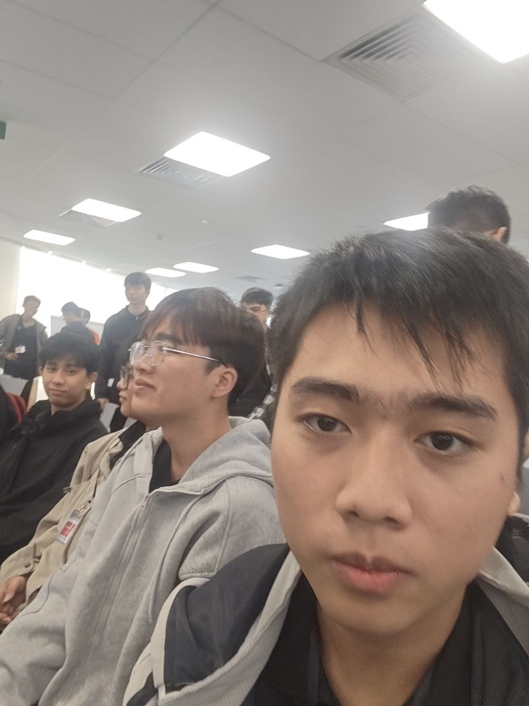
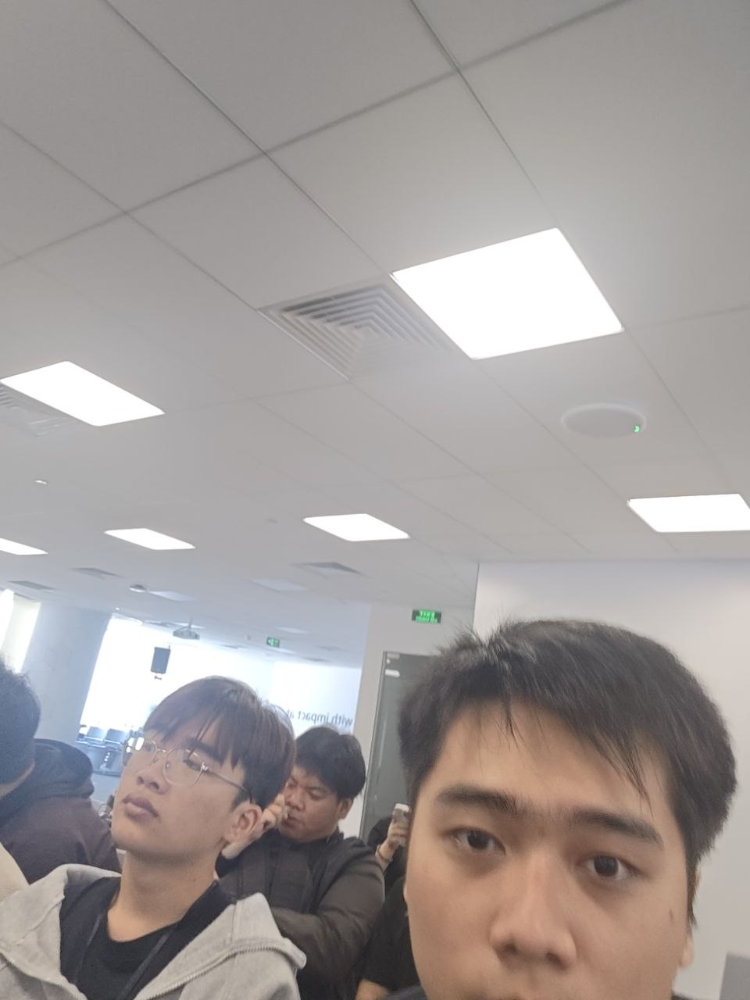
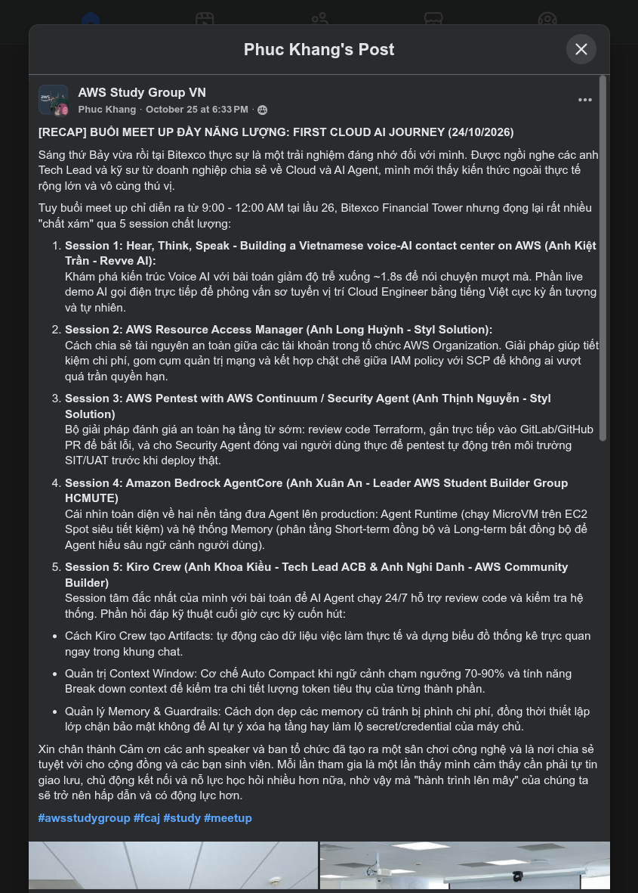
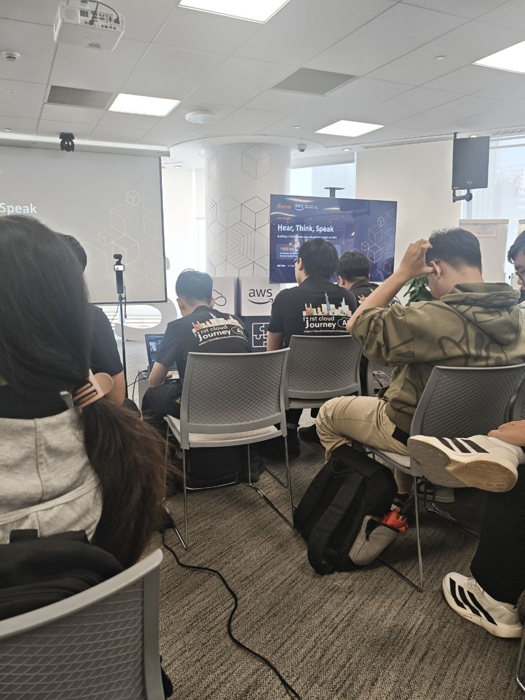
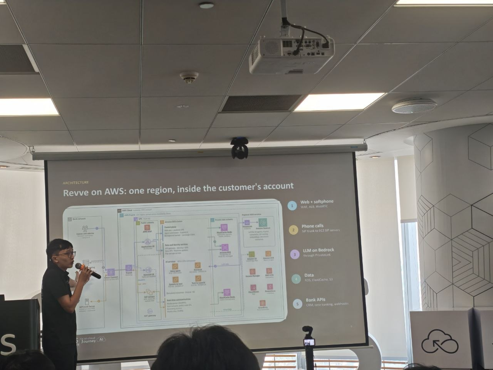
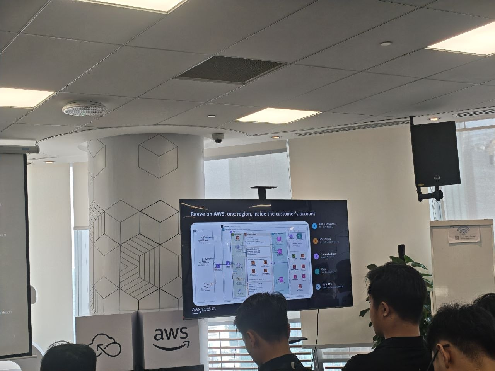
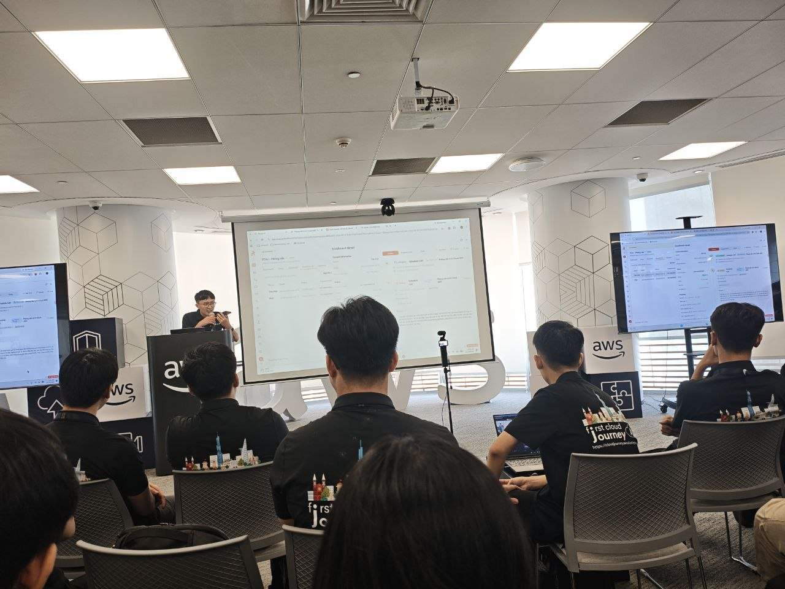
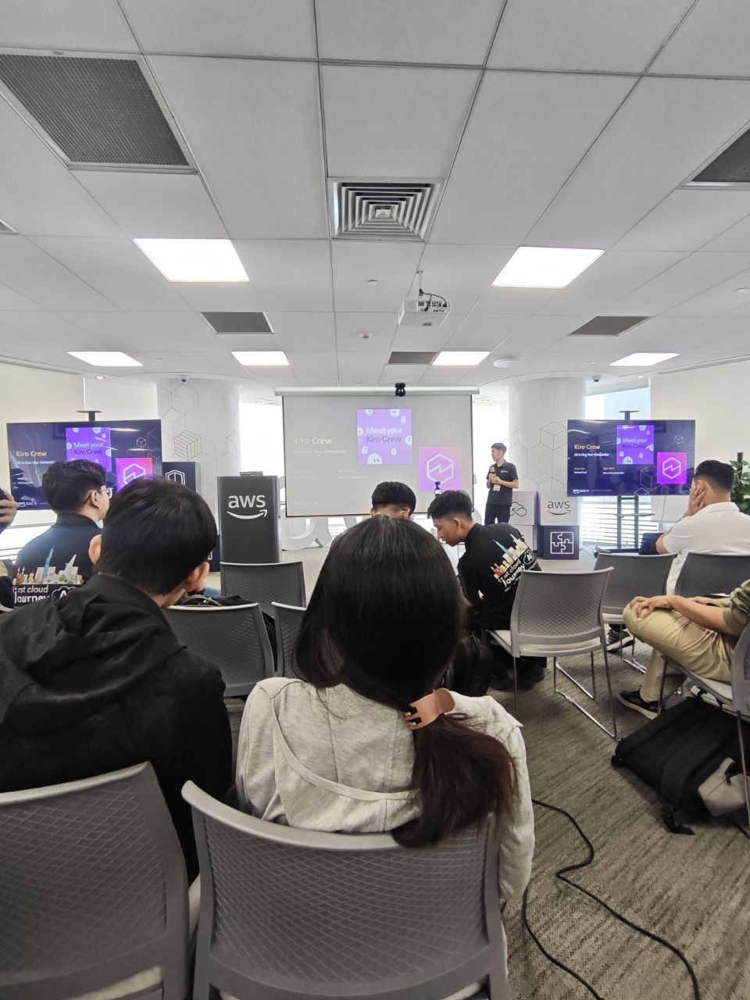
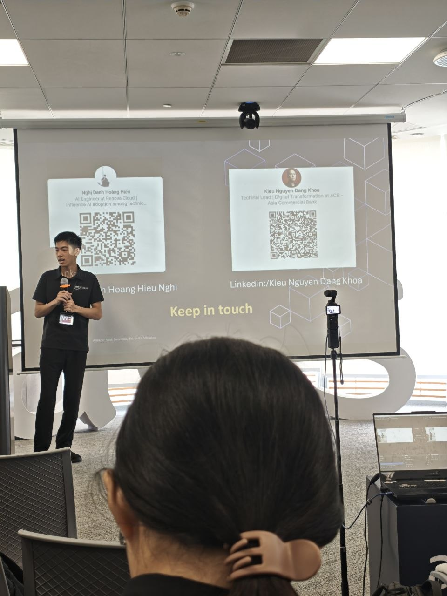

# Event 3: First Cloud AI Journey Meetup — Building Cloud & AI Agents for Production

- **Date & Time:** Saturday, October 24, 2026 (09:00 AM – 12:00 PM)
- **Location:** AWS Vietnam Office, 26th Floor, Bitexco Financial Tower, No. 2 Hai Trieu, Ben Nghe Ward, District 1, Ho Chi Minh City
- **Role:** Intern / Participating Builder (Attendee)
- **Organizers:** AWS First Cloud Journey (FCJ/FCAJ) in collaboration with AWS Study Group VN & AWS Student Builder Groups

### Keynote Speakers & Guest Industry Experts:
1. **Mr. Kiet Tran** — AI Engineer at Revve AI (AWS Partner specializing in Voice AI Contact Center solutions)
2. **Mr. Long Huynh** — DevOps Engineer at Styl Solution (Former FCJ Admin)
3. **Mr. Thinh Nguyen** — DevSecOps & Cloud Engineer at Styl Solution
4. **Mr. Xuan An Nguyen** — Leader of AWS Student Builder Group at HCMUTE
5. **Mr. Khoa Kieu** — Technical Lead at Asia Commercial Bank (ACB)
6. **Mr. Nghi Danh** — AI Engineer at Renova Cloud, AWS Community Builder, Leader of AWS Student Builder Group at HUFLIT

---

## Event Check-in & Community Outreach Evidence

> **Event Attendance Summary:** Completed attendance across 3 technical events during the internship period at the AWS Vietnam Office (26th Floor Bitexco Financial Tower), accompanied by community recap sharing.

| Event Hall Overview & Attendee Check-in | Personal Clear-Face Check-in at the Event |
| :---: | :---: |
|  |  |

### Community Knowledge Sharing on AWS Study Group VN
Right after attending the meetup, I synthesized all the practical insights and architectural lessons gathered across the 5 technical sessions into an in-depth recap article posted on the **AWS Study Group VN** community (>50,000 members) to share with fellow students and cloud practitioners:

---

## 1. Event Atmosphere & Program Background

Following the previous two flagship community gatherings — the AWS Community Day in August and the FCJ Build-a-thon Kick-off in September — the **First Cloud AI Journey Meetup in October 2026** immersed attendees into a more pragmatic engineering challenge: **Bridging the gap between AI Agent prototypes and mission-critical production cloud architectures.**

On Saturday morning, the auditorium at the 26th floor of Bitexco was packed with university students from AWS Student Builder Groups alongside experienced software engineers, DevOps specialists, and Tech Leads from leading banks and technology enterprises across Ho Chi Minh City.

The three-hour program unfolded smoothly across 5 intensive sessions: exploring sub-second voice AI conversational pipelines, multi-account network governance, automated AI pentesting, serverless agent core runtimes, and live demonstrations of 24/7 cloud-hosted coding agents.

---

## 2. Session 1: Hear, Think, Speak — Building a Low-Latency Voice AI Contact Center on AWS

- **Speaker:** Mr. **Kiet Tran** — AI Engineer at Revve AI (AWS Partner specializing in enterprise conversational AI for commercial banking and enterprise contact centers).

| Speaker Kiet Tran presenting Voice AI insights | Enterprise Revve on AWS Architecture Diagram |
| :---: | :---: |
|  |  |

### 2.1. The 200ms Reflex Challenge in Human Conversation
Mr. Kiet opened the session with a relatable observation: in natural human conversations, the typical pause between speaking turns hovers around **~200ms**. If an automated voice assistant takes longer than 2 seconds of awkward silence to respond, callers will assume the telephone line has dropped.

To address this challenge, he evaluated the trade-offs across three contemporary architectural approaches:
- **Cascade Architecture (STT ➔ LLM ➔ TTS):** The most widespread, battle-tested model running on production today. Incoming audio is converted to text via Automatic Speech Recognition, processed through an LLM for intent reasoning, and transformed back into audio via Text-to-Speech synthesis. Its greatest advantage lies in leveraging state-of-the-art foundation models (such as Claude 3.5 Sonnet on Amazon Bedrock) while allowing fine-grained control over Vietnamese phonetic pronunciation and banking terminology. The primary trade-off is accumulated latency across stages (typically totaling ~1.8 seconds).
- **Speech-to-Speech Architecture (S2S):** Native audio-in, audio-out models (such as Amazon Nova Sonic). While offering rapid reflex speeds, Vietnamese conversational inflection remains somewhat unnatural due to current training corpus limitations.
- **Full-Duplex S2S Architecture:** An emerging hybrid paradigm pairing a lightweight S2S model at the conversational frontline for immediate reflex responses, backed by a heavyweight LLM operating asynchronously for deep business logic reasoning.

### 2.2. Engineering Optimizations & Enterprise Banking Architecture
To push overall turnaround latency down to ~1.8 seconds, the engineering team at Revve AI implemented two key techniques:
1. **Prompt Caching:** Caching the invariant system prompts on Amazon Bedrock, which significantly slashes Time-to-First-Token (TTFT).
2. **Natural Conversational Fillers:** When the assistant must query an external banking API or database, it dynamically injects subtle conversational filler phrases (*"Certainly, please give me just a moment while I pull up those details..."*) to sustain conversational continuity without dead air.

On the infrastructure side, the solution adheres to rigorous banking compliance:
- Call traffic traverses Application Load Balancers into an **Amazon EKS** cluster hosting SIP servers, WebRTC UDP media servers, and self-hosted STT/TTS models running on GPU instances for accelerated matrix calculations.
- EKS workers communicate with **Amazon Bedrock** strictly via **AWS PrivateLink**, keeping all voice and transcript payloads confined within the private AWS network backbone without routing through public Internet.
- Customer state and transactional records reside in Amazon RDS Multi-AZ, with call audio archived into Amazon S3 encrypted end-to-end via AWS KMS.

### 2.3. Live Recruitment Interview Demo on Stage
The highlight of the session was a live interactive demonstration. The AI agent, playing the role of *"Mai – Talent Acquisition Assistant at May Xanh Cloud Solutions"*, dialed direct phone calls on stage to Mr. Kiet and an audience student volunteer to conduct initial candidate screenings for a Cloud Engineer position.

The AI systematically probed candidates with multi-tiered technical questions on 3-tier VPC network topologies, EC2 sizing, S3 lifecycle policies, and RDS high availability. When a student playfully answered that their expected monthly salary was "0 VND", the AI gracefully adapted with witty humor rather than breaking into repetitive loops.

Mr. Kiet revealed that across an 800-call proof-of-concept, the system achieved a **94% intent routing accuracy**, while an automated screening campaign for VPBank reached a **62% completed interaction rate**, operating at an economical cost of approximately **~3,000 VND (~$0.12 USD) per call**.

---

## 3. Session 2: Multi-Account Resource Management and Sharing with AWS Resource Access Manager (AWS RAM)

- **Speaker:** Mr. **Long Huynh** — DevOps Engineer at Styl Solution (Former FCJ Admin).

### 3.1. Infrastructure Duplication in Multi-Account Environments
As companies expand their cloud footprints, infrastructure is naturally partitioned across separate AWS accounts (Dev, Staging, Production, Security, Shared Services). When each account redundantly provisions its own VPC subnets, Transit Gateways, Route 53 Resolver rules, and software licenses, enterprises incur substantial billing waste and operational overhead.

### 3.2. Core Mechanics of AWS RAM & The Critical AZ ID Gotcha
Mr. Long introduced **AWS Resource Access Manager (AWS RAM)** — a **complimentary service** enabling central owner accounts to securely share infrastructure assets with member accounts across an AWS Organization without duplicating components.

He emphasized an invaluable, hard-earned lesson that often catches cloud engineers off guard:
> **The Availability Zone Name Trap:**  
> In AWS, logical AZ designations like ap-southeast-1a are randomly assigned per account. The physical facility backing ap-southeast-1a in Account A does not necessarily correspond to the physical facility of ap-southeast-1a in Account B.  
> When writing Infrastructure as Code (Terraform / CloudFormation) to share subnets across accounts, **engineers must explicitly map subnets to physical Availability Zone IDs (AZ ID, such as apse1-az1)**. Mapping by logical name risks scattering compute across separate data centers, triggering steep and unexpected Cross-AZ Data Transfer charges.

He also clarified the effective permissions evaluation model: an action is only granted when it satisfies the mathematical intersection of all three policy boundaries: **RAM Managed Permissions ∩ IAM Policies ∩ Service Control Policies (SCPs)** of the AWS Organization.

---

## 4. Session 3: Automated Penetration Testing (AI Pentest) with AWS Continuum & AWS Security Agent

- **Speaker:** Mr. **Thinh Nguyen** — DevSecOps & Cloud Engineer at Styl Solution.

### 4.1. Bottlenecks of Traditional Manual Pentesting
Mr. Thinh highlighted three core friction points in conventional penetration testing:
1. High cost: Commissioning a specialized external security firm typically costs **$5,000 to $20,000 USD** per assessment.
2. Extended turnaround times of several weeks, making continuous testing incompatible with rapid agile release cycles.
3. Heavy dependency on the individual expertise of the assigned security auditor.

### 4.2. AWS Security Agent & Dynamic OTP Handling
AWS Security Agent (part of the AWS Continuum solution suite) runs on Amazon Bedrock, providing three automated layers across the SDLC:
- **Design Security Review:** Inspects architecture markdown documentation or Terraform definitions pre-deployment to flag design vulnerabilities (200 free reviews/month).
- **Code Security Review:** Plugs directly into GitHub/GitLab Pull Requests and CI/CD pipelines to map internal application data flows (1,000 free reviews/month).
- **Automated Penetration Testing:** The AI assumes the dual role of user and threat actor, dynamically generating attack graphs to discover and exploit vulnerabilities on live staging websites.

A standout engineering tip was his **automated workaround for Email OTP authentication**: when a web application requires a one-time password delivered via email, Mr. Thinh configured an Amazon EventBridge rule to intercept the inbound email, routed the payload to an AWS Lambda function with a Lambda Function URL enabled to parse the token, and provided that Function URL endpoint directly within the Security Agent's Login Instructions. The AI agent then programmatically called the endpoint to obtain its own OTP and proceed with authentication.

He stressed a strict rule of thumb: **Never run automated AI penetration testing against Production environments**; testing must be restricted to SIT or UAT to avoid corrupting live customer state.

---

## 5. Session 4: Taking AI Agents from Prototype to Production with Amazon Bedrock AgentCore

- **Speaker:** Mr. **Xuan An Nguyen** — Leader of AWS Student Builder Group at HCMUTE.

### 5.1. Personal Growth & The Prototype-to-Enterprise Divide
Mr. Xuan An began with an inspiring personal narrative, recounting his journey from feeling uncertain about career paths as a third-year student to leading the AWS Student Builder Group at Ho Chi Minh City University of Technology and Education (HCMUTE).

He pointed out that while creating an AI Agent prototype locally with LangChain or CrewAI takes only hours, deploying agents to production serving thousands of concurrent users brings daunting engineering hurdles: isolating multi-tenant conversational state, persisting memory without ballooning token expenses, and maintaining observability under load.

### 5.2. Exploring Two Core Pillars: Runtime and Memory
To address these challenges, Amazon Bedrock AgentCore provides an integrated serverless platform centered around two foundational pillars:
1. **AgentCore Runtime (MicroVM Sandboxing):**
   - Each user session ID is provisioned with an isolated, lightweight MicroVM executing on EC2 Spot instances.
   - This guarantees complete tenant boundary isolation, eliminating cross-session data leakage. Furthermore, compute billing is strictly tied to active I/O computation cycles; during user thinking or idle phases, compute cost drops to zero.
2. **AgentCore Memory (Two-Tier Memory Architecture):**
   - **Short-term Memory:** Synchronously retains raw conversational turns for the active session. It supports **Memory Branching** (resembling Git branches), empowering sub-agents to explore divergent task trajectories without polluting the primary context.
   - **Long-term Memory:** Asynchronously distills persistent insights across 4 distinct strategies: Conversation Summaries, User Preference profiling, Semantic factual assertions, and Episodic task execution history.

---

## 6. Session 5: Kiro & Kiro Crew — 24/7 AI Coding Companion and Automated Code Review

- **Speakers:**
  - Mr. **Nghi Danh** — AI Engineer at Renova Cloud, AWS Community Builder, Leader of AWS Student Builder Group at HUFLIT.
  - Mr. **Khoa Kieu** — Technical Lead at Asia Commercial Bank (ACB) with over 6 years of engineering leadership.

| Slide presenting Kiro Crew on the auditorium screen | Co-speakers: Nghi Danh and Khoa Kieu |
| :---: | :---: |
|  |  |

### 6.1. The Kiro Reel Paradigm: Autonomous Cloud-Hosted AI
Mr. Nghi opened the finale session by contrasting the AI tooling landscape on AWS: Amazon Q assists broad workplace tasks, whereas Kiro focuses squarely on software engineering.

The defining breakthrough of Kiro Reel is hosting the AI agent persistently on a cloud server (Amazon EC2 or VPS). Developers are no longer tethered to their laptops; the agent operates continuously 24/7 guided by three principles:
- **Persistent Memory:** Autonomously learns codebase conventions and past code review feedback across sessions without requiring developers to constantly re-upload prompt instructions.
- **Scheduled Cronjobs:** Wakes up at off-peak hours (e.g., 3:00 AM) to inspect pending Pull Requests and run maintenance tasks.
- **Human-in-the-loop Guardrails:** Routine file editing, linting, and unit test generation execute autonomously; however, any destructive operation (database truncations, environment variable alterations, or infrastructure deployments) triggers an automatic hold requiring human approval.

### 6.2. 4 Practical Live Demos by Mr. Khoa (ACB Tech Lead)
Mr. Khoa mirrored his screen to walk the audience through 4 real-world operational scenarios:
1. **Mobile Ops via Telegram:** Linked Kiro Reel to a Telegram bot. While away from his laptop, he sent chat commands from his phone instructing the agent to examine the *Talent Radar* GitHub repository, author an API endpoint to fetch active customers, and open a ready Pull Request. When asked about RDS database health, the bot queried CloudWatch Logs and reported current CPU utilization and free memory.
2. **Automated Infrastructure & News Cronjobs:** A 5-minute health check monitored AWS service availability, sending immediate alerts to Telegram upon service degradation; paired with an 8:00 AM daily cron job collecting and summarizing top global AI Agent breakthroughs.
3. **Custom "AI Code Reviewer" for Tech Leads:** With developer PR volumes surging due to AI tools, a single Tech Lead cannot manually review every pull request. Mr. Khoa uploaded company coding guidelines and security checklists into Kiro Reel's Knowledge Base. The AI scanned incoming PR diffs, cited exact internal policy clauses breached by specific lines of code, proposed compliant fixes, and posted inline review comments directly onto GitHub.
4. **Visual Artifacts Dashboard:** Prompted Kiro Reel to scrape IT recruitment portals across Vietnam, generating an interactive salary and tech-stack demand chart directly within the chat window.

### 6.3. Technical Q&A & Community Minigame
- **Context Window Management:** Mr. Nghi detailed Kiro Reel's **Auto-Compact** feature (which automatically compresses conversation history at 70% or 90% context saturation) alongside **Context Breakdown** telemetry, giving engineers full visibility into token consumption across tools, code, and chat history.
- **Interactive Minigame:** The room engaged in trivia questions testing concepts of *Spec-driven development*, Kiro's 5 client interfaces (IDE, CLI, Reel, Web, Mobile Beta), and multi-provider foundation model support (Claude, OpenAI, Gemini, DeepSeek/Kimi).

---

## 7. Key Takeaways & Direct Implementation in Project AgentSys

Attending the **First Cloud AI Journey Meetup** offered invaluable practical architectural principles that directly shaped and hardened our internship capstone project **EduMedia AI (Smart Lecture Storage & Search Engine on AWS)**:

| Key Meetup Principle | Architectural Parallel | Direct Implementation in Project AgentSys |
| :--- | :--- | :--- |
| **Defensive Guardrails & Human-in-the-Loop** *(Session 5 - Kiro Crew)* | Protective layers preventing autonomous agents from performing destructive actions or data deletions. | Engineered **Demo Guardrails** into AgentSys: flag is\_demo\_protected blocks deletion requests with an HTTP 403 error, enforces a maximum payload limit of 25MB, and validates MIME types to protect public evaluation sessions. |
| **Tiered Memory Decoupling** *(Session 4 - Bedrock AgentCore)* | Decoupling short-term in-session conversation records from durable semantic knowledge stores to prevent token bloat. | Implemented a two-tier memory design: Amazon DynamoDB persists conversational metadata with automatic S3-offloading when transcripts exceed 250KB; paired with Titan Vector Subsampling (reduced from 1536 to 256 dimensions) for long-term semantic retrieval. |
| **Shift-Left IaC Security Review** *(Session 3 - AWS Security Agent)* | Validating infrastructure configurations and code within CI/CD pipelines to catch misconfigurations early. | Audited the SAM Template under IAM Least-Privilege principles: eliminated all wildcard \* permissions and segregated Lambda execution roles between Ingestion pipelines and Search query handlers. |
| **FinOps & Serverless Scale-to-Zero** *(Session 1 & Session 2)* | Centralizing resource governance, avoiding cross-AZ billing traps, and optimizing cost models. | Built AgentSys on a pure Serverless Scale-to-Zero architecture leveraging AWS Lambda and DynamoDB On-Demand. When idle, the system consumes no resources, maintaining fixed baseline expenses at **$0.00 USD**. |

---

**Related:** [4. Participated Events](../) · [1. Worklog](../../1-Worklog/) · [5. Workshop](../../5-Workshop/) · [6. Self-Evaluation](../../6-Self-evaluation/)
