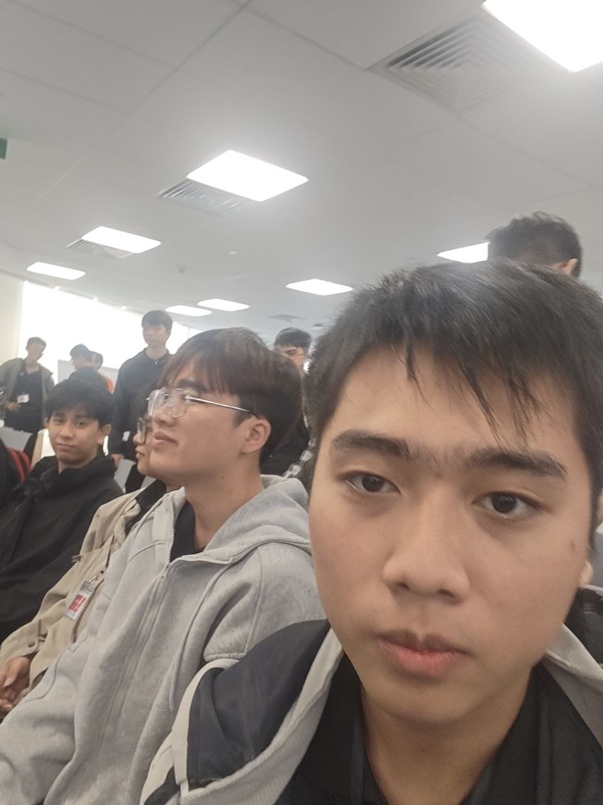
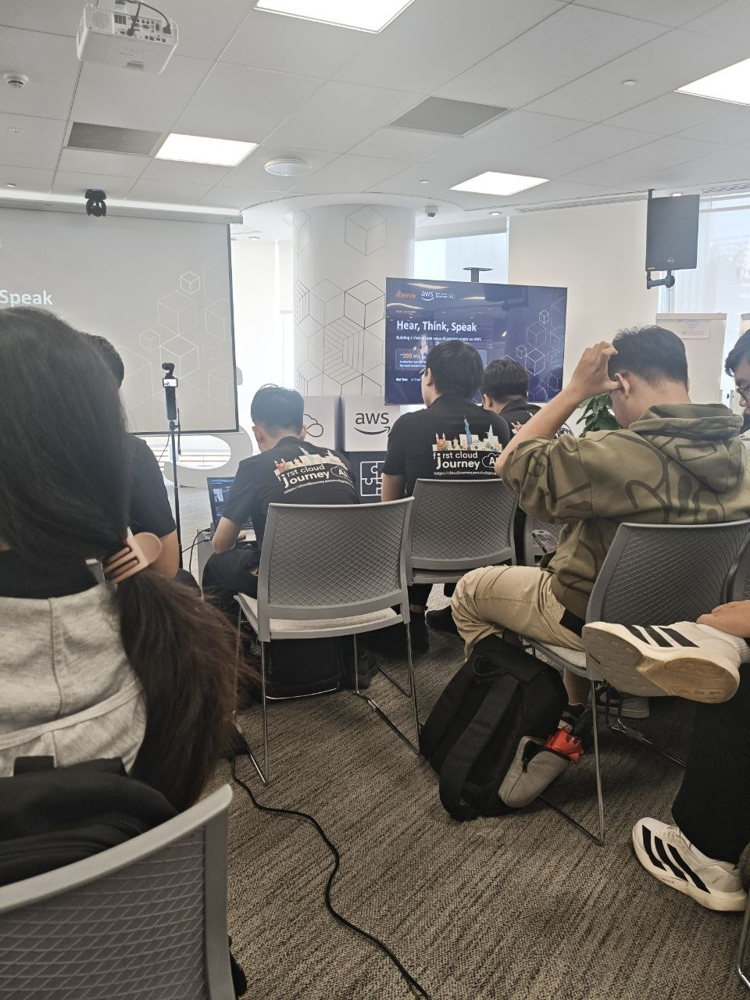
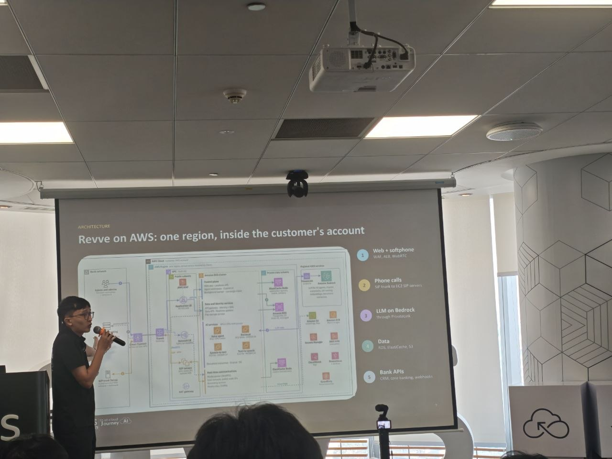
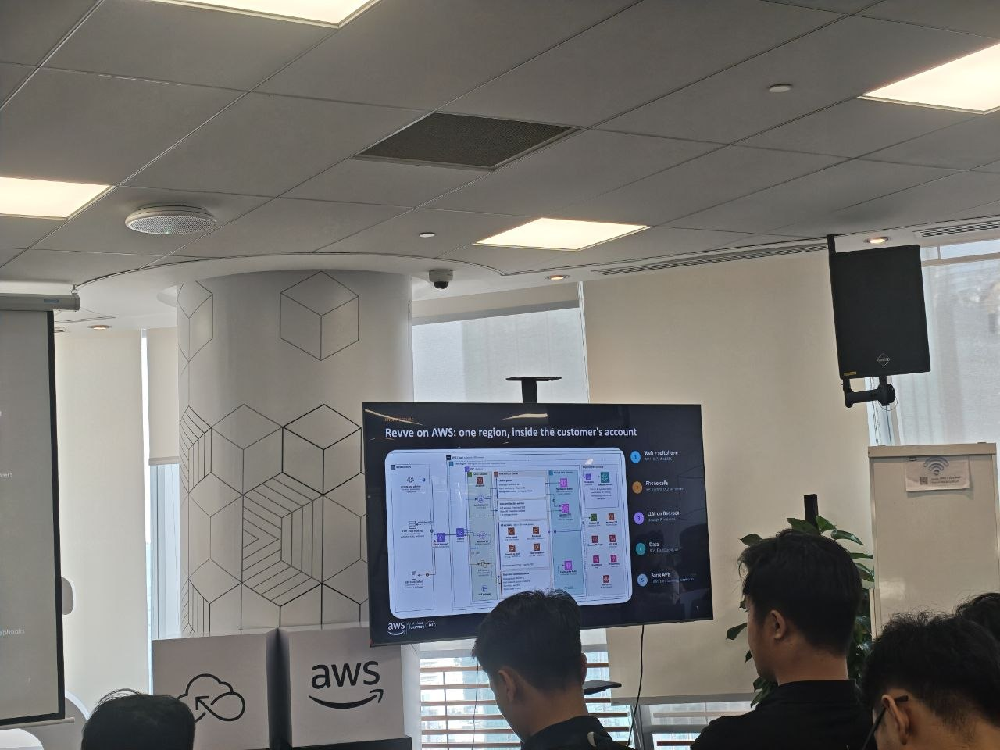
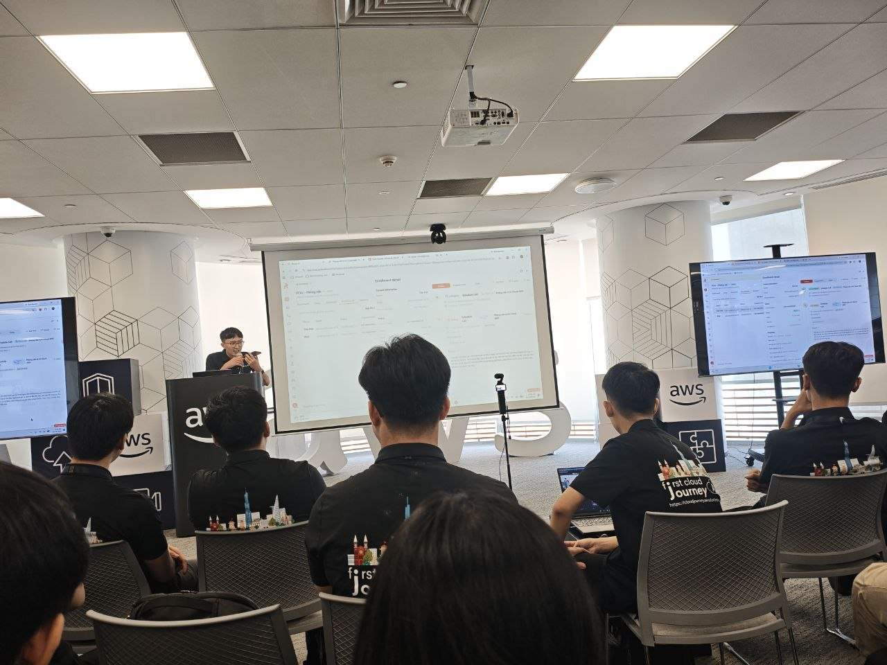
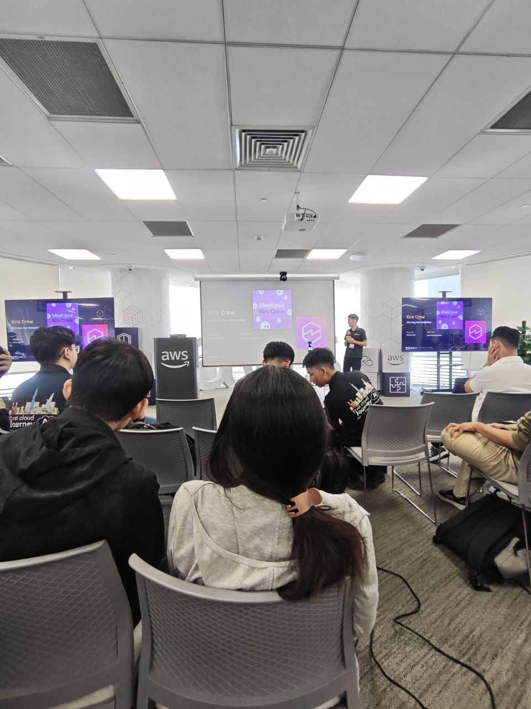
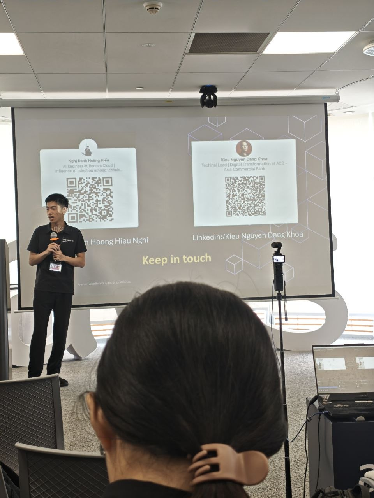

# Event 3: First Cloud AI Journey Meetup — Building Cloud & AI Agents for Production

- **Thời gian:** Thứ Bảy, 24/10/2026 (09:00 – 12:00)
- **Địa điểm:** Văn phòng AWS Việt Nam, Lầu 26, Bitexco Financial Tower, Số 2 Hải Triều, Phường Bến Nghé, Quận 1, TP.HCM
- **Vai trò:** Thực tập sinh / Builder tham dự (Attendee)
- **Đơn vị tổ chức:** First Cloud Journey (FCJ/FCAJ) phối hợp cùng AWS Study Group VN & Các AWS Student Builder Groups

### Các diễn giả & khách mời chia sẻ tại sự kiện:
1. **Anh Kiệt Trần** — AI Engineer tại Revve AI (Đối tác AWS chuyên giải pháp Contact Center Voice AI)
2. **Anh Long Huỳnh** — DevOps Engineer tại Styl Solution (Cựu Admin FCJ)
3. **Anh Thịnh Nguyễn** — DevSecOps & Cloud Engineer tại Styl Solution
4. **Anh Nguyễn Xuân An** — Leader AWS Student Builder Group tại ĐH Sư phạm Kỹ thuật TP.HCM (HCMUTE)
5. **Anh Kiều Nguyễn Đăng Khoa** — Technical Lead tại Ngân hàng Á Châu (ACB)
6. **Anh Danh Hoàng Hiếu Nghị** — AI Engineer tại Renova Cloud, AWS Community Builder, Leader AWS Student Builder Group tại HUFLIT

---

## Hình ảnh Check-in Tham Gia Sự Kiện

| Toàn cảnh hội trường lầu 26 Bitexco | Check-in cá nhân rõ mặt tại sự kiện |
| :---: | :---: |
|  |  |

---

## 1. Không gian sự kiện & Bối cảnh chương trình

Tiếp nối hai sự kiện lớn trước đó là AWS Community Day (tháng 8) và FCJ Build-a-thon Kick-off (tháng 9), buổi **First Cloud AI Journey Meetup tháng 10/2026** đưa người tham dự vào một bài toán thực tế và thách thức hơn: **Làm sao để đưa các giải pháp Cloud Architecture và AI Agent từ môi trường thử nghiệm (Prototype) lên môi trường vận hành thực tế của doanh nghiệp (Production).**

Hội trường tại lầu 26 Bitexco sáng thứ Bảy đông kín người, quy tụ đông đảo các bạn sinh viên từ các câu lạc bộ AWS Cloud Club / Builder Groups cùng các kỹ sư, Tech Lead đến từ nhiều doanh nghiệp và ngân hàng lớn.

Sự kiện diễn ra liên tục trong 3 tiếng với 5 phiên chuyên đề được sắp xếp mạch lạc: đi từ bài toán tương tác giọng nói độ trễ thấp, quản trị mạng đa tài khoản, kiểm thử bảo mật tự động bằng AI, nền tảng Bedrock AgentCore, cho đến màn live demo trợ lý AI Coding chạy 24/7 trên server.

---

## 2. Phiên 1: Hear, Think, Speak — Xây dựng Hệ thống Voice AI Agent Độ trễ Thấp trên AWS

- **Diễn giả:** Anh **Kiệt Trần** — AI Engineer tại Revve AI (Đối tác AWS chuyên cung cấp giải pháp tổng đài thông minh cho các định chế tài chính và ngân hàng).

| Diễn giả Kiệt Trần chia sẻ kinh nghiệm thực tế | Kiến trúc hệ thống Revve Voice AI trên AWS |
| :---: | :---: |
|  |  |

### 2.1. Thách thức phản xạ 200ms trong giao tiếp con người
Anh Kiệt mở đầu bằng một câu hỏi rất thú vị: Trong giao tiếp tự nhiên giữa người với người, khoảng lặng phản hồi trung bình chỉ khoảng **~200ms**. Nếu một trợ lý ảo nghe xong mà im lặng quá 2 giây, người gọi sẽ cảm thấy mất tự nhiên và tưởng đường truyền bị ngắt.

Để giải quyết bài toán này, anh phân tích ưu nhược điểm của 3 hướng kiến trúc hiện nay:
- **Kiến trúc Cascade (STT ➔ LLM ➔ TTS):** Đây là mô hình truyền thống và đang được áp dụng phổ biến nhất trên Production. Âm thanh được chuyển thành chữ qua Speech-to-Text, chuyển vào LLM để suy luận, rồi đưa qua Text-to-Speech phát ra giọng nói. Ưu điểm lớn nhất là tận dụng được trí thông minh sâu sắc của các mô hình LLM hàng đầu (như Claude 3.5 Sonnet trên Bedrock) và dễ dàng can thiệp chỉnh sửa phát âm tiếng Việt. Nhược điểm là độ trễ bị cộng dồn qua từng khâu (thực tế đạt tầm 1.8 giây).
- **Kiến trúc Speech-to-Speech (S2S):** Mô hình nhận trực tiếp file âm thanh và trả ra âm thanh (như Amazon Nova Sonic). Tốc độ phản hồi cực nhanh, nhưng ngữ điệu tiếng Việt hiện tại còn cứng do tập dữ liệu huấn luyện tiếng Việt của các mô hình này chưa đủ lớn.
- **Kiến trúc Full-Duplex S2S:** Xu hướng kết hợp mô hình S2S nhẹ ở tiền tuyến để phản xạ ngay lập tức, trong khi một mô hình LLM lớn chạy ngầm phía sau để giải quyết các logic nghiệp vụ phức tạp.

### 2.2. Kỹ thuật tối ưu cuộc gọi và kiến trúc ngân hàng trên AWS
Để đưa độ trễ từ lúc người dùng dứt câu đến khi nghe được phản hồi xuống mức chấp nhận được (~1.8 giây), team Revve AI áp dụng hai kỹ thuật rất thực tế:
1. **Prompt Caching:** Lưu đệm phần System Prompt cố định của LLM trên Amazon Bedrock, giúp thời gian sinh ra token đầu tiên nhanh hơn rõ rệt.
2. **Chèn câu đệm tự nhiên (Filler Words):** Trong lúc hệ thống phải gọi công cụ ngoài hoặc tra cứu cơ sở dữ liệu, bot sẽ tự động phát các câu nói đệm như *"Dạ vâng, anh chờ em tra cứu thông tin một chút nhé..."* để giữ nhịp hội thoại, không tạo khoảng lặng chết.

Về mặt hạ tầng, hệ thống được thiết kế theo tiêu chuẩn khắt khe của ngân hàng:
- Toàn bộ lưu lượng cuộc gọi đi qua Application Load Balancer vào cụm **Amazon EKS** chạy worker SIP Server, WebRTC Media Server trên nền UDP và các mô hình STT/TTS tự host trên GPU instances để tăng tốc tính toán.
- Kết nối từ EKS tới **Amazon Bedrock** thông qua **AWS PrivateLink**, đảm bảo toàn bộ dữ liệu âm thanh và hội thoại chỉ chạy trong mạng nội bộ AWS, không đi ra ngoài Internet công cộng.
- Dữ liệu khách hàng lưu tại Amazon RDS Multi-AZ, kết hợp Amazon S3 lưu file ghi âm cuộc gọi và mã hóa đầu cuối bằng AWS KMS.

### 2.3. Màn Live Demo phỏng vấn trực tiếp tại hội trường
Phần hấp dẫn nhất của phiên là màn demo thực tế ngay trên sân khấu. AI đóng vai *"Mai – Trợ lý tuyển dụng của công ty Mây Xanh"* gọi điện thoại trực tiếp đến số của anh Kiệt và một bạn sinh viên trong hội trường để phỏng vấn sơ tuyển vị trí Cloud Engineer.

AI tự động đặt các câu hỏi kỹ thuật về thiết kế VPC 3 tầng, dịch vụ EC2, S3, RDS và khả năng mở rộng. Khi bạn sinh viên thử thách bằng cách trả lời mức lương mong muốn là "0 đồng", AI xử lý rất linh hoạt và dí dỏm chứ không bị đơ hay lặp từ. 

Anh Kiệt cho biết qua thử nghiệm 800 cuộc gọi thực tế, tỷ lệ định tuyến đúng ý định người dùng đạt **94%**, và một chiến dịch gọi phỏng vấn cho VPBank đã đạt tỷ lệ hoàn thành tương tác **62%**, với chi phí vận hành bình quân chỉ khoảng **~3.000 VNĐ cho mỗi cuộc gọi**.

---

## 3. Phiên 2: Quản lý và Chia sẻ Tài nguyên Đa tài khoản với AWS Resource Access Manager (AWS RAM)

- **Diễn giả:** Anh **Long Huỳnh** — DevOps Engineer tại Styl Solution (Cựu Admin FCJ).

### 3.1. Vấn đề trùng lặp tài nguyên trong môi trường Multi-Account
Khi doanh nghiệp phát triển lớn mạnh, hạ tầng đám mây thường được tách thành nhiều tài khoản AWS độc lập (môi trường Dev, Staging, Production, Security, Data). Nếu mỗi tài khoản đều tự khởi tạo các tài nguyên dùng chung như VPC Subnet, Transit Gateway, Route 53 Resolver Rules hay bản quyền phần mềm, công ty sẽ phải trả chi phí duy trì rất lãng phí và đội ngũ hạ tầng phải tốn nhiều công sức bảo trì lặp đi lặp lại.

### 3.2. Bản chất AWS RAM và lưu ý đắt giá về AZ ID
Anh Long giới thiệu dịch vụ **AWS Resource Access Manager (AWS RAM)** — một công cụ hoàn toàn **miễn phí** của AWS giúp tài khoản sở hữu (Owner) có thể chia sẻ tài nguyên an toàn cho các tài khoản thành viên trong tổ chức mà không cần tạo mới.

Đặc biệt, anh Long chia sẻ một kinh nghiệm thực chiến xương máu mà rất nhiều kỹ sư mới làm Cloud hay mắc phải:
> **Cái bẫy về tên vùng khả dụng (Availability Zone - AZ):**  
> Trong AWS, các tên gọi AZ như ap-southeast-1a chỉ là tên logic được AWS gán ngẫu nhiên cho từng tài khoản. Vùng ap-southeast-1a ở tài khoản A chưa chắc đã nằm cùng trung tâm dữ liệu vật lý với ap-southeast-1a ở tài khoản B.  
> Khi viết mã hạ tầng (Terraform / CloudFormation) để chia sẻ Subnet xuyên tài khoản, **bắt buộc phải ánh xạ theo mã AZ vật lý (AZ ID, ví dụ apse1-az1)**. Nếu cấu hình nhầm theo tên logic, các máy chủ sẽ nằm ở hai trung tâm dữ liệu khác nhau, khiến doanh nghiệp phải trả thêm khoản chi phí truyền dữ liệu liên vùng (Cross-AZ Data Transfer) rất đắt đỏ.

Anh cũng làm rõ cơ chế đánh giá quyền hạn thực tế: một hành động chỉ được phép thực thi khi nó thỏa mãn phần giao của 3 lớp chính sách: **RAM Managed Permissions ∩ IAM Policies ∩ Service Control Policies (SCPs)** của AWS Organization.

---

## 4. Phiên 3: Tự động hóa Kiểm thử Xâm nhập (AI Pentest) với AWS Continuum & AWS Security Agent

- **Diễn giả:** Anh **Thịnh Nguyễn** — DevSecOps & Cloud Engineer tại Styl Solution.

### 4.1. Điểm nghẽn của Pentest truyền thống
Theo anh Thịnh, việc kiểm thử xâm nhập (Pentest) thủ công hiện nay có 3 trở ngại lớn:
1. Chi phí rất cao: Thuê một đội ngũ chuyên gia bảo mật bên ngoài kiểm thử một ứng dụng thường tốn từ **5.000 USD đến 20.000 USD**.
2. Thời gian kéo dài hàng tuần lễ, không thể đáp ứng được nhịp phát triển phần mềm liên tục.
3. Phụ thuộc lớn vào trình độ của từng chuyên gia cá nhân.

### 4.2. Giải pháp AWS Security Agent & Mẹo xử lý mã OTP
AWS Security Agent (nằm trong bộ giải pháp AWS Continuum) chạy trên nền Amazon Bedrock, hỗ trợ 3 tính năng tự động:
- **Design Security Review:** Quét tài liệu thiết kế kiến trúc hoặc mã Terraform từ sớm để cảnh báo rủi ro (miễn phí 200 lượt/tháng).
- **Code Security Review:** Tích hợp trực tiếp vào GitHub/GitLab Pull Request để kiểm tra luồng dữ liệu trong code (miễn phí 1.000 lượt/tháng).
- **Automated Penetration Testing:** AI tự động đóng vai người dùng và hacker để dựng sơ đồ tấn công (Attack Graph), tự tìm và khai thác lỗ hổng trên web.

Một thủ thuật kỹ thuật rất độc đáo được anh Thịnh chia sẻ là **cách vượt qua bước xác thực OTP qua Email**: Khi ứng dụng bắt nhập mã xác thực gửi về hòm thư, anh thiết lập một rule trên Amazon EventBridge bắt email đến, chuyển nội dung vào một hàm AWS Lambda có bật Lambda Function URL để tự động tách mã số. Sau đó, anh đưa đường dẫn Function URL này vào phần hướng dẫn đăng nhập (Login Instructions) để AI Security Agent tự gọi API lấy mã OTP và tiếp tục bài test.

Anh Thịnh đặc biệt lưu ý: **Tuyệt đối chỉ chạy AI Pentest trên môi trường SIT hoặc UAT, không bao giờ được quét trên Production** vì các kịch bản khai thác của AI sẽ làm xáo trộn dữ liệu thực tế của khách hàng.

---

## 5. Phiên 4: Đưa AI Agent từ Prototype lên Production với Amazon Bedrock AgentCore

- **Diễn giả:** Anh **Nguyễn Xuân An** — Leader AWS Student Builder Group tại HCMUTE.

### 5.1. Chặng đường học tập và khoảng cách đưa Agent lên môi trường thật
Anh An mở đầu bằng câu chuyện rất chân thành về hành trình của bản thân từ những năm đầu đại học, từng có giai đoạn mông lung về định hướng nghề nghiệp trước khi tìm thấy đam mê với Cloud và gắn bó cùng câu lạc bộ AWS Student Builder Group tại trường ĐH Sư phạm Kỹ thuật TP.HCM.

Anh phân tích rằng hiện nay việc dựng một bản demo AI Agent bằng LangChain hay CrewAI trên máy tính cá nhân là rất dễ dàng. Nhưng khi đưa lên môi trường doanh nghiệp phục vụ hàng ngàn người dùng, kỹ sư sẽ lập tức đối mặt với những bài toán hóc búa: làm sao để phiên chat của người này không lẫn vào người khác, làm sao để lưu trữ bộ nhớ bền vững mà không bị phình chi phí token, và làm sao giám sát hệ thống khi có sự cố.

### 5.2. Mổ xẻ hai trụ cột cốt lõi: Runtime và Memory
Để giải quyết bài toán trên, Amazon Bedrock AgentCore cung cấp một nền tảng toàn diện với 2 thành phần trọng tâm:
1. **AgentCore Runtime (Môi trường thực thi MicroVM):**
   - Mỗi phiên làm việc (Session ID) của người dùng được cấp một máy ảo siêu nhẹ (MicroVM) chạy trên các máy chủ EC2 Spot.
   - Nhờ chạy trên MicroVM riêng, dữ liệu giữa các người dùng được cô lập hoàn toàn, không có nguy cơ lộ lọt thông tin. Đồng thời, doanh nghiệp chỉ bị tính tiền khi CPU đang thực sự tính toán xử lý (Active I/O), còn trong thời gian chờ người dùng phản hồi thì hoàn toàn miễn phí.
2. **AgentCore Memory (Hệ thống quản lý bộ nhớ 2 tầng):**
   - **Short-term Memory (Bộ nhớ ngắn hạn):** Lưu lại toàn bộ tin nhắn thô trong phiên trò chuyện hiện tại. Hỗ trợ tính năng phân nhánh bộ nhớ (Memory Branching) tương tự như nhánh Git, giúp các tác tử con (Sub-agents) xử lý các nhánh công việc riêng biệt mà không làm nhiễu ngữ cảnh của nhau.
   - **Long-term Memory (Bộ nhớ dài hạn):** Hệ thống chạy nền tự động chắt lọc các điểm mấu chốt từ bộ nhớ ngắn hạn để lưu lại lâu dài theo 4 chiến lược: Tóm tắt nội dung hội thoại, Ghi nhớ sở thích thói quen người dùng, Lưu trữ các sự thật tri thức chuẩn xác, và Ghi nhớ các bước thực hiện tác vụ thành công trong quá khứ.

---

## 6. Phiên 5: Kiro & Kiro Crew — Trợ lý AI Coding 24/7 và Tự động hóa Code Review

- **Diễn giả:**
  - Anh **Danh Hoàng Hiếu Nghị** — AI Engineer tại Renova Cloud, AWS Community Builder, Leader AWS Student Builder Group tại HUFLIT.
  - Anh **Kiều Nguyễn Đăng Khoa** — Technical Lead tại Ngân hàng Á Châu (ACB) với hơn 6 năm kinh nghiệm dẫn dắt đội ngũ kỹ thuật.

| Slide giới thiệu Kiro Crew trên màn hình lớn | Hai diễn giả: Anh Nghị Danh và Anh Kiều Khoa |
| :---: | :---: |
|  |  |

### 6.1. Triết lý Kiro Reel: Để AI làm việc độc lập 24/7 trên Cloud
Anh Nghị mở đầu phiên bằng việc phân định hai nhánh công cụ AI trên AWS: Amazon Q chuyên hỗ trợ các tác vụ công việc tổng quát, còn Kiro tập trung chuyên sâu cho lập trình viên.

Điểm đặc biệt nhất của Kiro Reel là tư duy đưa AI Agent lên chạy trực tiếp trên một máy chủ đám mây độc lập (Amazon EC2 hoặc VPS). Lập trình viên không cần phải cắm máy tính cá nhân cả ngày lẫn đêm, mà AI có thể tự vận hành bền bỉ 24/7 nhờ 3 trụ cột:
- **Persistent Memory:** Tự động ghi nhớ phong cách code và những lỗi sai đã từng sửa qua các phiên làm việc trước đó, không bắt người dùng phải liên tục tải lại file cấu hình.
- **Tác vụ hẹn giờ (Cronjobs):** Tự động thức dậy vào ban đêm (lúc 3h hay 5h sáng) để kiểm tra các Pull Request mới hoặc chạy bảo trì kho code.
- **Lớp bảo vệ Guardrails có sự can thiệp của con người (Human-in-the-loop):** Với các thao tác đọc code, viết test, sửa lỗi thông thường, AI được phép tự động chạy. Nhưng với bất kỳ lệnh nào có nguy cơ xóa dữ liệu hoặc chuẩn bị triển khai hạ tầng thật lên AWS, hệ thống luôn chặn lại và bắt buộc phải có kỹ sư nhấn xác nhận (Approve).

### 6.2. 4 Màn Live Demo thực tế của Anh Kiều Khoa (Tech Lead ACB)
Anh Khoa trực tiếp chia sẻ màn hình máy tính và thực hiện 4 tình huống làm việc thực tế khiến cả hội trường rất thích thú:
1. **Lập trình và điều hành từ xa qua Telegram:** Anh kết nối Kiro Reel với bot Telegram. Khi đang ở ngoài không mang laptop, anh chỉ cần gửi tin nhắn giao việc qua điện thoại. Kiro Reel tự động đọc repo GitHub dự án *Talent Radar*, viết mã API lấy danh sách khách hàng và tự động tạo luôn một Pull Request hoàn chỉnh trên GitHub. Khi được hỏi tình trạng của database RDS, bot tự động tra cứu CloudWatch Logs và trả lời chi tiết về mức sử dụng CPU và dung lượng bộ nhớ còn trống.
2. **Tự động hóa giám sát với Cronjob:** Cứ mỗi 5 phút, bot tự động quét kiểm tra sức khỏe của các dịch vụ AWS và gửi thông báo khẩn vào nhóm Telegram nếu phát hiện có dịch vụ gặp sự cố; đúng 8h00 sáng mỗi ngày, bot tự động tổng hợp 8 tin tức mới nhất về AI Agents trên thế giới gửi cho team đọc đầu ngày.
3. **Ứng dụng "AI Code Reviewer" cho Tech Lead:** Khi số lượng Pull Request của các bạn lập trình viên tăng vọt nhờ có AI hỗ trợ, một mình Tech Lead không thể review xuể. Anh Khoa tải bộ tài liệu chuẩn code và checklist an toàn của công ty lên làm cơ sở tri thức cho Kiro Reel. Khi có PR mới, AI tự động quét từng dòng code, chỉ rõ đoạn nào vi phạm mục nào trong tài liệu quy chuẩn công ty, gợi ý đoạn code sửa chuẩn và tự động bắn nhận xét thành comment trực tiếp trên GitHub Pull Request.
4. **Dựng Dashboard trực quan qua Artifacts:** Ra lệnh cho Kiro Reel tự động cào dữ liệu từ các trang tuyển dụng CNTT tại Việt Nam, AI tự động tổng hợp mức lương và nhu cầu việc làm rồi vẽ thành một biểu đồ thống kê rất trực quan trong khung chat.

### 6.3. Hỏi đáp kỹ thuật & Minigame sôi nổi
- **Kiểm soát chi phí và dung lượng Context Window:** Anh Nghị chia sẻ Kiro Reel có tính năng **Auto-Compact** (tự động nén gọn ngữ cảnh khi dung lượng hội thoại chạm ngưỡng 70% hoặc 90%) và tính năng **Context Breakdown** để kỹ sư nhìn thấy rõ bao nhiêu % token đang thuộc về code, bao nhiêu % thuộc về lịch sử chat, từ đó chủ động dọn dẹp bộ nhớ cũ tránh phình chi phí token API.
- **Phần Minigame đố vui nhận quà:** Các bạn sinh viên hào hứng trả lời các câu hỏi về quy trình phát triển hướng đặc tả (*Spec-driven development*), 5 client tương tác của Kiro (IDE, CLI, Reel, Web, Mobile Beta), và các họ mô hình AI được hỗ trợ (Claude, OpenAI, Gemini, DeepSeek/Kimi).

---

## 7. Tổng kết bài học và giá trị ứng dụng vào dự án EduMedia AI

Buổi Meetup không chỉ đem lại những trải nghiệm thực tế sinh động mà còn mang đến cho em những bài học kiến trúc đắt giá, có thể đối chiếu và áp dụng trực tiếp vào dự án thực tập **EduMedia AI (Hệ thống Lưu trữ & Tra cứu Bài giảng Thông minh trên AWS)**:

| Bài học đúc kết từ Sự kiện | Kinh nghiệm & Kiến trúc đối chiếu | Giải pháp áp dụng thực tế vào Dự án EduMedia AI |
| :--- | :--- | :--- |
| **Cơ chế Guardrails & Human-in-the-loop** *(Phiên 5 - Kiro Crew)* | Thiết lập lớp rào chắn an toàn, không cho phép AI tự ý thực hiện các hành động có tính chất phá hoại hoặc xóa dữ liệu. | Em đã thiết kế bộ lọc **Demo Guardrails** cho EduMedia AI: gắn cờ is\_demo\_protected chặn xóa dữ liệu mẫu (trả về lỗi HTTP 403), giới hạn dung lượng tải lên tối đa không quá 25MB và kiểm duyệt định dạng file MIME để bảo vệ hệ thống khi mở cho giám khảo kiểm thử công khai. |
| **Quản lý bộ nhớ phân tầng Short/Long-term** *(Phiên 4 - Bedrock AgentCore)* | Tách biệt giữa bộ nhớ hội thoại ngắn hạn theo phiên và tri thức ngữ nghĩa dài hạn để tối ưu chi phí và tránh tràn bộ nhớ. | Áp dụng vào EduMedia AI qua mô hình phân tầng: Amazon DynamoDB lưu trữ metadata hội thoại ngắn hạn kết hợp cơ chế S3-offloading tự động chuyển transcript sang S3 khi vượt 250KB; đồng thời dùng **Amazon Titan Text Embeddings V2 (256 chiều chuẩn hóa L2)** để lưu trữ vector tìm kiếm ngữ nghĩa dài hạn. |
| **Rà soát an toàn kiến trúc IaC từ sớm** *(Phiên 3 - AWS Security Agent)* | Quét mã nguồn và file cấu hình hạ tầng ngay trong quy trình CI/CD để phát hiện lỗ hổng cấu hình trước khi triển khai. | Rà soát toàn bộ SAM Template của dự án để đảm bảo nguyên tắc IAM Least-Privilege: không sử dụng quyền quản trị `AdministratorAccess` hay `Action: *`, phân tách riêng rẽ vai trò IAM Role giữa 3 hàm Lambda (`Ingest`, `Aggregator` và `API`). |
| **Tư duy FinOps & Tối ưu chi phí hạ tầng** *(Phiên 1 & Phiên 2)* | Quản lý tài nguyên tập trung, tránh lãng phí cước Cross-AZ và tận dụng tối đa mô hình tính phí theo mức sử dụng thực tế. | Xây dựng EduMedia AI hoàn toàn trên nền tảng Serverless Scale-to-Zero với AWS Lambda và DynamoDB On-Demand. Khi không có người dùng truy cập, toàn bộ hệ thống tự động co về 0, giữ chi phí duy trì cố định ở mức **0.00 USD**. |

---

**Liên quan:** [4. Các sự kiện đã tham gia](../) · [1. Nhật ký công việc](../../1-Worklog/) · [5. Workshop](../../5-Workshop/) · [6. Tự đánh giá](../../6-Self-evaluation/)
