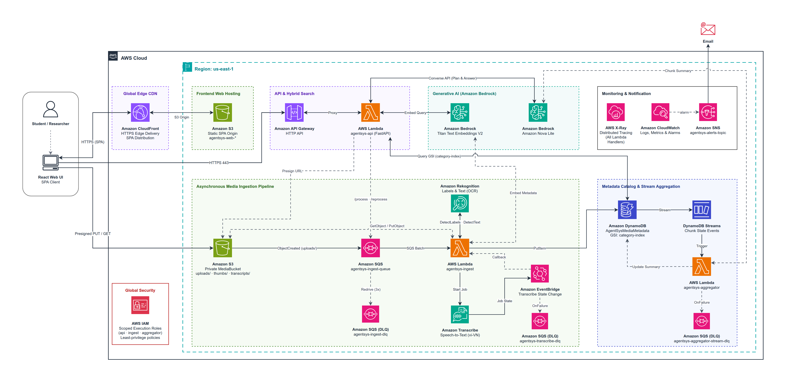

# 5.1. Problem Overview, Serverless Architecture & FinOps Estimation

---

## 1. Problem Statement

Modern learners and researchers manage thousands of unstructured multimodal assets (whiteboard photos, lecture slides, audio recordings, video demos).
* Default filenames (IMG\_091522.jpg, voice\_record\_01.m4a) convey zero semantic context.
* Manually searching for specific moments like *"teacher reviewing matrix exercises"* or *"integration formula on board"* requires tedious manual review.

---

## 2. Workshop Objectives

Build and deploy **EduMedia AI** following an **Event-Driven Serverless** architecture on AWS:
1. Upload files directly to **Amazon S3** (Private Bucket, SSE-S3 encryption).
2. Buffer upload events via **Amazon SQS** with an automated **Dead-Letter Queue (DLQ)**.
3. Orchestrate **AWS Lambda** processing:
   * Images: **Amazon Rekognition** extracts object labels and Vietnamese OCR.
   * Audio/Video: **Amazon Transcribe** generates Vietnamese speech-to-text (*vi-VN*).
4. Generate 256-dimensional semantic embeddings using **Amazon Titan Text Embeddings V2** and persist catalog in **Amazon DynamoDB**.
5. Natural language Vietnamese query routing powered by **Amazon Bedrock (Nova Lite)**.
6. End-to-end monitoring with **Amazon CloudWatch Logs & Alarms**.

---

## 3. System Architecture Diagram

### 3.1. Service Selection Rationale:

The architecture strictly adheres to AWS Well-Architected Framework principles, choosing Serverless and Managed Services over traditional provisioning based on clear technical justifications:

| Selected AWS Service | Evaluated Alternative | Cost Optimization Criteria | High Availability (HA) | Serverless / Managed Model |
| :--- | :--- | :--- | :--- | :--- |
| **Amazon S3** *(Standard Storage)* | Amazon EFS / Amazon EBS | **$0.023 / GB / month**. 13x cheaper than EFS ($0.30/GB). Direct **Presigned URLs** offload client upload/download traffic entirely, saving 100% of compute and bandwidth costs on backend APIs. | Data durability of **99.999999999% (11 9s)** alongside **99.99% designed Availability (99.9% SLA commitment)**, automatically replicated across at least 3 Availability Zones (AZs) in the Region. | **Managed Object Storage**, eliminating disk volume provisioning, filesystem sizing, and storage server management. |
| **AWS Lambda** *(Python 3.12 Runtime)* | Amazon ECS *(Fargate / EC2)* | **$0.00 idle cost (Zero Idle Cost)**. Metered strictly per millisecond and GB-second during actual event execution. 1M free requests/month under AWS Free Tier. ECS Fargate incurs continuous base charges (~$15 - $30/month/task) even with zero traffic. | Default Multi-AZ redundancy across the Region; scales instantaneously from 0 to thousands of concurrent executions without managing Auto Scaling Groups. | **Pure Serverless FaaS**, eliminating OS patching, security kernel upgrades, and container runtime daemon maintenance. |
| **Amazon API Gateway** *(HTTP API)* | Application Load Balancer (ALB) / REST API | Low cost of **$1.00 / million requests** (>70% cheaper than REST API at $3.50/M). Zero idle hourly charges compared to ALB (~$16 - $20/month base LCU cost). | Native Multi-AZ fault tolerance; protected against L3/L4 DDoS attacks via **default AWS Shield Standard** combined with **Route Throttling** (burst and steady-state rate limits) to safeguard backend Lambdas. | **Serverless HTTP API**, native CORS handling, direct zero-overhead Lambda proxy routing. API security validation is enforced at the application tier (FastAPI `verify_api_key` dependency checking `X-API-Key` header) rather than relying on native API Gateway usage plans. |
| **Amazon DynamoDB** *(On-Demand Mode)* | Amazon RDS Aurora *(PostgreSQL / MySQL)* | **$0.00 idle cost**. Metered strictly per actual read/write request units (RRU/WRU) plus 25 GB Always Free storage. Aurora Serverless v2 requires a continuous minimum ACU allocation (~$35 - $60/month). | Automatic synchronous data replication across 3 AZs; backed by a 99.99% SLA with single-digit millisecond query latency (<10ms). | **NoSQL Serverless Database**, immune to connection pool exhaustion during Lambda scale bursts; zero schema migration downtime. |
| **Amazon SQS & DLQ** *(Message Queue)* | Amazon Kinesis Data Streams / Apache Kafka (MSK) | **$0.40 / million requests**. 1 million requests free every month (Always Free). In contrast, Kinesis charges per Shard-hour (~$11/month/shard) and MSK requires continuous cluster broker fees (~$100+/month). | Highly resilient distributed message queue across Multi-AZ with up to 14 days message retention, absorbing traffic bursts without downstream AI throttling. | **Fully Managed Queue**, automatically batch-triggering Lambda Ingest workers and isolating corrupted payloads into Dead-Letter Queues (DLQ). |
| **Amazon Bedrock** *(Nova Lite & Titan Embeddings V2)* | Self-hosted LLM on Amazon EC2 GPU *(G4dn / G5)* | **$0.06 / million input tokens** (Nova Lite) and **$0.02 / million input tokens** (Titan Embeddings V2). Total practical testing cost is mere pennies. Self-hosting open-source LLMs on EC2 GPU (g4dn.xlarge or g5.xlarge) costs **$380 – $750 USD/month** continuously. | Foundation models hosted on AWS high-performance GPU clusters with built-in high availability and automated inference load distribution. | **Serverless GenAI API (FaaS)**, requiring zero management of GPU hardware, CUDA drivers, vLLM containers, or inference scaling clusters. |
| **Amazon Rekognition & Transcribe** | Custom self-trained ML models on EC2 | Amazon Transcribe billed at official rate **$0.024 / minute ($0.0004 / second)**. Rekognition billed at $0.001/image. Eliminates R&D, data labeling, model training, and continuous hosting overhead. | Purpose-built AWS AI services backed by 99.9% SLAs and automatic elastic concurrency. | **Pre-trained Managed AI Services**: Transcribe natively optimized for Vietnamese speech-to-text (*vi-VN*); Rekognition handles object labeling (DetectLabels) and slide text/title extraction (DetectText) out-of-the-box without custom ML training. |

---

## 4. FinOps Cost Modeling & Production Workload Estimates (AWS Region: us-east-1)

Within the FCAJ project framework, operational expenditures are engineered following **FinOps (Cloud Financial Management)** principles based on two realistic deployment scenarios modeled via the **AWS Pricing Calculator**:
* **Official AWS Public Estimate:** [Official EduMedia AI Public Estimate](https://calculator.aws/#/estimate?id=cd02bfb0db81283141c38707032c1bfdbc20a934)

### 4.1. Scenario 1: Self-hosted Workshop & POC Evaluation (1 Tester)
* **Evaluation Workload:** 50 slide images, 5 audio files (20 total minutes), 100 Bedrock AI queries, 1 GB S3 storage, 2,000 Lambda & DynamoDB invocations.
* **Gross Incurred Cost (Without Free Tier):** **$0.48 – $0.84 USD** (~12,000 – 21,000 VND for completing the entire lab).
* **Net Invoiced Cost (With Free Tier):** Pay only for Bedrock On-Demand (~**$0.18 USD / ~4,500 VND**), or **$0.00 USD** if using an account eligible for AWS Free Tier Credits.

### 4.2. Scenario 2: Department Class / Study Club Workload (100 – 200 Students / Month)
Monthly workload: 1,500 lecture slides, 250 audio minutes, 2,000 Bedrock queries, 20 GB S3 storage, 15,000 Lambda invocations, DynamoDB On-Demand, 10 GB CloudFront DTO.

| AWS Service | Production Workload (100 - 200 Students) | Gross Cost (Without Free Tier) | Standard Production Bill (With Always Free) |
| :--- | :--- | :---: | :---: |
| **Amazon Rekognition** | 1,500 images × 2 APIs = 3,000 calls | **$3.00 USD** | **$3.00 USD** *(Year 1: $2.00)* |
| **Amazon Transcribe** | 250 lecture minutes vi-VN | **$6.00 USD** *(Rate Card $0.024/min)* | **$6.00 USD** *(Baseline Calculator: $1.50)* |
| **Amazon Bedrock** | 2,000 queries Nova Pro / Nova Lite (1K in + 300 out) + Embed | **$3.56 USD** | **$3.56 USD** |
| **Amazon S3** | 20 GB Standard storage + requests | **$0.46 USD** *(+ requests: $0.53)* | **$0.46 USD** *(Year 1: $0.35)* |
| **AWS Lambda & SQS** | 15,000 invocations (22,500 GB-s) + SQS | **$0.38 USD** | **$0.00 USD** *(Always Free Tier)* |
| **Amazon DynamoDB** | On-Demand (15,000 writes + 60,000 reads) | **$0.02 USD** | **$0.02 USD** *(< 25 GB Always Free)* |
| **Amazon CloudFront** | 10 GB Data Transfer Out | **$0.85 USD** | **$0.00 USD** *(Always Free 1 TB/mo)* |
| **TOTAL** | **Full System for 100 - 200 Students** | **$14.27 USD / month** *(Baseline Calculator: $9.77)* | **$13.04 – $13.09 USD / month** *(Baseline: $8.54)* |
| **CURRENCY CONVERSION** | **Exchange Rate: 1 USD = 25,500 VND** | **~364,000 VND / month** *(Baseline: ~249,000 VND)* | **~333,000 – 334,000 VND / month** *(Baseline: ~217,000 VND)* |
| **PER-STUDENT COST** | **Scale of 100 – 200 Students** | **1,819 – 3,639 VND / student / month** | **1,663 – 3,338 VND / student / month** |

> **AWS Pricing Calculator vs Rate Card Reconciliation:**
> * On the [AWS Pricing Calculator](https://calculator.aws/#/estimate?id=cd02bfb0db81283141c38707032c1bfdbc20a934), base monthly cost displays **4.96 USD / month** (Rekognition 3.00 USD for 3,000 images, Transcribe 1.50 USD baseline trial workload, S3 20GB 0.46 USD, Lambda 0.00 USD Always Free).
> * Scaling up to the full production workload of **250 audio minutes/month for 100–200 students (Amazon Transcribe Standard totaling 6.00 USD)** plus Bedrock Inference (Nova Lite / Nova Pro + Titan Embeddings) and S3 API / CloudWatch Logs, monthly production spend ranges between **13.04 – 14.27 USD / month** (~**1,663 – 3,639 VND / student / month**).
> * Over **82% of operational spend resides in AI Inference**. The entire Serverless compute/storage tier (Lambda, SQS, S3, DynamoDB, CloudFront) costs under **1.50 USD / month**, automatically scaling to 0.00 USD when idle.
> * **Architecture Diagram vs Cost Model Reconciliation:** The architecture diagram captures the complete end-to-end production topology—spanning Frontend Edge delivery via **Amazon CloudFront CDN** backed by **Amazon S3 Static SPA Hosting** (`agentsys-web-*`, validated at `d27yx88v3wm0yt.cloudfront.net` in section 5.5) alongside the Backend Serverless ingestion and AI processing pipeline in `us-east-1`—aligning 100% with every line item modeled in the FinOps cost breakdown.

---

## 5. Technical Acceptance & Verification Criteria

Before proceeding to evaluation or resource cleanup, the workshop implementation is verified against the following concrete engineering deliverables:

| No | Test Deliverable | Verification Method | Expected Engineering Outcome | AWS Services |
| :---: | :--- | :--- | :--- | :--- |
| **1** | Infrastructure as Code | `sam deploy` or CloudFormation Console | Stack `edumedia-ai` (or `agentsys`) reaches `CREATE_COMPLETE` or `UPDATE_COMPLETE`, exporting all Outputs (ApiEndpoint, S3 Bucket, TableName). | AWS SAM, CloudFormation |
| **2** | Health Check API | `GET /health` | Returns HTTP 200 with discrete health diagnostics for S3, DynamoDB, Rekognition, and Bedrock. | API Gateway, Lambda |
| **3** | Visual Document Processing | Upload study slide via Web / API | SQS buffers event, triggers Lambda Ingest to call Rekognition Labels and OCR text extraction; classifies subject and category. | S3, SQS, Rekognition, DynamoDB |
| **4** | Audio Lecture Ingestion | Upload lecture audio (`.m4a`, `.mp3`) | Triggers Speech Processing, tracks job state through EventBridge, and writes transcript to S3 / DynamoDB. | S3, SQS, Transcribe, EventBridge |
| **5** | Intelligent Query Routing | `POST /api/v1/media/agent/query` | Generates a structured Search Plan (keywords, category, subject) and returns matching records with evidence timestamps. | Amazon Bedrock, DynamoDB GSI |
| **6** | Observability & Alarms | Synthetic traffic or intentional error injection | Structured JSON logs emitted (`MediaIngested`, `MediaIngestFailed`), 7 CloudWatch Alarms active in OK/ALARM states. | CloudWatch Logs, Alarms, SNS |
