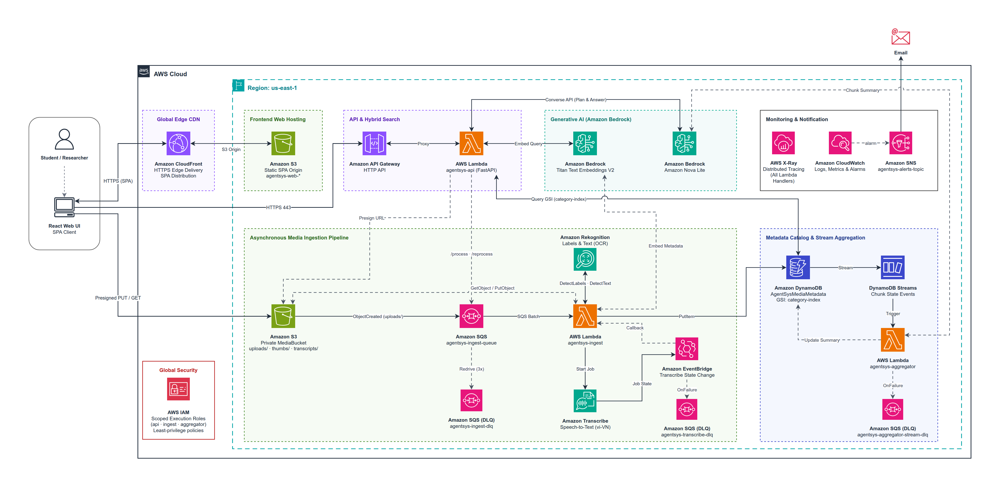

# 5.1. Tổng Quan Bài Toán, Kiến Trúc Serverless & Ước Tính FinOps

---

## 1. Bài toán thực tế (Problem Statement)

Người dùng (học sinh, sinh viên, kỹ sư) lưu trữ hàng nghìn hình ảnh bài giảng, ảnh chụp bảng viết tay, tệp ghi âm giọng nói dài và video bài học trong thiết bị. 
* Tên file mặc định (IMG\_091522.jpg, voice\_record\_01.m4a) không chứa bất kỳ ngữ nghĩa nào.
* Việc tìm lại nội dung như *"Đoạn thầy nhắc làm bài tập ma trận"* hay *"Công thức tính tích phân trên bảng"* thường mất hàng giờ xem lại thủ công.

---

## 2. Mục tiêu Workshop (Workshop Objectives)

Xây dựng hệ thống **EduMedia AI** xử lý tự động theo mô hình **Event-Driven Serverless**:
1. Upload tệp trực tiếp lên **Amazon S3** (Private Bucket, mã hóa SSE-S3).
2. Tự động đệm sự kiện qua **Amazon SQS** và **Dead-Letter Queue (DLQ)**.
3. **AWS Lambda** điều phối phân tích:
   * Ảnh: **Amazon Rekognition** trích xuất nhãn đối tượng + OCR văn bản tiếng Việt.
   * Âm thanh / Video: **Amazon Transcribe** bóc băng giọng nói tiếng Việt (*vi-VN*).
4. Nhúng vector 256 chiều qua **Amazon Titan Text Embeddings V2** và lưu catalog vào **Amazon DynamoDB**.
5. Nhận diện và trả lời câu hỏi tự nhiên tiếng Việt qua **Amazon Bedrock (Nova Lite)**.
6. Giám sát toàn diện qua **Amazon CloudWatch Logs & Alarms**.

---

## 3. Sơ đồ Kiến trúc Hệ thống (System Architecture)

### 3.1. Căn cứ Lựa chọn Dịch vụ (Service Selection Rationale):

Hệ thống được thiết kế dựa trên tiêu chuẩn AWS Well-Architected với các căn cứ kỹ thuật rõ ràng giữa mô hình Serverless/Managed Services so với các kiến trúc truyền thống:

| Dịch vụ AWS được chọn | Phương án thay thế cân nhắc | Tiêu chí Chi phí (Cost Optimization) | Tính sẵn sàng cao (High Availability) | Mô hình Serverless / Managed Services |
| :--- | :--- | :--- | :--- | :--- |
| **Amazon S3** *(Standard Storage)* | Amazon EFS / Amazon EBS | **$0.023 / GB / tháng**. Rẻ hơn 13 lần so với EFS ($0.30/GB). Hỗ trợ **Presigned URLs** cho phép client upload/download trực tiếp, tiết kiệm 100% băng thông và compute cho API backend. | Độ bền dữ liệu đạt **99.999999999% (11 số 9)** cùng Tính sẵn sàng (Availability) thiết kế **99.99%** (cam kết SLA 99.9%), tự động nhân bản đồng thời trên tối thiểu 3 Availability Zones (AZs) trong Region. | **Managed Object Storage**, không cần cấp phát trước dung lượng ổ đĩa hay quản lý máy chủ lưu trữ file. |
| **Amazon CloudFront** *(Web SPA CDN)* | EC2 Reverse Proxy (Nginx) / Direct S3 Public | Tặng **1 TB Data Transfer Out & 10 triệu requests/tháng vĩnh viễn (Always Free)** để phân phối giao diện React SPA (`agentsys-web-*`), chi phí nhàn rỗi **$0.00**. | Mạng lưới Edge toàn cầu với HTTPS TLS mặc định và khả năng chịu tải tức thì không cần tự vận hành máy chủ proxy. | **Managed Edge CDN**, tách biệt tầng phân phối Web UI tĩnh khỏi các endpoint API nghiệp vụ. |
| **AWS Lambda** *(Python 3.12 Runtime)* | Amazon ECS *(Fargate / EC2)* | **$0.00 chi phí nhàn rỗi (Zero Idle Cost)**. Chỉ tính tiền trên mili-giây và GB-giây thực tế khi có sự kiện. Miễn phí 1 triệu requests/tháng qua AWS Free Tier. So với ECS Fargate phải trả phí duy trì task liên tục kể cả khi không có lưu lượng (~$15 - $30/tháng). | Mặc định triển khai đa AZ trong Region; tự động scale từ 0 lên hàng nghìn concurrent executions tức thì mà không cần cấu hình Auto Scaling Group. | **Pure Serverless FaaS**, hoàn toàn không phải quản trị hệ điều hành máy chủ, vá lỗi bảo mật (OS patching) hay quản lý container daemon. |
| **Amazon API Gateway** *(HTTP API)* | Application Load Balancer (ALB) / REST API | Đơn giá **$1.00 / triệu requests** (tiết kiệm hơn 70% so với REST API $3.50/triệu). Không tốn phí cố định theo giờ như ALB (~$16 - $20/tháng kể cả khi không có lưu lượng). | Tự động dự phòng đa vùng khả dụng; bảo vệ chống tấn công DDoS L3/L4 thông qua **AWS Shield Standard mặc định** và giới hạn tốc độ cấp tài khoản của API Gateway kết hợp rate-limiting ở tầng ứng dụng. | **Serverless HTTP API**, tích hợp nguyên bản CORS, định tuyến trực tiếp vào Lambda. Xác thực (`verify_api_key` kiểm tra `X-API-Key` / JWT) và giới hạn tốc độ (`slowapi` `60 requests/phút/IP`) được thực thi trực tiếp tại tầng FastAPI. |
| **Amazon DynamoDB** *(On-Demand Mode)* | Amazon RDS Aurora *(PostgreSQL / MySQL)* | **$0.00 duy trì khi rảnh**. Tính phí chính xác theo số lượt đọc/ghi thực tế (WRU/RRU). Tặng kèm 25 GB lưu trữ Always Free. So với RDS Aurora Serverless v2 yêu cầu duy trì mức ACU tối thiểu liên tục (~$35 - $60/tháng). | Tự động nhân bản đồng bộ dữ liệu trên 3 AZs trong Region; cam kết SLA 99.99% với độ trễ truy xuất một chữ số mili-giây (< 10ms). | **NoSQL Serverless Database**, không lo cạn kiệt connection pool khi Lambda mở rộng đột biến; không cần quản trị bảo trì schema migrations. |
| **Amazon SQS & DLQ** *(Message Queue)* | Amazon Kinesis Data Streams / Apache Kafka (MSK) | **$0.40 / triệu requests**. Tặng 1 triệu requests miễn phí mỗi tháng (Always Free). So với Kinesis tính phí theo Shard-hour (~$11/tháng/shard) hoặc Amazon MSK (~$100+/tháng). | Hàng đợi tin cậy phân tán đa AZ (`agentsys-ingest-queue` lưu 24 giờ, **3 DLQs** lưu bền vững **14 ngày**), đệm tải an toàn (`MaximumConcurrency = 5`) chống tràn tài nguyên xử lý AI phía sau. | **Fully Managed Queue**, tự động phân phối thông điệp dạng batch cho Lambda Ingest; tự động chuyển tin nhắn lỗi vào Dead-Letter Queue (DLQ). |
| **Amazon Bedrock** *(Nova Pro / Nova Lite & Titan Embeddings V2)* | Tự host mô hình LLM trên Amazon EC2 GPU *(G4dn / G5)* | **$0.06 / triệu input tokens** (Nova Lite), **$0.02 / triệu input tokens** (Titan Embeddings V2), hỗ trợ Cross-Region Inference (`us.amazon.nova-pro-v1:0`) với chi phí kiểm nghiệm thực tế chỉ vài nghìn VNĐ/tháng. Tự host mô hình trên EC2 GPU (g4dn.xlarge hoặc g5.xlarge) tiêu tốn từ **$380 – $750 USD/tháng**. | Mô hình nền tảng do AWS vận hành trên cụm tính toán AI quy mô lớn với độ sẵn sàng cao và cơ chế phân phối tải tự động. | **Serverless GenAI API (FaaS)**, không cần quản trị hạ tầng phần cứng GPU, driver CUDA, container vLLM hay cân bằng tải mô hình. |
| **Amazon Rekognition & Transcribe** | Tự huấn luyện và triển khai mô hình ML riêng | Amazon Transcribe áp dụng biểu giá niêm yết chuẩn **$0.024 / phút ($0.0004 / giây)**. Rekognition tính phí **$0.001 / API call** (gọi cả `DetectLabels` + `DetectText` hết **$0.002 / ảnh**). Chi phí cực thấp, không tốn chi phí R&D, gán nhãn và đào tạo mô hình. | Dịch vụ AI chuyên dụng đạt chuẩn SLA 99.9% của AWS, xử lý song song với tính sẵn sàng cao. | **Pre-trained Managed AI Services**: Transcribe tối ưu sẵn sàng cho nhận diện giọng nói tiếng Việt (*vi-VN*); Rekognition thực hiện trích xuất nhãn đối tượng (DetectLabels) và nhận diện văn bản in / tiêu đề trên slide (DetectText) sẵn sàng sử dụng out-of-the-box mà không cần tự huấn luyện model. |

---

## 4. Dự toán Chi phí Vận hành FinOps (Mô hình Workload Sản xuất & Chi phí Thực tế)

Trong khuôn khổ dự án FCAJ, chi phí vận hành được tính toán theo nguyên lý **FinOps (Cloud Financial Management)** dựa trên 2 kịch bản thực tế đối chiếu qua **AWS Pricing Calculator**:
* **Link dự toán chính thức trên AWS:** [Bảng dự toán công khai EduMedia AI (`us-east-1` N. Virginia)](https://calculator.aws/#/estimate?id=ecbb5a062896472eb768e1aa807cb0a645a65aea)

### 4.1. Kịch bản 1: Người đọc tự triển khai thực hành Workshop (1 Tester / Self-hosted Lab)
* **Khối lượng kiểm thử:** 50 ảnh slide học tập, 5 tệp âm thanh (20 phút bài giảng), 100 lượt truy vấn Bedrock AI, 1 GB lưu trữ S3, 2.000 invocations Lambda & DynamoDB.
* **Chi phí gốc tiêu thụ (Gross Cost - khi không có Free Tier):** **$0.76 – $0.88 USD** (~19.400 – 22.400 VNĐ cho toàn bộ bài lab, tính theo đơn giá niêm yết Transcribe $0.024/phút).
* **Hóa đơn thực tế (Net Cost - khi có Free Tier):** Chỉ trả phần Bedrock On-Demand khoảng **$0.18 USD (~4.500 VNĐ)**, hoặc **$0.00 USD** nếu dùng tài khoản mới có gói tín dụng AWS Free Tier Credits.

### 4.2. Kịch bản 2: Triển khai thử nghiệm cho một lớp học (100 – 200 Sinh viên / 1 Tháng)
Khối lượng phục vụ: 1.500 ảnh bài giảng/slide, 250 phút ghi âm bài giảng dùng chung, 2.000 lượt tra cứu Bedrock, 20 GB lưu trữ S3 + PUT/GET requests, 15.000 invocations Lambda, 50.000 SQS messages, 15.000 HTTP API Gateway requests, DynamoDB On-Demand (15k W / 60k R), 10 GB CloudFront DTO, 2 custom metrics + 0.5 GB logs + 7 CloudWatch Alarms.

| Dịch vụ AWS | Khối lượng vận hành (100 - 200 sinh viên) | Gross Cost (Không Free Tier) | Hóa đơn Chuẩn dài hạn (Áp dụng Always Free) |
| :--- | :--- | :---: | :---: |
| **Amazon Rekognition** | 1.500 ảnh × 2 APIs = 3.000 calls | **$3.00 USD** | **$3.00 USD** *(Năm đầu: $2.00)* |
| **Amazon Transcribe** | 250 phút ghi âm bài giảng vi-VN | **$6.00 USD** *(Rate Card $0.024/phút)* | **$6.00 USD** *(Calculator: $1.50)* |
| **Amazon Bedrock** | 2.000 queries Nova Pro (2.0M in + 0.6M out) + Titan Embed V2 (2.0M) | **$3.56 USD** *(Nova Pro $3.52 + Embed $0.04)* | **$3.56 USD** |
| **Amazon S3** | 20 GB Standard + PUT (2.000) / GET (10.000) requests | **$0.47 USD** *(Lưu trữ $0.46 + Reqs $0.01)* | **$0.47 USD** *(Năm đầu: $0.35)* |
| **AWS Lambda & SQS** | 15.000 invocations (512MB, 1.5s) + 50.000 SQS msgs | **$0.21 USD** *(Lambda $0.19 + SQS $0.02)* | **$0.00 USD** *(Always Free: 1M Lambda + 1M SQS)* |
| **Amazon API Gateway** | HTTP API v2 (15.000 requests/tháng) | **$0.02 USD** | **$0.02 USD** |
| **Amazon DynamoDB** | On-Demand (15.000 writes + 60.000 reads, 0.02 GB) | **$0.02 USD** | **$0.02 USD** *(Lưu trữ < 25 GB Always Free)* |
| **Amazon CloudFront** | 10 GB Data Transfer Out + 15.000 HTTPS reqs | **$0.85 USD** | **$0.00 USD** *(Always Free 1 TB / 10M reqs)* |
| **Amazon CloudWatch** | 2 custom metrics ($0.60) + 0.5 GB logs ($0.25) + 7 alarms ($0.70) | **$1.55 USD** | **$0.00 USD** *(Always Free: 10 metrics / 10 alarms / 5 GB)* |
| **TỔNG CỘNG** | **Toàn bộ hệ thống cho 100 - 200 Sinh viên** | **$15.68 USD / tháng** *(Transcribe Calculator: $11.18)* | **$13.07 USD / tháng** *(Calculator trực tiếp: $10.14; Thực thu: $8.57)* |
| **QUY ĐỔI VNĐ** | **Tỷ giá quy đổi: 1 USD = 25.500 VNĐ** | **~400.000 VNĐ / tháng** *(Transcribe Calculator: ~285.000 VNĐ)* | **~333.000 VNĐ / tháng** *(Calculator trực tiếp: ~259.000 VNĐ; Thực thu: ~219.000 VNĐ)* |
| **BÌNH QUÂN / SV** | **Quy mô 100 – 200 sinh viên** | **1.999 – 3.998 VNĐ / SV / tháng** | **1.666 – 3.333 VNĐ / SV / tháng** |

> **Đối chiếu Công cụ AWS Pricing Calculator và Biểu giá Niêm yết (Rate Card):**
> * Trên công cụ chính thức [AWS Pricing Calculator (`us-east-1` N. Virginia)](https://calculator.aws/#/estimate?id=ecbb5a062896472eb768e1aa807cb0a645a65aea), toàn bộ **11 hạng mục thuộc 10 dịch vụ AWS** hiển thị tổng chi phí **10.14 USD / tháng** (**121.68 USD / 12 tháng**): Rekognition **$3.00**, Transcribe **$1.50**, Bedrock Nova Pro **$3.52**, Bedrock Titan Embeddings V2 **$0.04**, S3 **$0.47**, DynamoDB **$0.02**, SQS **$0.02** *(trước Free Tier)*, API Gateway **$0.02**, Lambda **$0.00**, CloudFront **$0.00** và CloudWatch **$1.55** *(trước Free Tier)*.
> * Khi trừ khoản Always Free Tier mà mục CloudWatch & SQS trên Calculator chưa tự khấu trừ (**$1.55 + $0.02 = $1.57 USD**), hóa đơn thực tế trên biểu giá Calculator là **$8.57 USD / tháng**, hoặc **$13.07 USD / tháng** (**~1.666 – 3.333 VNĐ / sinh viên / tháng**) khi áp dụng đơn giá niêm yết chuẩn của Transcribe (**$0.024/phút = $6.00 USD**) thay cho mức **$1.50 USD** (`$0.006/phút`) trên Calculator.
> * Khoảng **80% – 96% chi phí vận hành tập trung ở tầng AI Inference**. Khi loại trừ các API AI, toàn bộ hạ tầng Serverless (Lambda, SQS, S3, API Gateway, DynamoDB, CloudFront, CloudWatch) chỉ tốn **$0.51 USD / tháng** sau Always Free Tier và tự động co về **$0.00 USD** khi ở trạng thái nghỉ.
> * **Thống nhất giữa Sơ đồ Kiến trúc và Bảng Dự toán Chi phí:** Sơ đồ kiến trúc phản ánh đầy đủ toàn bộ kiến trúc End-to-End từ tầng phân phối Frontend tại biên (**Amazon CloudFront CDN** kết hợp **Amazon S3 Static SPA Origin** `agentsys-web-*`, vận hành thực tế tại `d27yx88v3wm0yt.cloudfront.net` ở mục 5.5) đến toàn bộ hệ thống Backend Serverless & AI tại Region `us-east-1`, khớp 100% với các hạng mục trong bảng dự toán trên AWS Pricing Calculator.

---

## 5. Tiêu chí Đánh giá & Kiểm thử Hoàn thành Workshop (Acceptance Criteria)

Trước khi tiến hành nghiệm thu hoặc dọn dẹp tài nguyên (Cleanup), workshop được xác minh dựa trên các tiêu chí kỹ thuật thực tế sau:

| STT | Hạng mục kiểm thử | Phương thức xác minh | Kết quả kỹ thuật kỳ vọng | Dịch vụ AWS liên quan |
| :---: | :--- | :--- | :--- | :--- |
| **1** | Khởi tạo Hạ tầng IaC | `sam deploy` hoặc CloudFormation Console | Stack `edumedia-ai` (hoặc `agentsys`) ở trạng thái `CREATE_COMPLETE` hoặc `UPDATE_COMPLETE`, xuất đầy đủ Outputs (ApiEndpoint, S3 Bucket, TableName). | AWS SAM, CloudFormation |
| **2** | Kiểm tra Sức khỏe API | `GET /health` | Trả về HTTP 200 kèm trạng thái chi tiết của từng component (S3, DynamoDB, Rekognition, Bedrock). | API Gateway, Lambda |
| **3** | Phân tích Tư liệu Hình ảnh | Upload ảnh slide học tập lên S3 qua Web / API | SQS nhận thông điệp, kích hoạt Lambda Ingest gọi Rekognition đọc nhãn và trích xuất nguyên văn OCR; phân loại đúng danh mục và môn học. | S3, SQS, Rekognition, DynamoDB |
| **4** | Phân tích Tư liệu Âm thanh | Upload file audio bài giảng (`.m4a`, `.mp3`) | Kích hoạt tác vụ Speech Processing, theo dõi trạng thái qua EventBridge và lưu trữ bản ghi transcript vào S3 / DynamoDB. | S3, SQS, Transcribe, EventBridge |
| **5** | Truy vấn Tìm kiếm Thông minh | `POST /api/v1/media/agent/query` | Trả về Search Plan có cấu trúc (keywords, category, subject) và danh sách tệp khớp ngữ nghĩa kèm mốc bằng chứng. | Amazon Bedrock, DynamoDB GSI |
| **6** | Giám sát & Báo động Vận hành | Gửi tải hoặc tạo lỗi thử nghiệm | CloudWatch Logs ghi log JSON có cấu trúc (`MediaIngested`, `MediaIngestFailed`), 7 CloudWatch Alarms sẵn sàng bảo vệ hệ thống. | CloudWatch Logs, Alarms, SNS |
