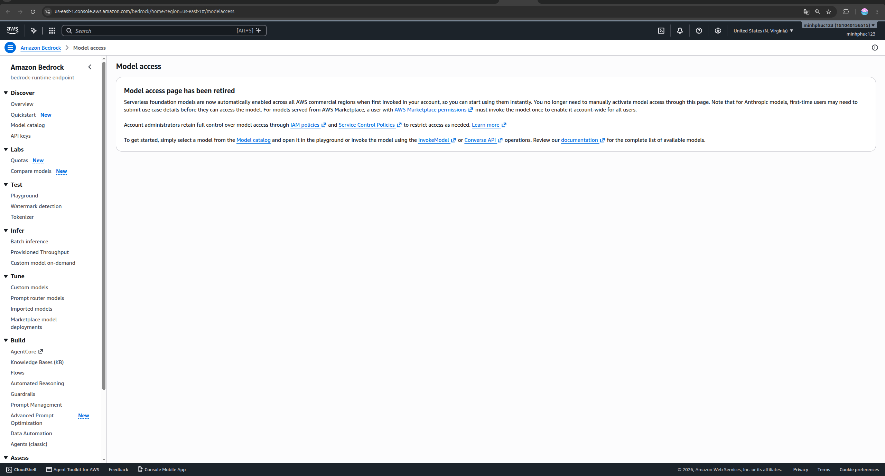

# 5.2. Environment Setup, AWS CLI, SAM, IAM Least-Privilege & Enabling Amazon Bedrock Model Access

---

## 1. Prerequisites & Tooling Setup

Before getting started, ensure the following developer tools are configured locally:

1. **AWS Account** with AdministratorAccess or permissions to provision IAM Roles, S3, DynamoDB, Lambda, SQS, API Gateway, and CloudWatch.
2. **AWS CLI v2**: Configured via aws configure.
3. **AWS SAM CLI**: Tooling for building and deploying Serverless applications.
4. **Python 3.12** & **Node.js 20+** (for running the Web UI).

### Verify AWS CLI Configuration:
```bash
aws sts get-caller-identity
aws configure get region
```
*Ensure the returned region is **us-east-1** (N. Virginia).*

---

## 2. Setting up Cost Guardrails (AWS Budgets)

To guarantee zero unexpected charges during development:
1. Open the **AWS Management Console** → Search for **AWS Budgets**.
2. Select **Create budget** → **Cost budget**.
3. Name: My Zero-Spend Budget → Monthly budget limit: **$1.00 USD** (Zero-Spend protection).
4. Configure an email notification trigger when actual spend exceeds threshold to ensure $0.00 USD billing.

---

## 3. Amazon Bedrock Model Access Management (Automated On-Demand Enablement)

Under the latest AWS Bedrock operational policies, access management for foundation models has been streamlined into fully serverless automated enablement:

1. **Model Access Retirement Notice & Instant Availability:**
   * For Amazon Serverless Foundation Models (including **Amazon Titan Text Embeddings V2** and **Amazon Nova Lite/Micro/Pro**), AWS has officially retired manual model access application workflows.
   * Models are now **automatically enabled on-demand** across all AWS commercial regions upon first invocation (`InvokeModel` or `Converse API`). Developers no longer need to submit manual use-case forms or await approval badges.



2. **IAM Least-Privilege Governance:**
   * Model invocation boundaries are now strictly governed by standard **IAM Policies** attached to Lambda execution roles (`bedrock:InvokeModel`) and Service Control Policies (SCPs), ensuring zero-trust governance directly via Infrastructure as Code (SAM).

{}
**Note:** For select third-party partner models (such as Anthropic Claude via AWS Marketplace), accounts may prompt for a one-time use-case registration prior to first invocation.
{}

---

## 4. IAM Least-Privilege Architecture
 
The SAM template (infra/template.yaml) defines three strictly segregated execution roles following least-privilege principles:

1. **IngestFunctionRole** (agentsys-ingest):
   * Scoped to s3:GetObject on uploads/\*.
   * rekognition:DetectLabels and rekognition:DetectText.
   * transcribe:StartTranscriptionJob and transcribe:GetTranscriptionJob.
   * dynamodb:PutItem and dynamodb:UpdateItem on table AgentSysMediaMetadata.
   * Consumer access to SQS queue agentsys-ingest-queue.
2. **AggregatorFunctionRole** (agentsys-aggregator):
   * Consumes events from DynamoDB Stream (GetRecords, GetShardIterator, DescribeStream).
   * Reads chunk metadata (BatchGetItem, GetItem, UpdateItem) on table AgentSysMediaMetadata.
   * bedrock:InvokeModel on amazon.nova-lite-v1:0 to synthesize multi-chunk audio transcripts and OCR findings.
   * Sends failed stream records to AggregatorStreamDLQ.
   * Emits operational metrics to CloudWatch namespace AgentSys.
3. **ApiFunctionRole** (agentsys-api):
   * Generates s3:PutObject Presigned URLs.
   * dynamodb:GetItem, dynamodb:Query (including GSI category-index), and dynamodb:DeleteItem.
   * bedrock:InvokeModel on authorized foundation models (Amazon Nova Lite, Titan Embeddings).

---

## 5. Running Automated Unit Tests

Run the local unit test suite with Pytest to verify core modules (ingestion pipeline, API authentication, and Bedrock query handling) before deploying to AWS:

```bash
cd agent_sys
python -m venv venv
# Windows:
.\venv\Scripts\activate
# Linux/macOS:
source venv/bin/activate

pip install -r requirements.txt
pytest -v
```
*Expected: Test suite passes, confirming business logic and IAM access assumptions function as designed.*

---

## 6. Building and Deploying with AWS SAM

```bash
cd agent_sys
sam build -t infra/template.yaml
sam deploy --guided
```

### Guided Deployment Parameters:
| Parameter | Recommended Value | Purpose |
| :--- | :--- | :--- |
| **Stack Name** | agentsys | CloudFormation Stack Name |
| **AWS Region** | us-east-1 | Target AWS Region |
| **Parameter ApiKey** | dev-local-api-key | API Protection Key (X-API-Key header) |
| **Parameter FrontendOriginUrl** | \* (or your Vercel/CloudFront domain) | Allowed Origin for CORS |
| **Confirm changes before deploy** | Y | Review CloudFormation changeset |
| **Allow SAM CLI IAM role creation** | Y | Grant SAM permission to create IAM roles |

After deployment succeeds, record the values in **Outputs**:
* ApiEndpoint: HTTP API Gateway Invoke URL (e.g., https://xxxx.execute-api.us-east-1.amazonaws.com - *note: HTTP API uses the $default stage, so do NOT append /Prod*)
* MediaBucketName: S3 Media Bucket Name
* MetadataTableName: AgentSysMediaMetadata
