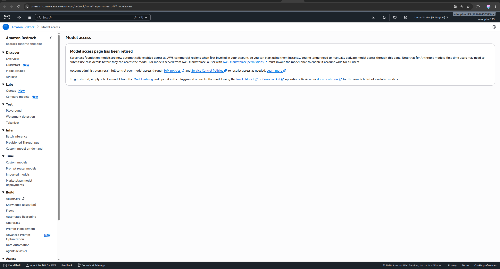

# 5.2. Chuẩn Bị Môi Trường, AWS CLI, SAM, IAM Least-Privilege & Bật Amazon Bedrock Model Access

---

## 1. Yêu cầu tiên quyết & Cài đặt công cụ

Trước khi bắt đầu, bạn cần chuẩn bị các công cụ sau trên máy tính cá nhân:

1. **Tài khoản AWS (AWS Account)** có quyền quản trị viên (AdministratorAccess) hoặc quyền khởi tạo IAM Role, S3, DynamoDB, Lambda, SQS, API Gateway, CloudWatch.
2. **AWS CLI v2**: Cài đặt và cấu hình thông qua aws configure.
3. **AWS SAM CLI**: Công cụ đóng gói và triển khai Serverless Application Model.
4. **Python 3.12** & **Node.js 20+** (để chạy Web UI).

### Xác minh cấu hình AWS CLI:
```bash
aws sts get-caller-identity
aws configure get region
```
*Đảm bảo kết quả trả về đúng User IAM của bạn và Region là **us-east-1** (N. Virginia).*

---

## 2. Thiết lập Ngân sách Chống Phát sinh Chi phí (AWS Budgets)

Để kiểm soát chặt chẽ chi phí và phòng ngừa phát sinh cước ngoài ý muốn:
1. Mở **AWS Management Console** → Tìm dịch vụ **AWS Budgets**.
2. Chọn **Create budget** → **Cost budget**.
3. Đặt tên: My Zero-Spend Budget → Đặt hạn mức: **$1.00 USD / tháng** (ngân sách Zero-Spend bảo vệ tài khoản).
4. Cấu hình gửi cảnh báo Email khi chi phí thực tế chạm hạn mức để luôn duy trì mức chi phí $0.00 USD.

---

## 3. Quản Lý Quyền Truy Cập Model Trên Amazon Bedrock (Cập Nhật Kích Hoạt Tự Động)

Theo chính sách mới nhất của AWS Bedrock, quy trình cấp quyền truy cập mô hình nền tảng (Foundation Models) đã được tối ưu hóa:

1. **Thông Báo Miễn Trừ Cấp Quyền Thủ Công (Retired Model Access Page):**
   * Đối với các Serverless Foundation Models của Amazon (như **Amazon Titan Text Embeddings V2** và **Amazon Nova Lite / Nova Pro**), AWS đã chính thức chuyển đổi sang cơ chế **kích hoạt tự động (automatically enabled on-demand)**.
   * Người dùng không còn cần phải nộp form yêu cầu phê duyệt hoặc ấn nút "Modify model access" thủ công như các phiên bản cũ. Các mô hình này sẵn sàng sử dụng ngay lập tức khi tài khoản thực hiện API call đầu tiên (`InvokeModel` hoặc `Converse API`) trong Region thương mại (như `us-east-1`).



2. **Quy tắc quản trị bảo mật IAM:**
   * Thay vì rào cản thủ công trên Console, việc kiểm soát quyền gọi model hiện được quản trị chặt chẽ bằng **IAM Policies** gắn vào Lambda Execution Role (`bedrock:InvokeModel`) và Service Control Policies (SCP).
   * Điều này giúp kiến trúc hệ thống chuẩn bị hạ tầng Serverless nhanh chóng, hoàn toàn tự động hoá thông qua Infrastructure as Code (SAM).

{}
**Lưu ý:** Đối với một số mô hình của bên thứ ba (như Anthropic Claude thông qua AWS Marketplace), tài khoản có thể được yêu cầu khai báo use-case thông tin sử dụng trong lần gọi API đầu tiên.
{}

---

## 4. Nguyên Tắc Phân Quyền Tối Thiểu (IAM Least-Privilege Roles)

Trong SAM Template (`infra/template.yaml`), hệ thống tự động khởi tạo 3 IAM Execution Roles độc lập với đặc quyền tối thiểu tuyệt đối, tương ứng chính xác với chức năng nhiệm vụ của từng Lambda:

1. **IngestFunctionRole** (`agentsys-ingest` - dòng 260-315 trong `template.yaml`):
   * **S3 Access (`ReadMediaObjects`)**: Quyền `s3:GetObject` trên `uploads/*` để tải media thô; quyền `s3:PutObject` trên `thumbs/*` và `transcripts/*` để trích xuất ảnh thumbnail và lưu trữ toàn văn bản bóc băng Transcribe trở lại S3.
   * **AI / ML Ingestion**: Quyền trích xuất nhãn và văn bản in/viết tay trên slide (`rekognition:DetectLabels`, `rekognition:DetectText`); quyền khởi tạo và theo dõi tiến trình bóc băng âm thanh (`transcribe:StartTranscriptionJob`, `transcribe:GetTranscriptionJob`).
   * **DynamoDB Access (`DynamoWrite`)**: Quyền ghi và cập nhật trạng thái (`dynamodb:PutItem`, `dynamodb:GetItem`, `dynamodb:UpdateItem`, `dynamodb:Scan`, `dynamodb:Query`, `dynamodb:BatchWriteItem`, `dynamodb:DescribeTable`) trên bảng `AgentSysMediaMetadata` và GSI `category-index`.
   * **Amazon Bedrock (`BedrockInvoke`)**: Quyền gọi suy luận mô hình nền tảng (`bedrock:InvokeModel`) trên `amazon.nova-lite-v1:0`, `amazon.nova-pro-v1:0`, và `amazon.titan-embed-text-v2:0`.
   * **CloudWatch Custom Metrics (`CustomMetrics`)**: Quyền phát chỉ số vận hành (`cloudwatch:PutMetricData`) với điều kiện bắt buộc `cloudwatch:namespace: AgentSys`.
   * **SQS Ingestion Event**: Quyền tiêu thụ thông điệp từ hàng đợi đệm `agentsys-ingest-queue`.
2. **AggregatorFunctionRole** (`agentsys-aggregator` - dòng 355-402 trong `template.yaml`):
   * **DynamoDB Streams & Table (`DynamoDBStreamAndTableAccess`)**: Quyền đọc sự kiện Stream (`dynamodb:DescribeStream`, `dynamodb:GetRecords`, `dynamodb:GetShardIterator`, `dynamodb:ListStreams`); quyền đọc/cập nhật chunks metadata tổng hợp theo key (`dynamodb:GetItem`, `dynamodb:BatchGetItem`, `dynamodb:UpdateItem`, `dynamodb:Query`, `dynamodb:Scan`, `dynamodb:DescribeTable`) trên bảng `AgentSysMediaMetadata`.
   * **Amazon Bedrock (`BedrockInvocation`)**: Quyền gọi suy luận mô hình nền tảng (`bedrock:InvokeModel`) trên `amazon.nova-lite-v1:0` và `amazon.nova-pro-v1:0` để tổng hợp báo cáo phân tích đa phương thức từ chunks.
   * **SQS Stream DLQ (`SQSStreamDLQAccess`)**: Quyền gửi bản ghi thất bại (`sqs:SendMessage`) vào Dead-Letter Queue `AggregatorStreamDLQ`.
   * **CloudWatch Custom Metrics (`CustomMetrics`)**: Quyền phát chỉ số vận hành (`cloudwatch:PutMetricData`) vào namespace `AgentSys`.
3. **ApiFunctionRole** (`agentsys-api` - dòng 435-502 trong `template.yaml`):
   * **S3 Presigned Access (`PresignUploads`)**: Quyền tạo Presigned PUT URL tải lên trực tiếp (`uploads/*`, `direct/*`), Presigned GET URL truy xuất nội dung media và thumbnail (`thumbs/*`, `uploads/*`), và quyền `s3:DeleteObject` phục vụ xóa tài nguyên.
   * **DynamoDB Access (`DynamoAccess`)**: Quyền CRUD siêu dữ liệu (`dynamodb:GetItem`, `dynamodb:PutItem`, `dynamodb:DeleteItem`, `dynamodb:Scan`, `dynamodb:Query`, `dynamodb:BatchWriteItem`) trên bảng `AgentSysMediaMetadata` và GSI `category-index`.
   * **Amazon Bedrock (`BedrockInvoke`)**: Quyền gọi suy luận mô hình nền tảng (`bedrock:InvokeModel`, `bedrock:InvokeModelWithResponseStream`) trên `amazon.nova-lite-v1:0`, `amazon.nova-pro-v1:0`, và `amazon.titan-embed-text-v2:0` phục vụ endpoint AI Search Planner và hội thoại Converse API (Plan & Answer).
   * **SQS Ingestion Dispatch (`IngestQueueSend`)**: Quyền gửi thông điệp (`sqs:SendMessage`) vào hàng đợi `agentsys-ingest-queue` khi người dùng gọi API kích hoạt xử lý hoặc tái xử lý media (`/process`, `/reprocess`).
   * **CloudWatch Custom Metrics (`CustomMetrics`)**: Quyền phát chỉ số vận hành API (`cloudwatch:PutMetricData`) vào namespace `AgentSys`.
   * **Health Check & Diagnostics (`HealthPings`, `HealthBucket`, `HealthTable`)**: Quyền kiểm tra trạng thái dịch vụ nền tảng tại endpoint `/health` (`sts:GetCallerIdentity`, `rekognition:ListCollections`, `transcribe:ListTranscriptionJobs`, `bedrock:GetFoundationModel`, `bedrock:GetInferenceProfile`, `s3:ListBucket` trên `MediaBucket`, `dynamodb:DescribeTable` trên `MetadataTable`).

---

## 5. Chạy Kiểm Thử Tự Động Trước Khi Triển Khai (Unit Testing)

Thực thi bộ kiểm thử unit test cục bộ với Pytest để xác minh tính đúng đắn của các module chính (pipeline ingest, xác thực API, và xử lý Bedrock) trước khi deploy lên AWS:

```bash
# 1. Clone repository mã nguồn dự án EduMedia AI
git clone https://github.com/Mphuc310771/edumedia-ai.git
cd edumedia-ai

# 2. Khởi tạo và kích hoạt môi trường ảo Python
python -m venv venv
# Windows:
.\venv\Scripts\activate
# Linux/macOS:
source venv/bin/activate

# 3. Cài đặt thư viện phụ thuộc và chạy 143 unit test cases
pip install -r requirements.txt
pytest -v
```
*Kỳ vọng: Các test cases vượt qua thành công, xác nhận logic xử lý và phân quyền hoạt động ổn định.*

---

## 6. Đóng Gói & Triển Khai Bằng AWS SAM (Build & Deploy)

Từ thư mục dự án `edumedia-ai`:

```bash
sam build -t infra/template.yaml
sam deploy --guided
```

### Các thông số nhập trong SAM Guided Deploy:
| Tham số | Giá trị đề xuất | Ý nghĩa |
| :--- | :--- | :--- |
| **Stack Name** | edumedia-ai | Tên CloudFormation Stack (hoặc agentsys) |
| **AWS Region** | us-east-1 | Khu vực triển khai hỗ trợ đầy đủ Bedrock |
| **Parameter ApiKey** | dev-local-api-key | Khóa bảo vệ API (Header X-API-Key) |
| **Parameter FrontendOriginUrl** | \* (hoặc URL Vercel/CloudFront) | Domain được cấp phép CORS |
| **Confirm changes before deploy** | Y | Xác nhận tài nguyên trước khi tạo |
| **Allow SAM CLI IAM role creation** | Y | Cho phép SAM tự động tạo IAM Roles |

Sau khi triển khai hoàn tất, lưu lại các giá trị trong bảng **Outputs**:
* ApiEndpoint: URL gọi HTTP API Gateway (ví dụ: https://xxxx.execute-api.us-east-1.amazonaws.com - *lưu ý: HTTP API sử dụng $default stage nên không có hậu tố /Prod*)
* MediaBucketName: Tên S3 Bucket lưu trữ media
* MetadataTableName: AgentSysMediaMetadata
