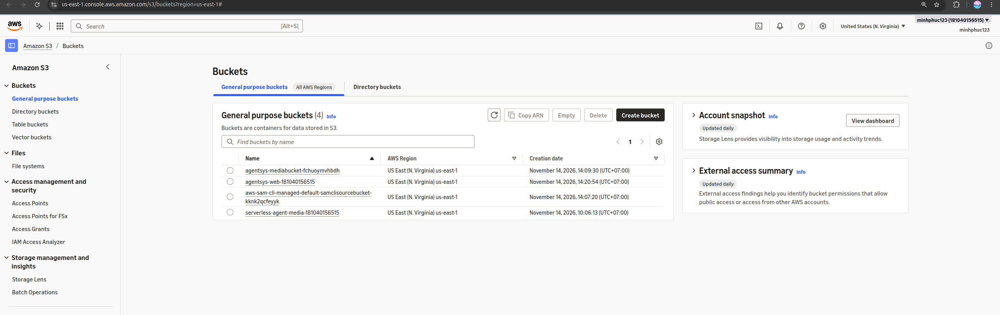
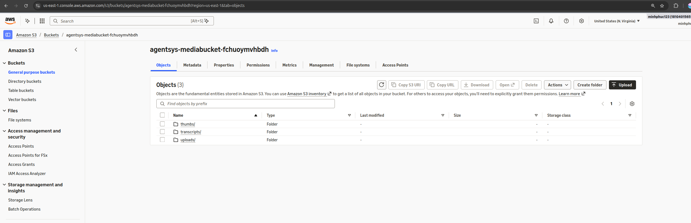
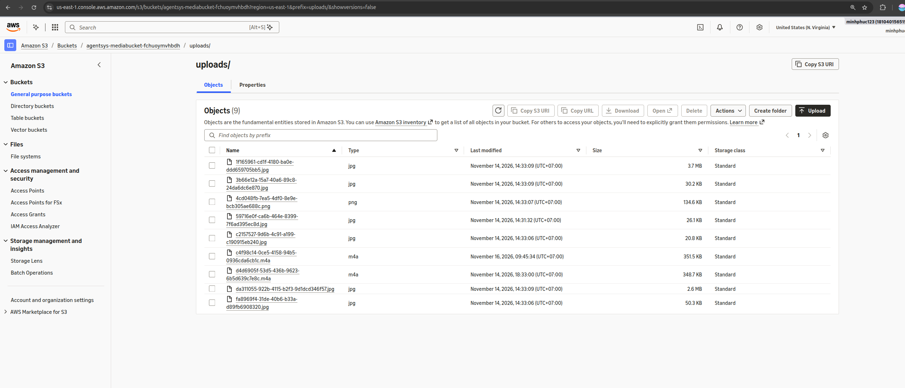
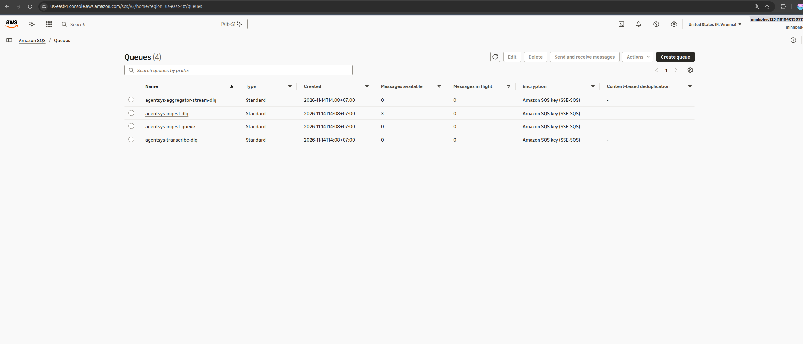

# 5.3. Configuring Amazon S3, SQS Buffer Queue, Dead-Letter Queue (DLQ) & Event Notifications

---

## 1. Amazon S3 Storage Architecture & Security

In the AgentSys architecture, **Amazon S3** acts as the central multimodal Data Lake managing two key object spaces:
* `uploads/`: Raw uploaded media assets (classroom slide captures, lecture voice recordings in `.m4a` / `.mp3`).
* `transcripts/raw/`: Full-text JSON transcription payloads offloaded from DynamoDB to prevent exceeding the 400KB item size limit.

### Core Storage Security Baseline:
1. **Block All Public Access:** Enabled globally to prevent unauthorized data exposure. All client read/write operations must authenticate via time-limited IAM Presigned URLs (15-minute expiration).
2. **Server-Side Encryption:** Configured by default with AES-256 (SSE-S3) to safeguard data-at-rest.
3. **Cross-Origin Resource Sharing (CORS):** Permits the React Web Frontend to upload media directly to S3 via HTTP `PUT` using Presigned URLs:

```json
[
  {
    "AllowedHeaders": ["*"],
    "AllowedMethods": ["GET", "PUT", "POST", "HEAD"],
    "AllowedOrigins": ["*"],
    "ExposeHeaders": ["ETag"]
  }
]
```


*Figure: Active S3 Buckets provisioned by the SAM CloudFormation stack.*


*Figure: Verified folder hierarchy (uploads/, thumbs/, and transcripts/) separating raw and derived assets.*


*Figure: Verified media assets uploaded to the uploads/ prefix via S3 Presigned URLs.*

---

## 2. SQS Buffer & Dead-Letter Queue (DLQ) Architecture

Instead of binding S3 events directly to Lambda, AgentSys introduces **Amazon SQS** as a resilient buffer:


flowchart LR
    S3[Amazon S3<br>Prefix: uploads/] -->|s3:ObjectCreated| SQS[Amazon SQS<br>agentsys-ingest-queue]
    SQS -->|Batch Size: 5<br>Visibility: 720s| Lambda[AWS Lambda<br>agentsys-ingest]
    SQS -.->|After 3 failed retries| DLQ[Amazon SQS DLQ<br>agentsys-ingest-dlq]
    DLQ --> Alarm[CloudWatch Alarm<br>DLQMessagesVisible > 0]



*Figure: SQS ingestion buffer queue and failure-isolation Dead-Letter Queues.*

### Architectural Benefits:
1. **Traffic Spike Smoothing:** If a batch of 50 videos is uploaded concurrently, SQS absorbs the burst and feeds messages progressively to Lambda without exhausting concurrency.
2. **Zero Data Loss Isolation:** Damaged or corrupted media files are transferred to the DLQ after 3 retries (maxReceiveCount=3), allowing root-cause analysis without breaking pipeline throughput.
3. **VisibilityTimeout 720s (6x Lambda Timeout 120s):** Aligns with the AWS Well-Architected Framework: SQS visibility timeout must be 6 times the max Lambda execution timeout to prevent redundant duplicate invocations during intensive media workloads.

---

## 3. Recursive Event Loop Prevention

**Crucial FinOps Rule:** Subscribing S3 Event Notifications to the entire bucket wildcard s3:\* triggers an infinite recursion when Amazon Transcribe outputs a .json transcript → S3 emits an event → Lambda triggers Transcribe → Infinite billing loop!

**Enforced Mitigation in AgentSys:**
* Ingestion events are strictly filtered to the prefix **Prefix: uploads/**.
* Transcribe outputs are strictly scoped to the prefix **Prefix: transcripts/**.

---

## 4. Testing Media Uploads via Presigned URL

```bash
# 1. Retrieve API Endpoint and API Key
API_ENDPOINT=$(aws cloudformation describe-stacks --stack-name agentsys --query "Stacks[0].Outputs[?OutputKey=='ApiEndpoint'].OutputValue" --output text)
API_KEY="dev-local-api-key"  # Or your configured Parameter ApiKey from SAM deployment

# 2. Request a Presigned Upload URL
RESPONSE=$(curl -s -X POST "$API_ENDPOINT/api/v1/media/upload-url" \
  -H "X-API-Key: $API_KEY" \
  -H "Content-Type: application/json" \
  -d '{"filename": "test-board.jpg", "content_type": "image/jpeg"}')

UPLOAD_URL=$(echo $RESPONSE | jq -r '.presigned_url // .upload_url')
FILE_ID=$(echo $RESPONSE | jq -r '.file_id')

echo "File ID: $FILE_ID"
echo "Presigned URL: $UPLOAD_URL"

# 3. Upload binary image via HTTP PUT
curl -X PUT -T "test-board.jpg" -H "Content-Type: image/jpeg" "$UPLOAD_URL"
```

*Upon successful PUT, S3 automatically forwards the notification to SQS, triggering the background Lambda ingestion.*
