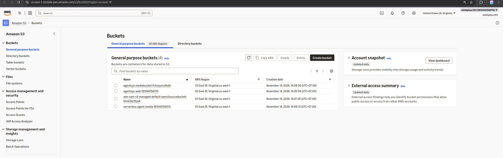
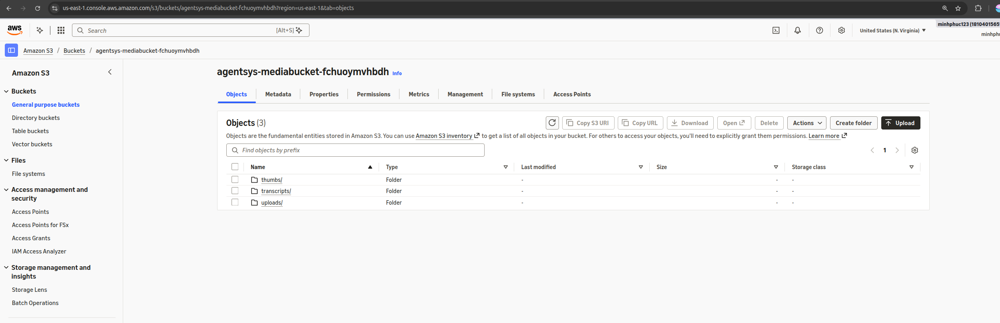
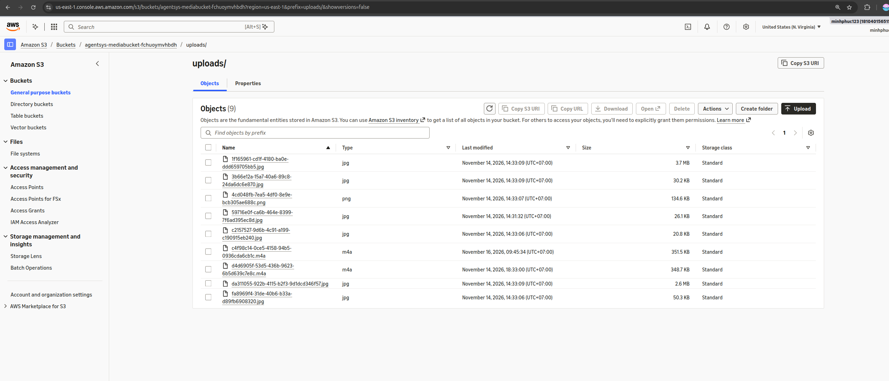
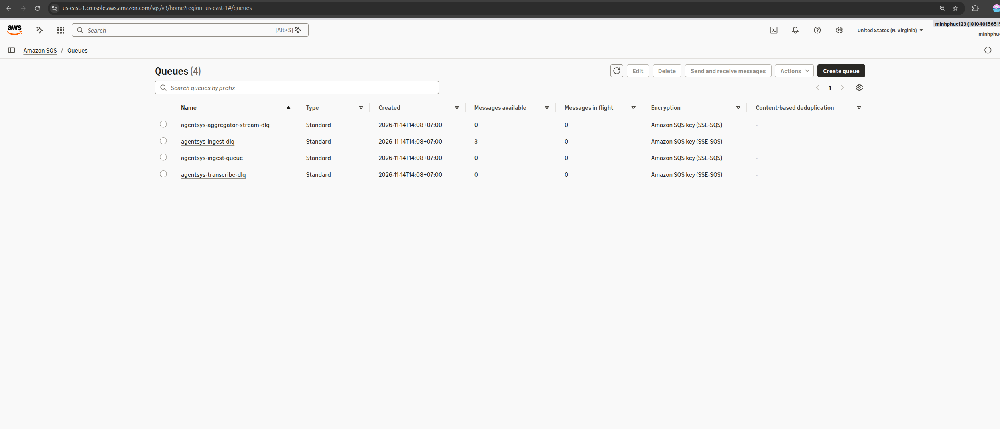

# 5.3. Thiết Lập Amazon S3, SQS Buffer Queue, Dead-Letter Queue (DLQ) & Event Notifications

---

## 1. Thiết lập & Bảo mật Kho lưu trữ Amazon S3

Trong kiến trúc của AgentSys, **Amazon S3** đóng vai trò là Data Lake trung tâm lưu trữ hai nhóm dữ liệu:
* `uploads/`: Tệp media gốc (ảnh chụp slide bài giảng, file ghi âm giọng nói `.m4a`, `.mp3`).
* `transcripts/raw/`: Văn bản bóc băng chi tiết định dạng JSON cho các file âm thanh có độ dài lớn nhằm chống tràn giới hạn 400KB của DynamoDB.

### Các thiết lập bảo mật cốt lõi:
1. **Chặn truy cập công cộng (Block Public Access):** Kích hoạt toàn diện để đảm bảo 100% dữ liệu học tập không bị lộ ra Internet. Toàn bộ lượt đọc/ghi từ client đều phải thông qua S3 Presigned URL có chữ ký xác thực IAM và thời gian hết hạn nghiêm ngặt (15 phút).
2. **Mã hóa dữ liệu tại chỗ (Server-Side Encryption):** Bật mặc định mã hóa AES-256 (SSE-S3) bảo vệ dữ liệu ở trạng thái nghỉ (data-at-rest).
3. **Cấu hình Cross-Origin Resource Sharing (CORS):** Cho phép trình duyệt Web Frontend tải trực tiếp tệp lên S3 thông qua HTTP `PUT` bằng Presigned URL:

```json
[
  {
    "AllowedHeaders": ["*"],
    "AllowedMethods": ["GET", "PUT", "POST", "HEAD"],
    "AllowedOrigins": ["*"],
    "ExposeHeaders": ["ETag"]
  }
]
```


*Hình: Danh sách S3 Buckets khởi tạo từ CloudFormation stack.*


*Hình: Cấu trúc thư mục uploads/, thumbs/ và transcripts/ phân tách rõ ràng trong S3 Media Bucket.*


*Hình: Các tệp hình ảnh và âm thanh được tải lên thư mục uploads/ qua Presigned URL.*

---

## 2. Kiến trúc Hàng đợi Buffer SQS & Dead-Letter Queue (DLQ)

Thay vì kết nối trực tiếp sự kiện S3 vào Lambda, AgentSys sử dụng **Amazon SQS** làm tầng đệm:


flowchart LR
    S3[Amazon S3<br>Prefix: uploads/] -->|s3:ObjectCreated| SQS[Amazon SQS<br>agentsys-ingest-queue]
    SQS -->|Batch Size: 5<br>Visibility: 720s| Lambda[AWS Lambda<br>agentsys-ingest]
    SQS -.->|Sau 3 lần thử lại thất bại| DLQ[Amazon SQS DLQ<br>agentsys-ingest-dlq]
    DLQ --> Alarm[CloudWatch Alarm<br>DLQMessagesVisible > 0]



*Hình: Hàng đợi đệm SQS và các Dead-Letter Queues cách ly lỗi.*

### Tại sao kiến trúc này tối quan trọng?
1. **Chống sập do quá tải (Traffic Spike Smoothing):** Khi người dùng tải lên 50 video cùng lúc, SQS sẽ giữ các thông điệp và nhả dần theo từng đợt (batch) cho Lambda xử lý, không làm cạn kiệt Lambda Concurrent Executions.
2. **Cô lập lỗi (Zero Data Loss with DLQ):** Nếu tệp âm thanh bị lỗi hoặc hỏng codec, sau 3 lần retry (maxReceiveCount=3), tin nhắn được đẩy vào DLQ để kỹ sư kiểm tra mà không làm gián đoạn toàn bộ hệ thống.
3. **VisibilityTimeout 720s (6x Lambda Timeout 120s):** Tuân thủ AWS Well-Architected Framework: thời gian ẩn của SQS phải gấp 6 lần thời gian timeout tối đa của Lambda Ingest để tránh duplicate processing khi xử lý tệp nặng.

---

## 3. Ngăn Chặn Vòng Lặp Sự Kiện Đệ Quy (Recursive Event Loop Prevention)

**Quy tắc FinOps quan trọng:** Nếu cấu hình S3 Event Notification cho toàn bộ bucket s3:\*, khi Amazon Transcribe tạo file kết quả .json, S3 sẽ lại phát sự kiện gọi Lambda → Lambda lại gọi Transcribe → Gây ra vòng lặp vô tận đốt cháy ngân sách!

**Giải pháp trong AgentSys:**
* S3 Event Notification chỉ kích hoạt khi có tệp tạo mới với tiền tố **Prefix: uploads/**.
* Amazon Transcribe chỉ được phép ghi kết quả vào tiền tố **Prefix: transcripts/**.

---

## 4. Kiểm thử Upload Tệp Bằng Presigned URL Qua CLI

```bash
# 1. Lay API Endpoint va API Key tu Stack
API_ENDPOINT=$(aws cloudformation describe-stacks --stack-name agentsys --query "Stacks[0].Outputs[?OutputKey=='ApiEndpoint'].OutputValue" --output text --region us-east-1)
API_KEY="dev-local-api-key"  # Gia tri mac dinh hoac ApiKey da nhap khi deploy SAM

# 2. Lay Presigned URL tu API
RESPONSE=$(curl -s -X POST "$API_ENDPOINT/api/v1/media/upload-url" \
  -H "X-API-Key: $API_KEY" \
  -H "Content-Type: application/json" \
  -d '{"filename": "test-board.jpg", "content_type": "image/jpeg"}')

UPLOAD_URL=$(echo $RESPONSE | jq -r '.presigned_url // .upload_url')
FILE_ID=$(echo $RESPONSE | jq -r '.file_id')

echo "File ID: $FILE_ID"
echo "Presigned URL: $UPLOAD_URL"

# 3. Upload file len S3 qua HTTP PUT
curl -X PUT -T "test-board.jpg" -H "Content-Type: image/jpeg" "$UPLOAD_URL"
```

*Sau khi PUT thành công, S3 tự động phát sự kiện vào SQS và kích hoạt Lambda Ingest xử lý trong nền.*
