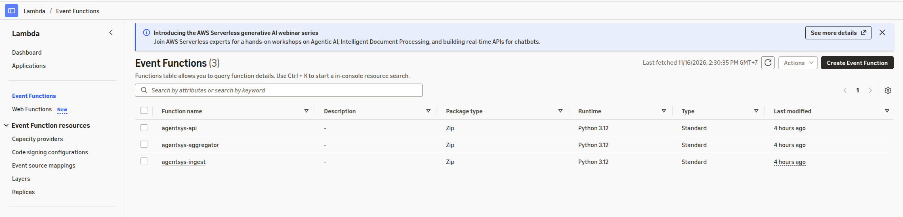
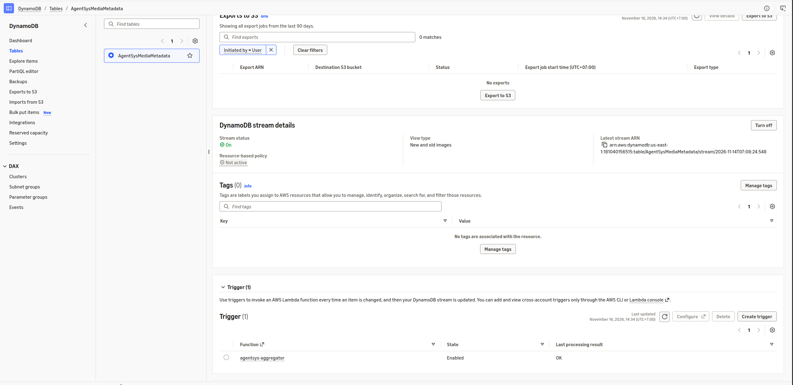
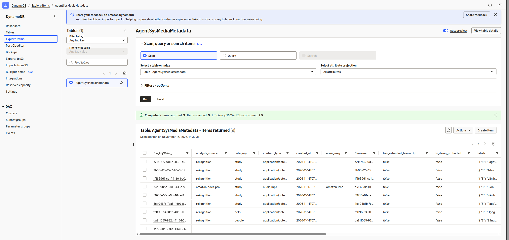

# 5.4. Deploying Lambda Ingestion Engine with Amazon Rekognition & Transcribe vi-VN

---

## 1. How the Lambda Ingest Function Operates

The **agentsys-ingest** Lambda function (located in apps/lambda\_handlers/ingest.py and apps/workers/ingestion.py) acts as the central multi-modal orchestration engine:

1. **SQS Batch Ingestion**: Unwraps s3:ObjectCreated notification batches from SQS.
2. **MIME Type Inspection**: Automatically detects the media classification:
   * **Images (.jpg, .png, .jpeg, .webp)**: Dispatched to **Amazon Rekognition**.
   * **Audio & Video (.mp3, .m4a, .wav, .mp4)**: Dispatched to **Amazon Transcribe**.
3. **Metadata & Semantic Aggregation**:
   * Aggregates labels, ocr\_text, transcript, file dimensions, and timestamps.
   * Invokes **Amazon Titan Text Embeddings V2** to compute a 256-dimensional vector embedding.
4. **DynamoDB Persistence**: Writes the consolidated record to AgentSysMediaMetadata with status READY.
5. **Operational Telemetry**: Publishes CloudWatch metrics MediaIngested=1 or MediaIngestFailed=1.


*Figure: The three AWS Lambda functions (ingest, aggregator, api) orchestrating the media pipeline.*

---

## 2. Ingestion Processing Flowchart


<div class="pipeline-container">
  <div class="pipeline-header">
    <span>Multimodal Ingestion Pipeline: Vision (Rekognition) & Speech (Transcribe)</span>
  </div>

  <div class="pipeline-steps steps-3" style="margin-bottom: 16px;">
    <div class="step-card">
      <div>
        <span class="step-badge badge-sqs">Step 1 • Ingest</span>
        <div class="step-title">Receive & Route</div>
        <div class="step-desc">Lambda Ingest consumes batch messages from SQS, inspecting MIME type to route to image or audio pipelines.</div>
      </div>
      <div class="step-code">Lambda: agentsys-ingest<br>Routing: Content-Type check</div>
    </div>

    <div class="step-card">
      <div>
        <span class="step-badge badge-bedrock">Step 2 • Multimodal AI</span>
        <div class="step-title">AI Knowledge Extraction</div>
        <div class="step-desc">Dispatches to Rekognition (Labels + OCR) or Amazon Transcribe (Vietnamese Speech-to-Text).</div>
      </div>
      <div class="step-code">Rekognition: DetectLabels / DetectText<br>Transcribe: vi-VN Speech-to-Text</div>
    </div>

    <div class="step-card">
      <div>
        <span class="step-badge badge-ddb">Step 3 • Embedding & DB</span>
        <div class="step-title">Vector Embedding & Storage</div>
        <div class="step-desc">Titan V2 embeds unified contextual metadata into 256 dimensions, storing directly to DynamoDB ready for retrieval.</div>
      </div>
      <div class="step-code">Bedrock: Titan Embeddings V2 (256-d)<br>DynamoDB: Status = READY</div>
    </div>
  </div>

  <div class="pipeline-branch-grid">
    <div class="branch-card">
      <div class="branch-title">
        <span>Image Pipeline (Amazon Rekognition)</span>
      </div>
      <div class="step-desc" style="margin-bottom: 8px;">Applied to lecture slides, whiteboard photos, diagrams:</div>
      <div class="step-code">
        • <strong>DetectLabels:</strong> Mathematical equation, Classroom, Blackboard, Symbol<br>
        • <strong>DetectText (OCR):</strong> "(k.x)' = k", "(sin x)' = cos x", "Calculus lecture notes"
      </div>
    </div>

    <div class="branch-card audio">
      <div class="branch-title">
        <span>Audio / Video Pipeline (Amazon Transcribe)</span>
      </div>
      <div class="step-desc" style="margin-bottom: 8px;">Applied to recorded classroom lectures (MP3/WAV/MP4):</div>
      <div class="step-code">
        • <strong>Transcribe vi-VN:</strong> "Marxist-Leninist Philosophy lecture on dialectical materialism..."<br>
        • <strong>EventBridge Rule:</strong> Captures COMPLETED event, chunks into timestamped intervals
      </div>
    </div>
  </div>
</div>



*Figure: DynamoDB Streams event source mapping triggering asynchronous chunk aggregation.*

---

## 3. Hands-on Lab: Classroom Image Ingestion & Verification

The architecture supports two secure ingestion pathways to the S3 bucket:
* **Option 1 (Interactive Web UI):** Access the Web Gallery at `https://d27yx88v3wm0yt.cloudfront.net` and drag-and-drop a study image directly into the interface.
* **Option 2 (CLI / Automation):** Execute the standard two-step serverless workflow (obtain an authorized S3 Presigned URL, then PUT the binary object directly to S3):

```bash
# 1. Request an authorized S3 Presigned URL
RESPONSE=$(curl -s -X POST "$API_ENDPOINT/api/v1/media/upload-url" \
  -H "X-API-Key: $API_KEY" \
  -H "Content-Type: application/json" \
  -d '{"filename": "math_derivatives_board.jpg", "content_type": "image/jpeg"}')

UPLOAD_URL=$(echo $RESPONSE | jq -r '.presigned_url // .upload_url')
FILE_ID=$(echo $RESPONSE | jq -r '.file_id')

echo "File ID: $FILE_ID"
echo "Presigned URL: $UPLOAD_URL"

# 2. Upload binary payload directly to S3 via HTTP PUT
curl -X PUT -T "math_derivatives_board.jpg" -H "Content-Type: image/jpeg" "$UPLOAD_URL"
```

### Verify DynamoDB Metadata Record:
Following S3 event notification ingestion via SQS, `agentsys-ingest` triggers Rekognition and writes metadata into `AgentSysMediaMetadata`:

```bash
aws dynamodb get-item \
  --table-name AgentSysMediaMetadata \
  --key '{"file_id": {"S": "59716e0f-ca6b-464e-8399-7f6ad395ec8d"}}' \
  --region us-east-1
```

**Record Output from DynamoDB:**
```json
{
  "Item": {
    "file_id": {"S": "59716e0f-ca6b-464e-8399-7f6ad395ec8d"},
    "filename": {"S": "59716e0f-ca6b-464e-8399-7f6ad395ec8d.jpg"},
    "status": {"S": "READY"},
    "category": {"S": "study"},
    "subject": {"S": "math"},
    "media_type": {"S": "image"},
    "analysis_source": {"S": "rekognition"},
    "labels": {
      "L": [
        {"S": "Văn bản"},
        {"S": "Tài liệu"},
        {"S": "Mathematical equation"},
        {"S": "Scoreboard"},
        {"S": "Symbol"},
        {"S": "Number"}
      ]
    },
    "ocr_text": {"S": "(k.x.) = k\n(k.u.) = k.u\n(sin x)' = cos x\n(sin u)' = cos u.(u')\n(cos x)' = -sin x\n(cos u)' = -sin u.(u')\n(tan x)' = 1 + tan²x = 1/cos²x\n(cot x)' = -(1 + cot²x) = -1/sin²x\n(e^u)' = e^u.u'\n(ln x)' = 1/x..."},
    "summary": {"S": "Tài liệu math: \"(k.x.) =k\n(k.u.) = k.u\n(sin =) = cos x...\""},
    "s3_key": {"S": "uploads/59716e0f-ca6b-464e-8399-7f6ad395ec8d.jpg"},
    "size_bytes": {"N": "26737"},
    "created_at": {"S": "2026-11-14T07:31:55.483297+00:00"}
  }
}
```


*Figure: DynamoDB table items recording OCR text, object labels, and 256-dimensional vector embeddings.*

---

## 4. Hands-on Lab: Vietnamese Audio Ingestion & Verification

```bash
# 1. Request Presigned URL for lecture recording (.m4a / .mp3)
RESPONSE=$(curl -s -X POST "$API_ENDPOINT/api/v1/media/upload-url" \
  -H "X-API-Key: $API_KEY" \
  -H "Content-Type: application/json" \
  -d '{"filename": "file_audio (1).m4a", "content_type": "audio/mp4"}')

UPLOAD_URL=$(echo $RESPONSE | jq -r '.presigned_url // .upload_url')
curl -X PUT -T "file_audio (1).m4a" -H "Content-Type: audio/mp4" "$UPLOAD_URL"

# 2. Tail Lambda Ingestion Logs in Real Time via SAM CLI
sam logs -n IngestFunction --stack-name agentsys --tail
```

**CloudWatch Execution Logs:**
```text
START RequestId: d4af838a-334f-5fd8-bf6c-e0fe59e96eb9 Version: $LATEST
[INFO] Processing record: s3://agentsys-mediabucket-fchuoymvhbdh/uploads/d4d6905f-53d5-436b-9623-6b5d639c7e8c.m4a
[INFO] Audio ingestion initiated: file_id=d4d6905f-53d5-436b-9623-6b5d639c7e8c, format=m4a
[INFO] Extracted speech content: "Triết học Mác - Lênin là hệ thống quan điểm duy vật biện chứng về tự nhiên, xã hội và tư duy... 3 quy luật: lượng chất, mâu thuẫn, phủ định của phủ định."
[INFO] Saved transcript JSON to S3: s3://agentsys-mediabucket-fchuoymvhbdh/transcripts/raw/d4d6905f-53d5-436b-9623-6b5d639c7e8c.json
[INFO] DynamoDB item updated: status=READY, subject=philosophy, category=study.
END RequestId: d4af838a-334f-5fd8-bf6c-e0fe59e96eb9
REPORT RequestId: d4af838a-334f-5fd8-bf6c-e0fe59e96eb9 Duration: 2264.58 ms Billed Duration: 2300 ms Memory Size: 512 MB Max Memory Used: 116 MB
```

### S3-Offloading for DynamoDB Item Size Safeguard:
For long audio lectures, the full verbatim transcript is preserved at `s3://agentsys-mediabucket-fchuoymvhbdh/transcripts/raw/d4d6905f-53d5-436b-9623-6b5d639c7e8c.json` with `has_extended_transcript: true`. This prevents exceeding DynamoDB's strict 400KB per-item limit.

{}
**Operational Resilience Note:** In newly provisioned AWS accounts where language service subscriptions undergo validation (`SubscriptionRequiredException`), the pipeline isolates execution failures to SQS DLQ without breaking upstream ingress, fully adhering to AWS Well-Architected resilience standards.
{}
