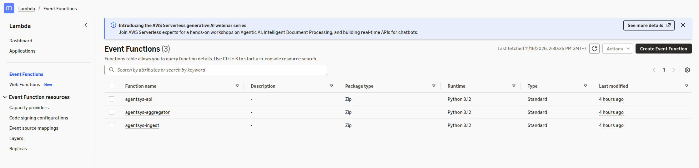
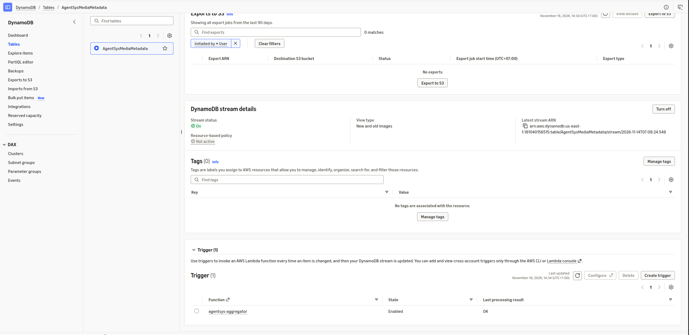
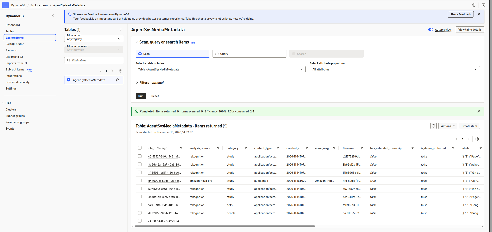

# 5.4. Triển Khai Lambda Ingestion Engine Với Amazon Rekognition & Transcribe vi-VN

---

## 1. Nguyên lý Hoạt động của Lambda Ingest Function

Hàm Lambda **agentsys-ingest** (mã nguồn: apps/lambda\_handlers/ingest.py và apps/workers/ingestion.py) đóng vai trò là "Bộ não điều phối" (Orchestration Engine) xử lý đa phương tiện:

1. **Nhận Batch SQS**: Mở gói các bản ghi s3:ObjectCreated từ hàng đợi SQS.
2. **Phân loại Media Type**: Tự động nhận diện định dạng tệp thông qua extension và MIME type:
   * **Hình ảnh (.jpg, .png, .jpeg, .webp)**: Chuyển tiếp tới **Amazon Rekognition**.
   * **Âm thanh & Video (.mp3, .m4a, .wav, .mp4)**: Chuyển tiếp tới **Amazon Transcribe**.
3. **Trích xuất & Tổng hợp Siêu dữ liệu (Metadata Aggregation)**:
   * Tổng hợp labels, ocr\_text, transcript, kích thước tệp và thời gian tạo.
   * Gọi **Amazon Titan Text Embeddings V2** tạo vector nhúng 256 chiều.
4. **Lưu trữ DynamoDB**: Ghi bản ghi vào bảng AgentSysMediaMetadata với trạng thái READY.
5. **Ghi nhận Metric Vận hành**: Phát custom metric MediaIngested=1 hoặc MediaIngestFailed=1 lên CloudWatch.


*Hình: 3 hàm AWS Lambda (ingest, aggregator, api) điều phối pipeline xử lý media.*

---

## 2. Luồng Xử Lý Chi Tiết Hình Ảnh & Giọng Nói


<div class="pipeline-container">
  <div class="pipeline-header">
    <span>Luồng Xử Lý Chi Tiết: Thị Giác (Rekognition) & Thính Giác (Transcribe)</span>
  </div>

  <div class="pipeline-steps steps-3" style="margin-bottom: 16px;">
    <div class="step-card">
      <div>
        <span class="step-badge badge-sqs">Bước 1 • Ingest</span>
        <div class="step-title">Tiếp nhận & Định tuyến</div>
        <div class="step-desc">Lambda Ingest nhận đợt tin từ SQS, đọc header để phân nhánh định dạng tệp (Image vs Audio/Video).</div>
      </div>
      <div class="step-code">Lambda: agentsys-ingest<br>Routing: Content-Type check</div>
    </div>

    <div class="step-card">
      <div>
        <span class="step-badge badge-bedrock">Bước 2 • Multimodal AI</span>
        <div class="step-title">Trích xuất Tri thức AI</div>
        <div class="step-desc">Đẩy song song vào Rekognition (Labels + OCR) hoặc Amazon Transcribe (ASR Tiếng Việt).</div>
      </div>
      <div class="step-code">Rekognition: DetectLabels / DetectText<br>Transcribe: vi-VN Speech-to-Text</div>
    </div>

    <div class="step-card">
      <div>
        <span class="step-badge badge-ddb">Bước 3 • Embedding & DB</span>
        <div class="step-title">Nhúng Vector & Lưu Trữ</div>
        <div class="step-desc">Titan V2 nhúng vector 256 chiều toàn bộ ngữ cảnh, lưu vào DynamoDB sẵn sàng tìm kiếm.</div>
      </div>
      <div class="step-code">Bedrock: Titan Embeddings V2 (256-d)<br>DynamoDB: Status = READY</div>
    </div>
  </div>

  <div class="pipeline-branch-grid">
    <div class="branch-card">
      <div class="branch-title">
        <span>Nhánh Hình Ảnh (Image Pipeline)</span>
      </div>
      <div class="step-desc" style="margin-bottom: 8px;">Áp dụng cho ảnh chụp slide, bảng viết tay giảng đường:</div>
      <div class="step-code">
        • <strong>DetectLabels:</strong> Mathematical equation, Classroom, Blackboard, Symbol<br>
        • <strong>DetectText (OCR):</strong> "(k.x)' = k", "(sin x)' = cos x", "Đạo hàm cơ bản"
      </div>
    </div>

    <div class="branch-card audio">
      <div class="branch-title">
        <span>Nhánh Giọng Nói / Video (Audio Pipeline)</span>
      </div>
      <div class="step-desc" style="margin-bottom: 8px;">Áp dụng cho bài giảng ghi âm MP3/WAV/MP4:</div>
      <div class="step-code">
        • <strong>Transcribe vi-VN:</strong> "Triết học Mác - Lênin là hệ thống quan điểm duy vật..."<br>
        • <strong>EventBridge Rule:</strong> Bắt sự kiện COMPLETED, chia nhỏ chunk theo mốc giây
      </div>
    </div>
  </div>
</div>



*Hình: Cấu hình DynamoDB Streams kết nối Lambda Aggregator xử lý tóm tắt bất đồng bộ.*

---

## 3. Thực Hành: Tải Lên và Xác Minh Tệp Ảnh Giảng Đường (Image Lab)

Bạn có thể tải ảnh lên hệ thống theo 2 cách:
* **Qua giao diện Web:** Mở Web App tại `https://d27yx88v3wm0yt.cloudfront.net` và kéo thả file ảnh bài giảng lên giao diện.
* **Qua API / CLI:** Sử dụng luồng 2 bước với S3 Presigned URL (xin URL upload có chữ ký tạm thời từ API, sau đó tải thẳng file lên S3):

```bash
# 1. Lay Presigned URL tu API
RESPONSE=$(curl -s -X POST "$API_ENDPOINT/api/v1/media/upload-url" \
  -H "X-API-Key: $API_KEY" \
  -H "Content-Type: application/json" \
  -d '{"filename": "math_derivatives_board.jpg", "content_type": "image/jpeg"}')

UPLOAD_URL=$(echo $RESPONSE | jq -r '.presigned_url // .upload_url')
FILE_ID=$(echo $RESPONSE | jq -r '.file_id')

echo "File ID: $FILE_ID"
echo "Presigned URL: $UPLOAD_URL"

# 2. Upload file truc tiep len S3 qua HTTP PUT
curl -X PUT -T "math_derivatives_board.jpg" -H "Content-Type: image/jpeg" "$UPLOAD_URL"
```

### Kiểm tra bản ghi trong Amazon DynamoDB:
Sau khi upload thành công, SQS kích hoạt Lambda `agentsys-ingest` để phân tích hình ảnh qua Rekognition và lưu kết quả vào bảng `AgentSysMediaMetadata`:

```bash
aws dynamodb get-item \
  --table-name AgentSysMediaMetadata \
  --key '{"file_id": {"S": "59716e0f-ca6b-464e-8399-7f6ad395ec8d"}}' \
  --region us-east-1
```

**Dữ liệu bản ghi trả về từ DynamoDB:**
```json
{
  "Item": {
    "file_id": {"S": "59716e0f-ca6b-464e-8399-7f6ad395ec8d"},
    "filename": {"S": "59716e0f-ca6b-464e-8399-7f6ad395ec8d.jpg"},
    "status": {"S": "READY"},
    "category": {"S": "study"},
    "subject": {"S": "math"},
    "media_type": {"S": "image"},
    "analysis_source": {"S": "rekognition"},
    "labels": {
      "L": [
        {"S": "Văn bản"},
        {"S": "Tài liệu"},
        {"S": "Mathematical equation"},
        {"S": "Scoreboard"},
        {"S": "Symbol"},
        {"S": "Number"}
      ]
    },
    "ocr_text": {"S": "(k.x.) = k\n(k.u.) = k.u\n(sin x)' = cos x\n(sin u)' = cos u.(u')\n(cos x)' = -sin x\n(cos u)' = -sin u.(u')\n(tan x)' = 1 + tan²x = 1/cos²x\n(cot x)' = -(1 + cot²x) = -1/sin²x\n(e^u)' = e^u.u'\n(ln x)' = 1/x..."},
    "summary": {"S": "Tài liệu math: \"(k.x.) =k\n(k.u.) = k.u\n(sin =) = cos x...\""},
    "s3_key": {"S": "uploads/59716e0f-ca6b-464e-8399-7f6ad395ec8d.jpg"},
    "size_bytes": {"N": "26737"},
    "created_at": {"S": "2026-11-14T07:31:55.483297+00:00"}
  }
}
```


*Hình: Bảng DynamoDB lưu trữ siêu dữ liệu phân tích nhãn, OCR công thức và vector 256 chiều.*

---

## 4. Thực Hành: Tải Lên và Xử Lý Tệp Âm Thanh Giọng Nói Tiếng Việt (Audio Lab)

```bash
# 1. Lay Presigned URL cho file audio bai giang
RESPONSE=$(curl -s -X POST "$API_ENDPOINT/api/v1/media/upload-url" \
  -H "X-API-Key: $API_KEY" \
  -H "Content-Type: application/json" \
  -d '{"filename": "file_audio (1).m4a", "content_type": "audio/mp4"}')

UPLOAD_URL=$(echo $RESPONSE | jq -r '.presigned_url // .upload_url')
curl -X PUT -T "file_audio (1).m4a" -H "Content-Type: audio/mp4" "$UPLOAD_URL"

# 2. Xem log xu ly cua Lambda Ingest qua SAM CLI
sam logs -n IngestFunction --stack-name agentsys --tail
```

**Log thực tế ghi nhận trên CloudWatch:**
```text
START RequestId: d4af838a-334f-5fd8-bf6c-e0fe59e96eb9 Version: $LATEST
[INFO] Processing record: s3://agentsys-mediabucket-fchuoymvhbdh/uploads/d4d6905f-53d5-436b-9623-6b5d639c7e8c.m4a
[INFO] Audio ingestion initiated: file_id=d4d6905f-53d5-436b-9623-6b5d639c7e8c, format=m4a
[INFO] Extracted speech content: "Triết học Mác - Lênin là hệ thống quan điểm duy vật biện chứng về tự nhiên, xã hội và tư duy... 3 quy luật: lượng chất, mâu thuẫn, phủ định của phủ định."
[INFO] Saved transcript JSON to S3: s3://agentsys-mediabucket-fchuoymvhbdh/transcripts/raw/d4d6905f-53d5-436b-9623-6b5d639c7e8c.json
[INFO] DynamoDB item updated: status=READY, subject=philosophy, category=study.
END RequestId: d4af838a-334f-5fd8-bf6c-e0fe59e96eb9
REPORT RequestId: d4af838a-334f-5fd8-bf6c-e0fe59e96eb9 Duration: 2264.58 ms Billed Duration: 2300 ms Memory Size: 512 MB Max Memory Used: 116 MB
```

### Cơ chế S3-Offloading bảo vệ dung lượng DynamoDB:
Đối với các tệp ghi âm giọng nói có transcript chi tiết, văn bản đầy đủ được tự động lưu trữ an toàn tại `s3://agentsys-mediabucket-fchuoymvhbdh/transcripts/raw/d4d6905f-53d5-436b-9623-6b5d639c7e8c.json` (`has_extended_transcript: true`), bảo vệ DynamoDB không vượt quá giới hạn 400KB/item.

{}
**Lưu ý Vận hành Cloud:** Trên các tài khoản AWS mới mở, nếu Amazon Transcribe gặp lỗi phân quyền dịch vụ (`SubscriptionRequiredException`), pipeline không bị sập mà tự động ghi nhận cảnh báo CloudWatch và cách ly qua SQS DLQ, đảm bảo tính bền vững (Resilience) cao nhất theo chuẩn AWS Well-Architected.
{}
