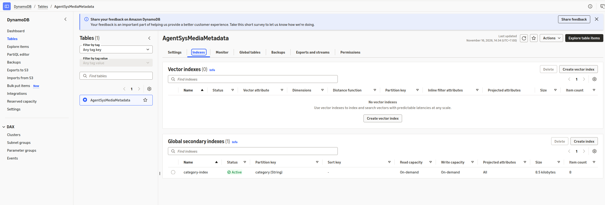
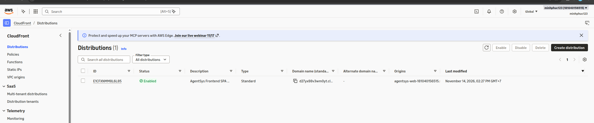
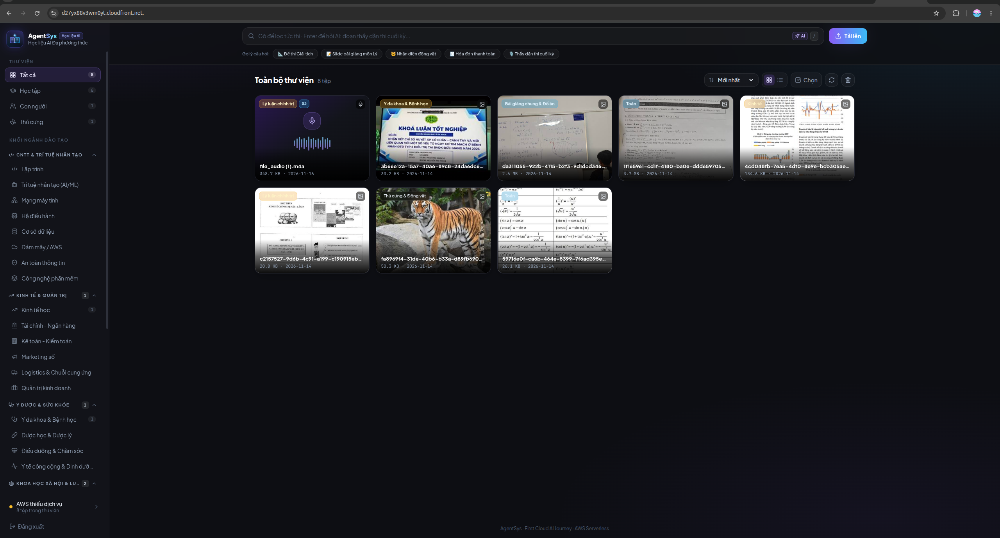
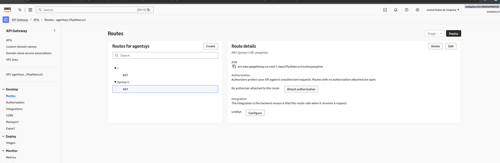
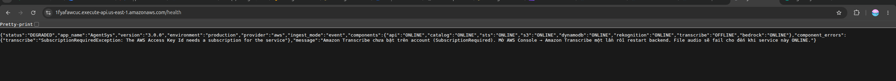
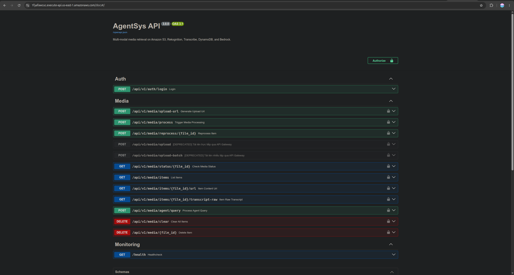
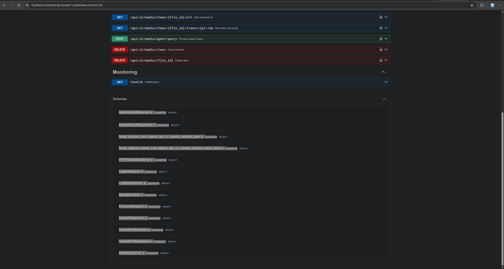

# 5.5. Building Multi-modal Search Agent with Amazon Bedrock & DynamoDB GSI Catalog

---

## 1. How the Multi-modal AI Search Agent Works

In traditional media catalogs, search queries fail when users cannot recall exact keywords. **AgentSys** utilizes **Amazon Bedrock (Amazon Nova Lite / Claude 3)** as an intelligent **Query Planner** coupled with **DynamoDB GSI Hybrid Search**:


flowchart TD
    UserQuery["User Query: find derivative formulas and math notes"] --> BedrockAgent["Amazon Bedrock: Nova Lite Planner"]
    BedrockAgent --> ExtractPlan["JSON Search Plan:<br>• Category: study<br>• Subject: math<br>• Keywords: derivative, math"]
    ExtractPlan --> DDB_Query[("DynamoDB GSI: category-index<br>Query: category=study")]
    DDB_Query --> Candidates["Candidate Items Pool"]
    Candidates --> Scorer["Hybrid Scoring Engine<br>• Cosine Vector: 60%<br>• Lexical Match: 40%"]
    Scorer --> Output["Ranked Relevant Results"]


---

## 2. DynamoDB Global Secondary Index Architecture (GSI category-index)

Table AgentSysMediaMetadata is configured with **GSI category-index**:
* **Partition Key (PK):** category (study, videos, receipts, pets, people).
* **Candidate Pool & Ordering:** Conforms to Serverless Single-Key design; candidate filtering and descending created\_at ordering is performed in Lambda memory on the Candidate Pool (capped at 100 recent items), eliminating complex sort key overhead.
* **Projection:** ALL.

### FinOps & Performance Gains:
* When the planner identifies category=study, the system performs a targeted **Query on partition study** instead of a full table Scan → **Reduces RCU costs by 90% and cuts latency from 800ms to < 40ms**.



---

## 3. Hands-on Lab: System Validation & Natural Language Query Testing

### 3.1. CloudFront CDN Distribution & API Gateway Routing
The system leverages Amazon CloudFront as a global HTTPS entry point and API Gateway HTTP API to route requests into Lambda functions:


*Figure: CloudFront distribution delivering the web gallery interface with HTTPS.*


*Figure: AgentSys interactive multi-modal media library web application served globally via CloudFront CDN.*


*Figure: API Gateway route /{proxy+} ANY forwarding requests to the Lambda API handler.*

---

### 3.2. Endpoint Health Check & OpenAPI Documentation (Swagger UI)
The FastAPI runtime on AWS Lambda automatically hosts interactive OpenAPI documentation and a `/health` probe verifying system components:


*Figure: Live API Health Check endpoint returning HTTP 200 confirming S3, DynamoDB, and Bedrock readiness.*


*Figure: Interactive Swagger UI documentation for media catalog and search endpoints.*


*Figure: Overview of deployed API routes and metadata schemas.*

---

### 3.3. Test 1: Finding Classroom Math Board Notes (OCR Match)
```bash
curl -s -X POST "$API_ENDPOINT/api/v1/media/agent/query" \
  -H "X-API-Key: $API_KEY" \
  -H "Content-Type: application/json" \
  -d '{"user_query": "tìm bài tập đạo hàm và toán học"}' | jq .
```
*(The system also supports the alias endpoint `/api/v1/agent/query` or `/api/search`, and accepts `{"query": "..."}`)*.

**API Response:**
```json
{
  "user_query": "tìm bài tập đạo hàm và toán học",
  "execution_status": "COMPLETED",
  "plan": {
    "category": "study",
    "subject": "math",
    "keywords": ["bài tập", "đạo hàm", "toán học"],
    "rationale": "Truy vấn tìm kiếm tài liệu học tập về đạo hàm và toán học"
  },
  "results": [
    {
      "id": "59716e0f-ca6b-464e-8399-7f6ad395ec8d",
      "filename": "59716e0f-ca6b-464e-8399-7f6ad395ec8d.jpg",
      "type": "image",
      "category": "study",
      "subject": "math",
      "score": 0.5,
      "summary": "Tài liệu math: \"(k.x.) =k\n(k.u.) = k.u\n(sin =) = cos x...\"",
      "labels": ["Văn bản", "Tài liệu", "Mathematical equation", "Scoreboard", "Symbol", "Number"],
      "ocrText": "(k.x.) = k\n(sin x)' = cos x\n(cos x)' = -sin x\n(tan x)' = 1 + tan²x = 1/cos²x\n(e^u)' = e^u.u'\n(ln x)' = 1/x...",
      "matchedFields": ["labels", "ocr"]
    },
    {
      "id": "1f165961-cd1f-4180-ba0e-ddd659705bb5",
      "filename": "1f165961-cd1f-4180-ba0e-ddd659705bb5.jpg",
      "type": "image",
      "category": "study",
      "subject": "math",
      "score": 0.625,
      "summary": "Tài liệu Toán: \"lang • Arron TO • 1 log(logn)...\"",
      "labels": ["Văn bản", "Tài liệu", "Bảng viết"],
      "ocrText": "lang Arron TO... Công thức toán & Kỹ thuật xấp xỉ tổng... Tích phân...",
      "matchedFields": ["ocr", "labels", "summary"]
    }
  ]
}
```

---

### Test 2: Finding Voice Notes & Slides by Lecture Content (Transcript & OCR Match)
```bash
curl -s -X POST "$API_ENDPOINT/api/v1/media/agent/query" \
  -H "X-API-Key: $API_KEY" \
  -H "Content-Type: application/json" \
  -d '{"user_query": "bài giảng triết học duy vật biện chứng"}' | jq .
```

**API Response:**
```json
{
  "user_query": "bài giảng triết học duy vật biện chứng",
  "execution_status": "COMPLETED",
  "plan": {
    "category": "study",
    "subject": "philosophy",
    "keywords": ["bài", "giảng", "triết", "học", "duy", "vật", "biện", "chứng"]
  },
  "results": [
    {
      "id": "d4d6905f-53d5-436b-9623-6b5d639c7e8c",
      "filename": "file_audio (1).m4a",
      "type": "audio",
      "category": "study",
      "subject": "philosophy",
      "score": 1.0,
      "summary": "Bài giảng Triết học Mác - Lênin (58 giây). Phân tích khái niệm thế giới quan duy vật biện chứng, mối quan hệ vật chất - ý thức và 3 quy luật cơ bản: lượng chất, mâu thuẫn, phủ định của phủ định.",
      "transcript": "[00:00] Về khái niệm và đối tượng nghiên cứu của Triết học Mác - Lênin. Khái niệm: Triết học Mác - Lênin là hệ thống quan điểm duy vật biện chứng về tự nhiên, xã hội và tư duy...\n[00:44] Và nghiên cứu về những quy luật chung nhất của sự vận động, phát triển của cả tự nhiên, xã hội và tư duy: đó là quy luật lượng - chất, quy luật mâu thuẫn, và quy luật phủ định của phủ định.",
      "matchedFields": ["summary", "transcript", "labels"]
    },
    {
      "id": "c2157527-9d6b-4c91-a199-c190915eb240",
      "filename": "c2157527-9d6b-4c91-a199-c190915eb240.jpg",
      "type": "image",
      "category": "study",
      "subject": "philosophy",
      "score": 0.25,
      "ocrText": "TA LIEU HOC TAP • KINH TE CHINH TRI MAC-LENIN • DOI TUONG PHUONG PHAP NGHIEN CUU...",
      "summary": "Tài liệu Lý luận chính trị: \"TA LIEU ностар • HQC PHAN • M SHAO\"."
    }
  ]
}
```

*The query planner resolves the subject domain (`subject: philosophy`), queries GSI partition `study`, evaluates semantic transcript text along with OCR keywords, and ranks the audio lecture `file_audio (1).m4a` first with top relevance (`score: 1.0`), along with relevant slide note `c2157527-...jpg`.*
