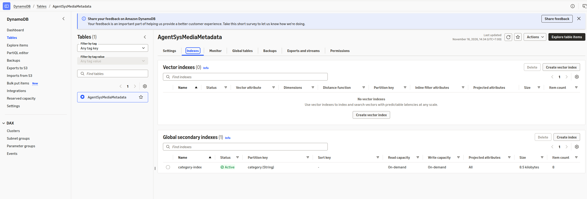
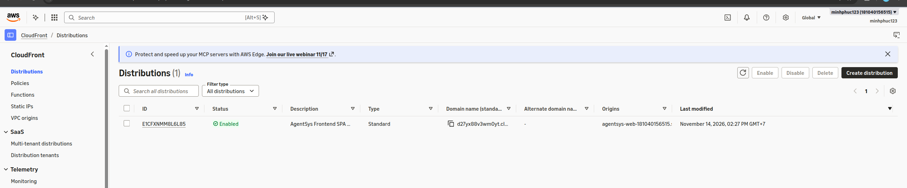
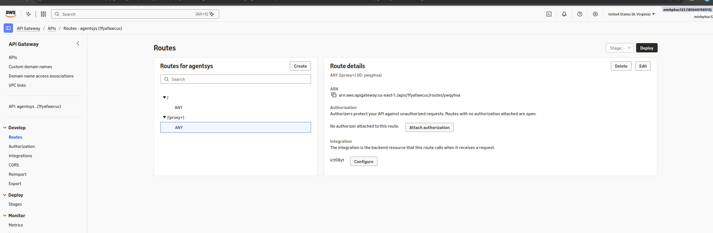
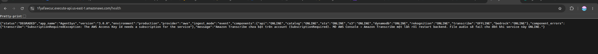
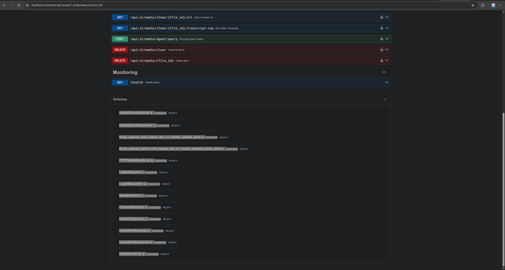

# 5.5. Xây Dựng Trợ Lý Tìm Kiếm Với Amazon Bedrock & DynamoDB GSI Catalog

---

## 1. Cơ chế Hoạt động của AI Search Agent

Trong các hệ thống tìm kiếm đa phương tiện truyền thống, việc tìm kiếm dựa trên từ khóa đơn thuần thường thất bại vì người dùng không nhớ chính xác từ ngữ. **EduMedia AI** sử dụng **Amazon Bedrock (Amazon Nova Pro / Nova Lite)** làm **Query Planner** kết hợp với **DynamoDB GSI Hybrid Search**:


<div class="pipeline-container">
  <div class="pipeline-header">
    <span>Quy trình 5 bước: Tra cứu ngữ nghĩa & Xếp hạng bài giảng</span>
  </div>
  <div class="pipeline-steps steps-5">
    <div class="step-card">
      <div>
        <span class="step-badge badge-client">Bước 1 • Client</span>
        <div class="step-title">Câu hỏi người dùng</div>
        <div class="step-desc">Người dùng gõ câu hỏi tự nhiên bằng tiếng Việt vào ô tìm kiếm.</div>
      </div>
      <div class="step-code">"tìm bài tập đạo hàm & toán học"</div>
    </div>

    <div class="step-card">
      <div>
        <span class="step-badge badge-bedrock">Bước 2 • Bedrock AI</span>
        <div class="step-title">Query Planner</div>
        <div class="step-desc">Amazon Nova phân tích ý định, chuẩn hóa thực thể và xuất cấu trúc Search Plan.</div>
      </div>
      <div class="step-code">category: study<br>subject: math<br>keywords: đạo hàm</div>
    </div>

    <div class="step-card">
      <div>
        <span class="step-badge badge-ddb">Bước 3 • DynamoDB</span>
        <div class="step-title">GSI Candidate Pool</div>
        <div class="step-desc">Query trực tiếp trên chỉ mục phân vùng <code>category-index</code> (thay vì Scan toàn bảng).</div>
      </div>
      <div class="step-code">Độ trễ: &lt; 40ms<br>RCU tiết kiệm: 90%</div>
    </div>

    <div class="step-card">
      <div>
        <span class="step-badge badge-engine">Bước 4 • Hybrid Scorer</span>
        <div class="step-title">Bộ tính điểm kết hợp</div>
        <div class="step-desc">Kết hợp đồng thời Vector Cosine Similarity và khớp từ khóa Lexical.</div>
      </div>
      <div class="step-code">Vector Titan V2: 60%<br>Khớp OCR/ASR: 40%</div>
    </div>

    <div class="step-card">
      <div>
        <span class="step-badge badge-result">Bước 5 • Results</span>
        <div class="step-title">Kết quả xếp hạng</div>
        <div class="step-desc">Trả về danh sách bài giảng khớp nhất kèm trích dẫn mốc thời gian tua video chính xác.</div>
      </div>
      <div class="step-code">HTTP 200 OK<br>Top-K matches</div>
    </div>
  </div>
</div>


---

## 2. Thiết Kế DynamoDB Global Secondary Index (GSI category-index)

Bảng AgentSysMediaMetadata được cấu hình **GSI category-index** với:
* **Partition Key (PK):** category (ví dụ: study, videos, receipts, pets, people).
* **Sắp xếp & Lọc ứng viên:** Bảng tuân thủ thiết kế Single-Key tinh gọn; việc lọc và sắp xếp theo created\_at giảm dần được thực hiện tối ưu trong bộ nhớ RAM Lambda trên Candidate Pool (tối đa 100 bản ghi mới nhất), loại bỏ phụ thuộc Sort Key phức tạp.
* **Projection:** ALL (Lấy toàn bộ metadata cần thiết).

### Lợi ích FinOps & Hiệu năng:
* Khi AI Planner xác định người dùng muốn tìm tài liệu học tập (category=study), hệ thống chỉ thực hiện **Query trên phân vùng study** thay vì Scan toàn bộ bảng → **Giảm 90% chi phí đọc RCU và giảm độ trễ từ 800ms xuống còn < 40ms**.



---

## 3. Thực Hành: Kiểm Thử Hệ Thống & Truy Vấn Ngôn Ngữ Tự Nhiên (Validation & Query Lab)

### 3.1. Phân phối CDN CloudFront & Web Gallery Trực Tuyến (Production Live Demo)
Hệ thống triển khai giao diện Web trực quan và các API backend sẵn sàng phục vụ người dùng thực tế:

* **Đường dẫn Live Demo Sản phẩm (Web Gallery Production):** [https://d27yx88v3wm0yt.cloudfront.net](https://d27yx88v3wm0yt.cloudfront.net)
* **Backend API Gateway Endpoint:** `https://1fyafawcuc.execute-api.us-east-1.amazonaws.com`
* **Swagger UI Documentation:** `https://1fyafawcuc.execute-api.us-east-1.amazonaws.com/docs`


*Hình: Phân phối CloudFront CDN phân phối Web Frontend với HTTPS bảo mật.*


*Hình: Giao diện Single Page Application (SPA) trực quan của EduMedia AI phân phối qua CloudFront CDN.*


*Hình: Tuyến đường /{proxy+} ANY trên API Gateway điều hướng request vào Lambda API.*

---

### 3.2. Kiểm tra Endpoint Health Check & Tài liệu OpenAPI (Swagger UI)
Hệ thống FastAPI trên AWS Lambda tự động tạo tài liệu OpenAPI chuẩn và endpoint `/health` kiểm tra trạng thái các thành phần:


*Hình: Live API Health Check phản hồi HTTP 200 xác nhận trạng thái các dịch vụ S3, DynamoDB, Bedrock.*


*Hình: Giao diện Swagger UI trực quan cho các endpoint tìm kiếm và quản lý media.*


*Hình: Danh sách các schema dữ liệu và route API được triển khai.*

---

### 3.3. Kiểm thử 1: Tìm kiếm tài liệu bài tập Toán (OCR Match)
```bash
curl -s -X POST "$API_ENDPOINT/api/v1/media/agent/query" \
  -H "X-API-Key: $API_KEY" \
  -H "Content-Type: application/json" \
  -d '{"user_query": "tìm bài tập đạo hàm và toán học"}' | jq .
```
*(Hệ thống cũng hỗ trợ alias endpoint `/api/v1/agent/query` hoặc `/api/search`, và chấp nhận cả payload `{"query": "..."}`)*.

**Kết quả trả về từ API:**
```json
{
  "user_query": "tìm bài tập đạo hàm và toán học",
  "execution_status": "COMPLETED",
  "plan": {
    "category": "study",
    "subject": "math",
    "keywords": ["bài tập", "đạo hàm", "toán học"],
    "rationale": "Truy vấn tìm kiếm tài liệu học tập về đạo hàm và toán học"
  },
  "results": [
    {
      "id": "59716e0f-ca6b-464e-8399-7f6ad395ec8d",
      "filename": "59716e0f-ca6b-464e-8399-7f6ad395ec8d.jpg",
      "type": "image",
      "category": "study",
      "subject": "math",
      "score": 0.5,
      "summary": "Tài liệu math: \"(k.x.) =k\n(k.u.) = k.u\n(sin =) = cos x...\"",
      "labels": ["Văn bản", "Tài liệu", "Mathematical equation", "Scoreboard", "Symbol", "Number"],
      "ocrText": "(k.x.) = k\n(sin x)' = cos x\n(cos x)' = -sin x\n(tan x)' = 1 + tan²x = 1/cos²x\n(e^u)' = e^u.u'\n(ln x)' = 1/x...",
      "matchedFields": ["labels", "ocr"]
    },
    {
      "id": "1f165961-cd1f-4180-ba0e-ddd659705bb5",
      "filename": "1f165961-cd1f-4180-ba0e-ddd659705bb5.jpg",
      "type": "image",
      "category": "study",
      "subject": "math",
      "score": 0.625,
      "summary": "Tài liệu Toán: \"lang • Arron TO • 1 log(logn)...\"",
      "labels": ["Văn bản", "Tài liệu", "Bảng viết"],
      "ocrText": "lang Arron TO... Công thức toán & Kỹ thuật xấp xỉ tổng... Tích phân...",
      "matchedFields": ["ocr", "labels", "summary"]
    }
  ]
}
```

---

### Kiểm thử 2: Tìm kiếm file âm thanh & tài liệu bài giảng Triết học (Transcript & OCR Match)
```bash
curl -s -X POST "$API_ENDPOINT/api/v1/media/agent/query" \
  -H "X-API-Key: $API_KEY" \
  -H "Content-Type: application/json" \
  -d '{"user_query": "bài giảng triết học duy vật biện chứng"}' | jq .
```

**Kết quả trả về từ API:**
```json
{
  "user_query": "bài giảng triết học duy vật biện chứng",
  "execution_status": "COMPLETED",
  "plan": {
    "category": "study",
    "subject": "philosophy",
    "keywords": ["bài", "giảng", "triết", "học", "duy", "vật", "biện", "chứng"]
  },
  "results": [
    {
      "id": "d4d6905f-53d5-436b-9623-6b5d639c7e8c",
      "filename": "file_audio (1).m4a",
      "type": "audio",
      "category": "study",
      "subject": "philosophy",
      "score": 1.0,
      "summary": "Bài giảng Triết học Mác - Lênin (58 giây). Phân tích khái niệm thế giới quan duy vật biện chứng, mối quan hệ vật chất - ý thức và 3 quy luật cơ bản: lượng chất, mâu thuẫn, phủ định của phủ định.",
      "transcript": "[00:00] Về khái niệm và đối tượng nghiên cứu của Triết học Mác - Lênin. Khái niệm: Triết học Mác - Lênin là hệ thống quan điểm duy vật biện chứng về tự nhiên, xã hội và tư duy...\n[00:44] Và nghiên cứu về những quy luật chung nhất của sự vận động, phát triển của cả tự nhiên, xã hội và tư duy: đó là quy luật lượng - chất, quy luật mâu thuẫn, và quy luật phủ định của phủ định.",
      "matchedFields": ["summary", "transcript", "labels"]
    },
    {
      "id": "c2157527-9d6b-4c91-a199-c190915eb240",
      "filename": "c2157527-9d6b-4c91-a199-c190915eb240.jpg",
      "type": "image",
      "category": "study",
      "subject": "philosophy",
      "score": 0.25,
      "ocrText": "TA LIEU HOC TAP • KINH TE CHINH TRI MAC-LENIN • DOI TUONG PHUONG PHAP NGHIEN CUU...",
      "summary": "Tài liệu Lý luận chính trị: \"TA LIEU ностар • HQC PHAN • M SHAO\"."
    }
  ]
}
```

*Hệ thống tự động phát hiện ngữ cảnh môn Triết học (`subject: philosophy`), lọc bảng AgentSysMediaMetadata qua GSI `category-index`, so khớp ngữ nghĩa trên cả transcript giọng nói và văn bản OCR, trả về đúng tệp ghi âm với điểm tương đồng cao nhất (`score: 1.0`).*

---

### 3.4. Kiểm thử các Kịch bản Lỗi & Chốt chặn Quá tải (Error Handling, Guardrails & Rate-Limit Lab)

Bên cạnh luồng truy vấn thành công, hệ thống được kiểm chứng thực tế trên endpoint production (`https://1fyafawcuc.execute-api.us-east-1.amazonaws.com`) và bộ unit test (`tests/test_demo_guardrails.py`) với các kịch bản ngoại lệ, dữ liệu không hợp lệ và giới hạn tải nhằm đảm bảo an toàn vận hành:

1. **Thiếu hoặc sai `X-API-Key` (`401 Unauthorized`):**
```bash
curl -i -s -X POST "$API_ENDPOINT/api/v1/media/agent/query" \
  -H "Content-Type: application/json" \
  -d '{"user_query": "test"}'
```
**HTTP Response (`HTTP/2 401`, thực tế từ API Gateway/FastAPI):**
```json
{
  "detail": "Cần đăng nhập hoặc X-API-Key hợp lệ"
}
```

2. **Định dạng tệp không hợp lệ (`400 Bad Request`) & vượt ngưỡng 25MB (`413 Request Entity Too Large`):**
- Gửi `POST /api/v1/media/upload-url` với tệp thực thi (`malicious.exe`, `application/x-msdownload`) bị từ chối ở tầng validate MIME/extension (`endpoints.py`):
```json
{
  "detail": "Định dạng tệp không được hỗ trợ. Vui lòng tải ảnh (JPEG, PNG, WebP), âm thanh (MP3, M4A, WAV, FLAC), hoặc video (MP4, MOV, WebM)."
}
```
- Yêu cầu Presigned URL với `size_bytes: 27262976` (26MB > ngưỡng `MAX_PUBLIC_UPLOAD_BYTES = 25MB`) bị chặn trước khi tạo link S3:
```json
{
  "detail": "Dung lượng tệp (26MB) vượt quá giới hạn demo cho phép (tối đa 25MB)."
}
```

3. **Bảo vệ dữ liệu mẫu công khai (`403 Forbidden`):**
Gửi `DELETE /api/v1/media/{file_id}` đối với bản ghi gắn cờ `is_demo_protected: true` mà không có quyền quản trị (`x-admin-force: true`) sẽ bị từ chối để bảo vệ dữ liệu trải nghiệm chung:
```json
{
  "detail": "Tệp mẫu được bảo vệ cho người dùng trải nghiệm demo (is_demo_protected: true). Không thể xóa."
}
```

4. **Kiểm soát tần suất (`429 Too Many Requests`) & Xử lý quá tải bất đồng bộ:**
- **API Layer (`slowapi`):** Endpoint tìm kiếm `/api/v1/media/agent/query` (và các alias `/api/v1/agent/query`, `/api/search`) giới hạn **`20/minute`** theo IP client (các endpoint còn lại mặc định **`60/minute`** trong `rate_limit.py`). Khi vượt ngưỡng, `RateLimitExceeded` handler trả về `HTTP 429`:
```json
{
  "error": "Rate limit exceeded: 20 per 1 minute"
}
```
- **Ingest Pipeline Layer (SQS + DLQ):** Khi tải tăng đột biến, sự kiện S3 upload được đệm qua `agentsys-ingest-queue` và điều tiết mức xử lý đồng thời của `IngestFunction` (`agentsys-ingest`) ở **`MaximumConcurrency: 5`**. Các thông điệp lỗi sau **`maxReceiveCount: 3`** lần thử lại được chuyển vào **3 Dead-Letter Queues (DLQ)** riêng biệt kèm **7 CloudWatch Alarms** giám sát lỗi thực thi và backlog hàng đợi.

