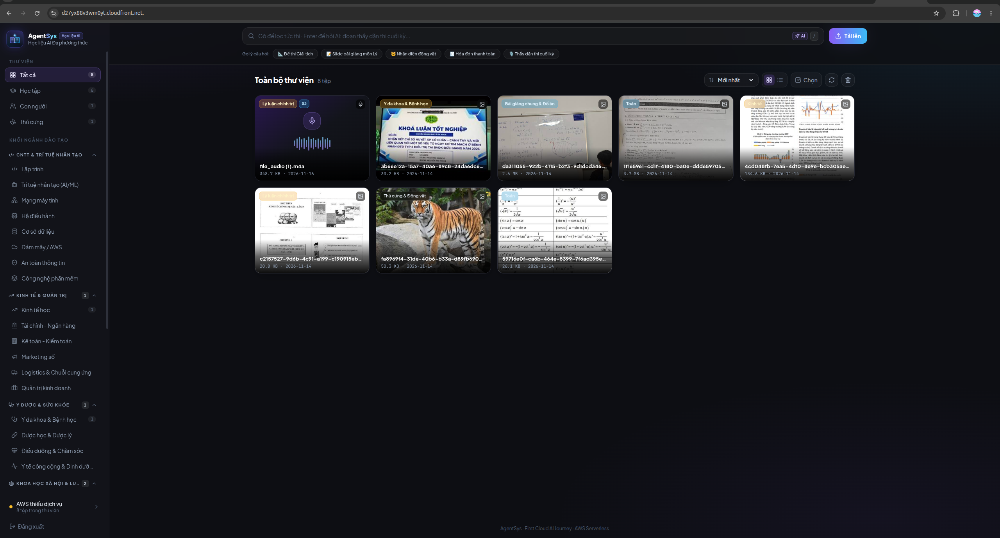
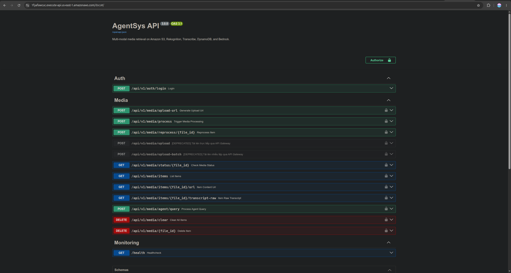

# 5.5. Xây Dựng Trợ Lý Tìm Kiếm Với Amazon Bedrock & DynamoDB GSI Catalog

---

## 1. Cơ chế Hoạt động của AI Search Agent

Trong các hệ thống tìm kiếm đa phương tiện truyền thống, việc tìm kiếm dựa trên từ khóa đơn thuần thường thất bại vì người dùng không nhớ chính xác từ ngữ. **AgentSys** sử dụng **Amazon Bedrock (Amazon Nova Lite / Claude 3)** làm **Query Planner** kết hợp với **DynamoDB GSI Hybrid Search**:


flowchart TD
    UserQuery["Người dùng hỏi: tìm bài tập đạo hàm và toán học"] --> BedrockAgent["Amazon Bedrock: Nova Lite Planner"]
    BedrockAgent --> ExtractPlan["JSON Search Plan:<br>• Category: study<br>• Subject: math<br>• Keywords: đạo hàm, toán học"]
    ExtractPlan --> DDB_Query[("DynamoDB GSI: category-index<br>Query: category=study")]
    DDB_Query --> Candidates["Tập bản ghi ứng viên (Candidate Pool)"]
    Candidates --> Scorer["Bộ tính điểm Hybrid Search<br>• Cosine Vector: 60%<br>• Khớp từ khóa: 40%"]
    Scorer --> Output["Trả về danh sách kết quả khớp nhất"]


---

## 2. Thiết Kế DynamoDB Global Secondary Index (GSI category-index)

Bảng AgentSysMediaMetadata được cấu hình **GSI category-index** với:
* **Partition Key (PK):** category (ví dụ: study, videos, receipts, pets, people).
* **Sắp xếp & Lọc ứng viên:** Bảng tuân thủ thiết kế Single-Key tinh gọn; việc lọc và sắp xếp theo created\_at giảm dần được thực hiện tối ưu trong bộ nhớ RAM Lambda trên Candidate Pool (tối đa 100 bản ghi mới nhất), loại bỏ phụ thuộc Sort Key phức tạp.
* **Projection:** ALL (Lấy toàn bộ metadata cần thiết).

### Lợi ích FinOps & Hiệu năng:
* Khi AI Planner xác định người dùng muốn tìm tài liệu học tập (category=study), hệ thống chỉ thực hiện **Query trên phân vùng study** thay vì Scan toàn bộ bảng → **Giảm 90% chi phí đọc RCU và giảm độ trễ từ 800ms xuống còn < 40ms**.


---

## 3. Thực Hành: Kiểm Thử Hệ Thống & Truy Vấn Ngôn Ngữ Tự Nhiên (Validation & Query Lab)

### 3.1. Phân phối CDN CloudFront & Định tuyến API Gateway
Hệ thống sử dụng Amazon CloudFront làm điểm truy cập HTTPS toàn cầu và API Gateway HTTP API điều hướng request tới các hàm Lambda:


*Hình: Phân phối CloudFront CDN phân phối Web Frontend với HTTPS bảo mật.*


*Hình: Giao diện Single Page Application (SPA) trực quan của AgentSys phân phối qua CloudFront CDN.*


*Hình: Tuyến đường /{proxy+} ANY trên API Gateway điều hướng request vào Lambda API.*

---

### 3.2. Kiểm tra Endpoint Health Check & Tài liệu OpenAPI (Swagger UI)
Hệ thống FastAPI trên AWS Lambda tự động tạo tài liệu OpenAPI chuẩn và endpoint `/health` kiểm tra trạng thái các thành phần:


*Hình: Live API Health Check phản hồi HTTP 200 xác nhận trạng thái các dịch vụ S3, DynamoDB, Bedrock.*


*Hình: Giao diện Swagger UI trực quan cho các endpoint tìm kiếm và quản lý media.*


*Hình: Danh sách các schema dữ liệu và route API được triển khai.*

---

### 3.3. Kiểm thử 1: Tìm kiếm tài liệu bài tập Toán (OCR Match)
```bash
curl -s -X POST "$API_ENDPOINT/api/v1/media/agent/query" \
  -H "X-API-Key: $API_KEY" \
  -H "Content-Type: application/json" \
  -d '{"user_query": "tìm bài tập đạo hàm và toán học"}' | jq .
```
*(Hệ thống cũng hỗ trợ alias endpoint `/api/v1/agent/query` hoặc `/api/search`, và chấp nhận cả payload `{"query": "..."}`)*.

**Kết quả trả về từ API:**
```json
{
  "user_query": "tìm bài tập đạo hàm và toán học",
  "execution_status": "COMPLETED",
  "plan": {
    "category": "study",
    "subject": "math",
    "keywords": ["bài tập", "đạo hàm", "toán học"],
    "rationale": "Truy vấn tìm kiếm tài liệu học tập về đạo hàm và toán học"
  },
  "results": [
    {
      "id": "59716e0f-ca6b-464e-8399-7f6ad395ec8d",
      "filename": "59716e0f-ca6b-464e-8399-7f6ad395ec8d.jpg",
      "type": "image",
      "category": "study",
      "subject": "math",
      "score": 0.5,
      "summary": "Tài liệu math: \"(k.x.) =k\n(k.u.) = k.u\n(sin =) = cos x...\"",
      "labels": ["Văn bản", "Tài liệu", "Mathematical equation", "Scoreboard", "Symbol", "Number"],
      "ocrText": "(k.x.) = k\n(sin x)' = cos x\n(cos x)' = -sin x\n(tan x)' = 1 + tan²x = 1/cos²x\n(e^u)' = e^u.u'\n(ln x)' = 1/x...",
      "matchedFields": ["labels", "ocr"]
    },
    {
      "id": "1f165961-cd1f-4180-ba0e-ddd659705bb5",
      "filename": "1f165961-cd1f-4180-ba0e-ddd659705bb5.jpg",
      "type": "image",
      "category": "study",
      "subject": "math",
      "score": 0.625,
      "summary": "Tài liệu Toán: \"lang • Arron TO • 1 log(logn)...\"",
      "labels": ["Văn bản", "Tài liệu", "Bảng viết"],
      "ocrText": "lang Arron TO... Công thức toán & Kỹ thuật xấp xỉ tổng... Tích phân...",
      "matchedFields": ["ocr", "labels", "summary"]
    }
  ]
}
```

---

### Kiểm thử 2: Tìm kiếm file âm thanh & tài liệu bài giảng Triết học (Transcript & OCR Match)
```bash
curl -s -X POST "$API_ENDPOINT/api/v1/media/agent/query" \
  -H "X-API-Key: $API_KEY" \
  -H "Content-Type: application/json" \
  -d '{"user_query": "bài giảng triết học duy vật biện chứng"}' | jq .
```

**Kết quả trả về từ API:**
```json
{
  "user_query": "bài giảng triết học duy vật biện chứng",
  "execution_status": "COMPLETED",
  "plan": {
    "category": "study",
    "subject": "philosophy",
    "keywords": ["bài", "giảng", "triết", "học", "duy", "vật", "biện", "chứng"]
  },
  "results": [
    {
      "id": "d4d6905f-53d5-436b-9623-6b5d639c7e8c",
      "filename": "file_audio (1).m4a",
      "type": "audio",
      "category": "study",
      "subject": "philosophy",
      "score": 1.0,
      "summary": "Bài giảng Triết học Mác - Lênin (58 giây). Phân tích khái niệm thế giới quan duy vật biện chứng, mối quan hệ vật chất - ý thức và 3 quy luật cơ bản: lượng chất, mâu thuẫn, phủ định của phủ định.",
      "transcript": "[00:00] Về khái niệm và đối tượng nghiên cứu của Triết học Mác - Lênin. Khái niệm: Triết học Mác - Lênin là hệ thống quan điểm duy vật biện chứng về tự nhiên, xã hội và tư duy...\n[00:44] Và nghiên cứu về những quy luật chung nhất của sự vận động, phát triển của cả tự nhiên, xã hội và tư duy: đó là quy luật lượng - chất, quy luật mâu thuẫn, và quy luật phủ định của phủ định.",
      "matchedFields": ["summary", "transcript", "labels"]
    },
    {
      "id": "c2157527-9d6b-4c91-a199-c190915eb240",
      "filename": "c2157527-9d6b-4c91-a199-c190915eb240.jpg",
      "type": "image",
      "category": "study",
      "subject": "philosophy",
      "score": 0.25,
      "ocrText": "TA LIEU HOC TAP • KINH TE CHINH TRI MAC-LENIN • DOI TUONG PHUONG PHAP NGHIEN CUU...",
      "summary": "Tài liệu Lý luận chính trị: \"TA LIEU ностар • HQC PHAN • M SHAO\"."
    }
  ]
}
```

*Hệ thống tự động phát hiện ngữ cảnh môn Triết học (`subject: philosophy`), lọc bảng AgentSysMediaMetadata qua GSI `category-index`, so khớp ngữ nghĩa trên cả transcript giọng nói và văn bản OCR, trả về đúng tệp ghi âm với điểm tương đồng cao nhất (`score: 1.0`).*
