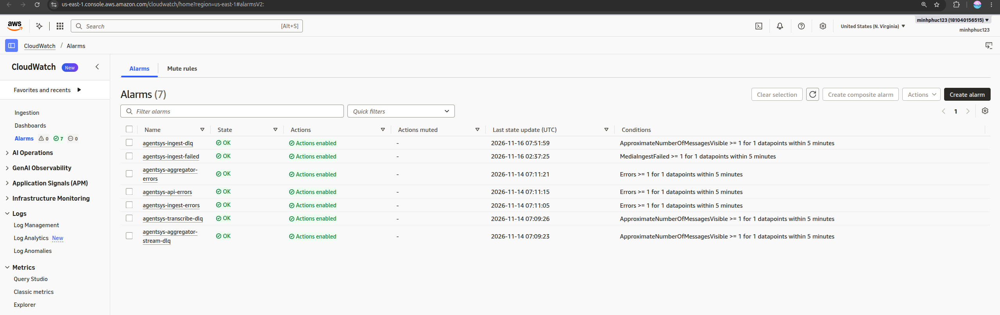
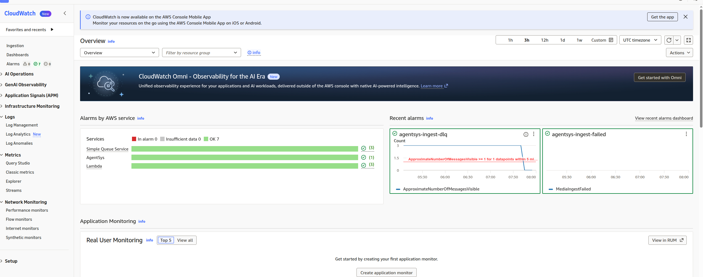
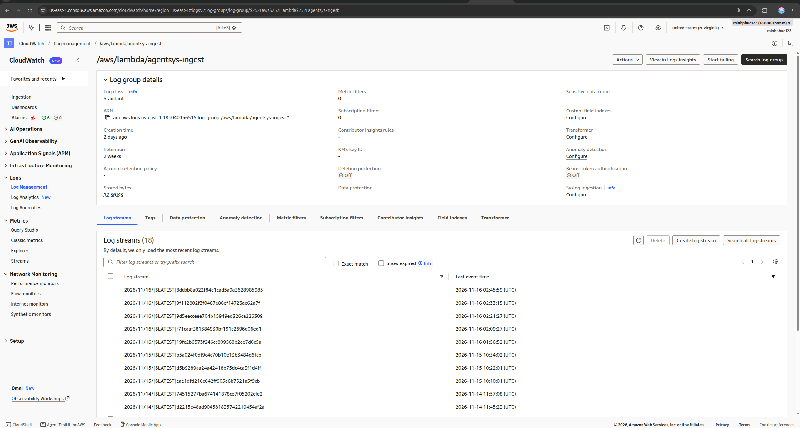
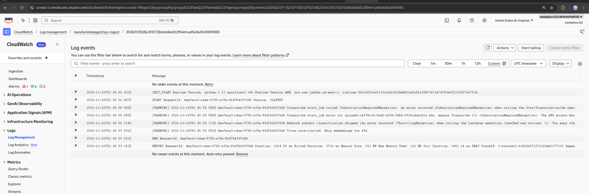

# 5.6. Setting up CloudWatch Monitoring, Alarms and Resource Cleanup Runbook

---

## 1. Infrastructure Evidence Summary

Before delving into monitoring details and cleanup procedures, the table below maps each core AWS infrastructure component of **AgentSys** to its live validation outcome and operational evidence:

| Component | Live Validation Result | Live Evidence Reference |
| :--- | :--- | :--- |
| **Amazon CloudFront** | Web gallery distribution active with full HTTPS edge termination | `d27yx88v3wm0yt.cloudfront.net` (Enabled) |
| **Amazon API Gateway** | HTTP API routes `/{proxy+}` ANY, CORS enabled, responds HTTP 200 on `/health` | `1fyafawcuc.execute-api.us-east-1.amazonaws.com` |
| **AWS Lambda** | 3 functions (`agentsys-api`, `agentsys-ingest`, `agentsys-aggregator`) with IAM least privilege | Python 3.12, healthy runtime executions |
| **Amazon S3** | Media Bucket blocking public access, SSE-S3 encryption, Presigned URL support | `agentsys-mediabucket-fchuoymvhbdh` |
| **Amazon SQS & DLQ** | Ingestion buffer queue and 3 Dead-Letter Queues protecting pipeline resilience | Batch size 5, max 3 retries against traffic spikes |
| **Amazon DynamoDB** | Table `AgentSysMediaMetadata` (PAY_PER_REQUEST), GSI `category-index`, Streams enabled | GSI Query < 40ms, status READY |
| **Amazon Rekognition & Transcribe** | Automatic object labeling, handwritten math board OCR, and Vietnamese ASR vi-VN | Derivatives OCR & Philosophy speech transcripts |
| **Amazon Bedrock** | Titan Text Embeddings V2 (256-d) & Nova Lite / Claude 3 Search Planner | Accurate JSON Search Plan, Hybrid vector scoring |
| **Amazon CloudWatch** | 7 core alarms active in OK state, custom metric `MediaIngested`, structured JSON logs | CloudWatch Dashboard & Log Streams |
| **Amazon SNS** | Topic `agentsys-alerts-topic` configured for immediate email notifications | Direct notification integration across 7 alarms |
| **AWS Budgets** | Budget `My Zero-Spend Budget` with $1.00 USD limit, verified cost **$0.00 USD** | Zero-spend safeguard active (Scale-to-Zero) |

---

## 2. System Observability with Amazon CloudWatch

Under official **AWS First Cloud Journey (FCJ)** evaluation standards, cloud-native systems must demonstrate robust **Operational Excellence**:

### 2.1. Structured Logging
Lambda functions (IngestFunction, AggregatorFunction, ApiFunction) emit structured JSON logs to **CloudWatch Logs**:
* Ingestion Log Group: `/aws/lambda/agentsys-ingest`
* Aggregator Log Group: `/aws/lambda/agentsys-aggregator`
* API Log Group: `/aws/lambda/agentsys-api`

### 2.2. Custom CloudWatch Metrics
Custom operational telemetry is published directly to namespace **AgentSys**:
* **MediaIngested**: Count of successfully processed and indexed assets.
* **MediaIngestFailed**: Count of unrecoverable failed ingestion tasks.

---

## 3. Automated CloudWatch Alarms & SNS Topic

The SAM Template provisions **7 core CloudWatch Alarms** connected synchronously to SNS Topic **agentsys-alerts-topic** for real-time alerting:


<div class="pipeline-container">
  <div class="pipeline-header">
    <i class="fas fa-bell"></i>
    <span>7 CloudWatch Alarms Matrix & Real-time SNS Alert Dispatcher</span>
  </div>
  <div class="alarm-cards-grid">
    <div class="alarm-card-item">
      <div class="alarm-card-name">🚨 agentsys-api-errors</div>
      <div class="alarm-card-desc">Monitors Lambda API 5xx runtime errors (HTTP 500/502/504) ≥ 1 within a 1-minute period.</div>
    </div>
    <div class="alarm-card-item">
      <div class="alarm-card-name">🚨 agentsys-ingest-errors</div>
      <div class="alarm-card-desc">Unhandled runtime exceptions when Lambda Ingest processes SQS batches ≥ 1.</div>
    </div>
    <div class="alarm-card-item">
      <div class="alarm-card-name">🚨 agentsys-aggregator-errors</div>
      <div class="alarm-card-desc">Lambda Aggregator failures while reading DynamoDB Streams or invoking Bedrock summarization.</div>
    </div>
    <div class="alarm-card-item">
      <div class="alarm-card-name">⚠️ agentsys-ingest-failed</div>
      <div class="alarm-card-desc">Custom CloudWatch metric alert when media processing or AI extraction fails.</div>
    </div>
    <div class="alarm-card-item">
      <div class="alarm-card-name">🛡️ agentsys-ingest-dlq</div>
      <div class="alarm-card-desc">Fires immediately when malformed messages land in Ingestion Dead-Letter Queue after 3 retries.</div>
    </div>
    <div class="alarm-card-item">
      <div class="alarm-card-name">🛡️ agentsys-aggregator-stream-dlq</div>
      <div class="alarm-card-desc">Alerts when DynamoDB Stream batch failures are discarded into Aggregator DLQ.</div>
    </div>
    <div class="alarm-card-item">
      <div class="alarm-card-name">🛡️ agentsys-transcribe-dlq</div>
      <div class="alarm-card-desc">Fires when Transcribe EventBridge state change signals a FAILED job.</div>
    </div>
  </div>
  <div style="margin-top: 14px; padding: 10px 14px; background: #f0fdf4; border: 1px solid #bbf7d0; border-radius: 6px; font-size: 12.5px; color: #166534; display: flex; align-items: center; gap: 8px;">
    <i class="fas fa-paper-plane" style="color: #16a34a;"></i>
    <span>All 7 Alarms route directly to <strong>Amazon SNS Topic: agentsys-alerts-topic</strong> for instant DevOps notifications.</span>
  </div>
</div>


### Verify All 7 Alarms on AWS Console:
1. Open **Amazon CloudWatch Console** → Navigate to **Alarms** (Region: us-east-1).
2. Verify all 7 configured alarms:
   * **agentsys-api-errors**: Lambda API 5xx error rate >= 1.
   * **agentsys-ingest-errors**: Lambda Ingestion runtime exceptions >= 1.
   * **agentsys-aggregator-errors**: Lambda Aggregator runtime exceptions >= 1.
   * **agentsys-ingest-failed**: Custom metric MediaIngestFailed >= 1.
   * **agentsys-ingest-dlq**: Ingestion SQS Dead-Letter Queue message count >= 1.
   * **agentsys-aggregator-stream-dlq**: DynamoDB Stream Dead-Letter Queue message count >= 1.
   * **agentsys-transcribe-dlq**: Transcribe EventBridge Dead-Letter Queue message count >= 1.


*Figure: CloudWatch Alarms console confirming all 7 alarms operating in OK status.*


*Figure: CloudWatch Overview dashboard confirming all 7 alarms operating in OK status alongside active metrics.*

### 3.1. Verify CloudWatch Log Streams:
Inspect live execution logs for Lambda functions (agentsys-ingest, agentsys-aggregator, agentsys-api):


*Figure: Active CloudWatch log streams mapped to individual Lambda execution runs.*


*Figure: Detailed log events recording OCR, speech transcription, and vector embedding progress.*

---

## 4. Resource Cleanup Runbook

To guarantee zero lingering costs following the workshop lab:

### Step 1: Empty the S3 Media Bucket
CloudFormation blocks stack deletion if an S3 bucket contains objects:

```bash
# 1. Empty all objects from the S3 Media Bucket
aws s3 rm s3://agentsys-mediabucket-fchuoymvhbdh --recursive

# 2. Empty frontend assets bucket (if applicable)
aws s3 rm s3://agentsys-web-181040156515 --recursive
```

*(Alternatively, retrieve bucket name dynamically from CloudFormation outputs:)*
```bash
BUCKET_NAME=$(aws cloudformation describe-stacks --stack-name agentsys --query "Stacks[0].Outputs[?OutputKey=='MediaBucketName'].OutputValue" --output text --region us-east-1)
aws s3 rm s3://$BUCKET_NAME --recursive
```

---

### Step 2: Delete CloudFormation Stack via SAM CLI
```bash
# Teardown the complete SAM stack (API Gateway, Lambda, DynamoDB, SQS, Alarms)
cd agent_sys
sam delete --stack-name agentsys --no-prompts --region us-east-1
```

*(Alternatively, run the automated 7-step teardown script:)*
```bash
bash scripts/cleanup.sh us-east-1 agentsys
```

*This command automatically deprovisions API Gateway, Lambda Functions, IAM Execution Roles, DynamoDB Table AgentSysMediaMetadata, SQS Queues, DLQs, and CloudWatch Alarms within 2 minutes.*

---

### Step 3: Verify 100% Resource Deprovisioning
```bash
# Verify stack deletion status
aws cloudformation describe-stacks --stack-name agentsys --region us-east-1
```
*The response Stack with id agentsys does not exist confirms all cloud resources have been cleanly torn down, returning your monthly bill to **$0.00 USD**!*
