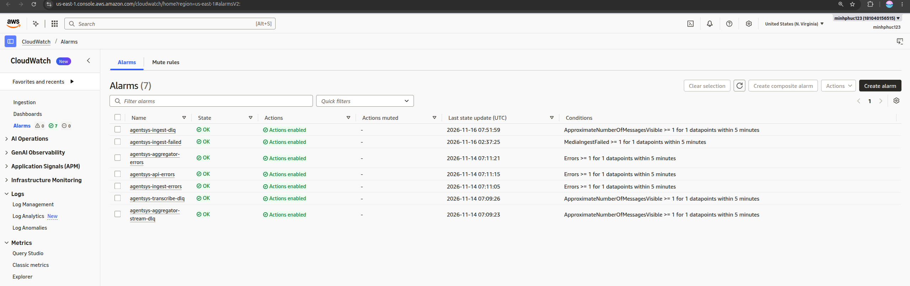
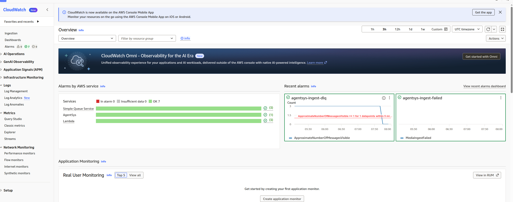
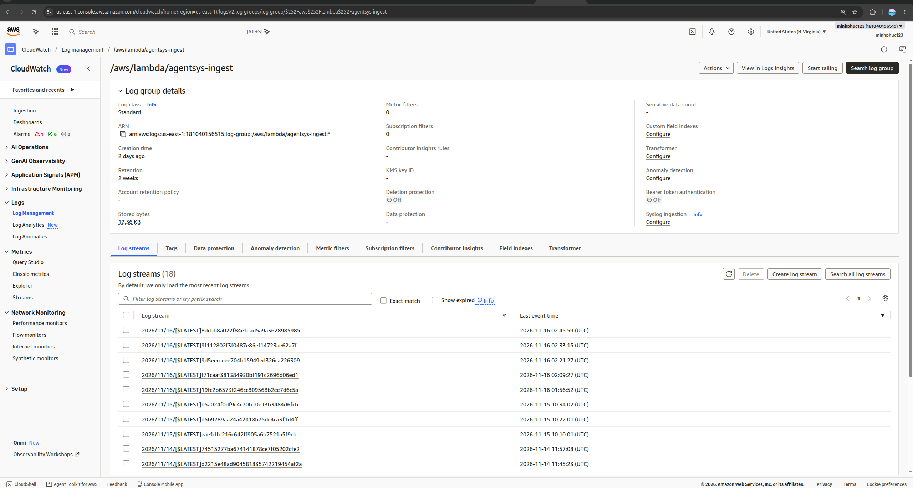
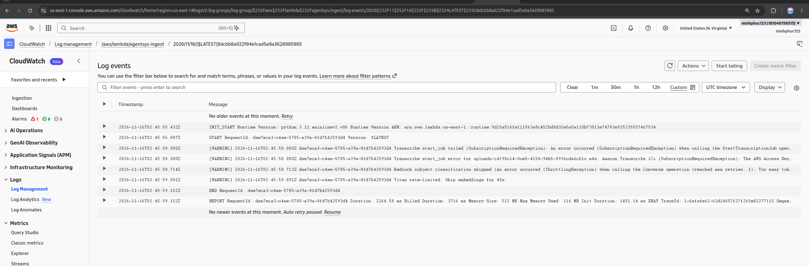

# 5.6. Thiết Lập CloudWatch Monitoring, Alarms và Quy Trình Dọn Dẹp Tài Nguyên (Cleanup)

---

## 1. Bảng Tổng Hợp Kiểm Thử & Bằng Chứng Hạ Tầng (Infrastructure Evidence Summary)

Trước khi đi vào chi tiết cấu hình giám sát và dọn dẹp, bảng dưới đây tổng hợp toàn bộ các thành phần hạ tầng trên AWS của hệ thống **EduMedia AI** (xây dựng trong khuôn khổ chương trình **AWS First Cloud AI Journey - FCAJ 2026**) cùng kết quả kiểm thử thực tế và bằng chứng trực quan:

| Thành phần (Component) | Kết quả kiểm thử thực tế (Validation Result) | Minh chứng vận hành (Live Evidence) |
| :--- | :--- | :--- |
| **Amazon CloudFront** | Phân phối Web Frontend hoạt động bình thường, hỗ trợ HTTPS toàn vẹn | `d27yx88v3wm0yt.cloudfront.net` (Enabled) |
| **Amazon API Gateway** | HTTP API tích hợp route `/{proxy+}` ANY, CORS đầy đủ, phản hồi `/health` HTTP 200 | `1fyafawcuc.execute-api.us-east-1.amazonaws.com` |
| **AWS Lambda** | 3 functions (`agentsys-api`, `agentsys-ingest`, `agentsys-aggregator`) phân quyền tối thiểu IAM | 3 Hàm hoạt động bình thường, runtime Python 3.12 |
| **Amazon S3** | Media Bucket chặn public access, mã hóa SSE-S3, hỗ trợ Presigned URL upload | `agentsys-mediabucket-fchuoymvhbdh` |
| **Amazon SQS & DLQ** | Hàng đợi đệm `agentsys-ingest-queue` và 3 Dead-Letter Queues bảo vệ pipeline | Batch size 5, retry tối đa 3 lần chống nghẽn |
| **Amazon DynamoDB** | Bảng `AgentSysMediaMetadata` (PAY_PER_REQUEST), GSI `category-index`, Streams kích hoạt | Query GSI < 40ms, trạng thái READY |
| **Amazon Rekognition & Transcribe** | Tự động nhận diện nhãn, OCR công thức bảng viết tay và bóc băng tiếng Việt vi-VN | Dữ liệu OCR đạo hàm & Transcript Triết học thực tế |
| **Amazon Bedrock** | Titan Text Embeddings V2 (256-d) & Nova Lite / Claude 3 xử lý Search Planner | Tạo Search Plan chính xác, Hybrid Vector Match |
| **Amazon CloudWatch** | 7 Alarms chủ động ở trạng thái OK, Metric Custom `MediaIngested`, Structured Logs | Dashboard và Log Streams đầy đủ |
| **Amazon SNS** | Topic `agentsys-alerts-topic` sẵn sàng phát cảnh báo tức thì qua Email | SNS Topic kết nối trực tiếp 7 Alarms |
| **AWS Budgets & FinOps** | Thiết lập ngân sách giám sát gói $180 Promotional Credits từ FCAJ. Trong giai đoạn thử nghiệm (do Amazon Transcribe đang chờ AWS Support kích hoạt subscription trên tài khoản mới), các tệp kiểm thử tập trung vào Rekognition, Lambda và DynamoDB nên chi phí tiêu hao cực thấp, nằm trọn trong hạn mức Credits được tài trợ | Cảnh báo chi phí theo ngưỡng credit FCAJ (Tránh phát sinh cước ngoài ý muốn) |

---

## 2. Khả năng Quan sát Hệ thống (Observability with Amazon CloudWatch)

Trong tiêu chí đánh giá kỹ thuật của chương trình thực tập **AWS First Cloud AI Journey (FCAJ 2026)**, một kiến trúc Cloud chuẩn Production bắt buộc phải có khả năng giám sát vận hành (**Operational Excellence**):

### 2.1. Structured Logging (Ghi log có cấu trúc)
Tất cả các hàm Lambda (IngestFunction, AggregatorFunction, ApiFunction) đều ghi log dưới dạng JSON có cấu trúc vào **CloudWatch Logs**:
* Log group Ingestion: `/aws/lambda/agentsys-ingest`
* Log group Aggregator: `/aws/lambda/agentsys-aggregator`
* Log group API: `/aws/lambda/agentsys-api`

### 2.2. Custom CloudWatch Metrics
Hệ thống tự động phát các chỉ số vận hành tùy biến (*Custom Metrics*) vào Namespace **AgentSys**:
* **MediaIngested**: Số lượng tệp đã xử lý và nhúng vector thành công.
* **MediaIngestFailed**: Số lượng tệp xử lý thất bại cần can thiệp.

---

## 3. Thiết lập Cảnh báo Tự động (CloudWatch Alarms & SNS Topic)

SAM Template tự động cấu hình **7 CloudWatch Alarms** cốt lõi và kết nối đồng bộ tới SNS Topic **`agentsys-alerts-topic`** để cảnh báo thời gian thực qua email:

| Tên CloudWatch Alarm | Nguồn giám sát (Metric / Service) | Điều kiện kích hoạt | Mục đích bảo vệ |
| :--- | :--- | :--- | :--- |
| `agentsys-api-errors` | Lambda `Errors` (API Function) | `Errors >= 1` trong 1 phút | Cảnh báo khi API Gateway / Lambda gặp lỗi 5xx |
| `agentsys-ingest-errors` | Lambda `Errors` (Ingest Function) | `Errors >= 1` trong 1 phút | Cảnh báo lỗi unhandled exception khi xử lý SQS |
| `agentsys-aggregator-errors` | Lambda `Errors` (Aggregator) | `Errors >= 1` trong 1 phút | Cảnh báo lỗi xử lý DynamoDB Streams hoặc Bedrock |
| `agentsys-ingest-failed` | Custom Metric `MediaIngestFailed` | `Count >= 1` trong 1 phút | Ghi nhận tệp media bị hỏng hoặc lỗi trích xuất AI |
| `agentsys-ingest-dlq` | SQS `ApproximateNumberOfMessagesVisible` | `Messages >= 1` trong 1 phút | Cảnh báo khi có tin nhắn rơi vào Ingest DLQ sau 3 lần retry |
| `agentsys-aggregator-stream-dlq` | SQS `ApproximateNumberOfMessagesVisible` | `Messages >= 1` trong 1 phút | Cảnh báo sự kiện Stream bị discard vào DLQ của Aggregator |
| `agentsys-transcribe-dlq` | SQS `ApproximateNumberOfMessagesVisible` | `Messages >= 1` trong 1 phút | Cảnh báo sự kiện Transcribe thất bại rơi vào DLQ |

### Xác minh 7 Alarms trên AWS Console:
1. Mở **Amazon CloudWatch Console** → Chọn mục **Alarms** (Region: `us-east-1`).
2. Xác minh toàn bộ 7 Alarms được kích hoạt và hiển thị trạng thái `OK` bảo vệ pipeline:


*Hình: Bảng điều khiển CloudWatch Alarms ghi nhận toàn bộ 7 cảnh báo ở trạng thái OK.*


*Hình: Bảng điều khiển CloudWatch Overview tổng hợp trạng thái toàn bộ 7 alarms ở mức OK và đồ thị giám sát.*

### 3.1. Xác minh CloudWatch Log Streams:
Kiểm tra log thực tế của các hàm Lambda (agentsys-ingest, agentsys-aggregator, agentsys-api):


*Hình: Danh sách các Log Streams tương ứng với các phiên thực thi của Lambda.*


*Hình: Log Events chi tiết hiển thị quá trình trích xuất OCR, ASR và nhúng vector.*

---

## 4. Quy trình Dọn dẹp Tài nguyên (Resource Cleanup Runbook)

Để đảm bảo tài khoản AWS của bạn không bao giờ phát sinh bất kỳ chi phí nào sau khi kết thúc buổi thực hành lab, hãy thực hiện theo đúng các bước sau:

### Bước 1: Xóa toàn bộ dữ liệu trong S3 Media Bucket
Do CloudFormation không thể xóa một S3 bucket còn chứa tệp, bạn cần dọn sạch bucket trước:

```bash
# 1. Xoa sach toan bo file trong S3 Media Bucket
aws s3 rm s3://agentsys-mediabucket-fchuoymvhbdh --recursive

# 2. Xoa sach toan bo file trong S3 Frontend Bucket (neu co)
aws s3 rm s3://agentsys-web-181040156515 --recursive
```

*(Hoặc dùng lệnh động tự lấy tên bucket từ CloudFormation Outputs:)*
```bash
BUCKET_NAME=$(aws cloudformation describe-stacks --stack-name agentsys --query "Stacks[0].Outputs[?OutputKey=='MediaBucketName'].OutputValue" --output text --region us-east-1)
aws s3 rm s3://$BUCKET_NAME --recursive
```

---

### Bước 2: Xóa toàn bộ CloudFormation Stack bằng SAM CLI
```bash
# Go bo toan bo ha tang SAM Stack (API Gateway, Lambda, DynamoDB, SQS, Alarms)
cd agent_sys
sam delete --stack-name agentsys --no-prompts --region us-east-1
```

*(Hoặc chạy script teardown tự động chuẩn hóa 7 bước:)*
```bash
bash scripts/cleanup.sh us-east-1 agentsys
```

*Lệnh này sẽ tự động xóa sạch toàn bộ: API Gateway, các Lambda Functions, IAM Execution Roles, bảng DynamoDB AgentSysMediaMetadata, SQS Queues, DLQ và CloudWatch Alarms trong vòng 2 phút.*

---

### Bước 3: Xác minh trạng thái dọn dẹp sạch sẽ
```bash
# Kiem tra trang thai stack sau khi go bo
aws cloudformation describe-stacks --stack-name agentsys --region us-east-1
```
*Kết quả thông báo Stack with id agentsys does not exist xác nhận toàn bộ tài nguyên đã được thu hồi hoàn toàn, chi phí về đúng **$0.00 USD**!*
